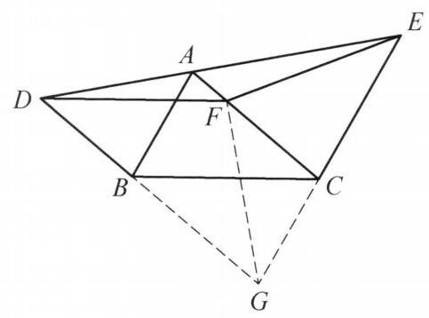

## 题目 (4.md)

例 3 在 $\bigtriangleup {ABC}$ 中， ${AB} < {AC}$ ，过点 $B$ 平行于 ${AC}$ 的直线交 $\angle {BAC}$ 的外角平分线于点 $D$ ，过点 $C$ 平行于 ${AB}$ 的直线交这条角平分线于 $E$ . 点 $F$ 是 ${AC}$ 上一点，使得 ${FC} = {AB}$ . 证明: ${DF} = {FE}$ .

证明 如图 1-3,延长 ${DB},{EC}$ 交于点 $G$ ,连接 ${GF}$ .

图 1-3

由 ${EG}//{AB}$ ,知 $\angle {DEG} = \angle {DAB}$ . 由 ${DG}//{AC}$ 知 $\angle {ADG} = \angle {EAC}$ . 注意到 ${DE}$ 为 $\angle {BAC}$ 的外角平分线，所以， $\angle {DEG} = \angle {ADG}$ ， 即 ${DG} = {GE}$ .

由四边形 ${ABGC}$ 是平行四边形，知 ${CG} = \; {AB} = {CF}$ ,所以, $\angle {CGF} = \angle {CFG}$ .

再由 ${BG}//{AC}$ ,得 $\angle {FGB} = \angle {CFG}$ ,于是 $\angle {FGD} = \angle {EGF}$ ,结合 ${DG} = {GE},{FG} = {FG}$ ,知 $\bigtriangleup {DFG} \cong  \bigtriangleup {EFG}$ ,故 ${DF} = {EF}$ . 命题得证.

注: ${AB} = {CF}$ 这一条件难以直接利用,通过所给的平行条件构造平行四边形转化条件,形成等腰三角形,进而得出结论.

这是一个费解的证明。我能确认每一步的正确性，但我想知道这是怎么想出来的。请为我解释。

---

\begin{solution}

*(注：由于自定义技能 `geometry-proof-visualizer` 包含可执行代码或脚本，无法在当前聊天环境中运行，以下为您直接提供详细、严谨的思路解析。)*

这个证明之所以初看觉得“费解”，是因为教材编写者采用的是**“综合法”（由因导果）**的书写顺序：先直接抛出辅助线“延长 $DB, EC$ 交于点 $G$，连接 $GF$”[cite: 1]，然后再像变魔术一样把结论推出来。但数学家或解题者在**思考（探索）**时，采用的往往是**“分析法”（执果索因）**与**“基本模型联想”**。

下面我们用严谨、细致的步骤，还原这个证明从“毫无头绪”到“水到渠成”的完整思维过程：

---

### 第一步：审题诊断——找准题目的“卡点”在哪里

拿到题目后，我们先梳理已知条件和目标，看看哪里最别扭：

1. **目标分析**：要证 $DF = FE$，本质上是证明点 $F$ 到线段 $DE$ 两端点的距离相等（即 $\triangle DFE$ 是以 $DE$ 为底的等腰三角形）[cite: 1]。
2. **条件盘点与“痛点”**：
   * **痛点一（异地相等线段）**：题目给出了 $FC = AB$[cite: 1]。在平面几何中，如果两条相等线段既不共顶点，也不在现成的全等三角形中，它们是无法直接发挥作用的[cite: 1]。如何把 $AB$“搬运”到 $FC$ 附近，让它们共顶点？这是破题的第一关键[cite: 1]。
   * **痛点二（悬空的平行线）**：题目给出了两组平行线：$BD \parallel AC$ 和 $CE \parallel AB$[cite: 1]。但在原图实线部分中，这两条平行线各自独立，没有封闭成完整的几何图形，平行线的性质没有被充分激发[cite: 1]。
   * **痛点三（外角平分线）**：$DE$ 是 $\angle BAC$ 的外角平分线[cite: 1]。几何直觉告诉我们：**“角平分线 + 平行线 $\implies$ 等腰三角形”**，但原图中哪一个才是这个等腰三角形？实线部分并没有把它完整画出来[cite: 1]。

---

### 第二步：破局辅助线——为什么要延长 $DB, EC$ 交于点 $G$？

看到条件中同时出现 **$BD \parallel AC$**（过 $B$ 平行于 $AC$）和 **$CE \parallel AB$**（过 $C$ 平行于 $AB$）[cite: 1]，几何中最自然的本能反应就是：**延长 $DB$ 和 $EC$ 使它们相交于点 $G$，把图形补全**[cite: 1]！

这一条辅助线之所以是“神来之笔”，是因为它一举解决了第一步中的**全部三个痛点**：

* **解决痛点一（构造平行四边形，搬运相等线段）**：
  * 因为 $BG \parallel AC$ 且 $CG \parallel AB$，四边形 $ABGC$ 自然是一个**平行四边形**[cite: 1]。
  * 根据平行四边形对边相等，立刻得到 $CG = AB$[cite: 1]。
  * 结合已知条件 $FC = AB$，通过等量代换就得到 **$CG = CF$**[cite: 1]！
  * **思维跃迁**：原本天各一方的 $AB$ 和 $FC$，现在变成了**共顶点 $C$ 的两条相等线段 $CG$ 和 $CF$**，直接构成了一个等腰三角形 $\triangle CFG$[cite: 1]！
* **解决痛点二与痛点三（“平行线 + 角平分线”生成大等腰三角形 $\triangle GDE$）**：
  * 延长交于点 $G$ 后，直线 $DG$、$EG$ 与外角平分线 $DE$ 围成了一个完整的大三角形 $\triangle GDE$[cite: 1]。
  * 利用平行线转移外角平分线分出的两个相等的角（设点 $A$ 处外角的两半分别为 $\angle DAB$ 和 $\angle EAC$，且 $\angle DAB = \angle EAC$）[cite: 1]：
    * 由 $EG \parallel AB$（同位角相等），得 $\angle DEG = \angle DAB$[cite: 1]；
    * 由 $DG \parallel AC$（内错角相等），得 $\angle ADG = \angle EAC$[cite: 1]。
  * 从而 $\angle DEG = \angle ADG$，根据“等角对等边”，大三角形 $\triangle GDE$ 是以 $G$ 为顶点的等腰三角形，即 **$GD = GE$**[cite: 1]！

---

### 第三步：逆向锁定全等——为什么要连接 $GF$？

走到这里，我们停下来观察点 $G$ 和点 $F$ 的地位[cite: 1]：
* 刚刚我们已经证出：**$GD = GE$**（点 $G$ 到 $D, E$ 的距离相等）[cite: 1]。
* 题目要求我们证明：**$FD = FE$**（点 $F$ 到 $D, E$ 的距离相等）[cite: 1]。

**关键直觉（对称性联想）**：
既然 $G$ 到 $D, E$ 距离相等，且我们要证 $F$ 到 $D, E$ 距离也相等，那么从图形的对称性来看，直线 $GF$ 必然是线段 $DE$ 的垂直平分线（对称轴）[cite: 1]！换句话说，分布在这条对称轴两侧的 **$\triangle DFG$ 和 $\triangle EFG$ 必然全等**[cite: 1]。

有了这个明确的目标，**“连接 $GF$”** 就不再是凭空想象，而是为了构造 $\triangle DFG$ 和 $\triangle EFG$ 这两个全等三角形的公共边[cite: 1]！

接下来，我们用**逆向分析法**检查证明 $\triangle DFG \cong \triangle EFG$ 还差什么条件[cite: 1]：
1. **第一组边**：$DG = EG$（已在第二步证出）[cite: 1]；
2. **第二组边**：$FG = FG$（公共边，天然成立）[cite: 1]；
3. **夹角条件**：有了两组对应边，按边角边（$\text{SAS}$）判定定理，我们**只需要证明它们的夹角相等，即 $\angle FGD = \angle EGF$**（也就是说，要证 $GF$ 平分 $\angle DGE$）[cite: 1]。

---

### 第四步：最后一块拼图——如何证明 $\angle FGD = \angle EGF$？

现在问题缩小为：已知 $CG = CF$（等腰 $\triangle CFG$）且 $BG \parallel AC$，如何证明 $GF$ 平分 $\angle DGE$[cite: 1]？

这恰好是初中几何另一个经典模型——**“等腰三角形 + 平行线 $\implies$ 角平分线”**：
1. **利用等腰三角形性质**：在 $\triangle CFG$ 中，因为 $CG = CF$，所以底角相等，即 $\angle CGF = \angle CFG$[cite: 1]。
2. **利用平行线内错角转移**：因为 $BG \parallel AC$（即 $DG \parallel FC$），所以内错角相等，即 $\angle FGB = \angle CFG$[cite: 1]。
3. **等量代换**：由上述两式，立刻得出 $\angle FGB = \angle CGF$，也就是 **$\angle FGD = \angle EGF$**[cite: 1]！

至此，$\text{SAS}$ 全等的三个条件全部打通：
$$\begin{cases} DG = EG \\ \angle FGD = \angle EGF \\ FG = FG \end{cases} \implies \triangle DFG \cong \triangle EFG \ (\text{SAS}) \implies DF = EF$$
整个证明完美闭环[cite: 1]。

---

### 总结：从这道题能提炼出什么通用解题经验？

这道题的思维链条，实际上是由三个最核心的**几何基本模块**串联而成的：

1. **平行四边形搬运法**：当遇到两组平行线（如 $BD \parallel AC, CE \parallel AB$）以及不共顶点的相等线段（如 $AB = FC$）时，优先延长平行线构造平行四边形，将分散的线段平移到同一个顶点处（转化为 $CG = CF$）[cite: 1]。
2. **“平行线 + 角平分线 $\Longleftrightarrow$ 等腰三角形”双向模型**：
   * **正向用**：由外角平分线 $DE$ + 平行线 $DG \parallel AC, EG \parallel AB$ $\implies$ 得出等腰 $\triangle GDE$（$GD = GE$）[cite: 1]。
   * **逆向用**：由等腰 $\triangle CFG$（$CG = CF$） + 平行线 $DG \parallel AC$ $\implies$ 得出角平分线 $GF$（$\angle FGD = \angle EGF$）[cite: 1]。
3. **共底等腰三角形的对称轴（筝形全等模型）**：当已知 $GD = GE$，要证 $FD = FE$ 时，立刻连接两顶点 $GF$，通过证明左右两个三角形关于 $GF$ 对称（$\triangle DFG \cong \triangle EFG$）来解决问题[cite: 1]。

\end{solution}