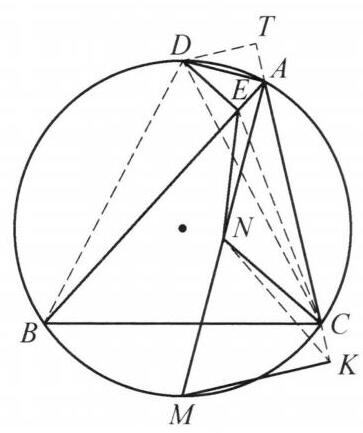

## 题目 (5.md)

例 4 如图, $\bigtriangleup {ABC}$ 满足 ${AB} > {AC}$ ,其外接圆为 $\Gamma ,\angle {BAC}$ 的内、外角平分线与圆 $\Gamma$ 交于点 $M, D$ (异于 $A$ ),点 $D$ 在边 ${AB}$ 上的射影为点 $E, N$ 为 ${AM}$ 的中点, $M$ 在 ${AC}$ 上的射影为点 $K$ . 证明: $\angle {NEA} = \angle {NCK}$ .

图 1-4

证明 过点 $D$ 作 ${DT} \bot  {AC}$ ,垂足为 $T$ ,连接 ${DB}$ , ${DC},{EC},{NK}$ .

因为 ${AD}$ 是 $\angle {BAC}$ 的外角平分线,所以 $\angle {EAD} = \; \angle {TAD}$ . 又 $\angle {AED} = \angle {ATD} = {90}^{ \circ  },{AD} = {AD}$ ,则 $\bigtriangleup {AED} \cong  \bigtriangleup {ATD}$ ,于是 ${DE} = {DT}$ . 结合 $\angle {DBE} = \; \angle {DCT}$ 及 $\angle {DEB} = \angle {DTC} = {90}^{ \circ  }$ ,知 Rt $\bigtriangleup {DEB} \cong$ Rt $\bigtriangleup {DTC}$ ,所以

$$
{AE} = {AB} - {BE} = {AB} - {CT} = {AB} - \left( {{AC} + {AT}}\right) ,
$$

结合 ${AE} = {AT}$ ,知 ${AE} = \frac{1}{2}\left( {{AB} - {AC}}\right)$ . 同理可得 ${CK} = \frac{1}{2}\left( {{AB} - {AC}}\right)$ ,即 ${AE} = {CK}$ .

在 Rt $\bigtriangleup {AKM}$ 中,由 $N$ 为 ${AM}$ 的中点,知 ${NK} = {NA}$ . 结合 ${AE} = {CK}$ 及 $\angle {NKC} = \angle {NAC} = \angle {EAN}$ 知 $\bigtriangleup {CKN} \cong  \bigtriangleup {EAN}$ ,故 $\angle {NEA} = \angle {NCK}$ . 原问题得证.

注: 容易观察到 ${NK} = {NA},\angle {NKC} = \angle {NAE}$ ，将问题转化为证明全等，只需再证明 ${CK} = {AE}$ 即可.

这是一个费解的证明。我能确认每一步的正确性，但我想知道这是怎么想出来的。请为我解释。

---

\begin{solution}

教材和参考书在书写证明时，通常采用**“由因导果”的综合法**（即先凭空画出辅助线 $DT \perp AC$，算出 $AE = CK$，最后再去证全等）[cite: 1]。这种写法在逻辑上最简短，但完全掩盖了思考的真实轨迹，读起来自然会有“神来之笔、不知从何想起”的困惑。

如果我们把思考过程还原为**“执果索因”的分析法**，你会发现这个证明并不是靠灵光一现，而是由三个非常自然的**几何条件反射**串联而成的：

---

### 第一步：破译中点 $N$ —— 为什么会想到连接 $NK$ 并转化出 $AE = CK$？

在读题时，有两组条件是高度绑定的：
1. $M$ 在 $AC$ 上的射影为 $K \implies \angle AKM = 90^\circ$（直角三角形 $AKM$）[cite: 1]；
2. $N$ 是 $AM$ 的中点（斜边中点）[cite: 1]。

**【条件反射 1：见“直角 + 斜边中点”，连斜边中线】**
在平面几何中，看到直角三角形的斜边中点，最本能的动作就是连接 $NK$[cite: 1]。一旦连出 $NK$，立刻白得两个核心性质：
* **边相等**：$NK = NA = NM$（直角三角形斜边中线等于斜边一半）[cite: 1]；
* **角相等**：等腰 $\triangle NAK$ 中，$\angle NKC = \angle NAK$。再结合 $AM$ 是 $\angle BAC$ 的内角平分线（$\angle NAK = \angle NAE$），立刻得到 **$\angle NKC = \angle NAE$**[cite: 1]。

**【执果索因：对比目标角所在的三角形】**
现在看我们要证的结论：$\angle NEA = \angle NCK$[cite: 1]。
* $\angle NEA$ 在 $\triangle NAE$ 中；
* $\angle NCK$ 在 $\triangle NKC$ 中。

观察这两个三角形 $\triangle NAE$ 和 $\triangle NKC$，我们手里已经有了：
1. 一组对应边相等：$NA = NK$[cite: 1]；
2. 这组边旁边的夹角相等：$\angle NAE = \angle NKC$[cite: 1]。

两个三角形已经有一边一角对应相等，现在要证另一个角 $\angle NEA = \angle NCK$，最直接、甚至唯一合理的途径就是**这两个三角形全等（$\triangle NAE \cong \triangle NKC$）**[cite: 1]！
而要按 $\text{SAS}$ 凑出全等，夹着相等角的另一组边就必须相等——也就是**必须证明 $AE = CK$**[cite: 1]。

> **关键降维**：走到这一步后，点 $N$ 的历史使命已经完成了！原题“证明两个神秘的角相等”被彻底等价转化为“**证明线段 $AE = CK$**”[cite: 1]。

---

### 第二步：解耦 $E$ 与 $K$ —— 为什么要去算 $\frac{1}{2}(AB - AC)$？

接下来我们要证 $AE = CK$[cite: 1]。但观察图形会发现一个麻烦：
* 点 $E$ 是由外角平分线与圆的交点 $D$ 向 $AB$ 作垂线得到的[cite: 1]；
* 点 $K$ 是由内角平分线与圆的交点 $M$ 向 $AC$ 作垂线得到的[cite: 1]。

$E$ 和 $K$ 分别由两个不同的点 $D$ 和 $M$ 独立生成，直接用全等把 $AE$ 和 $CK$ 搬到一起并不容易。

**【核心策略：算两次 / 用母体三角形的边长表示】**
当两条线段由对称或相似的规则分别生成在 $\triangle ABC$ 的两边上时，最稳健的思路是**“搭桥法”**：把 $AE$ 和 $CK$ 分别用 $\triangle ABC$ 的基本边长（$AB$ 和 $AC$）表示出来。如果算出来它俩都等于同一个关于 $AB, AC$ 的代数式，自然就有 $AE = CK$[cite: 1]。

---

### 第三步：处理圆弧中点基本图形 —— 为什么会作 $DT \perp AC$？

现在把注意力完全集中到点 $D$ 和线段 $AE$ 上（先把 $M, N, K$ 全部忘掉）。已知条件只有两个：
1. $AD$ 是 $\angle BAC$ 的外角平分线，且 $DE \perp AB$[cite: 1]；
2. $A, B, C, D$ 四点共圆[cite: 1]。

**【条件反射 2：见“角平分线 + 向一边作垂线”，必向另一边作垂线】**
已知 $AD$ 平分 $\angle BAC$ 的外角，且已经有了 $DE \perp AB$，初中几何最经典的辅助线就是**过 $D$ 向角的另一边 $AC$ 作垂线 $DT \perp AC$**[cite: 1]。
这样立刻构造出对称的直角三角形全等：
$$\text{Rt}\triangle AED \cong \text{Rt}\triangle ATD \implies AE = AT, \quad DE = DT$$
这一步把要求的 $AE$ 复制到了 $AC$ 延长线上的 $AT$，并且得到了两条相等的垂线段 $DE = DT$[cite: 1]。

**【条件反射 3：利用圆周角（或弧中点性质）构造第二组全等】**
多出来的垂线段 $DE = DT$ 怎么和 $\triangle ABC$ 的边 $AB, AC$ 产生联系？
因为 $D, E, B$ 构成直角三角形，$D, T, C$ 也构成直角三角形，自然连接 $DB, DC$[cite: 1]：
* **视角一（圆内接四边形性质，即书上的写法）**：在圆 $\Gamma$ 中，$A, B, C, D$ 四点共圆，所以 $\angle DBE = \angle DCT$（同弧所对圆周角/外角性质），配合 $\angle DEB = \angle DTC = 90^\circ$ 和刚证出的 $DE = DT$，由 $\text{AAS}$ 立得 $\text{Rt}\triangle DEB \cong \text{Rt}\triangle DTC$[cite: 1]。
* **视角二（更直观的圆弧中点性质）**：因为 $AD, AM$ 分别是 $\angle BAC$ 的外、内角平分线，其实 $D$ 和 $M$ 就是外接圆上**弧 $BC$ 的两个中点**！既然 $D$ 是弧 $BAC$ 的中点，必有弦长 $DB = DC$。再配合 $DE = DT$，由斜边直角边定理（$\text{HL}$）也能一眼看出 $\text{Rt}\triangle DEB \cong \text{Rt}\triangle DTC$。

**【线段和差代换】**
有了 $\text{Rt}\triangle DEB \cong \text{Rt}\triangle DTC$，就得到了衔接 $AB$ 边与 $AC$ 边的关键桥梁：**$BE = CT$**[cite: 1]。
现在看图把 $BE$ 和 $CT$ 拆开[cite: 1]：
* 在 $AB$ 边上：$BE = AB - AE$[cite: 1]；
* 在 $AC$ 边上：$CT = AC + AT = AC + AE$（因为 $AT = AE$）[cite: 1]。

令两者相等：
$$AB - AE = AC + AE \implies 2AE = AB - AC \implies AE = \frac{1}{2}(AB - AC)$$

同理，对内角平分线交点 $M$ 做完全相同的操作（过 $M$ 作 $AB$ 的垂线），也会一模一样地算出 $CK = \frac{1}{2}(AB - AC)$[cite: 1]。

---

### 总结：命题人与解题高手的真实思维链条

如果用一张图概括这道题是怎么想出来的，它的正向推导与逆向思考刚好相反：

1. **看条件 $N$ 是 $AM$ 中点 + $\angle AKM = 90^\circ$** $\xrightarrow{\text{本能连斜边中线}}$ 发现 $ NA = NK, \angle NAE = \angle NKC$[cite: 1]；
2. **看结论 $\angle NEA = \angle NCK$** $\xrightarrow{\text{凑 }\triangle NAE \cong \triangle NKC}$ 发现只缺条件 **$AE = CK$**[cite: 1]；
3. **看条件 $AD$ 是角平分线 + $DE \perp AB$** $\xrightarrow{\text{本能向另一边作垂线 }DT \perp AC}$ 产生兩对直角三角形全等，把 $AE$ 和 $CK$ 双双算成 $\frac{1}{2}(AB - AC)$[cite: 1]。

**补充一点竞赛背景**：在几何竞赛中，“三角形内（外）角平分线与外接圆的交点（即弧 $BC$ 的中点），向两边 $AB, AC$ 作垂线，会将两边切出长为 $\frac{AB+AC}{2}$ 和 $\frac{|AB-AC|}{2}$ 的线段”是一个非常高频的**基本模型（熟知结论）**。熟练的解题者一看到点 $D$ 向 $AB$ 作垂线、点 $M$ 向 $AC$ 作垂线，脑海里会立刻浮现出 $AE = CK = \frac{1}{2}(AB - AC)$ 这个结论，随后顺手连出斜边中线 $NK$ 即可完成证明[cite: 1]。

\end{solution}