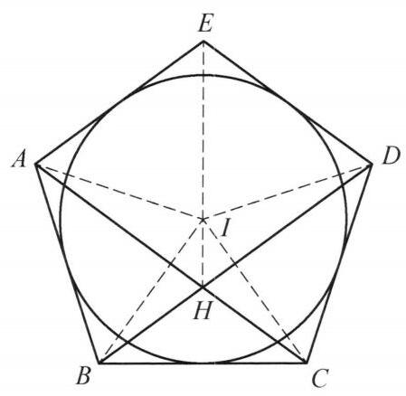
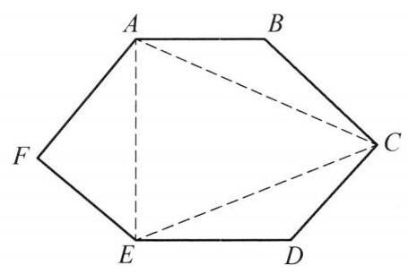

## 第一讲 全等三角形

## 知识精讲

证明三角形全等是处理平面几何问题的一种重要方法. 我们首先引入全等三角形的定义及其判定定理:

如果两个三角形的对应边都相等, 对应角也都相等, 那么这两个三角形称为全等三角形.

关于三角形全等, 有以下判定定理:

判定定理 1 如果一个三角形有两条边及它们的夹角与另一个三角形的两条边及它们的夹角对应相等, 那么这两个三角形全等.

判定定理 2 如果一个三角形有两个角及它们的夹边与另一个三角形的两个角及它们的夹边对应相等,那么这两个三角形全等.

判定定理 3 如果一个三角形有三条边与另一个三角形的三条边对应相等, 那么这两个三角形全等.

## 典型例题

---

例 1 已知 $O$ 为 $\bigtriangleup {ABC}$ 内一点,满足 ${OD} \bot  {BC},{OE} \bot  {AC}$ (点 $D, E$ 分别在边 ${BC},{AC}$ 上), $F$ 为边 ${AB}$ 的中点. 若 ${DF} = {EF}$ . 证明: $\angle {OBD} = \angle {OAE}$ .

证明 如图 1-1,分别取 ${AO},{BO}$ 的中点 $M$ , $N$ . 连接 ${ME},{MF},{ND},{NF}$ ,则 ${FM}$ 是 $\bigtriangleup {ABO}$ 的中位线,故 ${FM} = \frac{1}{2}{BO}$ . 因为 $\bigtriangleup {ODB}$ 是直角三角形, 所以, ${ND} = \frac{1}{2}{BO}$ ,即 ${FM} = {ND}$ .

图 1-1

同理, ${ME} = \frac{1}{2}{AO} = {FN}$ ,再结合 ${DF} = {EF}$ ,知 $\bigtriangleup {FND} \cong  \bigtriangleup {EMF}$ . 所以, $\angle {FND} = \angle {FME}$ . 又因为四边形 ${FNOM}$ 是平行四边形,所以, $\angle {FNO} = \angle {FMO}$ ,于是

$$
\angle {OND} = \angle {FND} - \angle {FNO} = \angle {FME} - \angle {FMO} = \angle {OME}.
$$

故 $\angle {OBD} = \frac{1}{2}\angle {OND} = \frac{1}{2}\angle {OME} = \angle {OAE}$ . 命题得证.

注:看到中点构造中位线是常见思路. 若中点在直角三角形的斜边上，想到利用结论:直角三角形斜边上的中线等于斜边的一半.

---

例 2 在 $\bigtriangleup {ABC}$ 中， $\angle C < \angle A < {90}^{ \circ  }$ ， $D$ 为边 ${AC}$ 上一点，使得 ${BD} = {BA}$ . $\bigtriangleup  {ABC}$ 的内切圆分别与边 ${AB}$ ， ${AC}$ 切于点 $K$ ， $L$ . 设 $J$ 为 $\bigtriangleup  {BCD}$ 的内心. 证明:直线 ${KL}$ 过线段 ${AJ}$ 的中点.

图 1-2

证明 如图 1-2,过点 $B$ 作 ${BS} \bot  {AC}$ 于点 $S,{BS}$ 与 ${KL}$ 交于点 $H$ . 过 $J$ 作 ${JR} \bot  {AC}$ 于点 $R$ ,连接 ${DJ},{HJ},{LJ},{AH}$ ,则由 ${BD} = {BA}$ ,知

$$
{LR} = {AD} + {DR} - {AL}
$$

$$
= {AD} + \frac{{BD} + {CD} - {BC}}{2} - \frac{{AB} + {AC} - {BC}}{2}
$$

$$
= \frac{1}{2}{AD} = {AS} = {SD}.
$$

所以 ${AL} = {SR},{SL} = {DR}$ .

因为

$$
\angle {CDJ} = \frac{1}{2}\angle {CDB} = \frac{1}{2}\left( {\angle {DAB} + \angle {DBA}}\right)
$$

$$
= \frac{1}{2}\left( {\angle {DAB} + {180}^{ \circ  } - 2\angle {DAB}}\right)  = {90}^{ \circ  } - \frac{1}{2}\angle {DAB} = \angle {ALH},
$$

所以 $\bigtriangleup {LSH} \cong  \bigtriangleup {DRJ}$ ,故 ${SH} = {JR}$ ,结合 ${HS}//{JR}$ 知 ${HSRJ}$ 为矩形,故 ${HJ} = \; {SR} = {AL}$ ,于是四边形 ${ALJH}$ 为平行四边形,从而 ${HL}$ 与 ${AJ}$ 互相平分. 原问题得证.

注:通过条件中的角相等及要证的结论中直线 ${KL}$ 过线段 ${AJ}$ 的中点猜测图中有一个矩形结构，再通过内切圆相关边长表达式即可导出结论.

---

例 3 在 $\bigtriangleup {ABC}$ 中， ${AB} < {AC}$ ，过点 $B$ 平行于 ${AC}$ 的直线交 $\angle {BAC}$ 的外角平分线于点 $D$ ，过点 $C$ 平行于 ${AB}$ 的直线交这条角平分线于 $E$ . 点 $F$ 是 ${AC}$ 上一点，使得 ${FC} = {AB}$ . 证明: ${DF} = {FE}$ .

证明 如图 1-3,延长 ${DB},{EC}$ 交于点 $G$ ,连接 ${GF}$ .

图 1-3

由 ${EG}//{AB}$ ,知 $\angle {DEG} = \angle {DAB}$ . 由 ${DG}//{AC}$ 知 $\angle {ADG} = \angle {EAC}$ . 注意到 ${DE}$ 为 $\angle {BAC}$ 的外角平分线，所以， $\angle {DEG} = \angle {ADG}$ ， 即 ${DG} = {GE}$ .

由四边形 ${ABGC}$ 是平行四边形，知 ${CG} = \; {AB} = {CF}$ ,所以, $\angle {CGF} = \angle {CFG}$ .

再由 ${BG}//{AC}$ ,得 $\angle {FGB} = \angle {CFG}$ ,于是 $\angle {FGD} = \angle {EGF}$ ,结合 ${DG} = {GE},{FG} = {FG}$ ,知 $\bigtriangleup {DFG} \cong  \bigtriangleup {EFG}$ ,故 ${DF} = {EF}$ . 命题得证.

注: ${AB} = {CF}$ 这一条件难以直接利用,通过所给的平行条件构造平行四边形转化条件,形成等腰三角形,进而得出结论.

---

例 4 如图, $\bigtriangleup {ABC}$ 满足 ${AB} > {AC}$ ,其外接圆为 $\Gamma ,\angle {BAC}$ 的内、外角平分线与圆 $\Gamma$ 交于点 $M, D$ (异于 $A$ ),点 $D$ 在边 ${AB}$ 上的射影为点 $E, N$ 为 ${AM}$ 的中点, $M$ 在 ${AC}$ 上的射影为点 $K$ . 证明: $\angle {NEA} = \angle {NCK}$ .

图 1-4

证明 过点 $D$ 作 ${DT} \bot  {AC}$ ,垂足为 $T$ ,连接 ${DB}$ , ${DC},{EC},{NK}$ .

因为 ${AD}$ 是 $\angle {BAC}$ 的外角平分线,所以 $\angle {EAD} = \; \angle {TAD}$ . 又 $\angle {AED} = \angle {ATD} = {90}^{ \circ  },{AD} = {AD}$ ,则 $\bigtriangleup {AED} \cong  \bigtriangleup {ATD}$ ,于是 ${DE} = {DT}$ . 结合 $\angle {DBE} = \; \angle {DCT}$ 及 $\angle {DEB} = \angle {DTC} = {90}^{ \circ  }$ ,知 Rt $\bigtriangleup {DEB} \cong$ Rt $\bigtriangleup {DTC}$ ,所以

$$
{AE} = {AB} - {BE} = {AB} - {CT} = {AB} - \left( {{AC} + {AT}}\right) ,
$$

结合 ${AE} = {AT}$ ,知 ${AE} = \frac{1}{2}\left( {{AB} - {AC}}\right)$ . 同理可得 ${CK} = \frac{1}{2}\left( {{AB} - {AC}}\right)$ ,即 ${AE} = {CK}$ .

在 Rt $\bigtriangleup {AKM}$ 中,由 $N$ 为 ${AM}$ 的中点,知 ${NK} = {NA}$ . 结合 ${AE} = {CK}$ 及 $\angle {NKC} = \angle {NAC} = \angle {EAN}$ 知 $\bigtriangleup {CKN} \cong  \bigtriangleup {EAN}$ ,故 $\angle {NEA} = \angle {NCK}$ . 原问题得证.

注: 容易观察到 ${NK} = {NA},\angle {NKC} = \angle {NAE}$ ，将问题转化为证明全等，只需再证明 ${CK} = {AE}$ 即可.

---

例 5 已知凸五边形 ${ABCDE}$ 满足 ${AB} = {BC} = {CD},\angle {EAB} = \angle {BCD}$ ， $\angle {EDC} = \angle {CBA}$ . 证明:过点 $E$ 作 ${BC}$ 的垂线与 ${AC},{BD}$ 三线共点.

图 1-5

证明 如图 1-5,设 ${AC},{BD}$ 的中垂线交于点 $I$ ，由题设条件 ${AB} = {BC} = {CD}$ 得 ${AC},{BD}$ 的中垂线分别过点 $B, C$ . 由 ${BD}\bot {CI},{AC}\bot {BI}$ ，知 ${AC}$ 与 ${BD}$ 的交点 $H$ 是 $\bigtriangleup  {BIC}$ 的垂心，于是 ${IH}\bot {BC}$ .

因为 ${IB},{IC}$ 分别为 $\angle {ABC},\angle {BCD}$ 的平分线, ${IA} = {IC},{IB} = {ID}$ ,且 ${AB} = {BC} = {CD}$ ,所以 $\bigtriangleup {IAB} \cong  \bigtriangleup {ICB} \cong  \bigtriangleup {ICD}$ ,则 $\angle {IAB} = \angle {ICB} = \; \frac{1}{2}\angle {BCD} = \frac{1}{2}\angle {EAB}$ ，即 ${AI}$ 平分 $\angle {EAB}$ ，同理 ${DI}$ 平分 $\angle {CDE}$ . 这说明圆 $I$ 是凸五边形 ${ABCDE}$ 的内切圆，故

$$
\angle {BIE} = {360}^{ \circ  } - \angle {EAB} - \angle {ABI} - \angle {AEI}
$$

$$
= {360}^{ \circ  } - \angle {EAB} - \frac{1}{2}\angle {ABC} - \frac{1}{2}\angle {AED}
$$

$$
= {360}^{ \circ  } - \angle {EAB} - \frac{1}{2}\angle {ABC} - \left( {{270}^{ \circ  } - \angle {EAB} - \angle {ABC}}\right)
$$

$$
= {90}^{ \circ  } + \frac{1}{2}\angle {ABC} = {90}^{ \circ  } + \angle {IBC}.
$$

所以 ${EI} \bot  {BC}$ . 原问题得证.

注:首先通过题设条件定出点 $I$ ，此时大概能猜出点 $I$ 是该五边形 ${ABCDE}$ 的内心，只需再证明 ${AI}$ ， ${DI}$ 分别为角平分线即可，这通过三角形全等实现.

---

例 6 在凸六边形 ${ABCDEF}$ 中， ${AB} = {CD} = {EF}$ ， ${BC} = {DE} = {FA}$ . 证明:若 $\angle {FAB} + \angle {ABC} = \angle {FAB} + \angle {EFA} = {240}^{ \circ  }$ ，则 $\angle {FAB} + \angle {CDE} = {240}^{ \circ  }$ .

图 1-6

证明 如图 1-6,连接 ${AC},{CE},{EA}$ .

由 $\angle {ABC} = \angle {EFA},{AB} = {EF},{BC} = {FA}$ ，知

$$
\bigtriangleup {ABC} \cong  \bigtriangleup {EFA}.
$$

于是

$$
{AC} = {AE},\angle {BAC} = \angle {FEA}.
$$

$$
\angle {EAC} = \angle {FAB} - \angle {FAE} - \angle {BAC}
$$

$$
= \angle {FAB} - \angle {FAE} - \angle {FEA}
$$

$$
= \angle {FAB} - \left( {{180}^{ \circ  } - \angle {EFA}}\right)
$$

$$
= {240}^{ \circ  } - {180}^{ \circ  }
$$

$$
= {60}^{ \circ  }\text{ . }
$$

结合 ${AC} = {AE}$ ,知 $\bigtriangleup {ACE}$ 是正三角形.

由 ${AB} = {CD},{BC} = {DE},{AC} = {CE}$ ,知 $\bigtriangleup {ABC} \cong  \bigtriangleup {CDE}$ ,所以 $\angle {ABC} = \; \angle {CDE}$ .

故

$$
\angle {FAB} + \angle {CDE} = \angle {FAB} + \angle {ABC} = {240}^{ \circ  }.
$$

所以，原问题得证.

注:由题中的边角关系，可通过三角形全等实现条件转化.

---

例 7 在 $\bigtriangleup {ABC}$ 中，设 $L$ 是 ${BC}$ 的中点， $E$ ， $F$ 分别是 $L$ 在 ${AC}$ ， ${AB}$ 上的射影. 圆 ${ABE}$ 与圆 ${ACF}$ 交于另一点 $P$ . 求证: ${AP}\bot {BC}$ .

图 1-7

证明 如图 1-7，设 ${AM},{AN}$ 分别是圆 ${ABE}$ 与圆 ${ACF}$ 的直径，则 $\angle {APM} = \angle {APN} = {90}^{ \circ  }$ ,故 $P, M, N$ 三点共线且 ${AP}\bot {PN}$ . 所以,要证 ${AP}\bot \; {BC},$ 只需证明: ${PN}//{BC}$ .

由 $\angle {AEM} = \angle {AEL} = {90}^{ \circ  }$ ,得 $E, L, M$ 三点共线.

同理可得 $F, L, N$ 三点共线.

连接 ${BM},{CN}$ ,所以

$$
\angle {BLM} = {90}^{ \circ  } - \angle {ACB} = \angle {LCN},
$$

$$
\angle {LBM} = {90}^{ \circ  } - \angle {ABC} = \angle {CLN}.
$$

又 ${BL} = {CL}$ ,所以

$$
\bigtriangleup {BLM} \cong  \bigtriangleup {CLN}
$$

故 $M$ 到 ${BC}$ 的距离等于 $N$ 到 ${BC}$ 的距离,即 ${MN}//{BC}$ . 所以 ${AP} \bot  {BC}$ ,原问题得证.

注: 两圆连心线可以刻画公共弦方向,这里 $M, N$ 作用与此类似.

---

例 8 设 $\bigtriangleup {ABC}$ 三内角的三等分线两两相交于 $D, E, F$ . 证明: $\bigtriangleup {DEF}$ 是正三角形.

图 1-8

证明 如图 1-8,设 ${BG},{BD}$ 是 $\angle {ABC}$ 的三等分线, ${CG},{CD}$ 是 $\angle {ACB}$ 的三等分线,于是 $D$ 为 $\bigtriangleup {BCG}$ 的内心,且

$$
\angle {BGC} = {180}^{ \circ  } - \left( {\frac{2}{3}\angle {ABC} + \frac{2}{3}\angle {ACB}}\right)
$$

$$
= {60}^{ \circ  } + \frac{2}{3}\angle {BAC}\text{ . }
$$

以 ${GD}$ 为对称轴,作 $\angle {GDF} = \angle {GDE} = {30}^{ \circ  }$ ,与边 ${GB},{GC}$ 分别交于点 $F, E$ ,顺次连接 $D, E, F$ ,则 $\bigtriangleup {DEF}$ 是顶点为 ${60}^{ \circ  }$ 的等腰三角形,即正三角形.

在 ${AB}$ 上取 ${BH} = {BD}$ ,在 ${AC}$ 上取 ${CK} = {CD}$ ,连接 ${HF},{EK},{HE},{FK}$ ,则

$$
\bigtriangleup {BHF} \cong  \bigtriangleup {BDF},\bigtriangleup {CKE} \cong  \bigtriangleup {CDE}.
$$

所以,

$$
{FH} = {FD} = {FE} = {DE} = {EK},
$$

①

且

$$
\angle {BFD} = \angle {FGD} + \angle {GDF}
$$

$$
= \frac{1}{2}\left( {{60}^{ \circ  } + \frac{2}{3}\angle {BAC}}\right)  + {30}^{ \circ  }
$$

$$
= {60}^{ \circ  } + \frac{1}{3}\angle {BAC}\text{ . }
$$

所以

$$
\angle {EFH} = {360}^{ \circ  } - 2\angle {BFD} - \angle {DFE}
$$

$$
= {360}^{ \circ  } - 2\left( {{60}^{ \circ  } + \frac{1}{3}\angle {BAC}}\right)  - {60}^{ \circ  }
$$

$$
= {180}^{ \circ  } - \frac{2}{3}\angle {BAC}.
$$

在等腰三角形 ${FEH}$ 中,有

$$
\angle {FHE} = \frac{1}{2}\left( {{180}^{ \circ  } - \angle {EFH}}\right)  = \frac{1}{3}\angle {BAC}.
$$

②

同理可得

$$
\angle {FKE} = \frac{1}{3}\angle {BAC}.
$$

③

由①②③可知，四边形 ${HFEK}$ 为圆内接等腰梯形，弦 ${HF}$ ， ${FE}$ ， ${EK}$ 所对的圆周角均为 $\frac{1}{3}\angle {BAC}$ ，所以弦 ${HK}$ 所对的圆周角为 $\angle {BAC}$ ，这表明 $A$ 在外接圆上，于是有 $\angle {HAF} = \angle {FAE} = \angle {EAK}$ . 即 ${AF}$ ， ${AE}$ 为 $\angle {BAC}$ 的三等分线，正三角形 ${DEF}$ 的三个顶点是 $\bigtriangleup  {ABC}$ 三内角三等分线两两相交的交点.

因此， $\bigtriangleup  {ABC}$ 的三内角的三等分线两两相交的交点组成的三角形与正 $\bigtriangleup  {DEF}$ 重合，也是个正三角形.

注:这是著名的莫莱定理，其证明方法比较典型.

