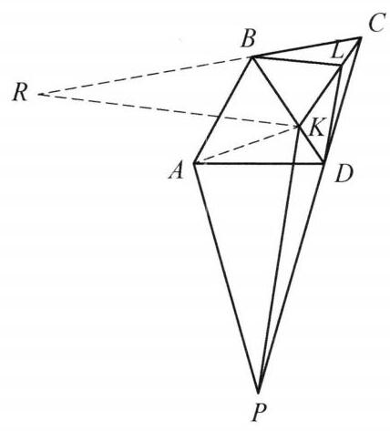

## 题目 (4.md)

例 3 在四边形 ${ABCD}$ 中，点 $K$ 在 ${BD}$ 上，点 $L$ 在 ${CK}$ 上且满足 $\angle {BLK} = \; \angle {BDA}$ ， $\angle {BKL} = \angle {BAD}$ . 作 ${PK}//{DL}$ 与 ${CD}$ 的延长线交于点 $P$ . 证明: $\angle {APK} = \angle {LBC}$ .

图 2-3

证明 如图 2-3,作 ${KR}//{BL}$ 与 ${CB}$ 的延长线交于点 $R$ . 由条件 $\angle {BLK} = \angle {BDA},\angle {BKL} = \; \angle {BAD}$ 知 $\bigtriangleup {BLK} \backsim  \bigtriangleup {BDA}$ ,故

$$
\angle {ABK} = \angle {DBL},\frac{BL}{BK} = \frac{BD}{AB}.
$$

于是 $\bigtriangleup {ABK} \backsim  \bigtriangleup {DBL}$ ,从而

$$
\frac{AK}{KB} = \frac{DL}{LB}.
$$

①

注意到 ${PK}//{DL}$ 及 ${KR}//{BL}$ ,则

$$
\frac{DL}{PK} = \frac{CL}{LK} = \frac{LB}{KR}.
$$

②

由①，②知 $\frac{AK}{KB} = \frac{PK}{KR}$ . 因为 $\angle {PKR} = \angle {DLB}$ ，又因为 $\angle {DLB} = \angle {AKB}$ ，所以 $\angle {PKR} = \angle {AKB}$ ，从而 $\angle {RKB} = \angle {PKA}$ ，再结合 $\frac{AK}{KB} = \frac{PK}{KR}$ 知 $\bigtriangleup  {RKB} \backsim \; \bigtriangleup  {PKA}$ ，故 $\angle {APK} = \angle {KRB} = \angle {LBC}$ . 原问题得证.

注:具有一个重合顶点的旋转相似往往成对出现，比如本题中的 $\bigtriangleup  {ABK} \backsim \; \bigtriangleup  {DBL}$ 及 $\bigtriangleup  {ABD} \backsim   \bigtriangleup  {KBL}$ .

这是一个费解的证明。我能确认每一步的正确性，但我想知道这是怎么想出来的。请为我解释。

---

\begin{solution}

这份证明之所以让人觉得“费解”，是因为书本在排版时只保留了干巴巴的“比例代换”和“倒角”，却隐去了背后最核心的**几何变换直觉（伴生相似 + 位似变换）**。如果直接看作辅助线 $KR \parallel BL$[cite: 1]，确实像“天外飞仙”；但只要顺着图形的结构往前推，每一步其实都是顺理成章的。

我们可以把设题人和解题人的真实思维过程还原为以下三个阶段：

---

### 第一步：挖掘已知——围绕点 $B$ 的“伴生相似”
题目给出了 $\angle BLK = \angle BDA$ 和 $\angle BKL = \angle BAD$，这直接指明了 $\triangle BLK \sim \triangle BDA$[cite: 1]。

* **思维本能**：正如书末“注”所提到的，共顶点的相似三角形往往成对出现（俗称“手拉手模型”）[cite: 1]。在原相似三角形中，点 $A, D$ 和点 $K, L$ 是割裂开的；为了产生新的联系，我们本能地把夹在公共顶点 $B$ 处的两边比例抽出来重组[cite: 1]：
  $$\frac{BL}{BK} = \frac{BD}{AB} \implies \frac{BL}{BD} = \frac{BK}{AB}$$
* **共线带来的便利**：因为点 $K$ 就在 $BD$ 上（射线 $BK$ 与射线 $BD$ 重合），所以 $\angle ABD$ 就是 $\angle ABK$，$\angle KBL$ 就是 $\angle DBL$[cite: 1]。由 $\triangle BLK \sim \triangle BDA$ 知顶角 $\angle ABD = \angle KBL$，因此无需加减公共角，直接就有 $\angle ABK = \angle DBL$，从而得到伴生相似 **$\triangle DBL \sim \triangle ABK$**[cite: 1]。
* **这一步的收获**：它把折线 **$D\text{-}L\text{-}B$** 与折线 **$A\text{-}K\text{-}B$** 绑定在了一起——两者的夹角相等（$\angle DLB = \angle AKB$），且两翼成比例（$\frac{DL}{LB} = \frac{AK}{KB}$）[cite: 1]。

---

### 第二步：核心破局——为什么要作辅助线 $KR \parallel BL$？
拿到 $\triangle DBL \sim \triangle ABK$ 后，我们再看题目的下一个动作：过 $K$ 作 $PK \parallel DL$ 交 $CD$ 延长线于 $P$[cite: 1]。**这是全题最重要的破局点：**

1. **用“位似变换”看条件 $PK \parallel DL$**：
   观察点 $C$：点 $C, L, K$ 共线，点 $C, D, P$ 也共线[cite: 1]。这意味着，**如果以点 $C$ 为位似中心**，把点 $L$ 沿着射线 $CL$ 拉伸到点 $K$，那么平行线 $PK \parallel DL$ 的作用，本质上就是把点 $D$ 同步位似拉伸到了点 $P$（线段 $DL$ 被放大成了线段 $PK$）[cite: 1]。
2. **发现“半成品”与构造动机**：
   * 我们在第一步得到的宝贵结论是关于 **$\triangle DBL$（包含 $DL$ 和 $BL$ 两翼）** 的，但题目给的 $PK \parallel DL$ 只把左翼 $DL$ 放大到了点 $K$ 处的 $PK$，**右翼 $BL$ 却还留在原地没动**[cite: 1]！
   * 同时，我们要证的目标是 $\angle APK = \angle LBC$[cite: 1]。其中 $\angle APK$ 在点 $K, P$ 附近，而 $\angle LBC$ 却远在直线 $BC$ 上，两者根本挨不着[cite: 1]。
3. **水到渠成的辅助线**：
   既然点 $B$ 恰好在过点 $C$ 的第三条射线 $CB$ 上，最自然的想法就是**把这个以 $C$ 为中心的位似变换补充完整**——过 $K$ 作 $KR \parallel BL$ 交 $CB$ 的延长线于 $R$[cite: 1]！
   * 这样一来，位似中心 $C$ 就把折线 **$D\text{-}L\text{-}B$** 整体位似放大成了折线 **$P\text{-}K\text{-}R$**[cite: 1]。
   * **一箭双雕**：不仅直接把远处的目标角 $\angle LBC$ 同位角平移到了 $\angle KRB$，而且折线 $P\text{-}K\text{-}R$ 完美继承了折线 $D\text{-}L\text{-}B$ 的几何特征——夹角相等（$\angle PKR = \angle DLB$），且两翼之比不变（$\frac{PK}{KR} = \frac{DL}{LB}$）[cite: 1]。

> **顺带纠正书中的一个小笔误**：证明过程第 ② 式写的是 $\frac{DL}{PK} = \frac{CL}{LK} = \frac{LB}{KR}$[cite: 1]，其实在 $\triangle CPK$ 和 $\triangle CRK$ 中由平行线分线段成比例，中间的公共比应当是 **$\frac{CL}{CK}$** 而非 $\frac{CL}{LK}$。不过因为中间项只是桥梁，并不影响首尾相等 $\frac{DL}{PK} = \frac{LB}{KR}$（即 $\frac{PK}{KR} = \frac{DL}{LB}$）的正确性[cite: 1]。

---

### 第三步：收官一击——围绕点 $K$ 的第二组“旋转相似”
经过前两步，所有的条件都被搬运到了点 $K$ 周围：
* 第一步告诉我们：折线 $A\text{-}K\text{-}B$ 与折线 $D\text{-}L\text{-}B$ 形状相同[cite: 1]；
* 第二步告诉我们：折线 $P\text{-}K\text{-}R$ 与折线 $D\text{-}L\text{-}B$ 形状相同[cite: 1]。

由传递性可知，**折线 $P\text{-}K\text{-}R$ 与折线 $A\text{-}K\text{-}B$ 形状完全相同**（即 $\frac{PK}{KR} = \frac{AK}{KB}$ 且 $\angle PKR = \angle AKB$；如果你把 $PR$ 连起来，它其实就是 $\triangle KPR \sim \triangle KAB$）[cite: 1]。

这时，**“共顶点的旋转相似成对出现”再次发威**，只不过这次的旋转中心换成了点 $K$[cite: 1]：
* 既然围绕点 $K$ 的旋转缩放把 $P \mapsto A$、$R \mapsto B$（即 $\triangle KPR \sim \triangle KAB$），那么它的**伴生旋转相似**必然是 **$\triangle PKA \sim \triangle RKB$**[cite: 1]！
* 书中最后那段“由 $\angle PKR = \angle AKB$ 得 $\angle RKB = \angle PKA$，再结合比例证得 $\triangle RKB \sim \triangle PKA$”，其实就是省去了连结 $PR$，直接手写了一遍以 $K$ 为中心的伴生相似证明[cite: 1]。
* 一旦 $\triangle PKA \sim \triangle RKB$，对应角 $\angle APK = \angle KRB = \angle LBC$ 便自然得证[cite: 1]。

---

整道题的底层设计逻辑可以用一条非常对称的链条来概括：

$$\underbrace{\triangle BDA \sim \triangle BLK}_{\text{已知条件}} \xrightarrow[\text{伴生相似}]{\text{以 } B \text{ 为中心}} \triangle DBL \sim \triangle ABK \xrightarrow[\text{把 } D\text{-}L\text{-}B \text{ 放大为 } P\text{-}K\text{-}R]{\text{以 } C \text{ 为中心的位似}} \triangle KPR \sim \triangle KAB \xrightarrow[\text{伴生相似}]{\text{以 } K \text{ 为中心}} \underbrace{\triangle KPA \sim \triangle KRB}_{\text{得出 }\angle APK = \angle LBC}$$

看清了“**$B$ 处旋转相似 $\to C$ 处位似搬运 $\to K$ 处旋转相似**”这三步变换后，那条辅助线 $KR \parallel BL$ 是不是就显得非常自然了？

\end{solution}