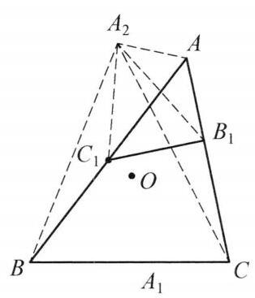
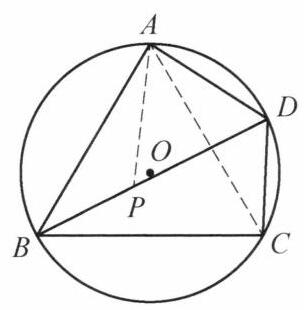
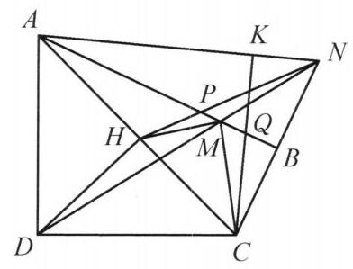
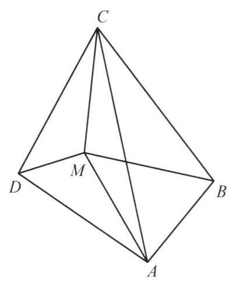

## 第二讲 相似三角形

## 知识精讲

如果两个三角形有等角，且对应边成比例，那么就称这两个三角形为相似三角形.

关于相似三角形，有如下判定定理:

判定定理 1 如果两个三角形有两个对应角相等，那么这两个三角形相似.

判定定理 2 如果两个三角形有两条边对应成比例，且它们的夹角相等，那么这两个三角形相似.

判定定理 3 如果两个三角形的三边对应成比例,那么这两个三角形相似.

## 典型例题

例 1 已知圆 ${O}_1$ 和圆 ${O}_2$ 交于 $P, Q$ 两点,两圆的外公切线分别切圆 ${O}_1$ 和圆 ${O}_2$ 于点 $A, B$ . 点 $A, B$ 与 $Q$ 在点 $P$ 两侧. 过点 $A$ 作 ${AC} \bot  {BP}$ 交 ${O}_1{O}_2$ 于点 $C$ . 证明: $\angle {APC} = {90}^{ \circ  }$ .

图 2-1

证明 如图 2-1,连接 ${QP}$ 并延长交 ${AB}$ 于点 $D$ ,连接 ${O}_{1}Q,{AQ}$ ,则 $D{A}^2 = {DP} \cdot  {DQ} = \; D{B}^2$ ,即 $D$ 为线段 ${AB}$ 的中点.

连接 ${O}_{1}A$ ,则由 ${O}_{1}C \bot  {DP},{O}_{1}A \bot  {DB}$ , ${AC} \bot  {BP}$ ,知 $\bigtriangleup {DBP} \backsim  \bigtriangleup {O}_1{AC}$ ,故 $\frac{DP}{DB} = \frac{{O}_{1}C}{{O}_{1}A}$ . 所以

$$
\frac{{O}_{1}C}{{O}_{1}P} = \frac{{O}_{1}C}{{O}_{1}A} = \frac{DP}{DB} = \frac{DP}{DA} = \frac{AP}{AQ},
$$

结合 $\angle {PAQ} = \frac{1}{2}\angle P{O}_{1}Q = \angle P{O}_{1}C$ ,知 $\bigtriangleup P{O}_{1}C \backsim  \bigtriangleup {QAP}$ ,所以 $\angle {O}_1{PC} = \; \angle {AQP}$ ,故

$$
\angle {APC} = \angle {AP}{O}_1 + \angle {O}_1{PC} = \angle {O}_1{AP} + \angle {AQP}
$$

$$
= \angle {O}_1{AP} + \angle {PAD} = \angle {O}_1{AD} = {90}^{ \circ  }.
$$

所以，原问题得证.

注:利用相似联系线段长度和角度，是几何证明的常见手法.

例 2 锐角 $\bigtriangleup  {ABC}$ 中， ${AB} > {AC}$ ， $M$ 为其外接圆 $O$ 上劣弧 ${BC}$ 的中点， $K$ 为 $A$ 的对径点. 过 $O$ 作 ${AM}$ 的平行线交 ${AB}$ 于 $D$ ，交 ${CA}$ 的延长线于 $E$ . 直线 ${BM}$ 交直线 ${CK}$ 于 $P$ ，直线 ${CM}$ 交直线 ${BK}$ 于 $Q$ . 证明: $\angle {OPB} + \angle {OEB} = \angle {OQC} + \; \angle {ODC}$ .

图 2-2

证明 如图 2-2，连接 ${AK},{BO},{CO},{OM}.$ 由 ${OD}//{AM}$ ，知 $\angle {BDO} = \angle {BAM} = \angle {BCM} = \angle {CBP}$ . 注意到 $\angle {DBO} = {90}^{ \circ  } - \angle {ACB} = \angle {BCP}$ ,故 $\bigtriangleup {BOD} \backsim \; \bigtriangleup {CPB}$ ,于是有 $\frac{BD}{CB} = \frac{BO}{CP} = \frac{CO}{CP}$ ,故 $\frac{BD}{CO} = \frac{BC}{CP}$ ,而 $\angle {DBC} = \angle {AKC} = \angle {OCP}$ ,所以 $\bigtriangleup {DBC} \backsim  \bigtriangleup {OCP}$ . 同理,有 $\bigtriangleup {ECB} \backsim  \bigtriangleup {OBQ}$ .

所以

$$
\angle {OPB} - \angle {OQC} = \angle {OMB} + \angle {POM} - \angle {OMC} + \angle {QOM}
$$

$$
= \angle {POM} + \angle {QOM}
$$

$$
= \angle {POM} + \angle {COM} - \angle {BOM} + \angle {QOM}
$$

$$
= \angle {COP} - \angle {BOQ}
$$

$$
= \angle {BDC} - \angle {CEB}
$$

$$
= \angle {BAC} + \angle {ACD} - \angle {CAB} + \angle {ABE}
$$

$$
= \angle {ACD} + \angle {ABE}
$$

$$
= \angle {ACD} + \angle {AED} - \angle {ADE} + \angle {ABE}
$$

$$
= \angle {ODC} - \angle {OEB}\text{ . }
$$

即 $\angle {OPB} + \angle {OEB} = \angle {OQC} + \angle {ODC}$ .

注:通过比例关系导出 $\bigtriangleup  {DBC} \backsim   \bigtriangleup  {OCP}$ 及 $\bigtriangleup  {ECB} \backsim   \bigtriangleup  {OBQ}$ 是本题的关键.

例 3 在四边形 ${ABCD}$ 中，点 $K$ 在 ${BD}$ 上，点 $L$ 在 ${CK}$ 上且满足 $\angle {BLK} = \; \angle {BDA}$ ， $\angle {BKL} = \angle {BAD}$ . 作 ${PK}//{DL}$ 与 ${CD}$ 的延长线交于点 $P$ . 证明: $\angle {APK} = \angle {LBC}$ .

图 2-3

证明 如图 2-3,作 ${KR}//{BL}$ 与 ${CB}$ 的延长线交于点 $R$ . 由条件 $\angle {BLK} = \angle {BDA},\angle {BKL} = \; \angle {BAD}$ 知 $\bigtriangleup {BLK} \backsim  \bigtriangleup {BDA}$ ,故

$$
\angle {ABK} = \angle {DBL},\frac{BL}{BK} = \frac{BD}{AB}.
$$

于是 $\bigtriangleup {ABK} \backsim  \bigtriangleup {DBL}$ ,从而

$$
\frac{AK}{KB} = \frac{DL}{LB}.
$$

①

注意到 ${PK}//{DL}$ 及 ${KR}//{BL}$ ,则

$$
\frac{DL}{PK} = \frac{CL}{LK} = \frac{LB}{KR}.
$$

②

由①，②知 $\frac{AK}{KB} = \frac{PK}{KR}$ . 因为 $\angle {PKR} = \angle {DLB}$ ，又因为 $\angle {DLB} = \angle {AKB}$ ，所以 $\angle {PKR} = \angle {AKB}$ ，从而 $\angle {RKB} = \angle {PKA}$ ，再结合 $\frac{AK}{KB} = \frac{PK}{KR}$ 知 $\bigtriangleup  {RKB} \backsim \; \bigtriangleup  {PKA}$ ，故 $\angle {APK} = \angle {KRB} = \angle {LBC}$ . 原问题得证.

注:具有一个重合顶点的旋转相似往往成对出现，比如本题中的 $\bigtriangleup  {ABK} \backsim \; \bigtriangleup  {DBL}$ 及 $\bigtriangleup  {ABD} \backsim   \bigtriangleup  {KBL}$ .

例 4 设 ${A}_1,{B}_1,{C}_1$ 分别是 $\bigtriangleup  {ABC}$ 的边 ${BC},{CA},{AB}$ 上的点， $\bigtriangleup  A{B}_1{C}_1$ ， $\bigtriangleup {A}_{1}B{C}_1$ 和 $\bigtriangleup {A}_1{B}_{1}C$ 的外接圆分别与 $\bigtriangleup {ABC}$ 的外接圆交于另一点 ${A}_2,{B}_2$ , ${C}_2\left( {{A}_2 \neq  A,{B}_2 \neq  B,{C}_2 \neq  C}\right)$ ,点 ${A}_3,{B}_3$ 和 ${C}_3$ 分别是 ${A}_1,{B}_1,{C}_1$ 关于边 ${BC}$ , ${CA},{AB}$ 的中点的对称点. 证明: $\bigtriangleup {A}_2{B}_2{C}_2 \backsim  \bigtriangleup {A}_3{B}_3{C}_3$ .

图 2-4

证明 如图 2-4,设 $\bigtriangleup {ABC}$ 的外接圆圆心为 $O$ ,连接 ${A}_{2}A,{A}_2{B}_1,{A}_{2}C,{A}_{2}B,{A}_2{C}_1$ . 因为

$$
\angle {C}_1{A}_2{B}_1 = \angle {BAC} = \angle B{A}_{2}C,
$$

$$
\angle {A}_2{B}_1{C}_1 = \angle {A}_{2}A{C}_1 = \angle {A}_2{CB},
$$

所以 $\bigtriangleup {B}_1{A}_2{C}_1 \backsim  \bigtriangleup C{A}_{2}B$ ,于是,

$$
\frac{{B}_1{A}_2}{C{A}_2} = \frac{{A}_2{C}_1}{{A}_{2}B} = \frac{{B}_1{C}_1}{CB}.
$$

①

对四边形 $A{B}_1{C}_1{A}_2$ 和 ${ACB}{A}_2$ ,由托勒密定理,有

$$
A{A}_2 \cdot  {B}_1{C}_1 = {B}_1{A}_2 \cdot  A{C}_1 - {A}_2{C}_1 \cdot  A{B}_1;
$$

$$
A{A}_2 \cdot  {BC} = {A}_{2}C \cdot  {AB} - {A}_{2}B \cdot  {AC}.
$$

结合①，有

$$
\frac{{A}_{2}C}{{A}_{2}B} = \frac{{AC} - A{B}_1}{{AB} - A{C}_1} = \frac{C{B}_1}{B{C}_1} = \frac{A{B}_3}{A{C}_3}.
$$

又 $\angle C{A}_{2}B = \angle {BAC} = \angle {B}_{3}A{C}_3$ ,故 $\bigtriangleup B{A}_{2}C \backsim  \bigtriangleup {C}_{3}A{B}_3$ ,从而 $\angle {A}_2{CB} = \; \angle A{B}_3{C}_3$ . 同理有 $\angle {B}_2{CA} = \angle B{A}_3{C}_3$ .

注意到在圆 $O$ 中, $\angle {A}_{2}O{B}_2 = \angle {A}_2{OB} + \angle {B}_2{OA} - \angle {AOB}$ ,所以

$$
\angle {A}_2{C}_2{B}_2 = \frac{1}{2}\angle {A}_{2}O{B}_2
$$

$$
= \frac{1}{2}\left( {\angle {A}_2{OB} + \angle {B}_2{OA} - \angle {AOB}}\right)
$$

$$
= \angle {A}_2{CB} + \angle {B}_2{CA} - \angle {ACB}
$$

$$
= \angle A{B}_3{C}_3 + \angle B{A}_3{C}_3 + \left( {\angle {BAC} + \angle {ABC} - {180}^{ \circ  }}\right)
$$

$$
= {180}^{ \circ  } - \angle A{C}_3{B}_3 - \angle B{C}_3{A}_3
$$

$$
= \angle {A}_{3}{C}_{3}{B}_{3}\text{ . }
$$

同理有 $\angle {B}_2{A}_2{C}_2 = \angle {B}_3{A}_3{C}_3,\angle {C}_2{B}_2{A}_2 = \angle {C}_3{B}_3{A}_3$ ,所以 $\bigtriangleup {A}_2{B}_2{C}_2 \backsim \; \bigtriangleup {A}_3{B}_3{C}_3$ . 原问题得证.

注:托勒密定理是指:圆内接四边形的两组对边的乘积之和等于两对角线的乘积.

图 2-5

事实上，如图 2-5，设四边形 ${ABCD}$ 内接于圆 $O$ ，在 ${BD}$ 上取点 $P$ ，使得 $\angle {PAB} = \angle {CAD}$ ，结合 $\angle {ABP} = \angle {ACD}$ ， 知 $\bigtriangleup {ABP} \backsim  \bigtriangleup {ACD}$ ，于是 $\frac{AB}{AC} = \frac{BP}{CD}$ ，即

$$
{AB} \cdot  {CD} = {AC} \cdot  {BP}.
$$

①

又 $\angle {BAC} = \angle {PAD},\angle {ADP} = \angle {ACB}$ ，因此， $\bigtriangleup  {ABC} \backsim \; \bigtriangleup {APD}$ ，于是 $\frac{BC}{AC} = \frac{PD}{AD}$ ，即

$$
{BC} \cdot  {AD} = {AC} \cdot  {PD}.
$$

②

将①、②两式相加，得

$$
{AB} \cdot  {CD} + {BC} \cdot  {AD} = {AC}\left( {{BP} + {PD}}\right)  = {AC} \cdot  {BD}.
$$

例 5 在凸四边形 ${ABCD}$ 中, ${AB} > {AD},\angle {ABC} = \angle {CDA} = {90}^{ \circ  }$ . 在 ${AB}$ 上取点 $M$ 使得 ${AM} = {AD},{DM}$ 与 ${CB}$ 的延长线交于点 $N$ . 点 $D$ 在 ${AC}$ 上的投影为 $H$ , $C$ 在 ${AN}$ 上的投影为点 $K$ . 证明: $\angle {MHN} = \angle {MCK}$ .

图 2-6

证明 如图 2-6,设 ${HN},{CK}$ 与 ${AB}$ 分别交于点 $P, Q$ . 因为 ${AD} = {AM}$ ,所以,

$$
\angle {ADM} = \angle {AMD} = \angle {BMN}.
$$

$$
\text{ 又 }\angle {ADM} + \angle {CDN} = \angle {BMN} + \angle {CND} = {90}^{ \circ  }\text{ , }
$$

故 $\angle {CDN} = \angle {CND}$ ，即 ${CD} = {CN}$ . 在直角 $\bigtriangleup  {ADC}$ 中， 由 ${DH}\bot {AC}$ ，知 $C{D}^2 = {CH} \cdot  {CA}$ ，结合 ${CD} = {CN}$ ，得 $\frac{CH}{CN} = \frac{CN}{CA}$ ，于是 $\bigtriangleup  {CHN} \backsim \; \bigtriangleup  {CNA}$ ，故 $\angle {CNH} = \angle {CAN}$ .

由 ${CK}\bot {AK},{AB}\bot {BN}$ ，知 $\angle {KCA} = \angle {BPN}$ .

由 $A{D}^2 = {AH} \cdot  {AC}$ 及 ${AD} = {AM}$ ，知 $\frac{AM}{AH} = \frac{AC}{AM}$ ，结合 $\angle {HAM} = \angle {CAM}$ ，知 $\bigtriangleup {AHM} \backsim  \bigtriangleup {AMC}$ ，故 $\angle {AMH} = \angle {ACM}$ ，因此由

$$
\angle {BPN} = \angle {AMH} + \angle {MHP} = \angle {KCA} = \angle {ACM} + \angle {MCK}
$$

知 $\angle {MHN} = \angle {MCK}$ . 所以原问题得证.

注:射影定理结合线段相等可导出三角形相似，这一方法在本题中多次用到.

例 6 设 $\bigtriangleup {ABC}$ 的外接圆为圆 $O$ ，且 $I$ ， $J$ 分别是 $\bigtriangleup {ABC}$ 的内心和 $A$ -旁心， ${AJ}$ 交圆 $O$ 于点 $U$ ，点 $D$ 在 ${BC}$ 上且满足 ${DA} = {DJ},{AD}$ 交圆 $O$ 于点 $K, M$ 是 ${BC}$ 的中点， ${IM}$ 交 ${UK}$ 于点 $N$ . 证明: ${MI} = {MN}$ .

图 2-7

证明 如图 2-7,设 ${A}^{\prime }$ 为 $A$ 关于 ${BC}$ 的对称点. 因为 $\angle {AOB} = 2\angle {ACB} = \angle {AC}{A}^{\prime },\angle {A}^{\prime }{AC} = \angle {BAO}$ ，所以 $\bigtriangleup {AOB} \backsim  \bigtriangleup {AC}{A}^{\prime }$ ，于是 $\frac{AO}{AB} = \frac{AC}{A{A}^{\prime }}$ ，即

$$
{AO} \cdot  A{A}^{\prime } = {AB} \cdot  {AC}.
$$

①

由 $\bigtriangleup {AIB} \backsim  \bigtriangleup {ACJ}$ ，得 $\frac{AI}{AB} = \frac{AC}{AJ}$ ，即

$$
{AI} \cdot  {AJ} = {AB} \cdot  {AC}.
$$

②

由①、②得 ${AO} \cdot  A{A}^{\prime } = {AI} \cdot  {AJ}$ ，结合 $\angle {OAI} = \angle {JA}{A}^{\prime }$ ，知 $\bigtriangleup  {AIO} \backsim \; \bigtriangleup  A{A}^{\prime }J$ .

因为 $U$ 为弧 $\overset{\text{ ⏜ }}{BC}$ 的中点，所以， $U, M, O$ 三点共线. 设 ${UO}$ 与圆 $O$ 交于点 $V$ , 则 $\angle {VAU} = {90}^{ \circ  }$ . 由于 ${DA} = {DJ}$ ，且点 $D$ 在 $A{A}^{\prime }$ 的中垂线上，故 $D$ 是 $\bigtriangleup  {A{A}^{\prime }}J$ 的外心. 设 $T$ 在 $A{A}^{\prime }$ 的延长线上，且

$$
\angle {VUK} = \angle {VAK} = {90}^{ \circ  } - \angle {DAJ} = \angle J{A}^{\prime }T = \angle {OIU}.
$$

设 ${U}^{\prime }$ 是 $U$ 关于 ${BC}$ 的对称点,则

$$
{UI} = {2R} \cdot  \sin \frac{A}{2},
$$

$$
U{U}^{\prime } = {2UM} = {4R}{\sin }^2\frac{A}{2},
$$

$$
U{I}^2 = {UO} \cdot  U{U}^{\prime },
$$

故 $\bigtriangleup {UIO} \backsim  \bigtriangleup U{U}^{\prime }I$ ,所以, $\angle U{U}^{\prime }I = \angle {UIO}$ ,于是 $\angle {VUK} = \angle U{U}^{\prime }I$ ,故 ${UN}// \; {U}^{\prime }I$ ,又 $M$ 是 $U{U}^{\prime }$ 的中点,故 ${MI} = {MN}$ ,原问题得证.

注: 该问题关键是性质的转化,首先用对称的方法将 $D$ 转化为 $\bigtriangleup A{A}^{\prime }J$ 的外心,刻画 $D$ 在 ${BC}$ 上,再通过相似刻画 $\bigtriangleup A{A}^{\prime }J$ .

例 7 在一个凸四边形 ${ABCD}$ 内部有一点 $M$ ,满足 ${MA} = {MC},\angle {AMB} = \; \angle {MAD} + \angle {MCD},\angle {CMD} = \angle {MCB} + \angle {MAB}$ . 证明:

$$
{AB} \cdot  {CM} = {BC} \cdot  {MD}.
$$

图 2-8

证明 如图 2-8,不妨设点 $M$ 在 $\bigtriangleup {ACD}$ 内. 由条件得

$$
\angle {CMD} = \angle {MCB} + \angle {MAB}
$$

$$
= {360}^{ \circ  } - \angle {AMC} - \angle {ABC}.
$$

所以

$$
\angle {ABC} = {360}^{ \circ  } - \angle {AMC} - \angle {CMD} = \angle {AMD}.
$$

同理有 $\angle {ADC} = \angle {BMC}$ .

在射线 ${MD}$ 上取点 ${D}^{\prime }$ ,使得 $\angle {MA}{D}^{\prime } = \angle {ACB}$ ,

结合 $\angle {AM}{D}^{\prime } = \angle {ABC}$ ,知 $\bigtriangleup {AM}{D}^{\prime } \backsim  \bigtriangleup {CBA}$ . 故

$$
\angle {D}^{\prime }{AC} = \angle {D}^{\prime }{AM} + \angle {MAC}
$$

$$
= \angle {ACB} + \angle {MCA}
$$

$$
= \angle {MCB}\text{ . }
$$

又

$$
\frac{{D}^{\prime }A}{AC} = \frac{AM}{CB} = \frac{CM}{CB},
$$

所以 $\bigtriangleup {D}^{\prime }{AC} \backsim  \bigtriangleup {MCB}$ . 于是

$$
\angle A{D}^{\prime }C = \angle {CMB} = \angle {ADC},
$$

即 $D$ 与 ${D}^{\prime }$ 重合,因此 $\bigtriangleup {AMD} \backsim  \bigtriangleup {CBA}$ ,则 $\frac{AM}{CB} = \frac{MD}{AB}$ . 又 ${AM} = {CM}$ . 所以 ${AB}$ . ${CM} = {BC} \cdot  {MD}$ . 原问题得证.

