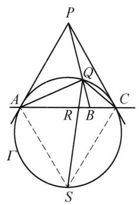
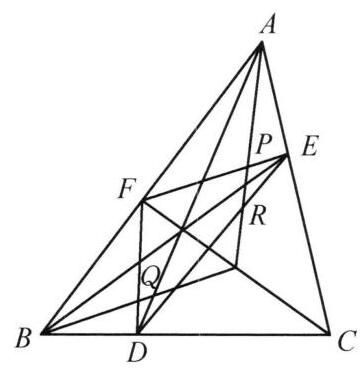
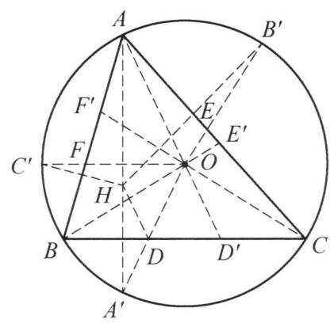

## 第三讲 点共线与线共点

## 知识精讲

## 一、梅涅劳斯定理

1. 梅涅劳斯定理: 设 ${A}^{\prime },{B}^{\prime },{C}^{\prime }$ 分别是 $\bigtriangleup {ABC}$ 的三边 ${BC},{CA},{AB}$ 或其延长线上的点,若 ${A}^{\prime },{B}^{\prime },{C}^{\prime }$ 三点共线,则

$$
\frac{B{A}^{\prime }}{{A}^{\prime }C} \cdot  \frac{C{B}^{\prime }}{{B}^{\prime }A} \cdot  \frac{A{C}^{\prime }}{{C}^{\prime }B} = 1
$$

2. 梅涅劳斯定理的逆定理: 设 ${A}^{\prime },{B}^{\prime },{C}^{\prime }$ 分别是 $\bigtriangleup {ABC}$ 的三边 ${BC},{CA}$ , ${AB}$ 或其延长线上的点,若

$$
\frac{B{A}^{\prime }}{{A}^{\prime }C} \cdot  \frac{C{B}^{\prime }}{{B}^{\prime }A} \cdot  \frac{A{C}^{\prime }}{{C}^{\prime }B} = 1,
$$

则 ${A}^{\prime },{B}^{\prime },{C}^{\prime }$ 三点共线.

3. 第一角元形式的梅涅劳斯定理: 设 ${A}^{\prime },{B}^{\prime },{C}^{\prime }$ 分别是 $\bigtriangleup {ABC}$ 的三边 ${BC}$ , ${CA},{AB}$ 所在直线 (包括三边的延长线) 上的点,则 ${A}^{\prime },{B}^{\prime },{C}^{\prime }$ 共线的充分必要条件是

$$
\frac{\sin \angle {BA}{A}^{\prime }}{\sin \angle {A}^{\prime }{AC}} \cdot  \frac{\sin \angle {AC}{C}^{\prime }}{\sin \angle {C}^{\prime }{CB}} \cdot  \frac{\sin \angle {CB}{B}^{\prime }}{\sin \angle {B}^{\prime }{BA}} = 1.
$$

4. 第二角元形式的梅涅劳斯定理: 设 ${A}^{\prime },{B}^{\prime },{C}^{\prime }$ 分别是 $\bigtriangleup {ABC}$ 的三边 ${BC}$ , ${CA},{AB}$ 所在直线上的点,点 $O$ 不在 $\bigtriangleup {ABC}$ 三边所在直线上,则 ${A}^{\prime },{B}^{\prime },{C}^{\prime }$ 三点共线的充要条件是

$$
\frac{\sin \angle {BO}{A}^{\prime }}{\sin \angle {A}^{\prime }{OC}} \cdot  \frac{\sin \angle {CO}{B}^{\prime }}{\sin \angle {B}^{\prime }{OA}} \cdot  \frac{\sin \angle {AO}{C}^{\prime }}{\sin \angle {C}^{\prime }{OB}} = 1.
$$

## 二、塞瓦定理

1. 塞瓦定理: 设 ${A}^{\prime },{B}^{\prime },{C}^{\prime }$ 分别是 $\bigtriangleup {ABC}$ 的三边 ${BC},{CA},{AB}$ 或其延长线上的点,若 $A{A}^{\prime }, B{B}^{\prime }, C{C}^{\prime }$ 三线平行或共点,则

$$
\frac{B{A}^{\prime }}{{A}^{\prime }C} \cdot  \frac{C{B}^{\prime }}{{B}^{\prime }A} \cdot  \frac{A{C}^{\prime }}{{C}^{\prime }B} = 1.
$$

2. 塞瓦定理的逆定理: 设 ${A}^{\prime },{B}^{\prime },{C}^{\prime }$ 分别是 $\bigtriangleup {ABC}$ 的三边 ${BC},{CA},{AB}$ 或其延长线上的点, 若

$$
\frac{B{A}^{\prime }}{{A}^{\prime }C} \cdot  \frac{C{B}^{\prime }}{{B}^{\prime }A} \cdot  \frac{A{C}^{\prime }}{{C}^{\prime }B} = 1,
$$

则 $A{A}^{\prime }, B{B}^{\prime }, C{C}^{\prime }$ 三线共点或互相平行.

3. 第一角元形式的塞瓦定理: 设 ${A}^{\prime },{B}^{\prime },{C}^{\prime }$ 分别是 $\bigtriangleup {ABC}$ 的三边 ${BC},{CA}$ , ${AB}$ 所在直线上的点,则三直线 $A{A}^{\prime }, B{B}^{\prime }, C{C}^{\prime }$ 平行或共点的充分必要条件是

$$
\frac{\sin \angle {BA}{A}^{\prime }}{\sin \angle {A}^{\prime }{AC}} \cdot  \frac{\sin \angle {AC}{C}^{\prime }}{\sin \angle {C}^{\prime }{CB}} \cdot  \frac{\sin \angle {CB}{B}^{\prime }}{\sin \angle {B}^{\prime }{BA}} = 1.
$$

4. 第二角元形式的塞瓦定理: 设 ${A}^{\prime },{B}^{\prime },{C}^{\prime }$ 分别是 $\bigtriangleup {ABC}$ 的三边 ${BC},{CA}$ , ${AB}$ 所在直线上的点, $O$ 是不在 $\bigtriangleup {ABC}$ 的三边所在直线上的点,则 $A{A}^{\prime }, B{B}^{\prime }$ , $C{C}^{\prime }$ 平行或共点的充分必要条件是

$$
\frac{\sin \angle {BO}{A}^{\prime }}{\sin \angle {A}^{\prime }{OC}} \cdot  \frac{\sin \angle {AO}{C}^{\prime }}{\sin \angle {C}^{\prime }{OB}} \cdot  \frac{\sin \angle {CO}{B}^{\prime }}{\sin \angle {B}^{\prime }{OA}} = 1.
$$

## 典型例题

例 1 (帕斯卡定理)圆内接六边形的三组对边的交点共线.

证明 如图 3-1,设圆内接六边形为 ${ABCDEF}$ ,直线 ${AB}$ 与 ${DE}$ 交于点 $P$ ,直线 ${BC}$ 与 ${EF}$ 交于点 $Q$ ,直线 ${CD}$ 与 ${FA}$ 交于点 $R$ . 因为 $\angle {DCB} = \angle {DAB},\angle {BCF} = \; \angle {BAF},\angle {FRP} = {180}^{ \circ  } - \angle {ARP},\angle {PRC} = {180}^{ \circ  } - \; \angle {PRD},\angle {CFE} = \angle {RDE},\angle {EFR} = \angle {EDA}$ ,所以

$$
\frac{\sin \angle {DCB}}{\sin \angle {BCF}} \cdot  \frac{\sin \angle {FRP}}{\sin \angle {PRC}} \cdot  \frac{\sin \angle {CFE}}{\sin \angle {EFA}} =
$$

$$
\frac{\sin \angle {DAB}}{\sin \angle {BAF}} \cdot  \frac{\sin \angle {ARP}}{\sin \angle {PRD}} \cdot  \frac{\sin \angle {RDE}}{\sin \angle {EDA}}.
$$

图 3-1

对 $\bigtriangleup {ADR}$ 和点 $P$ ,用第一角元形式的塞瓦定理,得

$$
\frac{\sin \angle {DAB}}{\sin \angle {BAF}} \cdot  \frac{\sin \angle {ARP}}{\sin \angle {PRD}} \cdot  \frac{\sin \angle {RDE}}{\sin \angle {EDA}} = 1,
$$

故

$$
\frac{\sin \angle {DCB}}{\sin \angle {BCF}} \cdot  \frac{\sin \angle {FRP}}{\sin \angle {PRC}} \cdot  \frac{\sin \angle {CFE}}{\sin \angle {EFA}} = 1.
$$

注意到 ${BC}$ 与 ${FE}$ 交于点 $Q$ ,故由第一角元形式的塞瓦定理得 ${BC},{FE},{RP}$ 三线共点于 $Q$ ,即 $P, Q, R$ 三点共线.

注:类似的结论, 对于椭圆、双曲线、抛物线也同样成立, 即我们有如下结论:

如果一个六边形内接于一条二次曲线 (椭圆、双曲线、抛物线), 那么它的三对对边的交点在同一条直线上.

例 2 已知 $A, B, C$ 为圆 $\omega$ 上任意三点, $M, N$ 为平面上任意两点, ${AM}$ 与 $\omega$ 的另一个交点为 ${A}_1,{A}_{1}N$ 与 $\omega$ 的另一个交点为 ${A}_2,{A}_{2}M$ 与 $\omega$ 的另一个交点为 ${A}_3$ . 类似定义 ${B}_1,{B}_2,{B}_3,{C}_1,{C}_2,{C}_3$ . 证明: $A{A}_3, B{B}_3, C{C}_3$ 三线共点.

图 3-2

证明 如图 3-2,只需证明: $A{A}_3, B{B}_3,{MN}$ 三线共点,因为同理也有 $A{A}_3, C{C}_3,{MN}$ 三线共点,于是 $A{A}_3, B{B}_3, C{C}_3$ 三线共点于 $A{A}_3$ 与 ${MN}$ 的交点.

设 $A{B}_2$ 与 ${A}_{2}B$ 交于点 $S, A{A}_3$ 与 $B{B}_3$ 交于 $T$ .

对六边形 $A{A}_3{A}_{2}B{B}_3{B}_2$ ,用帕斯卡定理,知 $T$ , $S, M$ 三点共线.

对六边形 ${A}_1{A}_{2}B{B}_1{B}_{2}A$ ,用帕斯卡定理,知 $M$ , $N, S$ 三点共线.

所以, $M, N, T$ 三点共线.

即 $A{A}_3, B{B}_3,{MN}$ 三线共点. 原问题得证.

注:对于圆上点较多的情形，可以考虑用帕斯卡定理证明共线.

例 3 已知直线上的三个定点依次为 $A, B, C,\Gamma$ 为过 $A, C$ 且圆心不在 ${AC}$ 上的圆. 分别作过 $A, C$ 两点且与圆 $\Gamma$ 相切的直线交于点 $P$ ，线段 ${PB}$ 与圆 $\Gamma$ 交于点 $Q$ . 证明: $\angle {AQC}$ 的平分线与 ${AC}$ 的交点不依赖于圆 $\Gamma$ 的选取.

证明 如图 3-3,设 $\angle {AQC}$ 的平分线与 ${AC}$ 交于 $R$ ,与圆 $\Gamma$ 交于异与 $Q$ 的一点 $S$ .

因为 $\bigtriangleup {PAC}$ 是等腰三角形,所以 $\frac{AB}{BC} = \frac{\sin \angle {APB}}{\sin \angle {CPB}}$ .

图 3-3

同理,在 $\bigtriangleup {ASC}$ 中, $\frac{AR}{RC} = \frac{\sin \angle {ASQ}}{\sin \angle {CSQ}}$ .

在 $\bigtriangleup {PAC}$ 中,由角元形式的塞瓦定理,得

$$
\frac{\sin \angle {APB}}{\sin \angle {CPB}} \cdot  \frac{\sin \angle {QAC}}{\sin \angle {QAP}} \cdot  \frac{\sin \angle {QCP}}{\sin \angle {QCA}} = 1.
$$

注意到

$$
\angle {PAQ} = \angle {ASQ} = \angle {QCA},
$$

$$
\angle {PCQ} = \angle {CSQ} = \angle {QAC},
$$

则

$$
\frac{\sin \angle {APB}}{\sin \angle {CPB}} = \frac{\sin \angle {PAQ}}{\sin \angle {QAC}} \cdot  \frac{\sin \angle {QCA}}{\sin \angle {PCQ}} = \frac{{\sin }^2\angle {ASQ}}{{\sin }^2\angle {CSQ}},
$$

即 $\frac{AB}{BC} = \frac{A{R}^2}{R{C}^2}$ . 原问题得证.

例 4 设 $D, E, F$ 分别是 $\bigtriangleup {ABC}$ 的边 ${BC},{CA},{AB}$ 上的点, $P, Q, R$ 分别是线段 ${EF},{FD},{DE}$ 上的点,且 ${DP},{EQ},{FR}$ 三线共点. 证明: ${AP},{BQ},{CR}$ 三线共点的充要条件是 ${AD},{BE},{CF}$ 三线共点.

图 3-4

证明 注意到

$$
\frac{EP}{PF} = \frac{EA}{AF} \cdot  \frac{\sin \angle {PAC}}{\sin \angle {BAP}},
$$

$$
\frac{FQ}{QD} = \frac{FB}{BD} \cdot  \frac{\sin \angle {QBA}}{\sin \angle {CBQ}},
$$

$$
\frac{DR}{RE} = \frac{DC}{CE} \cdot  \frac{\sin \angle {RCB}}{\sin \angle {ACR}}.
$$

三式相乘得

$$
\frac{EP}{PF} \cdot  \frac{FQ}{QD} \cdot  \frac{DR}{RE} \cdot  \frac{BD}{DC} \cdot  \frac{CE}{EA} \cdot  \frac{AF}{FB} \cdot  \frac{\sin \angle {BAP}}{\sin \angle {PAC}} \cdot  \frac{\sin \angle {CBQ}}{\sin \angle {QBA}} \cdot  \frac{\sin \angle {ACR}}{\sin \angle {RCB}} = 1.
$$

另一方面,因 ${DP},{EQ},{FR}$ 三线共点,由塞瓦定理,得

$$
\frac{EP}{PF} \cdot  \frac{FQ}{QD} \cdot  \frac{DR}{RE} = 1,
$$

因此

$$
\frac{BD}{DC} \cdot  \frac{CE}{EA} \cdot  \frac{AF}{FB} \cdot  \frac{\sin \angle {BAP}}{\sin \angle {PAC}} \cdot  \frac{\sin \angle {CBQ}}{\sin \angle {QBA}} \cdot  \frac{\sin \angle {ACR}}{\sin \angle {RCB}} = 1.
$$

于是,因 $D, E, F$ 分别是 $\bigtriangleup {ABC}$ 的边 ${BC},{CA},{AB}$ 上的点, ${AP},{BQ},{CR}$ 分别是过 $\bigtriangleup {ABC}$ 的三个顶点的三条直线,故由塞瓦定理,得

$$
{AP},{BQ},{CR}\text{ 三线共点 }
$$

$$
\Leftrightarrow  \frac{\sin \angle {BAP}}{\sin \angle {PAC}} \cdot  \frac{\sin \angle {CBQ}}{\sin \angle {QBA}} \cdot  \frac{\sin \angle {ACR}}{\sin \angle {RCB}} = 1
$$

$$
\Leftrightarrow  \frac{BD}{DC} \cdot  \frac{CE}{EA} \cdot  \frac{AF}{FB} = 1
$$

$$
\Leftrightarrow  {AD},{BE},{CF}\text{ 三线共点. }
$$

原问题得证.

注:本题只需用塞瓦定理将共点转化好即可.

例 5 设点 $P$ 是凸四边形 ${ABCD}$ 所在平面上一点， $\angle {APB}$ ， $\angle {BPC}$ ， $\angle {CPD}$ ， $\angle {DPA}$ 的平分线分别交 ${AB}$ ， ${BC}$ ， ${CD}$ ， ${DA}$ 于点 $K$ ， $L$ ， $M$ ， $N$ .

(1)寻找一点 $P$ ，使得 ${KLMN}L$ 是平行四边形；

(2)求所有这样的点 $P$ 的轨迹.

图 3-5

解(1)设点 $P$ 是 ${AC}$ 与 ${BD}$ 的垂直平分线的交点，则 ${PA} = {PC}$ ， ${PB} = {PD}$ ，因为 ${PK}$ 平分 $\angle {APB}$ ， ${PL}$ 平分 $\angle {BPC}$ ,所以

$$
\frac{AK}{KB} = \frac{PA}{PB} = \frac{PC}{PB} = \frac{CL}{LB},
$$

故 ${KL}//{AC}$ .

同理, ${MN}//{AC}$ .

所以 ${KL}//{MN}$ .

同理可得 ${LM}//{NK}$ ,所以 ${KLMN}$ 是平行四边形.

(2)如图 3-5，设 ${KLMN}$ 是平行四边形，则

$$
\frac{AK}{KB} \cdot  \frac{BL}{LC} \cdot  \frac{CM}{MD} \cdot  \frac{DN}{NA}
$$

$$
= \frac{PA}{PB} \cdot  \frac{PB}{PC} \cdot  \frac{PC}{PD} \cdot  \frac{PD}{PA}
$$

①

$$
= 1\text{ . }
$$

假设 ${KN}$ 与 ${BD}$ 交于点 $Q$ ,对 $\bigtriangleup {ABD}$ 及直线 ${KNQ}$ ,用梅涅劳斯定理,有

$$
\frac{DN}{NA} \cdot  \frac{AK}{KB} \cdot  \frac{BQ}{QD} = 1,
$$

结合①式得

$$
\frac{BL}{LC} \cdot  \frac{CM}{MD} \cdot  \frac{DQ}{QB} = 1
$$

在 $\bigtriangleup {BCD}$ 中应用梅涅劳斯定理的逆定理得, $Q, M, L$ 三点共线, ${KN}$ 与 ${LM}$ 交于点 $Q$ ,这不可能. 故 ${KN}//{BD}//{LM}$ ,因此

$$
\frac{PA}{PB} = \frac{AK}{KB} = \frac{AN}{ND} = \frac{PA}{PD},
$$

于是有 ${PB} = {PD}$ .

同理有 ${PA} = {PC}$ .

所以 $P$ 点的轨迹是 ${AC}$ 与 ${BD}$ 的垂直平分线的交点这一个点.

注: 反证法在几何证明中并不多见. 本题利用反证法证明 ${NK}//{BD}//{ML}$ ,关系式 $\frac{AK}{KB} \cdot  \frac{BL}{LC} \cdot  \frac{CM}{MD} \cdot  \frac{DN}{NA} = 1$ 是关键.

例 6 圆内接六边形 ${ABCDEF}$ 满足: ${AB} \cdot  {CD} \cdot  {EF} = {BC} \cdot  {DE} \cdot  {AF}$ . 设点 $B$ 关于直线 ${AC}$ 的对称点为 ${B}_1$ ，点 $D$ 关于直线 ${CE}$ 的对称点为 ${D}_1$ ，点 $F$ 关于直线 ${EA}$ 的对称点为 ${F}_1$ . 证明 $\bigtriangleup {B}_1{D}_1{F}_1 \backsim  \bigtriangleup {BDF}$ .

图 3-6

证明 如图 3-6, 由题设条件及正弦定理, 知

$$
\frac{\sin \angle {ACF}}{\sin \angle {ECF}} \cdot  \frac{\sin \angle {BEC}}{\sin \angle {BEA}} \cdot  \frac{\sin \angle {EAD}}{\sin \angle {CAD}}
$$

$$
= \frac{AF}{EF} \cdot  \frac{BC}{AB} \cdot  \frac{DE}{CD} = 1.
$$

所以,由角元塞瓦定理,得 ${CF},{BE},{AD}$ 交于一点 $P$ .

因为

$$
\angle {PC}{D}_1 = \angle {D}_1{CE} - \angle {PCE}
$$

$$
= \angle {ECD} - \angle {FCE}
$$

$$
= \angle {EAD} - \angle {FAE}
$$

$$
= \angle {EAD} - \angle {F}_1{AE}
$$

$$
= \angle {F}_{1}{AP}\text{ . }
$$

又

$$
\frac{{D}_{1}C}{CP} = \frac{DC}{CP} = \frac{FA}{AP} = \frac{{F}_{1}A}{AP},
$$

所以, $\bigtriangleup {D}_1{PC} \backsim  \bigtriangleup {F}_1{PA}$ ,故 $\frac{{D}_{1}P}{{F}_{1}P} = \frac{PC}{AP}$ ,结合 $\angle {APC} = \angle {FPD} = \angle {F}_{1}P{D}_1$ ,知 $\bigtriangleup {D}_{1}P{F}_1 \backsim  \bigtriangleup {CPA}$ ,而 $\bigtriangleup {CPA} \backsim  \bigtriangleup {DPF}$ ,故 $\bigtriangleup {D}_{1}P{F}_1 \backsim  \bigtriangleup {DPF}$ .

同理可得 $\bigtriangleup {B}_{1}P{F}_1 \backsim  \bigtriangleup {BPF},\bigtriangleup {B}_{1}P{D}_1 \backsim  \bigtriangleup {BPD}$ .

所以 $\bigtriangleup {B}_1{D}_1{F}_1 \backsim  \bigtriangleup {BDF}$ . 原问题得证.

注: ${AB} \cdot  {CD} \cdot  {EF} = {BC} \cdot  {DE} \cdot  {AF}$ 等价于 ${AD},{BE},{CF}$ 三线共点是常用转换,得到 $P$ 点后在图中导出相似即可得到结论.

例 7 设 $O, H$ 分别是锐角 $\bigtriangleup {ABC}$ 的外心和垂心,证明: 在边 ${BC},{CA},{AB}$ 上分别存在点 $D, E, F$ ,使得 ${OD} + {DH} = {OE} + {EH} = {OF} + {FH}$ 且 ${AD},{BE},{CF}$ 三线共点.

图 3-7

证明 如图 3-7,设 $H$ 关于 ${BC},{CA},{AB}$ 的对称点分别为 ${A}^{\prime },{B}^{\prime },{C}^{\prime }$ ,则 ${A}^{\prime },{B}^{\prime },{C}^{\prime }$ 均在 $\bigtriangleup {ABC}$ 的外接圆圆 $O$ 上. 设 $O{A}^{\prime }$ 与 ${BC}$ 交于 $D, O{B}^{\prime }$ 与 ${CA}$ 交于 $E, O{C}^{\prime }$ 与 ${AB}$ 交于 $F$ ,则 $D, E, F$ 满足要求.

设直线 ${AO},{BO},{CO}$ 与 ${BC},{CA},{AB}$ 的交点分别为 ${D}^{\prime },{E}^{\prime },{F}^{\prime }$ . 由于 ${DH} = D{A}^{\prime }$ ,则 ${OD} + {DH} = \; {OD} + D{A}^{\prime } = R$ ,其中 $R$ 为 $\bigtriangleup {ABC}$ 的外接圆半径. 同理有 ${OE} + {EH} = {OF} + {FH} = R$ .

由 $\angle {BAO} = {90}^{ \circ  } - \angle {ACB} = \angle {CA}{A}^{\prime }$ 得 $\angle {BO}{D}^{\prime } = \angle {COD}$ ，结合 ${OB} = {OC}$ ， $\angle {OB}{D}^{\prime } = \angle {OCD}$ ,有 $\bigtriangleup {OB}{D}^{\prime } \cong  \bigtriangleup {OCD}$ ,于是 $B{D}^{\prime } = {CD}$ . 同理, $C{E}^{\prime } = {AE}$ , $A{F}^{\prime } = {BF}$ .

对 $\bigtriangleup {ABC}$ 及点 $O$ ,应用塞瓦定理,得

$$
\frac{B{D}^{\prime }}{{D}^{\prime }C} \cdot  \frac{C{E}^{\prime }}{{E}^{\prime }A} \cdot  \frac{A{F}^{\prime }}{{F}^{\prime }B} = 1,
$$

即

$$
\frac{CD}{DB} \cdot  \frac{BF}{FA} \cdot  \frac{AE}{EC} = 1.
$$

由塞瓦定理逆定理,知 ${AD},{BE},{CF}$ 三线共点.

注: 条件 ${OD} + {DH} = {OE} + {EH} = {OF} + {FH}$ 容易联想到 $\bigtriangleup  {ABC}$ 有以 $O$ ， $H$ 为焦点的内切椭圆，只需验证切点满足第二个条件即可，这可用塞瓦定理证明.

例 8 设 $\bigtriangleup  {ABC}$ 的外心，内心，重心分别为 $O, I, G$ . 过点 $B$ 作 ${BP} \bot  {OI}$ 交 ${AI}$ 的延长线于点 $P$ . 过点 $P$ 作 ${PM}//{AC}$ 交 ${BC}$ 于点 $M$ . 证明: $I, G, M$ 三点共线.

图 3-8

证明 如图 3-8,设 ${AI}$ 与 ${BC}$ 交于点 $D,{AG}$ 与 ${BC}$ 交于点 $E$ . 要证 $I, G, M$ 三点共线，对 $\bigtriangleup  {ADE}$ 和直线 ${IGM}$ ,由梅涅劳斯定理,只需证明:

$$
\frac{AI}{ID} \cdot  \frac{DM}{ME} \cdot  \frac{EG}{GA} = 1.
$$

①

由 $I$ 为 $\bigtriangleup {ABC}$ 的内心,知

$$
\frac{AI}{ID} = \frac{AC}{CD}.
$$

②

由 ${PM}//{AC}$ ,得

$$
\frac{AC}{CD} = \frac{PM}{MD}.
$$

③

由 $G$ 为 $\bigtriangleup {ABC}$ 的重心,知

$$
\frac{EG}{GA} = \frac{1}{2}.
$$

④

由②，③，④知要证①成立，只需证明 ${PM} = {2ME}$ . 设 ${PE}$ 与 ${AC}$ 交于点 $F$ ，故只需证明 ${FC} = {2CE} = {BC}$ .

下面用同一法. 作 ${CF} = {BC}$ ，设 ${FE}$ 交 ${AD}$ 于 ${P}^{\prime }$ . 下证明 $B{P}^{\prime }\bot {OI}$ ，从而此点 ${P}^{\prime }$ 即为题目中要求的 $P$ .

连接 ${CI}$ 并延长交 $\bigtriangleup {ABC}$ 的外接圆于 $S$ ，则 $S$ 为弧 ${AB}$ 的中点且 ${SO} \bot  {AB}$ . 由鸡爪定理，有 ${SI} = {SA}$ ，且

$$
\angle {SOA} = \frac{1}{2}\angle {BOA} = \angle {ACB},
$$

于是 $\bigtriangleup {AOS} \backsim  \bigtriangleup {FCB}$ ,因此,

$$
\frac{SO}{SI} = \frac{SO}{SA} = \frac{FC}{FB}.
$$

⑤

作 ${AT} \bot  {CI}$ 交 ${P}^{\prime }B$ 的延长线于 $T$ ,则 ${AT}//{FB}$ . 因为 ${SO} \bot  {AB},{SI} \bot  {AT}$ , 所以 $\angle {OSI} = \angle {BAT}$ . 延长 $B{P}^{\prime }$ 交 ${AC}$ 于点 $X$ . 对 $\bigtriangleup {XCB}$ 及直线 $E{P}^{\prime }F$ ,由梅涅劳斯定理, 得

$$
\frac{XF}{FC} \cdot  \frac{CE}{EB} \cdot  \frac{B{P}^{\prime }}{{P}^{\prime }X} = 1,
$$

而 ${CE} = {EB},\frac{B{P}^{\prime }}{{P}^{\prime }X} = \frac{BA}{AX}$ ,所以 $\frac{XF}{FC} \cdot  \frac{BA}{AX} = 1$ .

又由 ${AT}//{FB}$ ,得 $\frac{XF}{AX} = \frac{FB}{AT}$ ,故 $\frac{BA}{FC} \cdot  \frac{FB}{AT} = 1$ ,从而

$$
\frac{FC}{FB} = \frac{BA}{AT}.
$$

⑥

由⑤，⑥得 $\frac{SO}{SI} = \frac{BA}{AT}$ ，于是结合 $\angle {OSI} = \angle {BAT}$ ，得 $\bigtriangleup  {OSI} \backsim   \bigtriangleup  {BAT}$ . 所以 ${OI} \bot \; B{P}^{\prime }$ . 即 ${P}^{\prime }$ 与 $P$ 重合.

原问题得证.

注:本题分两步证明:先用梅涅劳斯定理简化欲证结论，再用同一法证明 $B{P}^{\prime } \bot  {OI}$ ，要综合利用相似与梅涅劳斯定理，有一定的难度.

