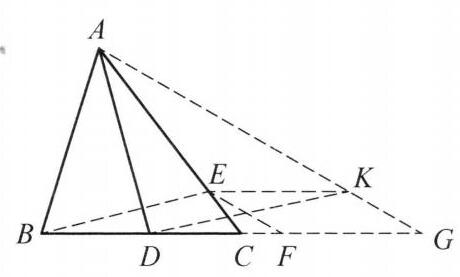
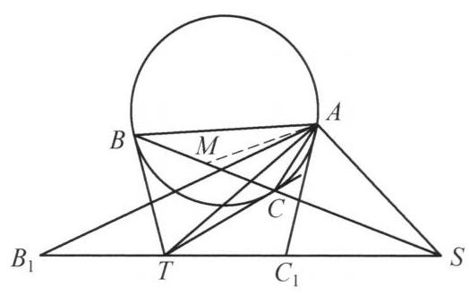
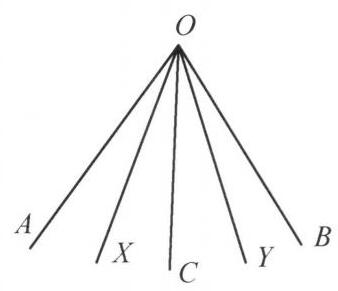
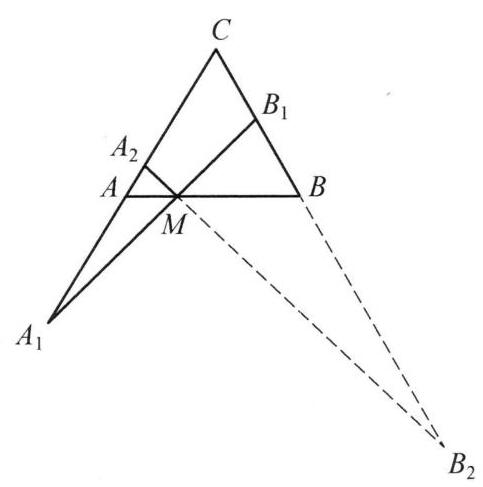
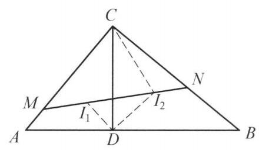

## 第四讲 平移、对称和旋转变换

## 知识精讲

## 一、平移变换

设 $\overrightarrow{a}$ 是平面上的已知向量,点 $P$ 为任意一点,如果 $\overrightarrow{P{P}^{\prime }} = \overrightarrow{a}$ ,则把点 ${P}^{\prime }$ 称为点 $P$ 依向量 $\overrightarrow{a}$ 平移得到的像. 通常利用平移把某一图形或图形的一部分平移到另一位置. 平移变换是证明线段相等、平行、两角相等的辅助工具.

## 二、对称变换

如果存在一条直线 $l$ ，使得对于平面上的每一个点 $P$ 及其对应点 ${P}^{\prime }$ ，其连线 $P{P}^{\prime }$ 都被定直线 $l$ 垂直平分，则称这种变换为对称变换，定直线 $l$ 称为对称轴.

## 三、旋转变换

设 $O$ 为平面上的一个定点， $P$ 为任意一点，点 $P$ 绕点 $O$ 旋转一个定角 $\theta$ 得到 ${P}^{\prime }$ . 把点 ${P}^{\prime }$ 称为以 $O$ 为旋转中心，以 $\theta$ 为旋转角得到的点 $P$ 的像. 旋转中心 $O$ 是旋转变换下唯一位置不变的点.

## 典型例题

---

例 1 点 $D$ 是 $\bigtriangleup {ABC}$ 的边 ${BC}$ 上一点，使得 ${AD} > {BC}, E$ 为 ${AC}$ 上一点，使得 $\frac{AE}{EC} = \frac{BD}{{AD} - {BC}}$ . 证明: ${AD} > {BE}$ .

证明 如图 4-1,延长 ${BC}$ 至点 $F$ ,使得 ${CF} = \; {AD} - {BC}$ ,再延长至点 $G$ ,使得 ${FG} = {BD}$ . 由条件 $\frac{AE}{EC} = \frac{BD}{{AD} - {BC}}$ ,知 $\frac{AE}{EC} = \frac{FG}{CF}$ ,从而 ${EF}//{AG}$ . 过点 $E$ 作 ${EK}//{CG}$ 交 ${AG}$ 于点 $K$ ,则四边形 ${FEKG}$ 为平行四边形,所以 ${EK} \text{ ⫫ } {FG}$ ,故 ${EK} \text{ ⫫ } {BD}$ ,于是 ${BDKE}$ 为平行四边形,即我们将 ${BE}$ 平移至 ${DK}$ , 则在 $\bigtriangleup {ADK}$ 中, $\angle {AKD} > \angle G$ ,而

$$
{AD} = {BD} + {DC} + {CF} = {DC} + {CF} + {FG} = {DG},
$$

图 4-1

故 $\angle {DAK} = \angle G$ ，于是 $\angle {AKD} > \angle {DAK}$ ，从而 ${AD} > {BE}$ .

注:通过平移，将 ${AD},{BE}$ 变为同一三角形的两边，然后利用大角对大边证明结论.

---

例 2 设 $\Gamma$ 是 $\bigtriangleup  {ABC}$ 的外接圆，圆 $\Gamma$ 在 $B, C$ 两点的切线交于 $T$ . 过 $A$ 且垂直于 ${AT}$ 的直线与直线 ${BC}$ 交于 $S$ ，点 ${B}_1,{C}_1$ 在直线 ${ST}$ 上( ${B}_1$ ， $B$ 在 ${BC}$ 的垂直平分线的同侧)，且 $T{B}_1 = T{C}_1 = {TB}$ . 证明: $\bigtriangleup  A{B}_1{C}_1 \backsim   \bigtriangleup  {ABC}$ .

图 4-2

证明 如图 4-2，设 $M$ 为 ${BC}$ 的中点，则 ${AM}$ ， ${AT}$ 是 $\angle {BAC}$ 的两条等角线，所以 $\angle {BAT} = \angle {MAC}$ . 又 $\angle {TBC} = \angle {BAC}$ ，所以

$$
\angle {TBA} = \angle {TBC} + \angle {CBA}
$$

$$
= \angle {BAC} + \angle {CBA}
$$

$$
= {180}^{ \circ  } - \angle {ACB},
$$

于是由 $T{C}_1 = {TB}$ 及正弦定理,得

$$
\frac{T{C}_1}{AT} = \frac{TB}{AT} = \frac{\sin \angle {BAT}}{\sin \angle {TBA}} = \frac{\sin \angle {MAC}}{\sin \angle {ACB}} = \frac{MC}{AM}.
$$

另一方面,因 $\angle {TMS} = {90}^{ \circ  } = \angle {TAS}$ ,故 $A, M, T, S$ 四点共圆,于是 $\angle {STA} = \angle {SMA}$ ，即 $\angle {C}_1{TA} = \angle {CMA}$ ，因此， $\bigtriangleup  {AT}{C}_1 \backsim   \bigtriangleup  {AMC}$ . 同理 $\bigtriangleup A{B}_{1}T \backsim  \bigtriangleup {ABM}$ . 故 $\bigtriangleup A{B}_1{C}_1 \backsim  \bigtriangleup {ABC}$ . 原问题得证.

注 1: 由相似对应 $\left( {T, M}\right.$ 为 ${B}_1{C}_1,{BC}$ 的中点) 知,只需证明 $\bigtriangleup {AMC} \backsim \; \bigtriangleup {AT}{C}_1$ ,根据点定义的先后顺序发现这样证明是最自然的.

注 2:给定一个角 $\angle {AOB}$ ，设 ${OC}$ 是其角平分线，过 $O$ 作两条关于 ${OC}$ 对称的直线 ${OX},{OY}$ ，则称 ${OY}$ 是 ${OX}$ 关于 $\angle {AOB}$ 的等角线.

图 4-3

三角形的中线的等角线称为陪位中线，记过 $\bigtriangleup  {ABC}$ 的顶点 $A$ 的中线的陪位中线称为 $\bigtriangleup {ABC}$ 的 $A$ -陪位中线. 关于陪位中线有如下重要结论:

设 $\bigtriangleup {ABC}$ 的外接圆在 $B, C$ 两点的切线交于 $P$ ,则 ${AP}$ 是 $\bigtriangleup {ABC}$ 的 $A$ -陪位中线.

---

例 3 设 $O, G$ 分别是 $\bigtriangleup {ABC}$ 的外心和重心, $G, O$ 关于三边 ${BC},{CA},{AB}$ 的对称点分别为 ${G}_1,{G}_2,{G}_3$ 和 ${O}_1,{O}_2,{O}_3$ . 证明: 七个三角形: $\bigtriangleup {G}_2{G}_{3}A$ , $\bigtriangleup {G}_1{G}_{3}B,\bigtriangleup {G}_1{G}_{2}C,\bigtriangleup {O}_2{O}_{3}A,\bigtriangleup {O}_1{O}_{3}A,\bigtriangleup {O}_1{O}_{2}C,\bigtriangleup {ABC}$ 的外接圆共点.

图 4-4

证明 如图 4-4,设 ${O}_2{G}_2$ 与 ${O}_3{G}_3$ 交于 ${X}_1$ ,类似的定义 ${X}_2,{X}_3$ .

下面证明圆 $A{O}_2{O}_3$ 与圆 $A{G}_2{G}_3$ 均经过 ${X}_1$ .

因为 ${O}_2,{G}_2$ 及 ${O}_3,{G}_3$ 分别是 $O\text{ 、 }G$ 关于 ${AC}$ 和 ${AB}$ 的对称点,所以 $\bigtriangleup A{O}_2{G}_2 \cong \; \bigtriangleup {AOG} \cong  \bigtriangleup A{O}_3{G}_3$ ,于是

$$
\angle A{G}_3{X}_1 = {180}^{ \circ  } - \angle A{G}_3{O}_3
$$

$$
= {180}^{ \circ  } - \angle A{G}_2{O}_2
$$

$$
= {180}^{ \circ  } - \angle A{G}_2{X}_1,
$$

故 ${A}_1,{G}_2,{G}_3,{X}_1$ 四点共圆.

同理由 $\angle A{O}_3{X}_1 = \angle A{O}_3{G}_3 = \angle A{O}_2{G}_2 = {180}^{ \circ  } - \angle A{O}_2{X}_1$ ,知 $A,{O}_2,{O}_3$ , ${X}_1$ 四点共圆. 故圆 $A{O}_2{O}_3$ 与圆 $A{G}_2{G}_3$ 均经过 ${X}_1$ .

设 $\bigtriangleup {ABC}$ 的垂心为 $H, H$ 关于三边 ${AB},{AC},{BC}$ 的对称点分别为 ${H}_3,{H}_2$ , ${H}_1$ ,则 ${H}_3,{H}_2,{H}_1$ 均在圆 $O$ 上且 ${H}_3$ 在 ${O}_3{G}_3$ 上, ${H}_2$ 在 ${O}_2{G}_2$ 上. 设 ${O}_3{X}_1$ 与 ${AB}$ 交于 ${D}_3,{O}_2{X}_1$ 与 ${AC}$ 交于 ${D}_2$ ,则 ${D}_3, H, G,{D}_2$ 共线,

$$
\angle {H}_3{X}_1{H}_2 = {180}^{ \circ  } - \left( {{180}^{ \circ  } - 2\angle A{D}_{3}G}\right)  - \left( {{180}^{ \circ  } - 2\angle A{D}_{2}G}\right)
$$

$$
= 2\left( {{180}^{ \circ  } - \angle {BAC}}\right)  - {180}^{ \circ  }
$$

$$
= {180}^{ \circ  } - 2\angle {BAC}
$$

$$
= \angle {H}_{3}B{H}_{2}\text{ . }
$$

故 ${X}_1$ 在圆 $O$ 上. 因此, ${O}_{2}{G}_{2}\text{ 、 }{O}_{3}{G}_{3}\text{ 、 }{O}_{1}{G}_{1}$ 交于圆 $O$ 上的同一点 ${X}_1 = {X}_2 = {X}_3 = \; X$ . 原问题得证.

注: 先定出交点 ${X}_1$ ,利用结论可知 ${X}_1$ 在圆 $A{G}_2{G}_3$ 与圆 $A{O}_2{O}_3$ 上,进而只需证明 ${X}_1$ 在圆 ${ABC}$ 上即可证明原结论,这利用点 $H$ 在欧拉线上并不难证.

---

例 4 在锐角 $\bigtriangleup {ABC}$ 中, $\angle A > {60}^{ \circ  }, H$ 为 $\bigtriangleup {ABC}$ 的垂心, $M, N$ 分别在边 ${AB},{AC}$ 上,且满足 $\angle {HMB} = \angle {HNC} = {60}^{ \circ  }.O$ 为 $\bigtriangleup {HMN}$ 的外心, $D$ 使得 $\bigtriangleup {DBC}$ 为正三角形 (且 $A, D$ 在 ${BC}$ 同侧). 证明: $H, O, D$ 三点共线.

图 4-5

证明 如图 4-5,由题设条件,知 $\angle {ABH} = \; \angle {ACH} = {90}^{ \circ  } - \angle A,\angle {HMB} = \angle {HNC} = {60}^{ \circ  }$ ，故 $\bigtriangleup {MHB} \backsim  \bigtriangleup {NHC}$ ，则 $\frac{MH}{NH} = \frac{BH}{HC}$ .

将 $H$ 以 $D$ 为中心顺时针旋转 ${60}^{ \circ  }$ 到 ${H}^{\prime }$ ，则 $\bigtriangleup D{H}^{\prime }H$ 为正三角形，且 $\bigtriangleup {DB}{H}^{\prime } \cong  \bigtriangleup {DCH}$ ，于是 ${H}^{\prime }B = {HC}$ ，所以

$$
\frac{MH}{NH} = \frac{BH}{B{H}^{\prime }}.
$$

①

注意到

$$
\angle {AHN} = \angle {CNH} - \angle {CAH}
$$

$$
= {60}^{ \circ  } - \left( {{90}^{ \circ  } - \angle C}\right)
$$

$$
= \angle {DBC} - \angle {CBH} = \angle {DBH}\text{ . }
$$

同理 $\angle {AHM} = \angle {DCH} = \angle {DB}{H}^{\prime }$ .

所以

$$
\angle {MHN} = \angle {AHM} + \angle {AHN} = \angle {DB}{H}^{\prime } + \angle {DBH} = \angle {HB}{H}^{\prime }.
$$

②

由①，②得 $\bigtriangleup  {H}^{\prime }{BH} \backsim   \bigtriangleup  {NHM}$ . 所以

$$
\angle {MNH} = \angle H{H}^{\prime }B = \angle D{H}^{\prime }B - \angle D{H}^{\prime }H = \angle {DHC} - {60}^{ \circ  }
$$

$$
\angle {MHO} = \frac{{180}^{ \circ  } - \angle {MOH}}{2} = {90}^{ \circ  } - \angle {MNH} = {150}^{ \circ  } - \angle {DHC}.
$$

由 ${AH} \bot  {BC}$ 得 $\angle {AHD} = \frac{1}{2}\angle {BDC} - \angle {BDH} = {30}^{ \circ  } - \angle {BDH}$ ,故

$$
\angle {HDC} = {60}^{ \circ  } - \angle {BDH} = {60}^{ \circ  } - \left( {{30}^{ \circ  } - \angle {AHD}}\right)  = \angle {AHD} + {30}^{ \circ  },
$$

$$
\angle {DHC} = {180}^{ \circ  } - \angle {HDC} - \angle {DCH} = {180}^{ \circ  } - \left( {\angle {AHD} + {30}^{ \circ  }}\right)  - \angle {AHM}.
$$

所以

$$
\angle {MHO} = {150}^{ \circ  } - \angle {DHC} = \angle {AHD} + \angle {AHM} = \angle {MHD},
$$

故 $H, O, D$ 三点共线. 原问题得证.

注:正三角形往往对应旋转 ${60}^{ \circ  }$ 的全等，结合条件中的 ${60}^{ \circ  }$ 角进一步提示要作出点 ${H}^{\prime }$ .

---

例 5 在圆内接四边形 ${ABCD}$ 中, $X, Y$ 分别为 $\bigtriangleup {ABC},\bigtriangleup {BCD}$ 的垂心. 证明: 四边形 ${AXYD}$ 是平行四边形.

证明 如图 4-6,设 $X, Y$ 关于 ${BC}$ 的对称点为 ${X}^{\prime }$ , ${Y}^{\prime }$ ,则 ${X}^{\prime },{Y}^{\prime }$ 在圆 ${ABCD}$ 上,于是 ${X}^{\prime }{Y}^{\prime } = {XY}$ 且由 $X, Y$ 分别是 $\bigtriangleup {ABC},\bigtriangleup {BCD}$ 的垂心,知 $A{X}^{\prime }//D{Y}^{\prime }$ ,所以四边形 $A{X}^{\prime }{Y}^{\prime }D$ 是圆内接等腰梯形,于是 ${AD} = {XY}$ . 这表明四边形 ${AXYD}$ 要么是平行四边形要么是梯形. 注意到 ${AD}$ 和 ${X}^{\prime }{Y}^{\prime }$ 关于圆 ${ABCD}$ 的某条直径对称,而 ${XY}$ 和 ${X}^{\prime }{Y}^{\prime }$ 关于 ${BC}$ 对称,故四边形 ${AXYD}$ 不是梯形,即四边形 ${AXYD}$ 是平行四边形.

图 4-6

注: 易知有 ${AX}//{DY}$ ,再通过两次对称证明 ${XY}//{AD}$ 即可.

图 4-7

---

例 6 如图 4-7,设 $\bigtriangleup {ABC}$ 是等腰三角形, $M$ 是底边 ${AB}$ 上的一点,过点 $M$ 的直线与 ${CA}$ 的延长线交于点 ${A}_1$ ,与 ${CB}$ 交于点 ${B}_1$ .

证明: $\frac{{A}_{1}A}{{A}_{1}M} = \frac{{B}_{1}B}{{B}_{1}M}$ .

证明 设直线 ${A}_1{B}_1$ 关于直线 ${AB}$ 的对称直线与 ${CA}$ 交于点 ${A}_2$ ,与 ${CB}$ 的延长线交于点 ${B}_2$ . 由 $\angle {A}_1{AM} = \angle {B}_2{BM},\angle {A}_1{MA} = \angle {B}_2{MB}$ 知 $\bigtriangleup {A}_1{AM} \backsim  \bigtriangleup {B}_2{BM}$ ,则 $\frac{{A}_{1}A}{{A}_{1}M} = \frac{{B}_{2}B}{{B}_{2}M}$ .

又 ${MB}$ 为 $\bigtriangleup {B}_{1}M{B}_2$ 的角平分线,所以 $\frac{{B}_{2}B}{{B}_{2}M} = \frac{{B}_{1}B}{{B}_{1}M}$ ,于是 $\frac{{A}_{1}A}{{A}_{1}M} = \frac{{B}_{1}B}{{B}_{1}M}$ . 原问题得证.

---

例 7 设 $\bigtriangleup {ABC}$ 和 $\bigtriangleup {XYZ}$ 的交点 ${A}_1,{A}_2,{B}_1,{B}_2,{C}_1,{C}_2$ 满足 $\frac{{A}_1{A}_2}{BC} = \; \frac{{B}_1{B}_2}{AC} = \frac{{C}_1{C}_2}{AB}$ . 证明: $\frac{{A}_2{B}_1}{XY} = \frac{{B}_2{C}_1}{YZ} = \frac{{C}_2{A}_1}{ZX}$ .

证明 如图 4-8,将 ${B}_2{B}_1$ 平移至 ${C}_{1}O$ ,则四边形 ${C}_{1}O{B}_1{B}_2$ 为平行四边形. 令 $\frac{{A}_1{A}_2}{BC} = \frac{{B}_1{B}_2}{AC} = \frac{{C}_1{C}_2}{AB} = \lambda$ ,在 $\bigtriangleup {C}_2{C}_{1}O$ 及 $\bigtriangleup {BAC}$ 中,由余弦定理并结合 $\angle {C}_2{C}_{1}O = \; \angle {BAC}$ ,得

$$
{C}_2{O}^2 = {C}_1{C}_2^2 + {C}_1{O}^2 - 2{C}_1{C}_2 \cdot  {C}_{1}O \cdot  \cos \angle {C}_2{C}_{1}O
$$

$$
= {C}_1{C}_2^2 + {B}_1{B}_2^2 - 2{C}_1{C}_2 \cdot  {B}_1{B}_2 \cdot  \cos \angle {C}_2{C}_{1}O
$$

$$
= {\lambda }^2\left( {A{B}^2 + A{C}^2 - {2AB} \cdot  {AC} \cdot  \cos \angle {BAC}}\right)
$$

$$
= {\lambda }^{2}B{C}^2 = {A}_1{A}_2^2,
$$

图 4-8

即 ${C}_{2}O = {A}_1{A}_2$ .

又 $\bigtriangleup {C}_2{C}_{1}O \backsim  \bigtriangleup {ABC}$ ,故 $\angle {C}_1{C}_{2}O = \angle {ABC}$ ,于是 ${C}_{2}O//{BC}$ . 即 ${C}_{2}O \bot  {BC}$ , 从而四边形 ${C}_{2}O{A}_2{A}_1$ 为平行四边形. 则 $O{A}_2//{ZX}$ ,故 $\angle O{A}_2{B}_1 = \angle {ZXY}$ . 由 $O{B}_1//{ZY}$ ,知 $\angle O{B}_1{A}_2 = \angle {ZYX}$ ,从而 $\bigtriangleup O{A}_2{B}_1 \backsim  \bigtriangleup {ZXY}$ ,所以

$$
\frac{O{A}_2}{ZX} = \frac{O{B}_1}{ZY} = \frac{{A}_2{B}_1}{XY},
$$

结合 $O{A}_2 = {C}_2{A}_1, O{B}_1 = {C}_1{B}_2$ ,得

$$
\frac{{A}_2{B}_1}{XY} = \frac{{B}_2{C}_1}{YZ} = \frac{{C}_2{A}_1}{ZX}.
$$

原问题得证.

注:通过平移，将 ${A}_1{A}_2$ ， ${B}_1{B}_2$ ， ${C}_1{C}_2$ 联系在一起，同时得到一个由 ${A}_2{B}_1$ ， ${B}_2{C}_1$ ， ${C}_2{A}_1$ 组成的三角形，再通过相似证明原问题.

---

例 8 直角 $\bigtriangleup {ABC}$ 中， $\angle C = {90}^{ \circ  }$ ， ${CD}$ 为 ${AB}$ 上的高，记 $\bigtriangleup  {ACD}$ 及 $\bigtriangleup {BCD}$ 的内心分别为 ${I}_1,{I}_2$ ，直线 ${I}_1{I}_2$ 与 ${CA},{CB}$ 分别交于点 $M, N$ .

证明: ${S}_{\bigtriangleup {ABC}} \geq  2{S}_{\bigtriangleup {CMN}}$ .

证明 如图 4-9，由 Rt $\bigtriangleup  {DAC} \backsim$ Rt $\bigtriangleup  {DCB}$ ， 知 $\bigtriangleup  {DAC}$ 可由 $\bigtriangleup  {DBC}$ 绕 $D$ 逆时针旋转 ${90}^{ \circ  }$ 再通过伸缩得到，即 $\frac{{I}_{2}D}{{I}_{1}D} = \frac{BD}{CD}$ . 又 $\angle {I}_{2}D{I}_1 = \angle {BDC} = \; {90}^{ \circ  }$ ，所以 $\bigtriangleup  {DCB} \backsim   \bigtriangleup  D{I}_1{I}_2$ ，于是 $\bigtriangleup  D{I}_1{I}_2$ 可由 $\bigtriangleup  {DCB}$ 绕 $D$ 逆时针旋转 ${45}^{ \circ  }$ 再伸缩得到，从而 ${CB}$ 与 ${I}_1{I}_2$ 之间的夹角为 ${45}^{ \circ  }$ ，故 ${CM} = {CN}$ . 而 $\angle {I}_2{CD} = \angle {I}_2{CN}$ ， $\angle {CD}{I}_2 = \; \angle {CN}{I}_2 = {45}^{ \circ  }$ ，因此 $\bigtriangleup {I}_2{CD} \cong  \bigtriangleup {I}_2{CN}$ ，于是 ${CD} = {CN}$ ，所以 ${CM} = {CN} = {CD}$ . 于是

$$
\frac{{S}_{\bigtriangleup {ABC}}}{{S}_{\bigtriangleup {CMN}}} = \frac{{AB} \cdot  {CD}}{{CM} \cdot  {CN}} = \frac{AB}{CD} \geq  2.
$$

图 4-9

注:在得到 ${CM} = {CN}$ 后，利用角平分线得到全等，推出 ${CM} = {CD} = {CN}$ ，再由面积公式推出结论.

