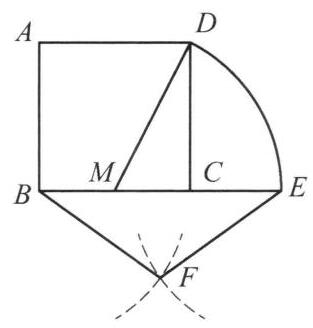
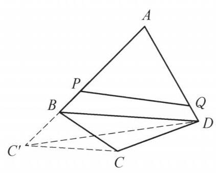
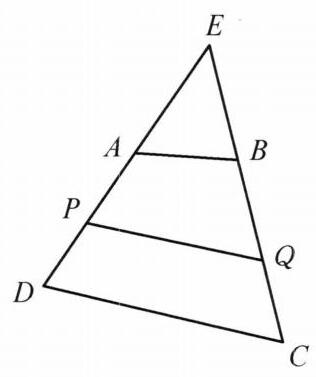
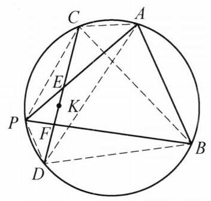
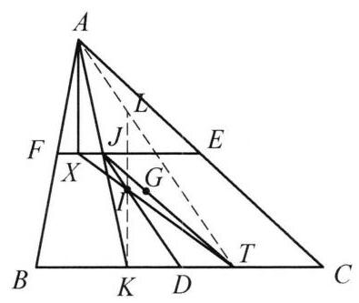
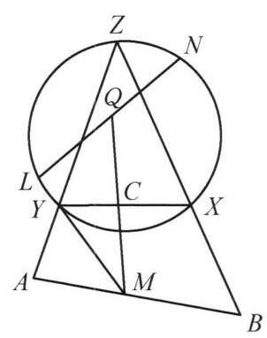
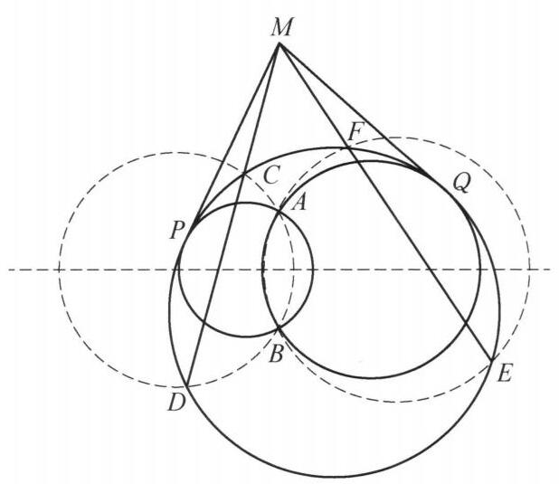
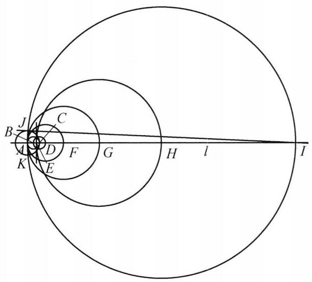
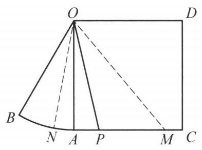
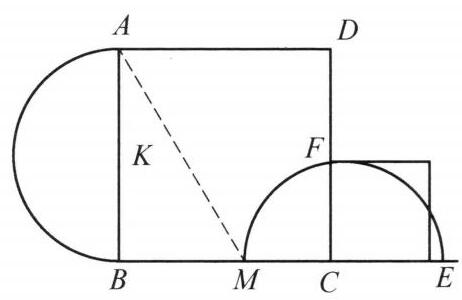

## 阅读欣赏

## 尺规作图

尺规作图，即利用直尺和圆规作图，它起源于古希腊，在尺规作图问题中，我们需要使用没有刻度且无限长的直尺(且只能使用其一边)和同样没有刻度，但可以张开任意宽的圆规，在有限步之内精确地作出需要的平面几何图形.

一般而言，以上描述在数学意义上还不够精确，因此我们需要使用下面的几条法则，以准确地定义尺规作图. 在尺规作图中，我们允许进行以下操作:

1. 作过两个确定点的直线；

2. 以一个确定点为圆心，作过另一个确定点的圆；

3. 作两条不平行的直线的交点;

4. 在确定一个圆和一条直线相交的前提下，作它们的一个或两个交点;

5. 在确定两个圆相交的前提下，作它们的一个或两个交点.

需要注意的是，在不同的问题中，这些法则可能会有一定变化，如第二条中，有时我们允许用圆规截取一段已有的长度作为半径，即以确定点为圆心，某两个确定点之间的距离为半径作圆. 事实上，即使我们不允许直接进行这一操作，也可以通过若干次允许的操作达到同样的效果. 另外，我们有时也允许取相切的圆和直线 (或相切两圆)的切点,而这同样可以用其他操作的组合来代替.

除此以外，在尺规作图中我们也会遇到需要在某些范围内任取一点的情况，而这一操作应遵循以下法则:

1. 允许在平面上、直线上、圆弧线上已确定的范围内任意选定一点 (所谓“确定范围”，依下面四条的规则);

2. 可以判断同一直线上不同点的位置次序;

3. 可以判断同一圆弧线上不同点的位置次序;

4. 可以判断平面上一点在直线的哪一侧;

5. 可以判断平面上一点在圆的内部还是外部.

自尺规作图诞生以来，一个一直困扰数学家们的问题便是什么样的几何对象 (线段、角等)可以由尺规作图得到，而什么样的不行，比如著名的立方倍积、化圆为方、三等分任意角等问题. 在解析几何的观点下，尺规作图所能作出的点的坐标均能够通过给定点的坐标经过有限次加减乘除与平方根运算得到. 利用这一性质，法国数学家万芝尔(Pierre Wantzel)于 1837 年证明了立方倍积与三等分任意角为尺规作图不可能问题，而 1882 年德国数学家林德曼(Lindman)证明了 π 是超越数， 从而化圆为方也是不可能通过尺规作图完成的. 在此之前，我们熟悉的数学家高斯已经证明了当 $n$ 是形如 ${2}^{{2}^k} + 1$ 的素数(即费马素数)或者若干个不同这样的素数的乘积时,正 $n$ 边形可以通过尺规作图精确作出.

在中学数学课程中, 我们已经接触了一些简单的尺规作图问题, 如作出给定线段的垂直平分线、作出给定角的角平分线等. 下面我们来看一些更复杂而又妙趣横生的尺规作图问题.

范例 1 利用尺规作正五边形.

解 根据高斯的结论，正五边形是可以通过尺规作图得到的，而这一点早在古希腊就已为人所知. 事实上，我们可以利用以下熟知结论进行构造:正五边形的对角线与边长之比为黄金分割数 $\frac{\sqrt{5} + 1}{2}$ .

图 4-10

如图 4-10,首先作一个正方形 ${ABCD}$ ,并作 ${BC}$ 中点 $M$ . 在射线 ${MC}$ 上截取 ${ME} = {MD}$ (即以 $M$ 为圆心, ${MD}$ 为半径作圆，与射线 ${MC}$ 交于点 $E$ ). 分别以 $B$ ， $E$ 为圆心，正方形边长为半径作圆，并交于点 $F$ .

此时，我们设正方形边长为 $a$ ，则 ${BE} = \frac{\sqrt{5} + 1}{2}a$ ，从而 $\bigtriangleup  {BFE}$ 是底边与腰长之比恰为 $\frac{\sqrt{5} + 1}{2} : 1$ 的等腰三角形，因此它的内角为 ${36}^{ \circ  },{36}^{ \circ  },{108}^{ \circ  }$ ，从而， $B, F, E$ 是某个正五边形的连续三个顶点. 其余两点可以通过如下方式构造:过 $B$ 作 ${FE}$ 平行线，交 ${FC}$ 延长线于点 $X$ ，然后过 $X$ 作 ${BE}$ 的平行线，过 $B$ 作 ${FX}$ 平行线交于点 $Y$ . 容易证明 ${BFEXY}$ 即为正五边形.

范例 2 作一个正方形，它与给定三角形拥有相同的面积.

解 注意到，以下问题容易通过尺规作图解决:(1)过平面上一点作已知直线的垂线; (2) 过已知直线外的一点作该直线的平行线. 对前者, 可以已知点为圆心, 充分长的距离为半径作圆，与直线交于两点，再作这两点的垂直平分线；而对后者， 既可利用两次垂直，也可以用中学平面几何中常见的等腰三角形结合角平分线的结构来构造.

在本题中，对于给定三角形，不妨为 $\bigtriangleup  {ABC}$ ，可以过 $C$ 作 ${AB}$ 的平行线 $l$ ，并过 $A, B$ 分别作 $l$ 的垂线，垂足为 ${A}^{\prime },{B}^{\prime }$ . 容易发现 $A{A}^{\prime }{B}^{\prime }B$ 是矩形，且面积等于 $\bigtriangleup {ABC}$ 的两倍. 通过取一组对边的中点，我们也容易得到一个矩形，它的面积恰好等于 $\bigtriangleup {ABC}$ 的面积. 因此，题目实际上转化为了如下问题:利用尺规作出一个正方形，它与给定的矩形拥有相同的面积.

事实上，如果我们将矩形的长和宽视作已知长度，问题又等价于作一条线段， 它的长度为两条已知长度的几何平均值. 我们利用直角三角形的射影定理来进行构造.

设 $a, b$ 为已知长度，我们首先在一条直线 $l$ 上取点 $X$ ，并截取 ${XY} = a,{YZ} = \; b$ ( $X, Y, Z$ 顺次排列). 作 ${XZ}$ 的中点 $P$ ，并以 $P$ 为圆心， ${PX}$ 为半径作圆 $\Gamma$ . 过 $Y$ 作 $l$ 的垂线，交 $\Gamma$ 于 $T$ (任取两交点之一即可). 这样，由于 $\bigtriangleup  {XYT}$ 和 $\bigtriangleup  {TYZ}$ 是相似的直角三角形，我们有 $Y{T}^2 = {XY} \cdot  {YZ}$ ，即 ${YT} = \sqrt{ab}$ .

应用范例 2 中的方法,我们也可以作一条线段,它的平方等于某个已知多边形的面积 (利用等积变换). 进一步,对于二次方程 ${x}^2 + {px} + q = 0$ ，其中 $p$ 是某个已知长度 (可正可负)，而 $q$ 是某些已知长度通过四则运算得到的二次量，如果方程有正实数根 $x$ ，我们同样可以利用求根公式，通过尺规作图构造长度 $x$ . 比如下面的问题.

范例 3 通过尺规作图画一条直线，它同时平分已知凸四边形的周长和面积.

解 我们先证明所求直线的存在性. 事实上，当我们取定四边形边界上一点时，过这一点显然有唯一的直线平分四边形的周长. 不妨点 $A$ 对应的直线与四边形边界的另一交点为 ${A}^{\prime }$ . 设此时直线 $A{A}^{\prime }$ 一侧的图形面积为 ${S}_0$ ，而四边形面积为 $S$ . 我们使 $A$ 顺时针沿边界移动,则 ${A}^{\prime }$ 以同样的速度沿边界顺时针移动. 当 $A$ 移至 ${A}^{\prime }$ 的初始位置时, ${A}^{\prime }$ 恰好移动到 $A$ 的初始位置,而直线 $A{A}^{\prime }$ 一侧的图形的面积是连续变化的,且在此过程中该面积从 ${S}_0$ 变化至 $S - {S}_0$ . 根据介值原理,有某一时刻直线 $A{A}^{\prime }$ 两侧的图形面积都恰为 $\frac{1}{2}S$ ,从而这条直线同时平分四边形的面积与周长. 因此一定存在这样的直线 (且有可能不止一条).

所求的直线与四边形的边界恰有两个交点, 而它们有可能在两条邻边上, 也可能在一组对边上. 以下分两种情况讨论. 设 ${ABCD}$ 为给定的四边形.

(1)若平分直线与四边形的一组邻边 ${AB},{AD}$ 分别交于 $P, Q$ . 设 ${AP} = x$ ， ${AQ} = y$ ，我们的目标是确定 $x$ ， $y$ .

设 ${AB},{BC},{CD},{DA}$ 的长分别为 $a, b, c, d$ ，且四边形面积为 $S$ ，于是根据条件我们有

$$
x + y = \frac{1}{2}\left( {a + b + c + d}\right) ,{xy} = \frac{S}{\sin A},
$$

从而 $x, y$ 是方程 ${t}^2 - \frac{1}{2}\left( {a + b + c + d}\right) t + \frac{S}{\sin A} =$ 0 的两根. 注意到, $\frac{S}{\sin A}$ 也是可以通过尺规作图构造的量. 事实上,可以过 $C$ 作 ${BD}$ 平行线,交 ${AB}$ 延长线于 ${C}^{\prime }$ (如图 4-11),则 $S = {S}_{\bigtriangleup A{C}^{\prime }D}$ ,从而 $\frac{S}{\sin A} = \; \frac{1}{2}A{C}^{\prime } \cdot  {AD}$ . 因此,只要上述方程有正实数解 $x, y$ 且满足 $x \leq  a, y \leq  d$ ,那么我们就可以通过尺规作图作出这两条线段长.

图 4-11

如果任何与两条邻边相交的直线都不符合要求, 那么我们进入第二种情况:

(2)若平分直线与四边形一组对边 ${AD},{BC}$ 分别相交于 $P, Q$ . 首先,如果 ${ABCD}$ 是平行四边形,那么任何一条对角线所在直线都可以同时平分其周长与面积,而这已在上一种情况讨论过. 如果 ${ABCD}$ 是等腰梯形,不妨 ${AD}//{BC}$ 且 ${AD} < {BC}$ ,则可以取 $P = A$ ,而 $Q$ 在 ${BC}$ 上满足 ${BQ} = \frac{1}{2}\left( {{AD} + {BC}}\right)$ ,而这也已在上一种情况中讨论过. 如果 ${ABCD}$ 是非等腰梯形,且 ${AD}//{BC}$ ,我们证明这是不可能的. 事实上, 我们有

$$
{S}_{APQB} = \frac{1}{2}\left( {{AP} + {BQ}}\right) h,
$$

$$
{S}_{DPQC} = \frac{1}{2}\left( {{DP} + {CQ}}\right) h,
$$

且 ${S}_{APQB} = {S}_{DPQC}$ ,从而 ${AP} + {BQ} = {DP} + {CQ}$ ,结合两四边形周长相等可得 ${AB} = \; {CD}$ ，即 ${ABCD}$ 是等腰梯形，矛盾.

因此，在此种情况下必有 ${AD}$ 不平行于 ${BC}$ . 如图 4-12，我们延长两条线段， 使其相交于 $E$ (不妨 $E$ 在 ${DA}$ ， ${CB}$ 延长线上). 接下来需要找到 ${EP} = x$ ， ${EQ} = y$ ， 使得它们符合条件. 设 ${EA} = e,{EB} = f$ ,则这里的 $x, y$ 应满足

$$
\left( {x - e}\right)  + a + \left( {y - f}\right)  = \frac{1}{2}\left( {a + b + c + d}\right) ,
$$

$$
{S}_{\bigtriangleup {EPQ}} - {S}_{\bigtriangleup {EAB}} = {S}_{\bigtriangleup {ECD}} - {S}_{\bigtriangleup {EPQ}},
$$

图 4-12

后者即 $2{S}_{\bigtriangleup {EPQ}} = {S}_{\bigtriangleup {EAB}} + {S}_{\bigtriangleup {ECD}}$ ,也就是

$$
{xy} = \frac{1}{2}\left( {{ef} + \left( {e + d}\right) \left( {f + b}\right) }\right) .
$$

因此, $x, y$ 是方程

$$
{t}^2 - \left( {e + f + \frac{b + c + d - a}{2}}\right) t + \frac{1}{2}\left( {{2ef} + {eb} + {fd} + {bd}}\right)  = 0
$$

的两根,而它们可以通过尺规作图得到.

范例 4 给定圆 $\Gamma$ 与圆上两条不相交的弦 ${CD},{AB}$ ,以及 ${CD}$ 上一点 $K$ . 求作 $\Gamma$ 上一点 $P$ ,使得 ${PA},{PB}$ 分别与 ${CD}$ 交于点 $E, F$ ,且 $K$ 为 ${EF}$ 中点.

解 如图 4-13,显然 $K$ 为 ${EF}$ 中点当且仅当 ${CE} - \; {DF} = {CK} - {DK}$ ，也即 $\frac{CE}{CD} - \frac{DF}{CD} = \frac{{CK} - {DK}}{CD}$ ，其中右边是已知量，设为 $t$ . 注意到，满足 $\frac{QC}{QD}$ 等于定值的点 $Q$ 的轨迹是一个阿波罗尼斯圆，因此我们计算 $\frac{PC}{PD}$ 的值，并由此作出阿波罗尼斯圆(取出直线上的内外分点并以此为直径画圆),使它与 $\Gamma$ 相交,从而确定点 $P$ 的位置.

图 4-13

因为 $A, B, D, P, C$ 均在一个圆上,我们有

$$
\frac{DF}{FC} = \frac{{S}_{\bigtriangleup {DPB}}}{{S}_{\bigtriangleup {CPB}}} = \frac{\frac{1}{2}{DP} \cdot  {DB} \cdot  \sin \angle {PDB}}{\frac{1}{2}{CP} \cdot  {CB} \cdot  \sin \angle {PCB}} = \frac{{DP} \cdot  {DB}}{{CP} \cdot  {CB}},
$$

这里用到 $\sin \angle {PDB} = \sin \angle {PCB}$ . 同理有 $\frac{CE}{ED} = \frac{{CP} \cdot  {CA}}{{DP} \cdot  {DA}}$ .

于是,由条件应有等式 $\frac{CE}{{CE} + {ED}} - \frac{DF}{{DF} + {FC}} = t$ ,即

$$
\frac{{CP} \cdot  {CA}}{{CP} \cdot  {CA} + {DP} \cdot  {DA}} - \frac{{DP} \cdot  {DB}}{{DP} \cdot  {DB} + {CP} \cdot  {CB}} = t.
$$

设 $\frac{PC}{PD} = q$ ,该等式化为 $\frac{q \cdot  {CA}}{{DA} + q \cdot  {CA}} - \frac{DB}{{DB} + q \cdot  {CB}} = t$ . 化简后,得到

$$
{q}^2 + \frac{t}{t - 1}\left( {\frac{DB}{CB} + \frac{DA}{CA}}\right) q + \frac{t + 1}{t - 1} \cdot  \frac{DA}{CA} \cdot  \frac{DB}{CB} = 0.
$$

因此, $q$ 是可以尺规构造的线段比例. 具体而言,任取一线段长作为基准长度 (设为 $a$ ),可以通过尺规作图构造一条线段长度等于 ${qa}$ . 于是,结合前述方法,可以找到点 $P$ .

除了常规的尺规作图外,也有要求只用直尺或者只用圆规进行作图的问题. 事实上, 数学家们已经证明, 只利用圆规就可以作出所有尺规作图可以得到的点, 而在平面上已有一个给定圆的情况下, 只用直尺同样可以作出任何尺规作图可以得到的点. 在没有已知圆的情况下, 只用直尺所能作出的图形就十分有限.

范例 5 给定一个正方形，只用直尺，作一个面积为该正方形两倍的正方形.

解 在这个问题中，我们只能用没有刻度的直尺进行作图，也就是说，我们只能做两件事:

(1)将已知线段向某一方向延长；(2)作两个已知点的连线.

容易得到，所求正方形的边长恰为给定正方形的对角线长，但是要找到正方形其他的顶点，却需要动一番脑筋. 这里，我们首先设法构造正方形一边的中点.

设 ${ABCD}$ 为给定正方形，我们在边 ${CD}$ 上任取两点 $E$ ， $F$ ，并连接 ${AE}$ ， ${AF}$ ， ${BE}$ ， ${BF}$ . 设直线 ${AE}$ ， ${BF}$ 交于点 $X$ ，而直线 ${AF}$ ， ${BE}$ 交于点 $Y$ . 连接 ${XY}$ ，并与 ${AB}$ 交于点 $K$ .

根据塞瓦定理，我们有 $\frac{AE}{EX}$ . $\frac{XF}{FB}$ . $\frac{BK}{KA} = 1$ ，而 ${AB}//{CD}$ ，所以 $\frac{AE}{EX} = \frac{XF}{FB}$ ， 从而 ${AK} = {KB}$ ，即 $K$ 为 ${AB}$ 中点.

在取得一边中点后，接下来的问题便迎刃而解.

延长 ${CB}$ ， ${DK}$ 交于 ${C}^{\prime }$ ，则 ${CB} = B{C}^{\prime }$ ，从而 $\bigtriangleup  {AC}{C}^{\prime }$ 是等腰直角三角形. 同样， 作出 ${BC}$ 的中点可以使我们得到 $A$ 关于 $B$ 的对称点 ${A}^{\prime }$ . 于是， ${AC}{A}^{\prime }{C}^{\prime }$ 即为所求的正方形.

范例 6 给定三角形 ${ABC}$ ，并已知其重心 $G$ 和内心 $I$ ，只用直尺，作出三角形的垂心 $H$ .

解 注意到, 已知重心和内心相当于知道三条中线与三条角平分线. 要解决这个问题, 需要我们对三角形五心的性质有相当的了解.

如图 4-14,设 ${AG},{BG},{CG}$ 分别交对边于 $D, E$ , $F$ (从而 $D, E, F$ 为三边中点). 连接 ${DI}$ ,并延长交 ${EF}$ 于点 $J$ . 利用位似,我们可以证明, $J$ 是 $\bigtriangleup {AEF}$ 的内切圆切点. 设 $\odot  I$ 与 ${BC}$ 切于点 $K, K$ 关于 $I$ 的对称点为 $L$ ，则由位似可得直线 ${AL}$ 过 ${BC}$ 边上的旁切圆切点 $T$ ， 进一步有 ${ID}//{AL}$ . 于是， ${ID}$ 是 $\bigtriangleup  {AKT}$ 的一条中位线，所以它过 ${AK}$ 中点，也即 ${AK},{ID},{EF}$ 交于一点.

图 4-14

因此， $J$ 为 $\bigtriangleup  {AEF}$ 的内切圆切点. 于是 ${AJ}$ 延长线与 ${BC}$ 的交点即为 ${BC}$ 上的切点 $K$ ，从而 ${IK} \bot  {BC}$ . 同样由位似可以得到，直线 ${JG}$ 交 ${BC}$ 的交点即为 ${BC}$ 上的旁切圆切点 $T$ ，而 ${AT}$ 与直线 ${KI}$ 的交点即为 $K$ 关于 $I$ 的对称点 $L$ . 设点 $A$ 引出的高为 ${h}_a$ ，则 ${KL}//{h}_a$ ，而 $I$ 为 ${KL}$ 中点，所以直线 ${TI}$ 过 ${h}_a$ 中点. 反过来，令 ${TI}$ 与 ${EF}$ 交于 $X$ ，则 ${AX}$ 即为 $A$ 到 ${BC}$ 的垂线.

用同样的方法可以得到 $B$ 到 ${AC}$ 的垂线,两垂线的交点即为垂心 $H$ .

范例 7 利用尺规作一个三角形，它内接于已知圆 $\Gamma$ ，且三边所在直线分别过已知点 $A, B, C$ .

解 本题称为卡斯蒂利昂问题，具有相当难度. 它由瑞士数学家克莱姆 (Gabriel Creamer) 提出，并于 1776 年由意大利数学家卡斯蒂利昂(Castillon)解决. 需要注意的是，并非所有的已知条件都可以作出符合要求的三角形，比如当 $A$ ， $B, C$ 是圆 $\Gamma$ 内部共线的三点时，这样的三角形就不存在，这是因为三角形三边所在直线上各取一点满足共线时，必有一点在对应边之外，而三角形的边是圆的一条弦，这意味着该点一定在圆的外侧，矛盾. 因此以下作法仅在已知条件足够好的情况下适用. 作法如下:

图 4-15

(1)在直线 ${AB}$ 上取一点 $M$ ，使得 $\overline{AM} \cdot  \overline{AB} = {p}^{2}$ (其中 $\overline{AM},\overline{AB}$ 为有向线段，而 ${p}^2$ 为点 $A$ 关于圆 $\Gamma$ 的幂).

( 2 )连接 ${MC}$ ，并在直线 ${MC}$ 上取一点 $Q$ ，满足 $\overline{MC}$ . $\overline{MQ} = {q}^{2}$ (其中 ${q}^2$ 为 $M$ 关于 $\Gamma$ 的幂).

(3)过 $Q$ 作弦 ${LN}$ ，满足 ${LN}$ 所对的圆周角等于 $\angle {AMQ}$ . (具体而言，设 $\Gamma$ 圆心为 $O$ ，半径为 $r$ ， $\angle {AMQ} = \varphi$ ，则作圆 $O\left( {r = \sqrt{1 - {\sin }^2\varphi }}\right)$ ,然后作 $Q$ 关于此圆的切线. 需注意此处的弦 ${LN}$ 不一定存在. )

(4)连接 ${LM}$ 交 $\Gamma$ 于另一点 $Y$ ，连接 ${AY}$ 交 $\Gamma$ 于另一点 $Z$ ，然后连接 ${BZ}$ 交 $\Gamma$ 于另一点 $X$ .

我们来证明 $\bigtriangleup {XYZ}$ 是符合条件的三角形. 显然只需证明 $X, Y, C$ 三点共线.

(1)由作法可知 $\overline{AM} \cdot  \overline{AB} = \overline{AY} \cdot  \overline{AZ}$ ，从而 $M, B, Z, Y$ 四点共圆， $\angle {AMY} = \; \angle {AZB}$ ，又因为 $\angle {AZB} = \angle {YLX}$ ，所以 $\angle {AMY} = \angle {YLX}$ ，即 ${LX}//{AB}$ .

( 2 )设 ${CQ}$ 与 ${LX}$ 交于 $K$ ，由于 ${LX}//{AB}$ ，可得 $\angle {LKQ} = \angle {AMC}$ . 而根据作法有 $\angle {LXN} = \angle {AMK}$ ，所以 ${QK}//{NX}$ ，从而 $\angle {KQL} = \angle {XNL}$ .

(3)由作法可知， $\overline{MC} \cdot  \overline{MQ} = \overline{MY} \cdot  \overline{ML}$ ，所以 $C, Q, L, Y$ 四点共圆，即 $\angle {LYC} = {180}^{ \circ  } - \angle {CQL}$ . 又因为 $L, Y, X, N$ 共圆，有 $\angle {LYX} = {180}^{ \circ  } - \angle {LNX}$ . 由于 $\angle {CQL} = \angle {LNX}$ ，可得 $\angle {LYC} = \angle {LYX}$ ，因此 $C$ 在直线 ${XY}$ 上.

范例 8 给定一个圆 $O$ 及其内部两点 $A$ 和 $B$ ，试用圆规和直尺作一个圆，使之与圆 $O$ 相切且经过点 $A$ 和点 $B$ .

解 过 $A$ 和 $B$ 任作一圆且与圆 $O$ 相交，交于 ${CD}$ ; 过 $A$ 和 $B$ 任作另一圆且与圆 $O$ 相交,交于 ${EF}$ . ${CD}$ 与 ${EF}$ 交于 $M$ ,过 $M$ 作圆 $O$ 的 2 条切线,切圆 $O$ 于 $P, Q$ ,于是圆 ${PAB}$ 和圆 ${QAB}$ 满足条件. 若 $M$ 点不存在,即 ${CD}$ 平行于 ${EF}$ ,那么取 $P$ 和 $Q$ 为 ${AB}$ 的中垂线和圆 $O$ 的交点即可(如图 4-16).

图 4-16

由于 $M$ 点为图上 3 圆根心，所以 $M, A, B$ 三点共线，此时 ${MA} \cdot  {MB} = \; {MC} \cdot  {MD} = M{P}^2$ ,所以 ${PM}$ 是两圆公切线. 即证.

范例 9 我们知道, 在尺规作图中, 出现的一维几何对象只有两种: 圆周和直线. 设一张纸上仅标记了距离为 1 的两个点. 证明: 可以在这张纸上用尺规作出一条直线及该直线上距离为 $\sqrt{2021}$ 的两个点，使得作图过程中出现的不同圆周和直线的总数不超过 10 个.

注:解答中应用明确的作图步骤，并对出现的圆周和直线依次编号. 如果你的作图过程中圆周和直线的总数超过 10 ，那么根据总数的大小可能有部分分数.

图 4-17

证明 按以下十步作图.

第一步，作直线 ${AB}$ ，记为 $l$ ，建立数轴 $A\left( 0\right)$ ， $B\left( 1\right)$ .

第二步，作 $\odot  \left( {B\text{ ， }{BA}}\right)$ 交 $l$ 于 $C\left( 2\right)$ .

第三步，作 $\odot  \left( {C,{CB}}\right)$ 交 $l$ 于 $D\left( 3\right)$ .

第四步，作过第二步、第三步中的圆的两个交点的直线交 $l$ 于 $E\left( {1.5}\right)$ .

第五步，作 $\odot  \left( {D,{DA}}\right)$ 交 $l$ 于 $F\left( 6\right)$ .

第六步，作 $\odot  \left( {F,{FA}}\right)$ 交 $l$ 于 $G\left( {12}\right)$ .

第七步，作 $\odot  \left( {G,{GE}}\right)$ 交 $l$ 于 $H\left( {22.5}\right)$ .

第八步，作 $\odot  \left( {H,{HA}}\right)$ 交 $l$ 于 $I\left( {45}\right)$ .

第九步，作 $\odot  \left( {A,{AC}}\right)$ 交第八步中的圆于 $J, K$ .

第十步，作直线 ${JI}$ .

来证 ${JI} = \sqrt{2021}$ .

事实上，注意到第八步中的圆以 ${AI}$ 为直径，所以 $\angle {AJI} = {90}^{ \circ  }$ . 又 ${AJ} = {AC} =$ 2, ${AI} = {45}$ ，所以 ${JI} = \sqrt{A{I}^2 - A{J}^2} = \sqrt{2021}$ .

注:本题是一个不太常规的几何题，难度不大. 第一步要发现 2021 = ${45}^2 - {2}^2$ ， 接下来需要构造一条长为 45 的线段和一个直角，这里的办法很多，基本都能做出来. 需要指出的是，允许以已知的一点为圆心，已知的两点之间的距离为半径作圆. 事实上，题目中的 10 步可以改进为 9 步，但是最佳常数目前还不知道是多少.

范例 10 一个发明家构思出了一种器械，利用它可以经过平面上的任一点作直线，平分所给定的凸图形的面积. 证明:

(1)可以利用该器械、圆规和直尺将给定的锐角三等分；

(2)可以利用该器械、圆规和直尺作一个正方形使之面积等于给定的圆.

证明(1)对半径为 2、圆心角为锐角 $\theta$ 的扇形 $O\overset{\text{ ⏜ }}{AB}$ ，以 ${OA}$ 为一边，向扇形外侧作正方形 ${OACD}$ . 由于扇形的面积为 ${4\pi } \cdot  \frac{\theta }{2\pi } = {2\theta }$ ，考虑正方形和半圆的并集所组成的面积为 $4 + {2\theta }$ 的凸图形 $O\overset{\text{ ⏜ }}{BA}{CD}$ ,过点 $O$ 作直线 ${OM}$ 平分这个图形的面积，交这个图形于另一个点 $M$ ，由于 ${2\theta } < 4$ ，所以 $M$ 在正方形的一条边 ${AC}$ 上(若在

${CD}$ 上,直线在 $D$ 一侧的面积不超过 2,矛盾).

此时直角梯形 ${ODCM}$ 的面积为 $\frac{1}{2}\left( {4 + {2\theta }}\right)  = 2 + \theta$ . 由梯形面积公式, $\frac{CD}{2}\left( {{OD} + {MC}}\right)  = 2 + \theta$ ,结合 ${CD} = {OD} = 2$ 解得 ${MC} = \theta$ .

在射线 ${AC}$ 上截取 ${AP}$ ,使得 ${AP} = \frac{2}{3}{MC} = \frac{2\theta }{3}$ ,此时三角形 ${OAP}$ 和扇形 $O\overset{\text{ ⏜ }}{AB}$ 的并集 $\overset{\text{ ⏜ }}{OBAP}$ 是一个面积为 ${2\theta } + \frac{OA}{2} \cdot  \frac{2\theta }{3} = \frac{8}{3}\theta$ 的曲边凸四边形,过 $O$ 作直线平分这个凸图形的面积交这个图形于另一点 $N$ . 由于扇形 $O\overset{\text{ ⏜ }}{AB}$ 的面积 ${2\theta }$ 大于三角形 ${OAP}$ 的面积,所以 $N$ 点在圆弧 $\overset{\text{ ⏜ }}{AB}$ 上,那么 ${S}_{O\overset{\text{ ⏜ }}{BN}} = \frac{1}{2} \cdot  \frac{8}{3}\theta  = \frac{4}{3}\theta$ ,故 $\angle {BON} = \frac{2}{3}\theta$ , 这样 ${ON}$ 就是 $\angle {AOB} = \theta$ 的一条三等分线.

图 4-18

图 4-19

(2)设圆的半径是 1 . 则其面积为 $\pi$ . 作边长为 4 的正方形 ${ABCD}$ ，以 ${AB}$ 为直径，向正方形外侧作半圆. 考虑正方形和半圆的并集所组成的面积为 ${16} + {2\pi }$ 的曲顶矩形 $\overset{\text{ ⏜ }}{AB}{CD}$ .

过点 $A$ 作直线平分该凸图形，由于正方形的面积大于半圆的面积，所以该直线交正方形于另一点 $M$ ，且 $M$ 在边 ${BC}$ 内部(若在 ${CD}$ 上，直线在 $D$ 一侧的面积不超过 8，矛盾). 此时直角梯形 ${ADCM}$ 的面积为 $\frac{1}{2}\left( {{16} + {2\pi }}\right)  = 8 + \pi$ . 由梯形面积公式, $\frac{CD}{2}\left( {{AD} + {MC}}\right)  = 8 + \pi$ ,结合 ${CD} = {AD} = 4$ 解得 ${MC} = \frac{\pi }{2}$ .

延长 ${MC}$ 到 $E$ ,使得 ${CE} = 2$ ,以 ${CE}$ 为直径作圆交 ${CD}$ 于 $F$ ,则由射影定理 ${CF} = \; \sqrt{{CM} \cdot  {CE}} = \sqrt{\pi }$ ，以 ${CF}$ 为边长作正方形即为所求.

注:平面上的图形叫做凸的，如果连接它内部的任意两点的线段都在该图形内部.

