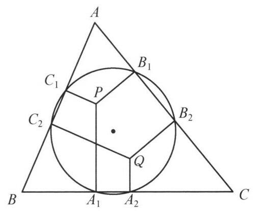
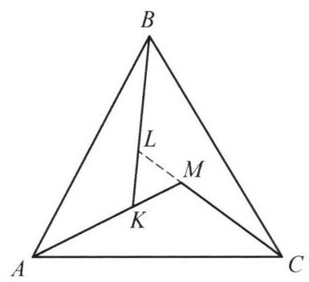

设圆 $O$ 与 $\bigtriangleup {ABC}$ 的边 ${BC},{CA},{AB}$ 分别交于点 ${A}_1$ 和 ${A}_2,{B}_1$ 和 ${B}_2,{C}_1$ 和 ${C}_2$ . 已知由点 ${A}_1,{B}_1,{C}_1$ 分别引 ${BC},{CA},{AB}$ 的垂线交于点 $P$ . 证明: 过 ${A}_2$ , ${B}_2,{C}_2$ 分别引 ${BC},{CA},{AB}$ 的垂线也交于一点.

证明

如图，由条件知，过 ${C}_1$ ， ${C}_2$ 垂直于 ${AB}$ 的两条直线关于圆心 $O$ 中心对称. 同理，过 ${A}_1$ ， ${A}_2$ 垂直于 ${BC}$ 的两条直线及过 ${B}_1$ ， ${B}_2$ 垂直于 ${AC}$ 的两条直线都关于 $O$ 中心对称.

将直线 $P{C}_1, P{A}_1, P{B}_1$ 绕 $O$ 旋转 ${180}^{ \circ  }$ 正好落在过 ${C}_2,{A}_2,{B}_2$ 分别垂直于 ${AB},{BC},{CA}$ 的直线上，点 $P$ 关于点 $O$ 中心对称点恰是过 ${C}_2,{A}_2,{B}_2$ 分别垂直于 ${AB},{BC},{CA}$ 的三条直线的交点，故原问题得证.

第 1 题

第 2 题
