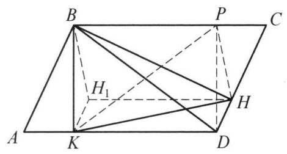
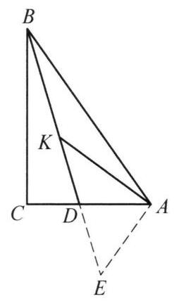

由平行四边形 ${ABCD}$ 的顶点引它的高 ${BK}$ 和 ${BH}$ ,已知 ${KH} = a,{BD} = \; b$ ,求点 $B$ 到 $\bigtriangleup {BKH}$ 的垂心 ${H}_1$ 的距离.

证明

如图,因为 $K{H}_1 \bot  {BH},{DH} \bot  {BH}$ ,所以 $K{H}_1//{DH}$ ,又 $H{H}_1 \bot  {BK},{DK} \bot  {BK}$ , 故 $H{H}_1//{DK}$ ,于是四边形 ${KDH}{H}_1$ 为平行四边形.

作平移变换 $T\left( \overrightarrow{{H}_{1}H}\right)$ ,则 $K$ 变到 $D,{H}_1$ 变到 $H, B$ 变到 ${BC}$ 上某点 $P$ ,故 ${PH} \bot  B{H}_1$ . 又 $B{H}_1 \bot  {KH}$ ,所以 ${PH} \bot  {KH}$ . 即在 Rt $\bigtriangleup {PHK}$ 中, ${PH} = \; \sqrt{P{K}^2 - K{H}^2}$ ,则四边形 ${BPDK}$ 为矩形,所以 ${PK} = {BD} = b$ ,故 ${PH} = \sqrt{{b}^2 - {a}^2}$ , 即 $B{H}_1 = \sqrt{{b}^2 - {a}^2}$ . 原问题得解.

第 10 题

第 11 题
