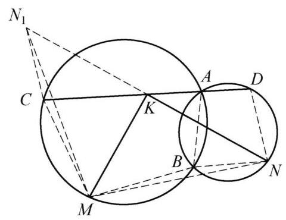
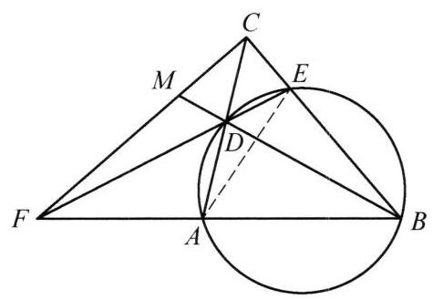

两个圆交于 $A, B$ 两点,经过点 $A$ 的直线再次与第一个圆交于点 $C$ ,与第二个圆交于点 $D$ . 设 $M, N$ 分别为不包含点 $A$ 的弧 $\overset{\text{ ⏜ }}{BC}$ 和弧 $\overset{\text{ ⏜ }}{BD}$ 的中点,点 $K$ 是线段 ${CD}$ 的中点. 证明: $\angle {MKN} = {90}^{ \circ  }$ .

证明

如图，设 ${N}_1$ 为 $N$ 关于点 $K$ 的对称点. 由 ${KN} = K{N}_1,{KC} = {KD}$ 及 $\angle {N}_1{KC} = \; \angle {NKD}$ ，知 $\bigtriangleup  {KC}{N}_1 \cong   \bigtriangleup  {KDN}$ ，因此， $C{N}_1 = {ND}$ ， $\angle {N}_1{CK} = \angle {NDK} = {180}^{ \circ  } - \; \angle {ABN}$ ，而 $\angle {MCK} = {180}^{ \circ  } - \angle {ABM}$ . 两式相加得 $\angle {N}_1{CM} = \angle {MBN}$ . 由题设条件，知 ${CM} = {MB},{BN} = {ND} = {CN}$ ，这说明 $\bigtriangleup  {MC}{N}_1 \cong   \bigtriangleup  {MBN}$ ，则 $M{N}_1 = {MN}$ ，而线段 ${MK}$ 是等腰三角形 $\bigtriangleup {MN}{N}_1$ 的中线，于是 $\angle {MKN} = {90}^{ \circ  }$ . 原问题得证.

第 14 题

第 15 题
