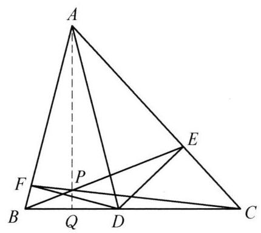
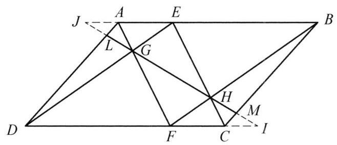

设 $D$ 是锐角 $\bigtriangleup {ABC}$ 的边 ${BC}$ 上一点,从点 $D$ 分别作 ${AC},{AB}$ 的垂线,垂足分别为 $E, F$ ,直线 ${BE}$ 和 ${CF}$ 交于点 $P$ . 证明: ${AP} \bot  {BC}$ 的充要条件是 ${AD}$ 平分 $\angle {BAC}$ .

证明

如图,设 $Q$ 是点 $A$ 在 ${BC}$ 上的投影,则由题设条件得 $\bigtriangleup {ABQ} \backsim  \bigtriangleup {DBF}$ ,于是 $\frac{BF}{DF} = \; \frac{BQ}{AQ}$ . 同理可得 $\frac{CE}{DE} = \frac{CQ}{AQ}$ ,于是 $\frac{CE}{BF} = \frac{DE}{DF} \cdot  \frac{CQ}{BQ}$ ,故

$$
\frac{BQ}{QC} \cdot  \frac{CE}{AE} \cdot  \frac{AF}{FB} = \frac{BQ}{CQ} \cdot  \frac{AF}{AE} \cdot  \frac{CE}{FB}
$$

$$
= \frac{BQ}{CQ} \cdot  \frac{AF}{AE} \cdot  \frac{DE}{DF} \cdot  \frac{CQ}{BQ}
$$

$$
= \frac{AF}{AE} \cdot  \frac{DE}{DF} = \frac{AF}{DF} \cdot  \frac{DE}{AE}.
$$

由塞瓦定理

${AQ},{BE},{CF}$ 三线共点 $\Leftrightarrow  \frac{BQ}{QC} \cdot  \frac{CE}{AE} \cdot  \frac{AF}{FB} = 1$

$$
\Leftrightarrow  \frac{AF}{DF} \cdot  \frac{DE}{AE} = 1
$$

$$
\Leftrightarrow  \frac{AF}{DF} = \frac{AE}{DE}
$$

$$
\Leftrightarrow  \bigtriangleup {ADF} \backsim  \bigtriangleup {ADE}
$$

$$
\Leftrightarrow  \angle {FAD} = \angle {EAD}
$$

$$
\Leftrightarrow  {AD}\text{ 平分 }\angle {BAC}\text{ . }
$$

但 ${AP} \bot  {BC} \Leftrightarrow  A, P, Q$ 三点共线 $\Leftrightarrow  {AQ},{BE},{CF}$ 三线共点.

故 ${AP} \bot  {BC} \Leftrightarrow  {AD}$ 平分 $\angle {BAC}$ . 原问题得证.

第 16 题

第 17 题
