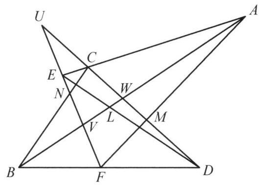

设 $A, C, E$ 为直线上三个点， $B, D, F$ 为另一直线上的三个点，直线 ${AB},{CD},{EF}$ 分别和 ${DE},{FA},{BC}$ 相交，交点分别为 $L, M, N$ . 证明: $L, M, N$ 三点共线.

证明

如图，设直线 ${EF}$ 与 ${CD}$ 交于点 $U$ ，直线 ${EF}$ 与 ${AB}$ 交于点 $V$ ，直线 ${CD}$ 与 ${AB}$ 交于点 $W$ .

对 $\bigtriangleup {UVW}$ 及直线 ${LDE}$ ， ${AMF}$ ， ${BCN}$ ， ${ACE}$ ， ${BDF}$ 应用梅涅劳斯定理，得

$$
\frac{VL}{LW} \cdot  \frac{WD}{DU} \cdot  \frac{UE}{EV} = 1
$$

①

$$
\frac{VA}{AW} \cdot  \frac{WM}{MU} \cdot  \frac{UF}{FV} = 1,
$$

②

$$
\frac{VB}{BW} \cdot  \frac{WC}{CU} \cdot  \frac{UN}{NV} = 1,
$$

③

$$
\frac{VA}{AW} \cdot  \frac{WC}{CU} \cdot  \frac{UE}{EV} = 1,
$$

④

$$
\frac{VB}{BW} \cdot  \frac{WD}{DU} \cdot  \frac{UF}{FV} = 1,
$$

⑤

$$
\frac{NV}{UN} \cdot  \frac{MU}{WM} \cdot  \frac{LW}{VL} = 1
$$

由梅涅劳斯定理的逆定理,知 $L, M, N$ 三点共线.

第 18 题

第 19 题
