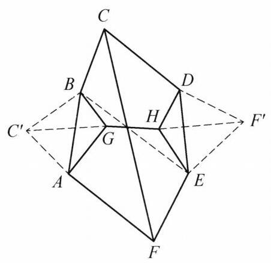
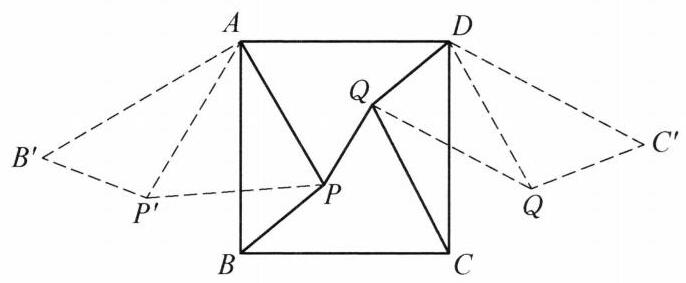

设 ${ABCDEF}$ 是凸六边形,满足 ${AB} = {BC} = {CD},{DE} = {EF} = {FA}$ , $\angle {BCD} = \angle {EFA} = {60}^{ \circ  }$ . 设 $G$ 和 $H$ 是这个六边形内部的两点,使得 $\angle {AGB} = \; \angle {DHE} = {120}^{ \circ  }$ . 证明:

$$
{AG} + {GB} + {GH} + {DH} + {HE} \geq  {CF}.
$$

证明

如图,以直线 ${BE}$ 为对称轴,作 $C$ 和 $F$ 关于直线 ${BE}$ 的对称点 ${C}^{\prime }$ 和 ${F}^{\prime }$ ,于是 ${C}^{\prime }{F}^{\prime } = \; {CF}$ ,且 $\bigtriangleup {AB}{C}^{\prime }$ 和 $\bigtriangleup {DE}{F}^{\prime }$ 为正三角形, $G\text{ 、 }H$ 分别在这两个三角形的外接圆上. 由托勒密定理, 有

$$
{C}^{\prime }G \cdot  {AB} = {AG} \cdot  {C}^{\prime }B + {GB} \cdot  {C}^{\prime }A,
$$

即 ${C}^{\prime }G = {AG} + {GB}$ . 同理,有 $H{F}^{\prime } = {DH} + {HE}$ ,于是

$$
{AG} + {GB} + {GH} + {DH} + {HE} =
$$

$$
{C}^{\prime }G + {GH} + H{F}^{\prime } \geq  {C}^{\prime }{F}^{\prime } = {CF}.
$$

原问题得证.

第 20 题

第 21 题
