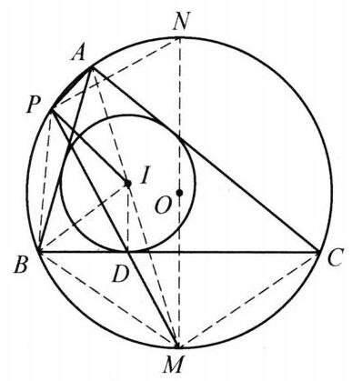

在 $\bigtriangleup {ABC}$ 中, ${AB} \neq  {AC}$ . 内切圆 $I$ 与边 ${BC}$ 切于点 $D$ ,直线 ${AI}$ 与 $\bigtriangleup {ABC}$ 的外接圆 $O$ 交于另一点 $M$ ,直线 ${DM}$ 与圆 $O$ 交于另一点 $P$ . 求 $\angle {API}$ 的大小.

证明

如图,不妨设 ${AB} < {AC}$ ,连接 ${BP},{BM},{MC},{DI},{AM},{PN}$ . 由熟知结论有 ${MB} = \; {MC} = {MI}$ . 又 $\angle {BPM} = \frac{1}{2}\angle {BAC} = \angle {MBC}$ ,则 $\bigtriangleup {DBM} \backsim  \bigtriangleup {BPM}$ ,故 $M{I}^2 = \; M{B}^2 = {MD} \cdot  {MP}$ ,于是 $\bigtriangleup {MPI} \backsim  \bigtriangleup {MID}$ ,从而 $\angle {MPI} = \angle {MID}$ .

设 $N$ 为点 $M$ 的对径点. 由 ${ID}//{MN}$ ,知 $\angle {MID} = \angle {AMO}$ . 则 $\angle {API} = \; \angle {APM} - \angle {IPM} = \angle {APM} - \angle {AMN} = \angle {APM} - \angle {APN} = \angle {NPM} = {90}^{ \circ  }$ . 原问题得解.

第 28 题

第 29 题
