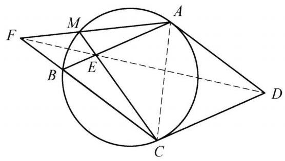

已知菱形 ${ABCD}$ 中， $\angle A = {120}^{ \circ  }$ . 圆 $O$ 为 $\bigtriangleup {ABC}$ 的外接圆， $M$ 为其上一点，连接 ${MC}$ 交 ${AB}$ 于点 $E,{AM}$ 交 ${CB}$ 的延长线于点 $F$ . 证明: $D, E, F$ 三点共线.

证明

如图，连接 ${AC},{DF},{DE}$ . 因为点 $M$ 在圆 $O$ 上，所以 $\angle {AMC} = {60}^{ \circ  } = \angle {ABC} = \; \angle {ACB}$ ，则 $\bigtriangleup  {AMC} \backsim   \bigtriangleup  {ACF}$ ，于是 $\frac{MC}{MA} = \frac{CF}{CA} = \frac{CF}{CD}$ . 又因为 $\angle {AMC} = \angle {BAC}$ ，所以 $\bigtriangleup {AMC} \backsim  \bigtriangleup {EAC}$ ，则 $\frac{MC}{MA} = \frac{AC}{AE} = \frac{AD}{AE}$ ，所以 $\frac{CF}{CD} = \frac{AD}{AE}$ . 又 $\angle {BAD} = \angle {BCD} = \; {120}^{ \circ  }$ ，则 $\bigtriangleup  {CFD} \backsim   \bigtriangleup  {ADE}$ ，因此 $\angle {ADE} = \angle {DFB}$ . 因为 ${AD}//{BC}$ ，所以 $\angle {ADF} = \; \angle {DFB} = \angle {ADE}$ ，于是 $F, E, D$ 三点共线. 原问题得证.

第 3 题

第 4 题
