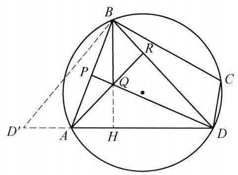

在圆内接四边形 ${ABCD}$ 中,已知 ${AB} = {BC},{AD} = {3DC}, R$ 为对角线 ${BD}$ 上一点,满足 ${DR} = {2RB}, Q$ 为线段 ${AR}$ 上一点,且满足 $\angle {ADQ} = \angle {BDQ}$ . 设 $P$ 为线段 ${AB}$ 与直线 ${DQ}$ 的交点,若 $\angle {ABQ} + \angle {CBD} = \angle {QBD}$ . 求 $\angle {APD}$ 的度数.

证明

如图，以 $B$ 为旋转中心旋转 $\bigtriangleup  {BCD}$ ，使得 ${BC}$ 与 ${BA}$ 重合，点 $D$ 转到 ${D}^{\prime }$ .

注意到 $\angle {BA}{D}^{\prime } + \angle {DAB} = \angle {BCD} + \angle {DAB} = {180}^{ \circ  }$ ，故 ${D}^{\prime }$ ， $A$ ， $D$ 三点共线. 延长 ${BQ}$ 与 ${AD}$ 交于点 $H$ ，由 $\angle {D}^{\prime }{BA} = \angle {DBC}$ ，有 $\angle {D}^{\prime }{BQ} = \angle {D}^{\prime }{BA} + \angle {ABQ} = \; \angle {DBC} + \angle {ABQ} = \angle {QBD}$ ,故 $\bigtriangleup {D}^{\prime }{BH} \cong  \bigtriangleup {DBH}$ ，于是 ${D}^{\prime }H = {HD}$ . 因为 ${AD} = \; {3DC} = 3{D}^{\prime }A$ ，所以 ${D}^{\prime }H = \frac{1}{2}{D}^{\prime }D = 2{D}^{\prime }A$ . 于是 $\frac{AH}{AD} = \frac{1}{3}$ . 对 $\bigtriangleup  {BHD}$ 及直线 ${RA}$ ，由梅涅劳斯定理，得 $\frac{DR}{RB} \cdot  \frac{BQ}{QH} \cdot  \frac{HA}{AD} = 1$ ，因此 $\frac{BQ}{QH} = \frac{3}{2}$ ，又 $\angle {ADQ} = \angle {BDQ}$ ，则 $\frac{BD}{DH} = \; \frac{BQ}{QH} = \frac{3}{2}$ ，因此 ${BD} = \frac{3}{2}{DH} = {3AH} = {DA}$ ，所以 ${DP}\bot {AB}$ ，即 $\angle {APD} = {90}^{ \circ  }$ .

第 30 题

第 31 题
