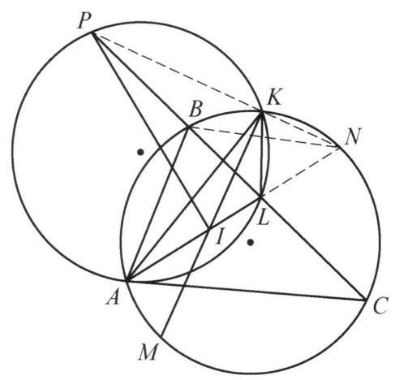
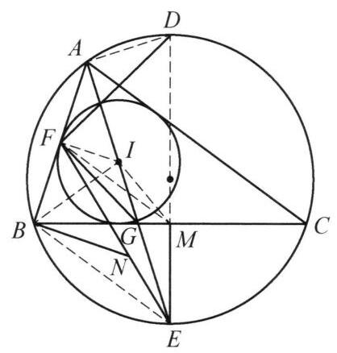

设 $M$ 是非等腰 $\bigtriangleup {ABC}$ 的外接圆圆弧 $\overset{\text{ ⏜ }}{BAC}$ 的中点, $I$ 是 $\bigtriangleup {ABC}$ 的内心, 点 $L$ 在边 ${BC}$ 上, ${AL}$ 为 $\angle {BAC}$ 的平分线, ${MI}$ 与 $\bigtriangleup {ABC}$ 的外接圆的第二个交点为 $K,\bigtriangleup {AKL}$ 的外接圆与直线 ${BC}$ 的第二个交点为 $P$ . 证明: $\angle {AIP} = {90}^{ \circ  }$ .

证明

如图,延长 ${AL}$ 与 $\bigtriangleup {ABC}$ 的外接圆交于点 $N$ ,则

$$
\angle {PKM} = \angle {PKA} + \angle {AKM}
$$

$$
= \angle {PLA} + \angle {AKM}
$$

$$
= \angle {NAC} + \angle {LCA} + \angle {AKM}
$$

$$
= \angle {BAN} + \angle {LCA} + \angle {AKM}
$$

$$
= \frac{1}{2}\overset{\text{ ⏜ }}{BN} + \frac{1}{2}\overset{\text{ ⏜ }}{AB} + \frac{1}{2}\overset{\text{ ⏜ }}{AM}
$$

$$
= \frac{1}{2}\overset{\text{ ⏜ }}{MKN} = {90}^{ \circ  }\text{ . }
$$

又 $\angle {MKN} = {90}^{ \circ  }$ ,所以, $P, K, N$ 三点共线.

由 $\angle {LNB} = \angle {ANB}$ 及 $\angle {NBL} = \angle {NAC} = \angle {NAB}$ 知 $\bigtriangleup {NBL} \backsim  \bigtriangleup {NAB}$ ,故 $N{I}^2 = N{B}^2 = {NL} \cdot  {NA} = {NK} \cdot  {NP}$ 结合 $\angle {INK} = \angle {INP}$ 知 $\bigtriangleup {IKN} \backsim  \bigtriangleup {PIN}$ , 所以 $\angle {PIN} = \angle {IKN} = {90}^{ \circ  }$ ,即 $\angle {AIP} = {90}^{ \circ  }$ . 原问题得证.

第 34 题

第 35 题
