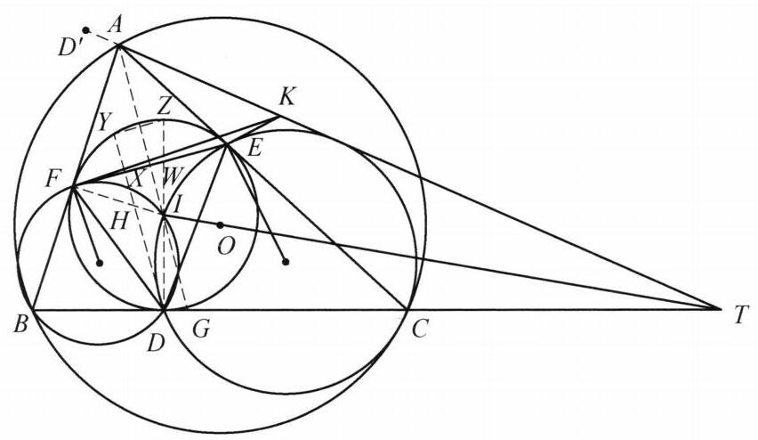

设 $\bigtriangleup {ABC}$ 的外心为 $O$ ,内心为 $I.\bigtriangleup {ABC}$ 的内切圆与 ${BC},{CA},{AB}$ 的切点分别为 $D, E, F$ . 点 $K$ 满足 ${KF}$ 与 $\bigtriangleup {BFD}$ 的外接圆相切, ${KE}$ 与 $\bigtriangleup {CED}$ 的外接圆相切. 证明: ${BC},{OI},{AK}$ 三线共点.

证明

如图, 首先证明下面的引理:

第 37 题

作 $D$ 关于 ${EF}$ 的对称点 ${D}^{\prime }$ ,则 $A{D}^{\prime },{OI},{BC}$ 三线共点.

引理的证明: 设 $\bigtriangleup {DEF}$ 的垂心为 $H,{DH}$ 与 ${EF}$ 交于点 $X,{DH}$ 与圆 $I$ 交于点 $Y,{AI}$ 与 ${EF}$ 交于点 $W,{DI}$ 与圆 $I$ 交于点 $Z,{AI}$ 与 ${BC}$ 交于点 $G$ .

由 $\bigtriangleup {AFI} \backsim  \bigtriangleup {FWI}$ ,得 $\frac{AI}{r} = \frac{AI}{IF} = \frac{FI}{IW} = \frac{r}{\frac{1}{2}{DH}} = \frac{2r}{DH}$ ,其中 $r$ 为圆 $I$ 的半径.

由 $\bigtriangleup {DYZ} \backsim  \bigtriangleup {IDG}$ ,得 $\frac{2r}{DY} = \frac{DZ}{DY} = \frac{IG}{ID} = \frac{IG}{r}$ .

所以, $\frac{AI}{IG} = \frac{DY}{DH}$ .

因为 ${HX} = {XY},{DY} = {D}^{\prime }H$ ,所以 $\frac{AI}{IG} = \frac{{D}^{\prime }H}{DH}$ ,又 $O, H, I$ 三点共线,故 $A{D}^{\prime }$ , ${BC},{OI}$ 三线共点.

引理得证. 回到原题.

取点 $K$ 关于 $\bigtriangleup {AEF}$ 的等角共轭点 ${K}^{\prime }$ ,则

$$
\angle {K}^{\prime }{EF} = \angle {KEA} = \angle {EDC} = \angle {DFE} = \angle {D}^{\prime }{FE}.
$$

同理可得 $\angle {K}^{\prime }{FE} = \angle {D}^{\prime }{EF}$ .

所以, $E{D}^{\prime }{K}^{\prime }F$ 为等腰梯形,因此, $A,{D}^{\prime }, K$ 三点共线,即 ${AK},{OI},{BC}$ 三线共点.
