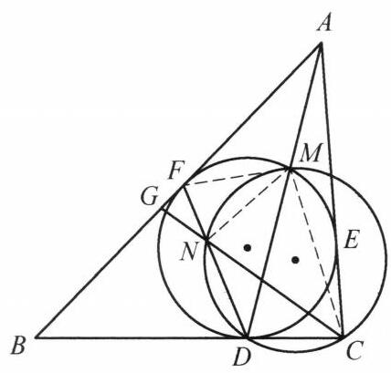

设 $\bigtriangleup {ABC}$ 的内切圆 $I$ 分别与边 ${BC},{CA},{AB}$ 切于点 $D, E, F.{AD}$ 与圆 $I$ 交于点 $M, N$ 为 $\bigtriangleup {CDM}$ 的外接圆与 ${DF}$ 的交点, ${CN}$ 与 ${AB}$ 交于点 $G$ . 证明: ${CD} = {3FG}$ .

证明

如图,连接 ${FM},{MN},{CM}$ ,则由题设条件,知 $\angle {FMD} = \angle {BFD} = \angle {BDF} = \; \angle {NMC}$ . 又结合 $\angle {FDM} = \angle {NCM}$ ,有 $\bigtriangleup {FMD} \backsim  \bigtriangleup {NMC}$ ,于是 $\angle {DFM} = \; \angle {CNM},\angle {FMD} = \angle {NMC}$ ,所以 $\angle {FMN} = \angle {DMC}$ ,结合 $\angle {CDM} = \angle {DFM} = \; \angle {NFM}$ ,知 $\bigtriangleup {FMN} \backsim  \bigtriangleup {DMC}$ . 因此 $\frac{FN}{CD} = \frac{MF}{MD}$ .

第 38 题

又 $\frac{MF}{DF} = \frac{AF}{AD}$ ,于是 ${FN} = \frac{CD}{MD} \cdot  \frac{AF}{AD} \cdot  {DF}$ ,即

$$
\frac{FN}{FD} = \frac{{CD} \cdot  {AF}}{{MD} \cdot  {AD}} = \frac{{CD} \cdot  {AF}}{\left( {{AD} - {AM}}\right)  \cdot  {AD}} = \frac{{CD} \cdot  {AF}}{A{D}^2 - A{F}^2}.
$$

设 ${AE} = {AF} = x,{BD} = {BF} = y,{CD} = {CE} = z$ ,则在三角形 ${ACD}$ 中,由余弦定理, 得

$$
A{D}^2 = A{C}^2 + C{D}^2 - {2AC} \cdot  {CD}\cos \angle {ACD}
$$

$$
= {\left( x + z\right) }^2 + {z}^2 - {2z}\left( {x + z}\right) \cos \angle {ACD}.
$$

①

在三角形 ${ABC}$ 中,由余弦定理,得

$$
\cos \angle {ACD} = \frac{B{C}^2 + A{C}^2 - A{B}^2}{{2BC} \cdot  {AC}}
$$

$$
= \frac{{\left( y + z\right) }^2 + {\left( x + z\right) }^2 - {\left( x + y\right) }^2}{2\left( {y + z}\right) \left( {x + z}\right) }.
$$

②

由①②得

$$
A{D}^2 = \frac{{x}^{2}y + {x}^{2}z + {4xyz}}{y + z},
$$

而 $A{D}^2 - A{F}^2 = A{D}^2 - {x}^2 = \frac{4xyz}{y + z}$ .

所以 $\frac{FN}{FD} = \frac{y + z}{4y}$ .

对三角形 ${CDN}$ 及直线 ${BGF}$ ,由梅涅劳斯定理,得

$$
\frac{CG}{GN} \cdot  \frac{NF}{FD} \cdot  \frac{DB}{BC} = 1.
$$

故 $\frac{CG}{GN} = \frac{{BC} \cdot  {FD}}{{DB} \cdot  {NF}} = \frac{y + z}{y} \cdot  \frac{4y}{y + z} = 4$ ,所以 ${CN} = {3GN}$ .

又由正弦定理得 $\frac{\sin \angle {FNG}}{\sin \angle {GFN}} = \frac{FG}{GN},\frac{\sin \angle {CND}}{\sin \angle {NDC}} = \frac{CD}{CN}$ .

即 $\frac{FG}{GN} = \frac{CD}{CN}$ . 于是由 ${CN} = {3GN}$ 得 ${CD} = {3FG}$ . 原问题得证.
