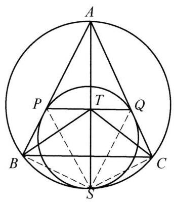
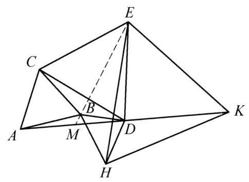

设 $\bigtriangleup {ABC}$ 内接于圆 $\omega$ ,圆 $r$ 与边 ${AB}$ 、 ${AC}$ 分别切于点 $P, Q$ ,与圆 $\omega$ 切于点 $S$ ,连接 ${AS}$ 和 ${PQ}$ ,记 ${AS}$ 与 ${PQ}$ 交于点 $T$ . 证明: $\angle {BTP} = \angle {CTQ}$ .

证明

如图,连接 ${BS},{PS},{QS},{CS}$ ,则 ${PS}$ 平分 $\angle {ASB},{QS}$ 平分 $\angle {ASC}$ ,于是

$$
\frac{BS}{BP} = \frac{AS}{AP} = \frac{AS}{AQ} = \frac{SC}{CQ}.
$$

①

而

$$
\frac{PT}{QT} = \frac{{S}_{\bigtriangleup {APT}}}{{S}_{\bigtriangleup {AQT}}} = \frac{\sin \angle {BAS}}{\sin \angle {CAS}} = \frac{SB}{SC}.
$$

②

由①，②得 $\frac{PT}{QT} = \frac{BP}{CQ}$ . 又 $\angle {BPT} = \angle {CQT}$ ，则 $\bigtriangleup  {BPT} \backsim   \bigtriangleup  {CQT}$ . 故 $\angle {BTP} = \; \angle {CTQ}$ . 原问题得证.

第 8 题

第 9 题
