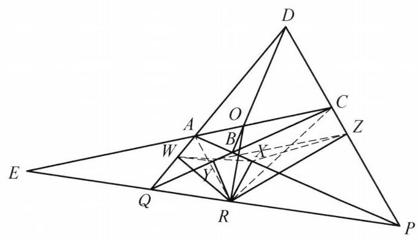

## 题目 (4.md)

例 3 设四边形 ${ABCD}$ 为凸四边形, ${AC}$ 与 ${BD},{AB}$ 与 ${CD},{AD}$ 与 ${BC}$ 分别交于点 $O, P, Q$ ,点 $O$ 在 ${PQ}$ 上的投影为 $R$ . 证明: 点 $R$ 在四边形 ${ABCD}$ 四边上的投影共圆.

证明 如图 5-8,设点 $R$ 在四边形 ${ABCD}$ 四边上的投影分别为 $X, Y, Z$ , $W$ ,则 $X, Y, Z, W$ 四点共圆 $\Leftrightarrow  \angle {XWY} = \angle {XZY}$ . 而 $\angle {XWY} = \angle {XWR} - \; \angle {YWR}$ . 注意到 $A, W, R, X;Q, W, Y, R$ 分别四点共圆,于是 $\angle {XWR} = \; \angle {XAR},\angle {YWR} = \angle {YQR}$ . 从而 $\angle {XWY} = \angle {XWR} - \angle {YWR} = \angle {XAR} - \angle {YQR}$ .

图 5-8

同理可得 $\angle {XZY} = \angle {YCR} - \angle {XPR}$ .

所以

$$
\angle {XWY} = \angle {XZY} \Leftrightarrow  \angle {XAR} + \angle {XPR} = \angle {YCR} + \angle {YQR}
$$

$$
\Leftrightarrow  \angle {ARQ} = \angle {CRP}\text{ . }
$$

下面证明: $\angle {ARQ} = \angle {CRP}$ .

延长 ${CA}$ 与 ${PQ}$ 交于点 $E$ . 对 $\bigtriangleup {DAC}$ 和直线 ${PQE},\bigtriangleup {ACP}$ 和直线 ${BOD}$ , $\bigtriangleup {DAP}$ 和直线 ${QBC}$ 分别用梅涅劳斯定理得

$$
\frac{QA}{DQ} \cdot  \frac{PD}{CP} \cdot  \frac{EC}{AE} = 1,
$$

$$
\frac{AO}{OC} \cdot  \frac{CD}{DP} \cdot  \frac{PB}{BA} = 1,
$$

$$
\frac{DQ}{QA} \cdot  \frac{AB}{BP} \cdot  \frac{PC}{CD} = 1
$$

将上述三式相乘,得 $\frac{AE}{EC} = \frac{AO}{OC}$ ,即 $C, O, A, E$ 成调和点列,又 $\angle {ORE} = {90}^{ \circ  }$ , 所以 $\angle {ARO} = \angle {CRO}$ ,故 $\angle {ARQ} = \angle {CRP}$ . 原问题得证.

这是一个费解的证明。我能确认每一步的正确性，但我想知道这是怎么想出来的。请为我解释。

---

\begin{solution}

这份证明之所以让人觉得“神来之笔、摸不着头脑”，是因为教材作者在成文时**拆掉了倒推的脚手架**，并且为了规避超纲概念，**把一个非常经典的射影几何定理硬生生拆成了三次梅涅劳斯定理**[cite: 1]。

如果我们把作者隐藏在草稿纸背后的真实思维还原出来，这道题其实是由**两个极其标准化的几何模块**拼接而成的。

---

## 一、 前半段揭秘：看似诡异的导角是怎么“倒推”出来的？

前半段的目标是证明垂足四边形 $XYZW$ 四点共圆[cite: 1]。面对这类“一点 $R$ 向四条直线作垂线”的**垂足圆（Pedal Circle）问题**，几何中只有一套标准动作：**利用共斜边的直角三角形四点共圆，把垂足之间的夹角还原回点 $R$ 与原图形交点的连线夹角**[cite: 1]。

但这里有三个让人困惑的细节，我们逐一拆解：

### 1. 为什么偏偏选了 $\angle XWY = \angle XZY$ 来导角？
四边形的四条边两两相交，一共有 **6 个交点**：原四边形的四个顶点 $A, B, C, D$，以及对边延长线的交点 $P, Q$[cite: 1]。
* 题目的核心已知条件是“$O$ 在 $PQ$ 上的投影为 $R$”，这意味着 **$P, Q$ 是必须被用上的核心点**[cite: 1]。
* 观察哪两个垂足和 $Q$ 绑在一起：$W \in AD, Y \in BC$，而 $AD \cap BC = Q$，因此 $Q, W, Y, R$ 四点共圆（以 $QR$ 为直径）[cite: 1]。这强烈暗示我们**应该把 $W$ 和 $Y$ 连起来**，因为弦 $WY$ 对应的圆周角可以直接转化到点 $Q$ 上[cite: 1]！
* 同理，$X \in AB, Z \in CD$，而 $AB \cap CD = P$，因此 $P, X, Z, R$ 四点共圆（以 $PR$ 为直径），这暗示我们**应该把 $X$ 和 $Z$ 绑在一起**[cite: 1]。
* 既然 $WY$ 和 $XZ$ 是天然的桥梁，要证 $X, Y, Z, W$ 共圆，最自然的切入点就是以 $XY$ 为公共弦，去证圆周角 $\angle XWY = \angle XZY$[cite: 1]。

### 2. 为什么证明里只出现了顶点 $A, C$，而顶点 $B, D$ 彻底消失了？
一旦选定了 $\angle XWY = \angle XZY$ 并以点 $R$ 为核心拆角（$\angle XWY = \angle XWR - \angle YWR$）：
* $\angle YWR$ 在圆 $(Q,W,Y,R)$ 中，顺理成章转化为 $\angle YQR$（用上了点 $Q$）[cite: 1]；
* $\angle XWR$ 涉及垂足 $X$（在边 $AB$ 上）和垂足 $W$（在边 $AD$ 上），这两条边的交点恰好是 $A$[cite: 1]！所以在以 $AR$ 为直径的圆 $(A,W,R,X)$ 中，$\angle XWR$ 自然就转化成了 $\angle XAR$[cite: 1]。
* 同理，右侧的 $\angle XZY = \angle YZR - \angle XZR$ 自动激活了交点 $C$（$BC \cap CD$）和交点 $P$（$AB \cap CD$）[cite: 1]。

**【思维盲区点破】**：并不是 $B, D$ 不能用！这题对两条对角线 $AC$ 和 $BD$ 是完全对称的[cite: 1]。如果你一开始选择证 $\angle WXY = \angle WZY$（以 $WY$ 为公共弦），那么导角就会自动激活顶点 $B, D, P, Q$，最后归结为证明 $\angle BRQ = \angle DRP$，同样能证出来！作者只是在对称的两组顶点 $(A,C)$ 和 $(B,D)$ 中任选了 $(A,C)$ 一组而已[cite: 1]。

### 3. 从 $\angle XAR + \angle XPR = \angle YCR + \angle YQR$ 是怎么跳到 $\angle ARQ = \angle CRP$ 的？
书上这一步跳得非常快，而且故意保留了字母 $X, Y$，掩盖了极其简单的几何本质[cite: 1]：
* 注意到点 $X$ 本来就在直线 $AP$（即边 $AB$）上，所以 **$\angle XAR$ 就是 $\angle PAR$，$\angle XPR$ 就是 $\angle APR$**[cite: 1]！
* 观察 $\triangle APR$：$\angle PAR + \angle APR$ 是它的两个内角之和[cite: 1]。由于 $Q, R, P$ 三点共线，根据**三角形外角定理**，$\triangle APR$ 在顶点 $R$ 处的外角正是 $\angle ARQ$[cite: 1]！因此直接有：
  $$\angle XAR + \angle XPR = \angle PAR + \angle APR = \angle ARQ$$
* 完全同理，因为 $C, Y, Q$ 共线（边 $BC$），在 $\triangle CQR$ 中利用外角定理，直接有[cite: 1]：
  $$\angle YCR + \angle YQR = \angle QCR + \angle CQR = \angle CRP$$

看穿了这层窗户纸，前半段其实就是：**把垂足四点共圆倒推还原，发现只需证明 $\angle ARQ = \angle CRP$**[cite: 1]。

---

## 二、 后半段揭秘：“三个梅氏定理相乘”背后的真正剧本

证明推到 $\angle ARQ = \angle CRP$（由于 $OR \perp PQ$，这等价于证明 $RO$ 平分 $\angle ARC$）时，教材突然拉出三个三角形连用三次梅涅劳斯定理，然后相乘消项[cite: 1]。这绝对不是作者在草稿纸上盲目试出来的，而是**射影几何中两个经典定理的“初等伪装”**：

### 1. 真正的幕后主角：完全四边形的调和性质 + 直角引理
在熟悉高等几何或竞赛几何的人眼中，看到题目给出的构型（四边形对边交于 $P, Q$，对角线交于 $O$，延长 $AC$ 交 $PQ$ 于 $E$），脑海中会立刻浮现两个现成的定理[cite: 1]：

1. **完全四边形的调和点列定理**：在完全四边形 $ABCDPQ$ 中，对角线 $AC$ 被另一条对角线交点 $O$ 以及对边交点连线 $PQ$ 的交点 $E$ **调和分割**，即 $C, O, A, E$ 成调和点列（$\frac{AE}{EC} = \frac{AO}{OC}$）[cite: 1]。
2. **调和线束的直角引理**：若直线上四点满足 $(C, A; O, E) = -1$，且直线外一点 $R$ 满足 $\angle ORE = 90^\circ$，则 $RO$ 和 $RE$ 必分别是 $\angle ARC$ 的内角平分线和外角平分线（即 $\angle ARO = \angle CRO$，从而 $\angle ARQ = \angle CRP$）[cite: 1]！

也就是说，在作者的脑海里，**从已知条件到 $\angle ARQ = \angle CRP$ 其实是一步到位的秒杀**[cite: 1]！

### 2. 为什么要写那三个梅涅劳斯定理？
因为这本教材在当前章节不便直接引用“完全四边形必出调和点列”这个结论作为已知定理，作者必须现场给 $\frac{AE}{EC} = \frac{AO}{OC}$ 补一个初等证明[cite: 1]。

那么，怎么用梅涅劳斯定理硬证 $\frac{AE}{EC} = \frac{AO}{OC}$？这也是一个**高度套路化的消元操作**[cite: 1]：
1. **第一步（锁定目标项 $\frac{AE}{EC}$）**：点 $A, C, E$ 在一条直线上，把 $AC$ 当作 $\triangle DAC$ 的一条边，用割线 $PQE$ 去截 $\triangle DAC$，列出第一个梅氏定理，抓出 $\frac{EC}{AE}$[cite: 1]。
2. **第二步（锁定目标项 $\frac{AO}{OC}$）**：点 $A, O, C$ 在一条直线上，把 $AC$ 当作 $\triangle ACP$ 的一条边，用割线 $BOD$ 去截 $\triangle ACP$，列出第二个梅氏定理，抓出 $\frac{AO}{OC}$[cite: 1]。
3. **第三步（专门清理残余项）**：把前两个式子相乘后，除了我们要的 $\frac{EC}{AE}$ 和 $\frac{AO}{OC}$，还剩下一堆“垃圾项”：$\frac{QA}{DQ}$、$\frac{PB}{BA}$、$\frac{CD}{DP}$[cite: 1]。观察分母和分子上的点：$D, Q, A$ 共线，$A, B, P$ 共线，$P, C, D$ 共线——这三条线恰好围成了外框大三角形 $\triangle DAP$，而多出来的三个分点 $Q, B, C$ 恰好共线[cite: 1]！于是对 $\triangle DAP$ 和割线 $QBC$ 列出第三个梅氏定理，把所有多余的线段比一次性约得干干净净[cite: 1]。

---

## 三、 总结：还原整道题的真实思维链条

如果把作者隐藏的思考过程铺平，整道题采用的是非常典型的**“两头凑（双向奔赴）”**策略：

1. **由因导果（正向直觉）**：
   看到“凸四边形对边交于 $P, Q$，对角线交于 $O$” $\xrightarrow{\text{完全四边形基本性质}}$ 延长 $CA$ 交 $PQ$ 于 $E$，必有调和点列 $(C, A; O, E) = -1$[cite: 1] $\xrightarrow{\text{结合条件 } OR \perp PQ}$ 触发调和点列直角引理，立刻得知 **$RO$ 平分 $\angle ARC$（即 $\angle ARQ = \angle CRP$）**[cite: 1]。（同理可知 $RO$ 也平分 $\angle BRD$）。
2. **执果索因（逆向拆解）**：
   要证四边垂足 $X, Y, Z, W$ 共圆 $\xrightarrow{\text{以 } XY \text{ 为弦}}$ 需证 $\angle XWY = \angle XZY$[cite: 1] $\xrightarrow{\text{利用 } RA, RQ, RC, RP \text{ 四圆消去垂足}}$ 转化为 $\angle XAR + \angle XPR = \angle YCR + \angle YQR$[cite: 1] $\xrightarrow{\triangle APR \text{ 与 } \triangle CQR \text{ 的外角定理}}$ 发现只需证 **$\angle ARQ = \angle CRP$**[cite: 1]。
3. **完美合龙**：
   正向推出的核心性质与逆向化简的最终需求在 $\angle ARQ = \angle CRP$ 处精准会师，最后把逆向过程倒过来写、把完全四边形的调和性质拆成三个梅氏定理写进正文，就成了书上那段看似天马行空的证明[cite: 1]。

\end{solution}