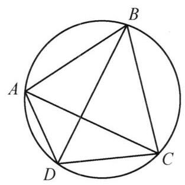
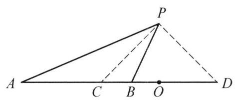
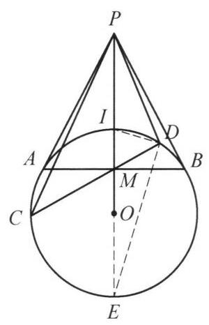
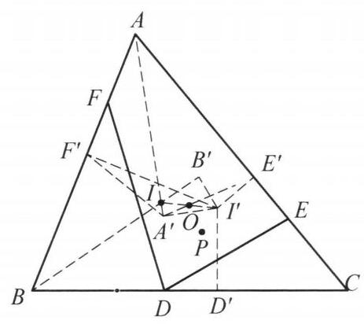
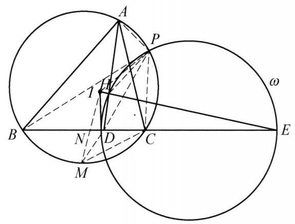
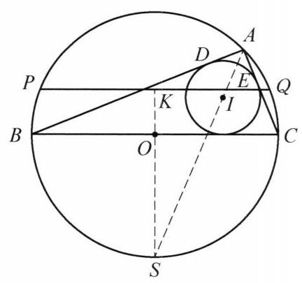

## 第五讲 圆的基本性质

## 知识精讲

圆是平面几何中最优美的图形，与圆有关的平面几何问题占据了平面几何问题的大部分.

一、关于四点共圆，有如下结论.

图 5-1

设 ${ABCD}$ 是一个凸四边形，则下面三个结论等价:

(1) $A$ ， $B$ ， $C$ ， $D$ 四点共圆；

(2) $\angle {ABC} + \angle {CDA} = {180}^{ \circ  }$ ；

(3) $\angle {ABD} = \angle {ACD}$ .

二、设 $A, C, B, D$ 四点共线，且 $C, D$ 分别内分与外分 ${AB}$ 成同一比值，即 $\frac{AC}{CB} = \frac{AD}{DB}$ ，则称 $C$ ， $D$ 调和分割线段 ${AB}, A, C, B, D$ 称为调和点列.

三、设 $P$ 为平面上的点， $P$ 到线段 ${AB}$ 的端点的距离的比为常数，即 $\frac{AP}{BP}$ 为常数，则点 $P$ 的轨迹为一个圆，这个圆称为阿波罗尼斯圆. 该圆与直线 ${AB}$ 的交点调和分割线段 ${AB}$ ，其圆心为这两个交点的中点.

图 5-2

事实上,延长 ${AB}$ 至点 $D$ ,使得

$$
\frac{AC}{CB} = \frac{AP}{PB} = \frac{AD}{DB} = k.
$$

由角平分线定理,知 ${PC}$ 平分 $\angle {APB},{PD}$ 平分 $\angle {APB}$ 的外角. 故 $\angle {CPD} = {90}^{ \circ  }$ . 又 $C, D$ 两点确定,取 ${CD}$ 的中点 $O$ ,则点 $P$ 的轨迹是以 $O$ 为圆心, ${OC}$ 为半径的圆.

由上面的说明可知如下四个结论中, 若有两个成立, 可推出另外两个成立:

(1) ${PC}$ 平分 $\angle {APB}$ ；

(2) ${PD}$ 平分 $\angle {APB}$ 的外角；

(3) $\angle {CPD} = {90}^{ \circ  }$ ；

(4) $A, B, C, D$ 成调和点列.

四、设 $D, E, F$ 分别 $\bigtriangleup {ABC}$ 的三边 ${BC},{CA},{AB}$ 上的三点,则平面上存在一个点在三个圆 ${AEF}$ 、圆 ${BFD}$ 及圆 ${CDE}$ 上,这个点称为 $\bigtriangleup {ABC}$ 的密克点.

图 5-3

图 5-4

图 5-5

## 典型例题

图 5-6

---

例 1 设点 $P$ 为圆 $O$ 外一点,直线 ${PA},{PB}$ 与圆 $O$ 分别相切于点 $A, B.{PO}$ 与弦 ${AB}$ 交于点 $M$ ,与圆 $O$ 交于点 $I$ . 过 $M$ 任作一条不同于 ${AB}$ 的弦 ${CD}$ . 证明: $I$ 为 $\bigtriangleup {PCD}$ 的内心.

证明 如图 5-6,设 ${PO}$ 的延长线与圆 $O$ 交于点 $E$ ,则 $P, I, M, E$ 成调和点列,连接 ${ID},{DE}$ ,则 $\angle {IDE} = {90}^{ \circ  }$ ,于是 ${DI}$ 平分 $\angle {PDM}$ . 同理可得 ${CI}$ 平分 $\angle {PCM}$ . 所以 $I$ 为 $\bigtriangleup {PCD}$ 的内心. 原问题得证.

注:调和点列是证明角平分线或垂直的一个重要工具.

---

例 2 设直线 $l$ 与 $\bigtriangleup {ABC}$ 的边 ${AB},{AC}$ 的延长线交于点 $D, E$ . 直线 $l$ 关于 ${BC}$ 的垂直平分线的对称直线 ${l}^{\prime }$ 交 ${AB},{AC}$ 的延长线于 ${D}^{\prime },{E}^{\prime }$ . 若 ${BD} + {CE} = \; {DE}$ . 证明: $B{D}^{\prime } + C{E}^{\prime } = {D}^{\prime }{E}^{\prime }$ .

图 5-7

证明 如图 5-7,在 ${DE}$ 上取点 $R$ ,使得 ${BD} = {DR}$ , 则由题设条件得 ${CE} = {ER}$ . 设 $\bigtriangleup {RBC}$ 的外心为 $O$ ,则 ${OD},{OE}$ 分别垂直平分 ${BR},{CR}$ ,即 $O$ 是 $\bigtriangleup {ADE}$ 的内心.

由于

$$
\angle A + \angle {BOC} = \angle A + 2\angle {BRC}
$$

$$
= \angle A + {360}^{ \circ  } - 2\angle {BRD} - 2\angle {CRE}
$$

$$
= \angle A + \angle {ADE} + \angle {AED}
$$

$$
= {180}^{ \circ  }\text{ . }
$$

因此, $A, B, O, C$ 四点共圆.

设 $R$ 关于 ${BC}$ 的垂直平分线的对称点为 ${R}^{\prime }$ ,则 ${R}^{\prime }$ 在 ${l}^{\prime }$ 上,因为 $\angle O{R}^{\prime }{D}^{\prime } = \; \angle {ORE} = {180}^{ \circ  } - \angle {OB}{D}^{\prime }$ ,所以, $O, B,{D}^{\prime },{R}^{\prime }$ 四点共圆,又 ${OB} = {OR} = O{R}^{\prime }$ ,故 $O{D}^{\prime }$ 平分 $\angle A{D}^{\prime }{E}^{\prime }$ ,同理 $O{E}^{\prime }$ 平分 $\angle A{E}^{\prime }{D}^{\prime }$ ,即 $O$ 是 $\bigtriangleup A{D}^{\prime }{E}^{\prime }$ 的内心.

在 ${D}^{\prime }{E}^{\prime }$ 上取点 $K$ ,使得 $K{D}^{\prime } = B{D}^{\prime }$ ,则 $\bigtriangleup {OB}{D}^{\prime } \cong  \bigtriangleup {OK}{D}^{\prime }$ ,于是 $\angle {BO}{D}^{\prime } = \; \angle {KO}{D}^{\prime }$ . 因为 $\angle {D}^{\prime }O{E}^{\prime } = \frac{1}{2}\angle A + {90}^{ \circ  }$ 及 $\angle {BOC} = {180}^{ \circ  } - \angle A$ ,所以 $\angle {BO}{D}^{\prime } + \; \angle {CO}{E}^{\prime } = {90}^{ \circ  } + \frac{1}{2}\angle A$ ,故 $\angle {CO}{E}^{\prime } = \angle {KO}{E}^{\prime }$ ,所以 $\bigtriangleup {OC}{E}^{\prime } \cong  \bigtriangleup {OK}{E}^{\prime }$ ,则 $C{E}^{\prime } = \; K{E}^{\prime }$ ,结合 $K{D}^{\prime } = B{D}^{\prime }$ ,知 $B{D}^{\prime } + C{E}^{\prime } = {D}^{\prime }{E}^{\prime }$ . 原问题得证.

注: 通过截长补短处理条件,利用 $\bigtriangleup {ADE}$ 与 $\bigtriangleup A{D}^{\prime }{E}^{\prime }$ 重合的内心 $O$ 构建两个三角形性质的关联.

---

例 3 设四边形 ${ABCD}$ 为凸四边形, ${AC}$ 与 ${BD},{AB}$ 与 ${CD},{AD}$ 与 ${BC}$ 分别交于点 $O, P, Q$ ,点 $O$ 在 ${PQ}$ 上的投影为 $R$ . 证明: 点 $R$ 在四边形 ${ABCD}$ 四边上的投影共圆.

证明 如图 5-8,设点 $R$ 在四边形 ${ABCD}$ 四边上的投影分别为 $X, Y, Z$ , $W$ ,则 $X, Y, Z, W$ 四点共圆 $\Leftrightarrow  \angle {XWY} = \angle {XZY}$ . 而 $\angle {XWY} = \angle {XWR} - \; \angle {YWR}$ . 注意到 $A, W, R, X;Q, W, Y, R$ 分别四点共圆,于是 $\angle {XWR} = \; \angle {XAR},\angle {YWR} = \angle {YQR}$ . 从而 $\angle {XWY} = \angle {XWR} - \angle {YWR} = \angle {XAR} - \angle {YQR}$ .

图 5-8

同理可得 $\angle {XZY} = \angle {YCR} - \angle {XPR}$ .

所以

$$
\angle {XWY} = \angle {XZY} \Leftrightarrow  \angle {XAR} + \angle {XPR} = \angle {YCR} + \angle {YQR}
$$

$$
\Leftrightarrow  \angle {ARQ} = \angle {CRP}\text{ . }
$$

下面证明: $\angle {ARQ} = \angle {CRP}$ .

延长 ${CA}$ 与 ${PQ}$ 交于点 $E$ . 对 $\bigtriangleup {DAC}$ 和直线 ${PQE},\bigtriangleup {ACP}$ 和直线 ${BOD}$ , $\bigtriangleup {DAP}$ 和直线 ${QBC}$ 分别用梅涅劳斯定理得

$$
\frac{QA}{DQ} \cdot  \frac{PD}{CP} \cdot  \frac{EC}{AE} = 1,
$$

$$
\frac{AO}{OC} \cdot  \frac{CD}{DP} \cdot  \frac{PB}{BA} = 1,
$$

$$
\frac{DQ}{QA} \cdot  \frac{AB}{BP} \cdot  \frac{PC}{CD} = 1
$$

将上述三式相乘,得 $\frac{AE}{EC} = \frac{AO}{OC}$ ,即 $C, O, A, E$ 成调和点列,又 $\angle {ORE} = {90}^{ \circ  }$ , 所以 $\angle {ARO} = \angle {CRO}$ ,故 $\angle {ARQ} = \angle {CRP}$ . 原问题得证.

---

例 4 设圆 $O$ 为 $\bigtriangleup {ABC}$ 的外接圆,点 $K$ 在边 ${BC}$ 上且不为 ${BC}$ 的中点, $D$ 为 ${AK}$ 延长线上一点, ${AB}$ 与 ${CD}$ 的延长线交于点 $E,{AC}$ 与 ${BD}$ 的延长线交于点 $F$ , 且 ${OK} \bot  {EF}$ . 证明: $D$ 在圆 $O$ 上.

证明 如图 5-9,设 ${OK}$ 的延长线与 ${EF}$ 交于点 $H,{CB}$ 与 ${FE}$ 的延长线交于点 $G$ . 在完全四边形 ${ABEDCF}$ 中,对角线 ${BC}$ 被对角线 ${AD}$ , ${EF}$ 调和分割,即 $G, B, K, C$ 为调和点列,又 $\angle {GHK} = {90}^{ \circ  }$ ,故 ${HK}$ 平分 $\angle {BHC}$ . 结合 ${OB} = \; {OC}$ ,知 $O, B, H, C$ 四点共圆. 于是

$$
\angle {EHB} = {90}^{ \circ  } - \angle {BHO} = {90}^{ \circ  } - \angle {BCO}
$$

$$
= \frac{1}{2}\angle {BOC} = \angle {BAC},
$$

图 5-9

则 $A, B, H, F$ 四点共圆.

同理可得, $A, E, H, C$ 四点共圆.

所以, $H$ 为完全四边形 ${ABCDEF}$ 的密克点,因此, $C, D, H, F;B, D, H$ , $E$ 分别四点共圆,故

$$
\angle {ABD} = \angle {EHD} = \angle {DCF},
$$

即 $A, B, C, D$ 四点共圆. 原问题得证.

注: 由于 $A, B, D, C$ 共圆等价于完全四边形 ${ABEDFC}$ 的密克点在 ${EF}$ 上, 因此只需证明 $H$ 为密克点,即可得到四点共圆.

---

例 5 如图,以 ${AB}$ 为直径的圆 ${\omega }_1$ 和以 $A$ 为圆心的圆 ${\omega }_2$ 相交于 $C, D$ 两点, 点 $E$ 在圆 ${\omega }_2$ 上( $E$ 在 ${\omega }_1$ 外且和点 $C$ 在直线 ${AB}$ 同侧). ${BE}$ 与 ${\omega }_2$ 交于另一点 $F$ ， 点 $K$ 在 ${\omega }_1$ 上且满足 ${2CK} \cdot  {AC} = {CE} \cdot  {AB}$ (点 $K$ 与点 $A$ 在过点 $C$ 的圆 ${\omega }_1$ 的直径的同一侧), ${KF}$ 与 ${\omega }_1$ 交于另一点 $L, D$ 关于 ${BE}$ 的对称点为 ${D}^{\prime }$ . 证明: $L, F, C$ , ${D}^{\prime }$ 四点共圆.

图 5-10

证明 如图 5-10,由题设条件 ${2CK} \cdot  {AC} = \; {CE} \cdot  {AB}$ 得 $\frac{CK}{CE} = \frac{CO}{AC} = \frac{KO}{AE}$ ,所以 $\bigtriangleup {OCK} \backsim \; \bigtriangleup {ACE}$ ,于是

$$
\angle {CLF} = \frac{1}{2}\angle {COK} = \frac{1}{2}\angle {CAE} = \angle {CFE}.
$$

在 ${EF}$ 上取一点 $T$ ,使得

$$
\frac{FT}{FD} = \frac{CE}{CD}.
$$

①

因为 $\angle {DFT} = \angle {DCE}$ ，所以 $\bigtriangleup  {DFT} \backsim   \bigtriangleup  {DCE}$ ，则 $\angle {FDT} = \angle {CDE} = \; \angle {CFE}$ . 又因为 $\angle {DET} = \angle {DCF}$ ， $\angle {DTE} = {180}^{ \circ  } - \angle {DTF} = {180}^{ \circ  } - \angle {DEC} = \; \angle {DFC}$ ,故 $\bigtriangleup {DTE} \backsim  \bigtriangleup {DFC}$ ,于是

$$
\frac{ET}{DE} = \frac{CF}{CD}.
$$

②

因为 $\angle {BCA} = \angle {BDA} = {90}^{ \circ  }$ ，所以， ${BD},{BC}$ 是圆 ${\omega }_2$ 的切线，于是 $\bigtriangleup  {BFC} \backsim \; \bigtriangleup  {BCE}, \bigtriangleup  {BFD} \backsim   \bigtriangleup  {BDE}$ ，则

$$
\frac{CE}{CF} = \sqrt{\frac{BE}{BF}} = \frac{DE}{DF}.
$$

③

将①式除②式得 $\frac{FT}{ET} \cdot  \frac{DE}{DF} = \frac{CE}{CF}$ ，结合③得 ${FT} = {ET}$ ，因此， $\angle {ATB} = {90}^{ \circ  }$ ，则点 $T$ 在 ${\omega }_1$ 上.

由 $\overset{\text{ ⏜ }}{BC} = \overset{\text{ ⏜ }}{BD}$ 得 $\angle {CTB} = \angle {DTB} = \angle {D}^{\prime }{TB}$ ,因此 $T, C,{D}^{\prime }$ 三点共线，故 $\angle F{D}^{\prime }C = \angle F{D}^{\prime }T = \angle {FDT} = \angle {CFT} = \angle {CLF}$ ,所以, $L, F, C,{D}^{\prime }$ 四点共圆. 原问题得证.

注:由条件寻找相似三角形，通过四边形的性质联想到添出对角线的中点，进而通过分析性质，得出结论.

---

例 6 设 $\bigtriangleup  {ABC}$ 的外心，内心分别为 $O, I$ ，点 $D, E, F$ 分别在边 ${BC},{CA}, \; {AB}$ 上满足 ${BD} + {BF} = {CA},{CD} + {CE} = {AB}$ . 若 $\bigtriangleup  {BFD}$ 与 $\bigtriangleup  {CDE}$ 的外接圆交于不同于 $D$ 的点 $P$ . 证明: ${OP} = {OI}$ .

图 5-11

证明 如图 5-11，作 $I$ 关于 $O$ 的对称点 ${I}^{\prime }$ ， 过 ${I}^{\prime }$ 向 ${BC},{CA},{AB}$ 作垂线,垂足分别为 ${D}^{\prime }$ , ${E}^{\prime },{F}^{\prime }$ ,过 ${I}^{\prime }$ 作 ${I}^{\prime }{A}^{\prime } \bot  {IA}$ 于 ${A}^{\prime },{I}^{\prime }{B}^{\prime } \bot  {IB}$ 于 ${B}^{\prime }$ . 则 $B{F}^{\prime } + B{D}^{\prime } = {CA}, C{D}^{\prime } + C{E}^{\prime } = {AB}$ . 所以, $D{D}^{\prime } = E{E}^{\prime } = F{F}^{\prime }.$

因为 $\angle {I}^{\prime }{A}^{\prime }A = \angle {I}^{\prime }{F}^{\prime }A = \angle {I}^{\prime }{E}^{\prime }A = {90}^{ \circ  }$ ,所以, $A,{F}^{\prime },{A}^{\prime },{E}^{\prime }$ 四点共圆. 由 $\angle {BAI} = \; \angle {CAI}$ ,知 ${A}^{\prime }{F}^{\prime } = {A}^{\prime }{E}^{\prime }$ ,又 $\angle {A}^{\prime }{F}^{\prime }A = \angle {A}^{\prime }{E}^{\prime }C$ , 于是 $\bigtriangleup {A}^{\prime }{F}^{\prime }F \cong  \bigtriangleup {A}^{\prime }{E}^{\prime }E$ ,因此, $\angle {A}^{\prime }F{F}^{\prime } = \; \angle {A}^{\prime }E{E}^{\prime }$ ,则 $A, E,{A}^{\prime }, F$ 四点共圆.

同理, $B, D,{B}^{\prime }, F$ 四点共圆.

由 $\angle {PFA} = \angle {PDB} = \angle {PEC}$ ,知 $A, F, P, E$ 四点共圆,故 $A, F,{A}^{\prime }, P$ 四点共圆, $B, F,{B}^{\prime }, P$ 四点共圆. 所以

$$
\angle P{B}^{\prime }I + \angle P{A}^{\prime }I = \angle P{B}^{\prime }B + \angle P{A}^{\prime }A = \angle {PFB} + \angle {PFA} = {180}^{ \circ  },
$$

因此, $P,{B}^{\prime }, I,{A}^{\prime }$ 四点共圆,又因为 $\angle {I}^{\prime }{A}^{\prime }I = \angle {I}^{\prime }{B}^{\prime }I = {90}^{ \circ  }$ ,所以, $P$ 在以 $I{I}^{\prime }$ 为直径的圆上,即 ${OP} = {OI}$ . 原问题得证.

注: 先找出一些以 $O$ 为圆心, ${OI}$ 为半径的圆上的点,再证明点 $P$ 与它们共圆,因而有 ${OP} = {OI}$ .

---

例 7 设 $I$ 是 $\bigtriangleup {ABC}$ 的内心, $D$ 是边 ${BC}$ 上一点, $E$ 是 ${BC}$ 延长线上点且满足 $\frac{BD}{DC} = \frac{BE}{EC}$ . 点 $H$ 在 ${IE}$ 上且 ${DH} \bot  {IE}$ . 证明: $\angle {AHE} = \angle {IDE}$ .

证明 如图 5-12,以线段 ${DE}$ 为直径作圆 $\omega$ . 记 $\frac{BD}{DC} = \frac{BE}{EC} = \lambda$ ,则圆 $\omega$ 是到点 $B$ ,点 $C$ 的距离比为 $\lambda$ 的点的轨迹,即阿波罗尼斯圆.

图 5-12

设 $P$ 为 $\bigtriangleup {ABC}$ 的外接圆与圆 $\omega$ 的交点,则 $\frac{PB}{PC} = \frac{DB}{DC}$ ,于是 ${PD}$ 是 $\angle {BPC}$ 的角平分线. 设 $M$ 是弧 $\overset{\text{ ⏜ }}{BC}$ 的中点,则 $P, D, M$ 三点共线,所以 $\angle {MCB} = \frac{1}{2}\angle A = \; \angle {MAC} = \angle {MPC}$ ，结合 $\angle {CMN} = \angle {CMA}$ 及 $\angle {CMD} = \angle {CMP}$ ，知 $\bigtriangleup  {MCN} \backsim \; \bigtriangleup  {MAC}, \bigtriangleup  {MCD} \backsim   \bigtriangleup  {MPC}$ ，于是 ${MN} \cdot  {MA} = M{C}^2 = {MD} \cdot  {MP}$ . 由鸡爪定理，有 $M{C}^2 = M{I}^2$ ，则 $M{I}^2 = {MD} \cdot  {MP}$ ，所以， $A, N, D, P$ 四点共圆且 $\bigtriangleup  {MDI} \backsim \; \bigtriangleup  {MIP}$ ，于是 $\angle {PHE} = \angle {PDE} = \angle {PAN}$ ， $\angle {MID} = \angle {MPI}$ ，所以， $A$ ， $I$ ， $H$ ， $P$ 四点共圆，故 $\angle {AHI} = \angle {API} = \angle {APD} - \angle {IPD} = \angle {ANB} - \angle {MID} = \angle {BDI}$ ， 即 $\angle {AHE} = \angle {IDE}$ . 原问题得证.

注:添出点 $P$ 并不容易，有了 $P$ 点后利用调和点列得到几何性质，进而导角得到要证的结论.

---

例 8 在 $\bigtriangleup {ABC}$ 中， $\angle A = {90}^{ \circ  }, D, E$ 分别为 $\bigtriangleup {ABC}$ 的内切圆与 ${AB},{AC}$ 的切点，边 ${BC}$ 的中位线所在直线与 $\bigtriangleup  {ABC}$ 的外接圆交于点 $P$ ， $Q$ . 证明: $D$ ， $E$ ， $P$ ， $Q$ 四点共圆.

图 5-13

证明 如图 5-13，设 $I$ ， $O$ 分别为 $\bigtriangleup  {ABC}$ 的内心、外心， ${AI}$ 的延长线与 $\bigtriangleup  {ABC}$ 的外接圆的第二个交点为 $S$ ，则点 $D$ ， $E$ 关于 ${AS}$ 对称，点 $P$ ， $Q$ 关于 ${OS}$ 对称，故只需证明 ${SD} = {SP}$ .

设 ${OS} \bot  {PQ}$ 于点 $K$ ，记 $r$ ， $R$ 分别为 $\bigtriangleup  {ABC}$ 的内切圆、外接圆的半径， $h$ 为点 $A$ 到 ${BC}$ 的距离.

由 $\angle {BAC} = {90}^{ \circ  }$ ，得 ${SI} = {SB} = \sqrt{2}R$ ， $\angle {DIS} = \; {180}^{ \circ  } - \angle {AID} = {135}^{ \circ  }$ . 于是由余弦定理得 $S{D}^2 =$

$$
S{I}^{2} + I{D}^{2} - {2SI} \cdot  {ID}\cos \angle {SID} = 2{R}^{2} + {r}^{2} + {2Rr}\text{ . 而 }S{P}^{2} = S{K}^{2} + O{P}^{2} - O{K}^{2} =
$$

${\left( R + \frac{h}{2}\right) }^2 + {R}^2 - {\left( \frac{h}{2}\right) }^2 = 2{R}^2 + {Rh}$ . 故只需证明

$$
{r}^2 + {2Rr} = {Rh}.
$$

①

事实上, $\bigtriangleup {ABC}$ 的周长为

$$
{2P} = \left( {{AD} + {AE}}\right)  + \left( {{BD} + {CE}}\right)  + {BC}
$$

$$
= {2r} + {2BC} = {2r} + {4R}.
$$

故 ${r}^2 + {2Rr} = \left( {r + {2R}}\right) r = {Pr} = {S}_{\bigtriangleup {ABC}} = \frac{1}{2}{BC} \cdot  h = {Rh}$ ,即①成立.

因此, 原问题得证.

注: 先定出圆心, 再通过基本量的表示证明线段相等.

---

例 9 设 $\omega$ 是一个过 $\bigtriangleup {ABC}$ 的顶点 $A, C$ 的圆,分别与边 ${AB},{BC}$ 交于另一点 $D, E$ . 圆 $\Gamma$ 与圆 $\omega$ 外切于点 $M$ ,且 $\Gamma$ 同时与边 ${AB},{BC}$ 相切. 证明: $\angle {AMC}$ 的角平分线过 $\bigtriangleup {ABC}$ 的内心.

图 5-14

证明 如图 5-14,设圆 $\Gamma$ 与 ${AB},{BC}$ 分别切于点 $P, Q.\bigtriangleup {APM}$ 的外接圆与 $\bigtriangleup {CQM}$ 的外接圆交于异于 $M$ 的一点 $I$ . 延长 ${CI}$ 交圆 ${AIMP}$ 于异于 $I$ 的点 ${C}^{\prime }$ ,延长 ${AI}$ 交圆 ${QMIC}$ 于异于点 $I$ 的点 ${A}^{\prime }$ ,则

$$
\angle {C}^{\prime }{PM} = \angle {MIC} = {180}^{ \circ  } - \angle {MQC}
$$

$$
= {180}^{ \circ  } - \angle {MPQ},
$$

$$
\angle {A}^{\prime }{QM} = \angle {MIA} = {180}^{ \circ  } - \angle {MPA}
$$

$$
= {180}^{ \circ  } - \angle {MQP},
$$

所以, ${C}^{\prime }, P, Q,{A}^{\prime }$ 共线.

过 $M$ 作圆 $\Gamma$ 和圆 $\omega$ 的公切线 ${MT}$ ,则

$$
{180}^{ \circ  } - \angle A{C}^{\prime }{A}^{\prime } = \angle {PMA} = \angle {PMT} + \angle {AMT}
$$

$$
= \angle {PQM} + \angle {MCA}
$$

$$
= \angle {MC}{A}^{\prime } + \angle {MCA}
$$

$$
= \angle {AC}{A}^{\prime },
$$

于是 $A, C,{A}^{\prime },{C}^{\prime }$ 四点共圆,故

$$
\angle {BAI} = \angle {PAI} = \angle C{C}^{\prime }{A}^{\prime } = \angle {CAI},
$$

$$
\angle {BCI} = \angle {QCI} = \angle A{A}^{\prime }{C}^{\prime } = \angle {ACI},
$$

所以, $I$ 是 $\bigtriangleup {ABC}$ 的内心.

又 $\angle {AMI} = \angle A{C}^{\prime }I = \angle A{C}^{\prime }C = \angle A{A}^{\prime }C = \angle {CMI}$ ,即 ${MI}$ 平分 $\angle {ABC}$ ,所以 $\angle {AMC}$ 的角平分线过 $\bigtriangleup {ABC}$ 的内心. 原问题得证.

注: 本题中点 $M$ 难以刻画,引入 ${A}^{\prime },{C}^{\prime }$ ,通过共圆来刻画 $M$ 的性质,剩下的问题就迎刃而解了.

