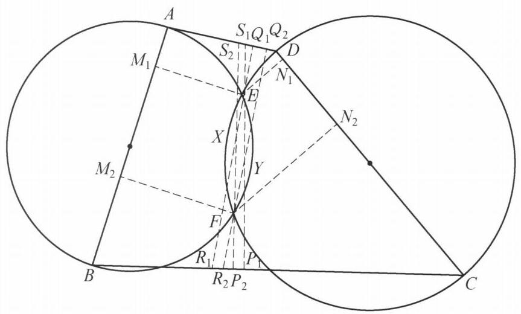

## 题目 (10.md)

例 9 凸四边形 ${ABCD}$ 中, ${AD}$ 不平行于 ${BC}$ . 分别以 ${AB},{CD}$ 为直径作圆, 设两圆交于 $E, F$ 两点,且 $E, F$ 均在四边形 ${ABCD}$ 形内. ${\omega }_E$ 是点 $E$ 在 ${AB},{BC}$ , ${CD}$ 上的投影的外接圆, ${\omega }_F$ 是点 $F$ 在 ${CD},{DA},{AB}$ 上的投影的外接圆. 证明: ${\omega }_E$ 与 ${\omega }_F$ 的根轴平分线段 ${EF}$ .

图 6-11

证明 如图 6-11,设点 $E$ 在 ${AB},{CD},{BC},{AD}$ 上的投影分别为 ${M}_1,{N}_1$ , ${P}_1,{Q}_1$ . 点 $F$ 在 ${AB},{CD},{BC},{AD}$ 上的投影分别为 ${M}_2,{N}_2,{P}_2,{Q}_2$ .

记 ${S}_1 = E{P}_1 \cap  {AD},{S}_2 = F{P}_2 \cap  {AD},{R}_1 = E{Q}_1 \cap  {BC},{R}_2 = F{Q}_2 \cap  {BC}, X = \; E{Q}_1 \cap  F{P}_2, Y = E{P}_1 \cap  F{Q}_2$ .

因为

$$
\angle {Q}_1{M}_1{P}_1 = \angle {Q}_1{M}_{1}E + \angle {P}_1{M}_{1}E
$$

$$
= \angle {EAD} + \angle {EBC}
$$

$$
= \angle {DAB} + \angle {ABC} - \left( {{180}^{ \circ  } - \angle {AEB}}\right)
$$

$$
= \angle {Q}_1{S}_{1}E + \angle E{P}_{1}C - {90}^{ \circ  }
$$

$$
= \angle {Q}_1{S}_{1}E
$$

$$
= \angle {P}_{1}{R}_{1}E\text{ . }
$$

所以, ${P}_1,{Q}_1,{M}_1,{R}_1,{S}_1$ 共圆,类似地 ${N}_1$ 也在该圆上,即 ${M}_1,{N}_1,{P}_1,{Q}_1$ , ${R}_1,{S}_1$ 均在 ${\omega }_E$ 上.

同理, ${M}_2,{N}_2,{P}_2,{Q}_2,{R}_2,{S}_2$ 均在 ${\omega }_F$ 上.

而 $\angle {P}_1 = \angle {P}_2 = \angle {Q}_1 = \angle {Q}_2 = {90}^{ \circ  }$ ,则 ${Q}_{1}X \cdot  X{R}_1 = {P}_{2}X \cdot  X{S}_2$ ,所以, $X$ 在 ${\omega }_E$ 与 ${\omega }_F$ 的根轴上.

同理, $Y$ 也在 ${\omega }_E$ 与 ${\omega }_F$ 的根轴上.

故 ${XY}$ 是 ${\omega }_E$ 与 ${\omega }_F$ 的根轴.

因为 ${P}_1{S}_1//{P}_2{S}_2,{Q}_1{R}_1//{Q}_2{R}_2$ ,所以 ${EXFY}$ 是平行四边形,于是 ${XY}$ 平分线段 ${EF}$ ,即 ${\omega }_E$ 与 ${\omega }_F$ 的根轴平分线段 ${EF}$ . 原问题得证.

注: 该问题的一个自然的想法是找出更多的圆 ${\omega }_E$ 和圆 ${\omega }_F$ 上的点,然后去刻画它们的根轴.

这是一个费解的证明。我能确认每一步的正确性，但我想知道这是怎么想出来的。请为我解释。

---

\begin{solution}

这个证明之所以让人觉得“像变魔术一样费解”，是因为教材采用了竞赛解答中典型的**“综合法（由因导果）”倒序书写**：它把最核心的几何直觉（平行四边形对角线互相平分）藏在了最后一行，却把为了配合这个直觉而构造的一堆辅助点（$R_i, S_i, X, Y$）毫无征兆地塞进了第一句话[cite: 1]。

如果把它的书写顺序倒过来，按照人类真实的破题思维——**“分析法（执果索因 / 逆向推导）”**来还原，你会发现每一步的构造不仅不突兀，反而是顺理成章、甚至是唯一自然的。

下面我们分四步完整还原这个证明的**逆向诞生过程**：

---

### 第一步：识破题面的“不对称障眼法”（补全四个垂足）

观察题目条件：
* 点 $E$ 和点 $F$ 的地位是完全对称的（都是两个直径圆的交点）[cite: 1]；
* $\omega_E$ 的定义只用了点 $E$ 在 $AB, BC, CD$ 三条边上的投影（唯独漏了 $AD$），而 $\omega_F$ 只用了点 $F$ 在 $CD, DA, AB$ 三条边上的投影（唯独漏了 $BC$）[cite: 1]。

在几何竞赛中，**“条件高度对称，但定义故意不对称”**往往是命题人设置的障眼法。面对这种不对称，最本能的第一反应就是：**点 $E$ 在第四条边 $AD$ 上的投影 $Q_1$ 其实也在 $\omega_E$ 上；点 $F$ 在第四条边 $BC$ 上的投影 $P_2$ 其实也在 $\omega_F$ 上[cite: 1]。**

一旦把 $Q_1$ 和 $P_2$ 补齐，$\omega_E$ 和 $\omega_F$ 就分别是点 $E, F$ 关于四边形 $ABCD$ 的“垂足圆”[cite: 1]。

---

### 第二步：从结论倒推——如何不靠计算证明“平分线段 $EF$”？

我们要证“根轴平分线段 $EF$”[cite: 1]。在纯几何中，如果不使用解析计算或中点公式，证明一条直线 $l$ 平分线段 $EF$ 最经典、最优雅的套路是什么？

答案是：**以 $EF$ 为一条对角线构造平行四边形 $EXFY$**，然后证明另一条对角线上的两个端点 $X, Y$ 都在根轴 $l$ 上[cite: 1]！只要 $X, Y$ 在根轴上，直线 $XY$ 就是根轴，而平行四边形的对角线互相平分，结论瞬间得证[cite: 1]。

那么，**利用图中现有的线，怎么过 $E, F$ 构造出天然的平行四边形？**
1. 题目为了定义 $\omega_E$ 和 $\omega_F$，已经从 $E, F$ 向四条边作了垂线[cite: 1]。
2. 注意到**垂直于同一条直线的两条垂线天然平行**！
3. 四条边中，$AB, CD$ 是用来作直径圆的，剩下的两条对边恰好是 $AD$ 和 $BC$（注意题目专门强调了一句**“$AD$ 不平行于 $BC$”**——为什么要给这个条件？就是为了保证 $AD$ 的垂线与 $BC$ 的垂线一定相交！[cite: 1]）。
4. 于是我们直接取这两对垂线：
   * 过 $E, F$ 作 $AD$ 的垂线：$EQ_1 \parallel FQ_2$（均垂直于 $AD$）[cite: 1]；
   * 过 $E, F$ 作 $BC$ 的垂线：$EP_1 \parallel FP_2$（均垂直于 $BC$）[cite: 1]。

把这两组平行线一交，设 $X = EQ_1 \cap FP_2$，$Y = EP_1 \cap FQ_2$，四边形 **$EXFY$ 天然就是一个平行四边形**[cite: 1]！这就是辅助点 $X, Y$ 诞生的真正原因。

---

### 第三步：如何证明 $X$ 在根轴上？（割线定理与 $R_1, S_2$ 的诞生）

有了平行四边形 $EXFY$，问题彻底转化为：**证明点 $X$（以及同理的点 $Y$）在 $\omega_E$ 与 $\omega_F$ 的根轴上**，即证点 $X$ 对两圆的圆幂相等：
$$\text{Pow}(X, \omega_E) = \text{Pow}(X, \omega_F)$$

怎么用几何方法表示点 $X$ 对两圆的圆幂？看一看经过点 $X$ 的两条现成直线：
* 直线 $EQ_1$ 经过点 $X$，且它上面的点 $Q_1$ 已经在圆 $\omega_E$ 上了[cite: 1]；
* 直线 $FP_2$ 经过点 $X$，且它上面的点 $P_2$ 已经在圆 $\omega_F$ 上了[cite: 1]。

要想写出圆幂，我们自然希望找到直线 $EQ_1$ 与 $\omega_E$ 的**第二个交点 $R_1$**，以及直线 $FP_2$ 与 $\omega_F$ 的**第二个交点 $S_2$**[cite: 1]。如果能找到它们，那么圆幂相等就等价于：
$$Q_1 X \cdot X R_1 = P_2 X \cdot X S_2$$

由相交弦/割线定理逆定理，上式成立当且仅当 **$Q_1, R_1, P_2, S_2$ 四点共圆**！

这时候，最精彩的一步来了——**$R_1$ 和 $S_2$ 在哪里时，$Q_1, R_1, P_2, S_2$ 会自动四点共圆？**
* 我们已知 $X R_1 \perp AD$ 于点 $Q_1$[cite: 1]。如果点 $S_2$ 恰好落在直线 $AD$ 上，那么 $\angle S_2 Q_1 R_1$ 就是天然的 $90^\circ$！
* 我们已知 $X S_2 \perp BC$ 于点 $P_2$[cite: 1]。如果点 $R_1$ 恰好落在直线 $BC$ 上，那么 $\angle S_2 P_2 R_1$ 也是天然的 $90^\circ$！

一旦 $\angle S_2 Q_1 R_1 = \angle S_2 P_2 R_1 = 90^\circ$，那么 $Q_1, P_2, R_1, S_2$ 四个点就**自动落在以 $R_1 S_2$ 为直径的圆上**，从而 $Q_1 X \cdot X R_1 = P_2 X \cdot X S_2$ 恒成立[cite: 1]！

这给了我们一个极其强烈的暗示：**去验证直线 $EQ_1$ 与 $BC$ 的交点 $R_1$ 是否真的在 $\omega_E$ 上，以及直线 $FP_2$ 与 $AD$ 的交点 $S_2$ 是否真的在 $\omega_F$ 上！**[cite: 1]

---

### 第四步：揭开六点共圆的真相——$\omega_E$ 的真实身份

现在只剩最后一个问题：为什么 $R_1 = EQ_1 \cap BC$ 和 $S_1 = EP_1 \cap AD$ 真的会落在圆 $\omega_E$ 上[cite: 1]？

书上的证明把“$P_1, Q_1, M_1, R_1, S_1$ 共圆”混在一起证，容易让人误以为 $R_1, S_1$ 是附带证出来的[cite: 1]。但事实恰恰相反：

1. **对于平面上任意一点 $E$，$P_1, Q_1, R_1, S_1$ 四点永远自动共圆！**
   为什么？因为 $Q_1, S_1$ 在直线 $AD$ 上，而 $R_1 Q_1 \perp AD$，所以 $\angle S_1 Q_1 R_1 = 90^\circ$；同理，$P_1, R_1$ 在直线 $BC$ 上，而 $S_1 P_1 \perp BC$，所以 $\angle S_1 P_1 R_1 = 90^\circ$[cite: 1]。
   （如果设 $T = AD \cap BC$，那么 $E$ 其实就是 $\triangle T R_1 S_1$ 的垂心，$P_1, Q_1$ 是两条高线的垂足。）
   因此，无论点 $E$ 在哪里，**$P_1, Q_1, R_1, S_1$ 都必然共圆，且这个圆就是以 $R_1 S_1$ 为直径的圆！**

2. **圆 $\omega_E$ 的真实身份，就是以 $R_1 S_1$ 为直径的圆！**
   既然 $P_1, Q_1, R_1, S_1$ 已经确定了一个以 $R_1 S_1$ 为直径的圆，那么要想证明 $M_1, N_1, P_1, Q_1, R_1, S_1$ 六点共圆，我们根本不需要去找什么复杂的圆，只需要证明：**当 $\angle AEB = 90^\circ$ 时，垂足 $M_1$ 也落在这个以 $R_1 S_1$ 为直径的圆上**（同理当 $\angle CED = 90^\circ$ 时，$N_1$ 也落在该圆上）[cite: 1]。

3. **倒角是怎么算出来的？**
   要证 $M_1$ 落在圆 $(P_1 Q_1 R_1 S_1)$ 上，只需证圆周角相等：
   $$\angle Q_1 M_1 P_1 = \angle Q_1 S_1 P_1 \quad (\text{即 } \angle Q_1 S_1 E)$$
   书上的那串倒角就是围绕这个目标展开的常规操作[cite: 1]：
   * **拆角**：把 $\angle Q_1 M_1 P_1$ 拆成 $\angle Q_1 M_1 E + \angle P_1 M_1 E$[cite: 1]。
   * **利用垂足四点共圆转角**：
     * 因为 $\angle A Q_1 E = \angle A M_1 E = 90^\circ$，所以 $A, Q_1, E, M_1$ 四点共圆（以 $AE$ 为直径），得 $\angle Q_1 M_1 E = \angle EAD$[cite: 1]；
     * 因为 $\angle B P_1 E = \angle B M_1 E = 90^\circ$，所以 $B, P_1, E, M_1$ 四点共圆（以 $BE$ 为直径），得 $\angle P_1 M_1 E = \angle EBC$[cite: 1]。
   * **代入唯一的核心条件 $\angle AEB = 90^\circ$**：
     在 $\triangle AEB$ 中，$\angle EAB + \angle EBA = 180^\circ - \angle AEB = 90^\circ$，因此：
     $$\angle EAD + \angle EBC = \angle DAB + \angle ABC - (\angle EAB + \angle EBA) = \angle DAB + \angle ABC - 90^\circ$$
   * **回到五边形 $A B P_1 E S_1$（或四边形内角和）**：
     在四边形 $A B P_1 S_1$ 中，利用 $\angle B P_1 S_1 = 90^\circ$，很容易把 $\angle DAB + \angle ABC - 90^\circ$ 化简为 $\angle Q_1 S_1 E$[cite: 1]。

---

### 思维脉络复盘

把整个探索过程串联起来，作者脑海中的真实路径是这样的：

$$\begin{aligned}
\text{欲证根轴平分 } EF &\xrightarrow{\text{几何模型}} \text{以 } EF \text{ 为对角线构造平行四边形 } EXFY \text{，转证 } X, Y \text{ 在根轴上} \\
&\xrightarrow{\text{寻找平行线}} \text{利用 } E, F \text{ 到 } AD, BC \text{ 的垂线天然平行，交出 } X, Y \\
&\xrightarrow{\text{欲证圆幂相等}} \text{需要割线 } EQ_1, FP_2 \text{ 与两圆的第二交点 } R_1, S_2 \text{ 满足 } Q_1, R_1, P_2, S_2 \text{ 共圆} \\
&\xrightarrow{\text{利用垂直条件}} \text{发现只要 } R_1 \in BC, S_2 \in AD \text{，就有双直角自动共圆} \\
&\xrightarrow{\text{回归原圆验证}} \text{发现 } (P_1 Q_1 R_1 S_1) \text{ 本身就是以 } R_1 S_1 \text{ 为直径的圆，只需倒角验证 } M_1, N_1 \text{ 在其上！}
\end{aligned}$$

你看，顺着这个方向想，每一步都是被目标“逼”出来的；而教材把最后一步放到了最前面写，才造就了那种“神来之笔”的错觉。对于这四个逆向步骤，你觉得哪一环的跨越最让你意外，或者想进一步探讨这题的其他证法（如代数计算或位似性质）吗？

\end{solution}