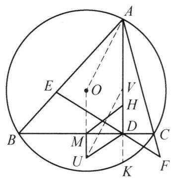

例 2 锐角 $\bigtriangleup {ABC}$ 中， ${AB} > {AC}, H$ 为其垂心， ${AD}\bot {BC}$ 于点 $D, E, F$ 在射线 ${AB},{AC}$ 上且 ${EF}$ 过点 $D$ ,满足 $B, E, C, F$ 四点共圆,其圆心为 $U, M$ 为 ${BC}$ 的中点. 证明: 四边形 ${MUDH}$ 为平行四边形.

图 6-4

证明 如图 6-4,设 $\bigtriangleup {ABC}$ 的外心为 $O$ ,延长 ${AD}$ 与圆 $O$ 交于点 $K$ .

由圆幂定理得 ${AD} \cdot  {DK} = {BD} \cdot  {DC} = {ED} \cdot  {DF}$ ,从而 $A, E, K, F$ 四点共圆. 设 $V$ 是 ${AK}$ 的中点,连接 ${OA}$ , ${OU},{UV}$ . 由 $A, B, K, C$ 和 $A, E, K, F$ 四点共圆,知 $K$ 为完全四边形 ${AEBDCF}$ 的密克点,则 $E, B, K, D$ 和 $D, K, F, C$ 都四点共圆,则 ${AK}$ 为圆 ${AEKF}$ 的直径.

由 $U, V$ 分别是圆 ${BECF}$ 和圆 ${AEKF}$ 的圆心,知 ${UV} \bot  {EF}$ ,导角易证 ${AO} \bot  {EF}$ ,故 ${UV}//{AO}$ ,又 ${OU}//{AV}$ ,则四边形 ${OAVU}$ 是平行四边形, 于是

$$
{MU} = {OU} - {OM} = {AV} - \frac{1}{2}{AH}
$$

$$
= \frac{1}{2}{AK} - \frac{1}{2}{AH} = \frac{1}{2}{HK} = {DH},
$$

所以，四边形 ${MUDH}$ 为平行四边形.

注:引入点 $K$ ，将命题转化为 ${MU} = {DK}$ ，通过共圆导出 ${AV} = {OU}$ 即可.

这是一个费解的证明。我能确认每一步的正确性，但我想知道这是怎么想出来的。请为我解释。