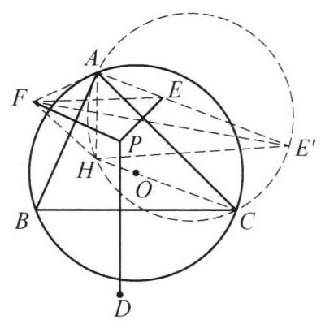

例 7 设锐角 $\bigtriangleup {ABC}$ 的外心为 $O$ ,垂心为 $H,\bigtriangleup {ABC}$ 内任一点 $P$ 关于 ${BC}$ , ${CA},{AB}$ 的对称点分别为 $D, E, F$ . 证明:

$$
\frac{{S}_{\bigtriangleup {HDE}}}{{S}_{\bigtriangleup {HDF}}} = \frac{{S}_{\bigtriangleup {OAB}}}{{S}_{\bigtriangleup {OAC}}}.
$$

证明 如图 6-9,设射线 ${AE}$ 与圆 ${AHC}$ 交于点 ${E}^{\prime }$ . 由 ${AP} = {AF} = {AE}$ 及 $\angle {EAF} = 2\angle {BAC}$ ，得 $\angle {AEF} = \; {90}^{ \circ  } - \angle {BAC} = \angle {ACH} = \angle {A{E}^{\prime }H}$ ，于是有 ${EF}// \; {E}^{\prime }H$ ，因此由正弦定理，得

$$
{S}_{\bigtriangleup {HEF}} = {S}_{\bigtriangleup E{E}^{\prime }F} = \frac{1}{2}{EF} \cdot  E{E}^{\prime } \cdot  \sin \angle {FE}{E}^{\prime }
$$

$$
= \frac{1}{2}{EF} \cdot  E{E}^{\prime } \cdot  \sin \angle {FEA}
$$

$$
= \frac{1}{2}{AF} \cdot  E{E}^{\prime } \cdot  \sin \angle {EAF}
$$

$$
= \frac{1}{2}{AE} \cdot  E{E}^{\prime } \cdot  \sin \angle {EAF}
$$

$$
= \frac{1}{2}{AE} \cdot  E{E}^{\prime } \cdot  \sin {2A}
$$

$$
= \frac{1}{2} \cdot  {I}_P \cdot  \sin {2A},
$$

图 6-9

其中 ${I}_P = {AE} \cdot  E{E}^{\prime }$ 是点 $P$ 对圆 $O$ 的幂的绝对值. (因为 $P$ 和 ${E}^{\prime }$ 关于 ${AC}$ 对称,圆 $O$ 和 $\bigtriangleup {ACH}$ 的外接圆也关于 ${AC}$ 对称,所以 $P$ 对圆 $O$ 的幂等于 $E$ 对 $\bigtriangleup {AHC}$ 外接圆的幂,最后还是要化到 $P$ 来处理. )

同理有

$$
{S}_{\bigtriangleup {HDE}} = \frac{1}{2} \cdot  {I}_P \cdot  \sin {2C},
$$

$$
{S}_{\bigtriangleup {HDF}} = \frac{1}{2} \cdot  {I}_P \cdot  \sin {2B}.
$$

设 $\bigtriangleup {ABC}$ 的外接圆半径为 $R$ ,则

$$
{S}_{\bigtriangleup {OAB}} = \frac{1}{2}{R}^2\sin {2C},
$$

$$
{S}_{\bigtriangleup {OAC}} = \frac{1}{2}{R}^2\sin {2B},
$$

$$
{S}_{\bigtriangleup {OBC}} = \frac{1}{2}{R}^2\sin {2A},
$$

所以

$$
\frac{{S}_{\bigtriangleup {HDE}}}{{S}_{\bigtriangleup {HDF}}} = \frac{{S}_{\bigtriangleup {OAB}}}{{S}_{\bigtriangleup {OAC}}}.
$$

原问题得证.

注: 通过等面积转化 ${S}_{\bigtriangleup {HDE}}$ ,将其表示成容易处理的形式是解决本题的关键.

这是一个费解的证明。我能确认每一步的正确性，但我想知道这是怎么想出来的。请为我解释。