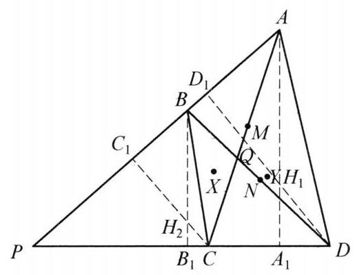

## 题目 (9.md)

例 8 在锐角 $\bigtriangleup {APD}$ 的边 ${AP}$ 和 ${PD}$ 上各取一点 $B, C$ ,四边形 ${ABCD}$ 的两条对角线相交于点 $Q,\bigtriangleup {APD}$ 和 $\bigtriangleup {BPC}$ 的垂心分别为 ${H}_1,{H}_2$ . 证明: 如果直线 ${H}_1{H}_2$ 经过 $\bigtriangleup {ABQ}$ 及 $\bigtriangleup {CDQ}$ 的外接圆的交点 $X$ ,那么,它必经过 $\bigtriangleup {BQC}$ 和 $\bigtriangleup {AQD}$ 的外接圆的交点 $Y$ .

证明 如图 6-10,记 ${AC},{BD}$ 的中点分别为 $M, N$ ,以 ${AC},{BD}$ 为直径作圆 ${\omega }_1,{\omega }_2$ . 作 $A{A}_1 \bot  {PD}$ 于 ${A}_1, B{B}_1 \bot  {PD}$ 于 ${B}_1, C{C}_1 \bot \; {PA}$ 于 ${C}_1, D{D}_1 \bot  {PA}$ 于 ${D}_1$ ,则 ${A}_1,{C}_1$ 在圆 ${\omega }_1$ 上, ${B}_1,{D}_1$ 在圆 ${\omega }_2$ 上.

图 6-10

因为 ${H}_{1}A \cdot  {H}_1{A}_1 = {H}_{1}D \cdot  {H}_1{D}_1$ ,所以点 ${H}_1$ 在圆 ${\omega }_1$ 和圆 ${\omega }_2$ 的根轴上. 同理 ${H}_2$ 也在圆 ${\omega }_1$ 和圆 ${\omega }_2$ 的根轴上,则 ${H}_1{H}_2$ 是圆 ${\omega }_1$ 和圆 ${\omega }_2$ 的根轴,于是

$$
X{M}^2 - C{M}^2 = X{N}^2 - D{N}^{2}.
$$

由 $\angle {XBD} = \angle {XAC},\angle {XDB} = \angle {XCA}$ ，知 $\bigtriangleup  {XAC} \backsim   \bigtriangleup  {XBD}$ . 类似地有 $\bigtriangleup  {YBD} \backsim   \bigtriangleup  {YCA}$ .

设 $\bigtriangleup  {XAC}$ 和 $\bigtriangleup  {XBD}$ 的相似比为 $k$ . 如果 $X{M}^2 - C{M}^2 = X{N}^2 - D{N}^2 = 0$ ，那么 $\angle {BXD} = {90}^{ \circ  }$ . 因为 $\angle {ABX} = {180}^{ \circ  } - \angle {AQX} = \angle {XQC} = \angle {XDC}$ ，所以 $P, B, X$ ， $D$ 四点共圆.

于是 $\angle P = {180}^{ \circ  } - \angle {BXD} = {90}^{ \circ  }$ ，这与 $\bigtriangleup  {PAD}$ 是锐角三角形矛盾，则 $X{M}^2 - \; C{M}^2 = X{N}^2 - D{N}^2 \neq  0$ . 此时 ${k}^2 = \frac{X{M}^2 - C{M}^2}{X{N}^2 - D{N}^2} = 1$ ，即 $k = 1$ ，也即 ${AC} = {BD}.$

结合 $\bigtriangleup  {YBD} \backsim   \bigtriangleup  {YCA}$ ，知 $\bigtriangleup  {YBD} \cong   \bigtriangleup  {YCA}$ ，故 $Y{M}^2 - C{M}^2 = Y{N}^2 - C{N}^2$ ， 则点 $Y$ 在圆 ${\omega }_1$ 与圆 ${\omega }_2$ 的根轴上,所以 ${H}_1,{H}_2, Y$ 三点共线. 原问题得证.

注: 通过将 ${H}_1{H}_2$ 变为两圆根轴去刻画 $X, Y$ 两点,想法还是比较巧妙的.

这是一个费解的证明。我能确认每一步的正确性，但我想知道这是怎么想出来的。请为我解释。

---

\begin{solution}

这是一道非常精妙的竞赛几何题。之所以觉得“费解”，是因为这个证明跨越了**垂心（高度性质）、圆的根轴（Power of a Point）、相似三角形与外接圆交点**这几个看似不直接相关但内在紧密联系的数学工具。

为了让你彻底理解这个证明的**动机和思维全景**，我们可以像作者一样，倒过来拆解其背后的探索过程。整个思路可以分为四个核心突破口：

---

### 一、 核心观察：点 $X$ 和 $Y$ 是什么？怎么刻画？
题目中涉及 $\triangle ABQ$ 和 $\triangle CDQ$ 的外接圆交点 $X$，以及 $\triangle BQC$ 和 $\triangle AQD$ 的外接圆交点 $Y$。
* **找圆的交点**：在平面几何中，两圆相交的交点通常不好直接通过坐标或繁琐的角度去硬算。但注意到 $\triangle ABQ$ 和 $\triangle CDQ$ 有一条公共边 $AQ$（或者从圆周角性质出发），交点 $X$ 实际上满足一系列关于角度的等式。
* **关键性质转化**：证明中写道：
  $$\angle XBD = \angle XAC, \quad \angle XDB = \angle XCA \implies \triangle XAC \sim \triangle XBD$$
  **这是怎么想到的？** 因为 $X$ 是两圆交点，利用圆内接四边形的性质可以把交点 $X$ 与顶点 $A, C, B, D$ 的夹角联系起来。这一对相似三角形 $\triangle XAC \sim \triangle XBD$ 表明，点 $X$ 在以 $AC$ 和 $BD$ 为对应线段的相似变换中扮演了某种中心或关联角色。

---

### 二、 桥梁搭建：垂心 $H_1, H_2$ 与以对角线为直径的圆
题目给出了 $\triangle APD$ 的垂心 $H_1$ 和 $\triangle BPC$ 的垂心 $H_2$，而我们要证明直线 $H_1H_2$ 经过 $X$ 和 $Y$。
* **垂心的代数转化**：垂心常常和垂直、高线相联系。证明中作了垂线 $AA_1 \perp PD$ 和 $CC_1 \perp PA$ 等。
* **为什么引入以 $AC$ 和 $BD$ 为直径的圆 $\omega_1, \omega_2$？**
  * 因为 $AA_1 \perp PD$ 意味着 $\angle AA_1D = 90^\circ$，同理 $CC_1 \perp PA$ 意味着 $\angle CC_1A = 90^\circ$。
  * 这说明点 $A_1, C_1$ 在以 $AC$ 为直径的圆 $\omega_1$ 上。
  * 垂心 $H_1$ 是 $\triangle APD$ 的垂心，因此 $H_1A \cdot H_1A_1 = H_1D \cdot H_1D_1$（这是幂性质/根轴的经典形式）。
* **天才的一步**：这个式子直接告诉我们，**垂心 $H_1$ 关于圆 $\omega_1$ 和圆 $\omega_2$ 的幂相等**！因此，$H_1$ 位于两圆 $\omega_1$ 和 $\omega_2$ 的**根轴**上。同理，$H_2$ 也在这条根轴上。
* **结论**：直线 $H_1H_2$ 居然就是圆 $\omega_1$ 和圆 $\omega_2$ 的**根轴**！这就把原本毫无头绪的“垂心连线”转化为了“两圆的根轴”。

---

### 三、 核心突防：如何把交点 $X$ 和根轴（或中点、圆的幂）联系起来？
我们已经知道 $H_1H_2$ 是 $\omega_1$ 和 $\omega_2$ 的根轴。如果我们要证明 $X$ 在这条直线上，只需要证明**点 $X$ 关于圆 $\omega_1$ 和圆 $\omega_2$ 的幂也相等**即可（即 $X$ 也在根轴上）。

* 设 $M, N$ 分别是 $AC, BD$ 的中点，圆 $\omega_1, \omega_2$ 的半径平方与中点距离有关。
* 结合前面得到的相似三角形 $\triangle XAC \sim \triangle XBD$（相似比为 $k$）：
  在相似三角形中，对应线段（如边长、中线、外接圆半径等）的比都等于相似比 $k$。
* 通过精巧的几何推导或坐标/向量关系可以得出点 $X$ 到中点 $M, N$ 的距离满足：
  $$XM^2 - CM^2 = k^2 (XN^2 - DN^2)$$
* **为什么 $k=1$？** 
  证明中通过反证法：如果 $XM^2 - CM^2 = XN^2 - DN^2 = 0$，会推导出 $\angle P = 90^\circ$，与“$\triangle APD$ 是锐角三角形”矛盾。
  因此该式不为 0，从而直接解出 $k^2 = 1 \implies k = 1$，即 **$AC = BD$**。
* 当 $k=1$ 时，上式变为：
  $$XM^2 - CM^2 = XN^2 - DN^2$$
  这恰好说明**点 $X$ 关于圆 $\omega_1$（以 $AC$ 为直径，半径为 $CM$）和圆 $\omega_2$（以 $BD$ 为直径，半径为 $DN$）的幂相等**！

---

### 四、 顺理成章：推导点 $Y$
* 既然点 $X$ 满足幂相等，说明 $X$ 在两圆的根轴上。而 $H_1, H_2$ 也在两圆的根轴上，因此直线 $H_1H_2$ 就是该根轴。
* 对于另一个交点 $Y$，由于 $\triangle YBD \sim \triangle YCA$，完全同理可证 $\triangle YBD \cong \triangle YCA$（因为前面已经得出 $AC=BD$，即对应边相等），从而同样有：
  $$YM^2 - CM^2 = YN^2 - CN^2$$
* 这说明**点 $Y$ 也满足关于圆 $\omega_1$ 和圆 $\omega_2$ 的幂相等**，因此 $Y$ 也在这条根轴上。
* 综上所述，$H_1, H_2, X, Y$ 四点共线（都在圆 $\omega_1$ 和 $\omega_2$ 的根轴上），原题得证。

---

### 💡 总结解题者的思维路径（顺藤摸瓜 vs 溯本求源）

1. **直觉层**：看到垂心 $H_1, H_2$，立刻想到高线，进而联想到直角三角形、四点共圆、以及**以边为直径的圆**。
2. **转化层**：发现 $H_1, H_2$ 满足关于圆 $\omega_1, \omega_2$ 的幂等关系，意识到**“根轴”**是连接这群几何元素的天然纽带。
3. **目标层**：题目要证 $H_1H_2$ 经过 $X$（和 $Y$），本质就是要证明 **$X$ 和 $Y$ 也在这个根轴上**。
4. **工具层**：利用 $X, Y$ 作为外接圆交点的相似角关系（$\triangle XAC \sim \triangle XBD$），把交点问题转化为**长度与中点的平方差关系**，最终通过不等式排除平凡情况，锁定 $k=1$ 和根轴方程。

\end{solution}