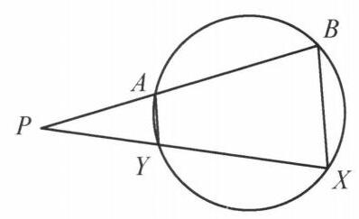
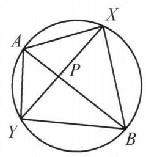
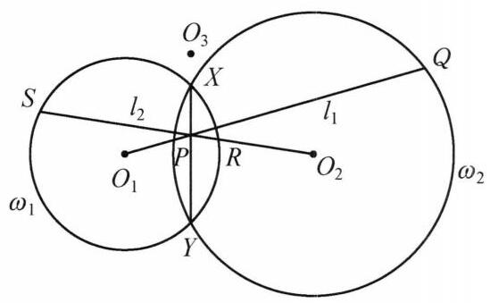

## 第六讲 圆幂与根轴

## 知识精讲

## 一、圆幂

如图，设 $A, B, X, Y$ 四点共圆，直线 ${AB},{XY}$ 交于点 $P$ .

图 6-1

图 6-2

由 $\bigtriangleup  {PAY} \backsim   \bigtriangleup  {PXB}$ ，知 $\frac{PA}{PY} = \frac{PX}{PB}$ ，即

$$
{PA} \cdot  {PB} = {PX} \cdot  {PY}.
$$

这表明 ${PA} \cdot  {PB}$ 的值与直线 ${AB}$ 的选择无关,仅取决于点 $P$ . 于是可以定义点 $P$ 关于圆的幂.

从一点 $P$ 作一圆的任一割线,交圆于两点 $A, B$ ,称 ${PA} \cdot  {PB}$ 的值为该点 $P$ 关于该圆的幂. 特别地,如果直线 ${AB}$ 经过该圆的圆心,则 ${PA} \cdot  {PB} = O{P}^2 - {R}^2$ , 其中 $R$ 为该圆的半径.

关于圆幂，有如下结论:

(1)如果点 $P$ 在圆外，那么 ${PA} \cdot  {PB}$ 为正；如果点 $P$ 在圆内，那么 ${PA} \cdot  {PB}$ 为负；

(2)设点 $P$ 在圆外，直线 ${PA}$ 与圆相切，切点为 $A$ ，则点 $P$ 关于该圆的圆幂为 $P{A}^2$ .

(3)设 $A, B, X, Y$ 是平面上不同的四个点，且直线 ${AB}$ 与直线 ${XY}$ 交于点 $P$ . 如果 ${PA} \cdot  {PB} = {PX} \cdot  {PY}$ ，那么 $A, B, X, Y$ 四点共圆.

## 二、根轴

有关圆幂的基本结论是: 关于两个不同心的圆，幂相等的点的轨迹是一条与两圆连心线垂直的直线. 当两圆相交时，它就是过两圆交点的直线. 把关于两个圆的幂相等的点的轨迹，称为这两个圆的根轴. 三个圆两两的根轴相交于一点或互相平行，若三条根轴交于一点，则该点称为这三个圆的根心.

## 典型例题

例 1 设圆 ${\omega }_1$ 与圆 ${\omega }_2$ 交于两点 $X$ ， $Y$ ，直线 ${l}_1$ 过圆 ${\omega }_1$ 的圆心， $O$ ，且交圆 ${\omega }_2$ 于 $P$ ， $Q$ 两点，直线 ${l}_2$ 过圆 ${\omega }_2$ 的圆心 ${O}_2$ 且交圆 ${\omega }_1$ 于 $R$ ， $S$ 两点. 证明:若 $P$ ， $Q$ ， $R, S$ 在一个圆上,则该圆的圆心在直线 ${XY}$ 上.

图 6-3

证明 如图 6-3,设 $P, Q, R, S$ 在圆 ${\omega }_3$ 上,圆 ${\omega }_1,{\omega }_2,{\omega }_3$ 的半径分别为 ${r}_1,{r}_2$ , ${r}_3$ . 下面证明: ${\omega }_3$ 的圆心 ${O}_3$ 在圆 ${\omega }_1$ 和圆 ${\omega }_2$ 的根轴上.

因为 ${O}_1$ 在圆 ${\omega }_2$ 与圆 ${\omega }_3$ 的根轴上,则点 ${O}_1$ 关于圆 ${\omega }_2,{\omega }_3$ 的圆幂相等,即

$$
{O}_1{O}_2^2 - {r}_2^2 = {O}_1{O}_3^2 - {r}_3^{2}.
$$

①

同理,由 ${O}_2$ 在圆 ${\omega }_1,{\omega }_3$ 的根轴上,有

$$
{O}_1{O}_2^2 - {r}_1^2 = {O}_2{O}_3^2 - {r}_3^{2}.
$$

②

将①，②两式相减，得

$$
\left( {{O}_1{O}_2^2 - {r}_2^2}\right)  - \left( {{O}_1{O}_2^2 - {r}_1^2}\right)  = \left( {{O}_2{O}_3^2 - {r}_3^2}\right)  - \left( {{O}_1{O}_3^2 - {r}_3^2}\right) ,
$$

即

$$
{O}_2{O}_3^2 - {r}_2^2 = {O}_1{O}_3^2 - {r}_1^{2}.
$$

所以点 ${O}_3$ 关于圆 ${\omega }_1$ 与 ${\omega }_2$ 的圆幂相等,即 ${O}_3$ 在圆 ${\omega }_1$ 与圆 ${\omega }_2$ 的根轴 ${XY}$ 上. 原问题得证.

注:该问题只需将条件、结论均转化为圆心在根轴上，结合圆幂表达式即得结论.

例 2 锐角 $\bigtriangleup {ABC}$ 中， ${AB} > {AC}, H$ 为其垂心， ${AD}\bot {BC}$ 于点 $D, E, F$ 在射线 ${AB},{AC}$ 上且 ${EF}$ 过点 $D$ ,满足 $B, E, C, F$ 四点共圆,其圆心为 $U, M$ 为 ${BC}$ 的中点. 证明: 四边形 ${MUDH}$ 为平行四边形.

图 6-4

证明 如图 6-4,设 $\bigtriangleup {ABC}$ 的外心为 $O$ ,延长 ${AD}$ 与圆 $O$ 交于点 $K$ .

由圆幂定理得 ${AD} \cdot  {DK} = {BD} \cdot  {DC} = {ED} \cdot  {DF}$ ,从而 $A, E, K, F$ 四点共圆. 设 $V$ 是 ${AK}$ 的中点,连接 ${OA}$ , ${OU},{UV}$ . 由 $A, B, K, C$ 和 $A, E, K, F$ 四点共圆,知 $K$ 为完全四边形 ${AEBDCF}$ 的密克点,则 $E, B, K, D$ 和 $D, K, F, C$ 都四点共圆,则 ${AK}$ 为圆 ${AEKF}$ 的直径.

由 $U, V$ 分别是圆 ${BECF}$ 和圆 ${AEKF}$ 的圆心,知 ${UV} \bot  {EF}$ ,导角易证 ${AO} \bot  {EF}$ ,故 ${UV}//{AO}$ ,又 ${OU}//{AV}$ ,则四边形 ${OAVU}$ 是平行四边形, 于是

$$
{MU} = {OU} - {OM} = {AV} - \frac{1}{2}{AH}
$$

$$
= \frac{1}{2}{AK} - \frac{1}{2}{AH} = \frac{1}{2}{HK} = {DH},
$$

所以，四边形 ${MUDH}$ 为平行四边形.

注:引入点 $K$ ，将命题转化为 ${MU} = {DK}$ ，通过共圆导出 ${AV} = {OU}$ 即可.

例 3 已知圆 $O$ 与圆 $\Gamma$ 交于 $A$ ， $B$ 两点，点 $O$ 在圆 $\Gamma$ 上，且在 ${AB}$ 上的投影为 $S$ ，直线 ${OS}$ 与圆 $\Gamma$ 交于点 $P$ ， $\angle {ASP}$ 的平分线与 $\odot  O$ 交于点 $L$ ，且 $A$ ， $L$ 在直线 ${OP}$ 的同侧， $K$ 为圆 $\Gamma$ 上的点，满足 ${PS} = {PK}$ ，且 $A, K$ 在直线 ${OP}$ 的同侧. 证明: ${SL} = {KL}$ .

图 6-5

证明 如图 6-5，设 ${PK}$ 与 ${BA}$ 的延长线交于点 $Q$ ， $\bigtriangleup  {QSP}$ 的内心为 ${L}^{\prime }$ ，因为 ${OP}$ 为圆 $\Gamma$ 的直径,则 $\angle {QSP} = \angle {OKP} = {90}^{ \circ  }$ ,于是 $\angle {QSO} = \; \angle {QKO} = {90}^{ \circ  }$ ,即 $Q, K, S, O$ 四点共圆.

由 ${PS} = {PK}$ 得 ${PO} = {PQ}$ . 由

$$
\angle Q{L}^{\prime }S = {90}^{ \circ  } + \frac{1}{2}\angle {QPS}
$$

$$
= {90}^{ \circ  } + \frac{1}{2}\angle {QPO} = {180}^{ \circ  } - \angle {QOP}
$$

$$
= {180}^{ \circ  } - \angle {QOS}
$$

知 $Q,{L}^{\prime }, S, O$ 四点共圆,则 $Q, K,{L}^{\prime }, S, O$ 五点共圆于 ${\Gamma }^{\prime }$ ,且 ${OQ}$ 为 ${\Gamma }^{\prime }$ 的直径.

由 $\angle Q{L}^{\prime }K = \angle {QSK} = {90}^{ \circ  } - \angle {KSP} = \frac{1}{2}\angle {KPS} = \angle {KP}{L}^{\prime }$ ,知 $\bigtriangleup Q{L}^{\prime }K \backsim \; \bigtriangleup {QP}{L}^{\prime }$ ,则 $Q{L}^{\prime 2} = {QK} \cdot  {QP}$ .

由于 ${AB}$ 是圆 $O$ 与圆 $\Gamma$ 的根轴,于是

$$
Q{L}^{\prime 2} = {QK} \cdot  {QP} = {QA} \cdot  {QB}
$$

$$
= Q{O}^2 - O{A}^2
$$

$$
= Q{L}^{\prime 2} + O{L}^{\prime 2} - O{A}^2,
$$

所以 $O{L}^{\prime } = {OA}$ ,这表明点 ${L}^{\prime }$ 在圆 $O$ 上,从而 $L$ 与 ${L}^{\prime }$ 重合. 因为点 $L$ 在 $\angle {KPS}$ 的平分线上,所以 ${PL}$ 为 ${KS}$ 的中垂线,因此, ${SL} = {KL}$ .

注: 利用结论可反推 $L$ 为 $\bigtriangleup {PQS}$ 的内心,由同一法即得出结论.

例 4 已知 ${AB}$ 是圆 $O$ 的弦, $M$ 是弧 $\overset{\text{ ⏜ }}{AB}$ 的中点. $C$ 是圆 $O$ 外任意一点,过点 $C$ 作圆 $O$ 的切线 ${CS},{CT}$ . 连接 ${MS},{MT}$ 分别交 ${AB}$ 于点 $E, F$ . 过 $E, F$ 作 ${AB}$ 的垂线,与 ${OS},{OT}$ 分别交于点 $X, Y$ . 再过点 $C$ 作圆 $O$ 的割线交圆 $O$ 于点 $P, Q$ , 连接 ${MP}$ 交 ${AB}$ 于 $R$ . 设 $Z$ 是 $\bigtriangleup {PQR}$ 的外心. 证明: $X, Y, Z$ 三点共线.

图 6-6

证明 如图 6-6,设以 $X$ 为圆心, ${XE}$ 为半径的圆为圆 $X$ ,记 $\bigtriangleup {PQR}$ 的外接圆为圆 $Z$ .

由 $M$ 是弧 $\overset{\text{ ⏜ }}{AB}$ 的中点,知 $\angle {MAB} = \angle {MPB} = \; \angle {MPA}$ ,结合 $\angle {AMR} = \angle {AMP}$ 得 $\bigtriangleup {MAR} \backsim  \bigtriangleup {MPA}$ , 于是

$$
{MR} \cdot  {MP} = M{A}^2 = M{B}^{2}.
$$

①

由 $\angle {MAE} = \angle {MSA}$ 及 $\angle {AME} = \angle {AMS}$ 得 $\bigtriangleup {MAE} \backsim  \bigtriangleup {MSA}$ ,则

$$
{ME} \cdot  {MS} = M{A}^{2}.
$$

②

由①，②两式得

$$
{MR} \cdot  {MP} = {ME} \cdot  {MS}.
$$

③

注意到 ${MR} \cdot  {MP}$ 为 $M$ 关于圆 $Z$ 的幂， ${ME} \cdot  {MS}$ 为 $M$ 关于圆 $X$ 的幂，于是由③可知， $M$ 在圆 $Z$ 与圆 $X$ 的根轴上.

另一方面， $C$ 关于圆 $O$ 的幂为 ${CP} \cdot  {CQ} = C{S}^2$ ，而 ${CP} \cdot  {CQ}$ 为 $C$ 关于圆 $Z$ 的幂，因此 $C$ 在圆 $Z$ 和圆 $X$ 的根轴上.

所以， ${CM}$ 是圆 $Z$ 和圆 $X$ 的根轴，于是 ${CM}\bot {ZX}$ .

同理，由对称性( $X, Y$ 对称)，有 ${CM}\bot {ZY}$ .

所以, $X, Y, Z$ 三点共线. 原问题得证.

注:通过根轴，我们得到了垂直于 ${XYZ}$ 的直线 ${CM}$ ，利用 ${CM} \bot  {ZX},{CM} \bot \; {ZY}$ 推出结论.

例 5 在锐角三角形 ${ABC}$ 中，点 $X, Y$ 是三角形 ${ABC}$ 内部的两个互异的动点，且满足 $B, C, X, Y$ 四点共圆及 $\angle {AXB} - \angle {ACB} = \angle {AYC} - \angle {ABC}$ . 证明: 直线 ${XY}$ 经过一个定点.

图 6-7

证明 如图 6-7，设过点 $A$ 的 $\bigtriangleup  {ABC}$ 的外接圆的切线与 ${BC}$ 的延长线交于点 $D$ .

设三角形 ${AXY}$ 的外接圆为 $\omega$ ，三角形 ${ABC}$ 的外接圆为 ${\omega }_1,{BCXY}$ 的外接圆为 ${\omega }_2$ .

由 $\angle {AXB} - \angle {ACB} = \angle {AYC} - \angle {ABC}$ 得

$$
{360}^{ \circ  } - \angle {AXC} - \angle {CXB} - \angle {ACX} - \angle {BCX}
$$

$$
= {360}^{ \circ  } - \angle {AYB} - \angle {CYB} - \angle {ABY} - \angle {CBY}\text{ , }
$$

即

$$
{360}^{ \circ  } - \left( {{180}^{ \circ  } - \angle {XAC}}\right)  - \left( {{180}^{ \circ  } - \angle {XBC}}\right)
$$

$$
= {360}^{ \circ  } - \left( {{180}^{ \circ  } - \angle {BAY}}\right)  - \left( {{180}^{ \circ  } - \angle {BCY}}\right) .
$$

所以

$$
\angle {CAX} + \angle {CBX} = \angle {BAY} + \angle {BCY}.
$$

$$
\angle {YAD} = \angle {BAD} - \angle {BAY}
$$

$$
= \angle {ACD} - \left( {\angle {CAX} + \angle {CBX} - \angle {BCY}}\right)
$$

$$
= \angle {ABC} + \angle {BAC} - \angle {CAX} - \angle {CBX} + \angle {BCY}
$$

$$
= \angle {ABX} + \angle {BAX} + \left( {{180}^{ \circ  } - \angle {BXY}}\right)
$$

$$
= \angle {AXY}\text{ . }
$$

所以 ${AD}$ 是三角形 ${AXY}$ 的外接圆 $\omega$ 的切线. 于是直线 ${AD}$ 是 ${\omega }_1$ 与 $\omega$ 的根轴. 又因为直线 ${XY}$ 是 $\omega ,{\omega }_2$ 的根轴,直线 ${BC}$ 是 ${\omega }_1,{\omega }_2$ 的根轴,则由根心定理,知 ${AD}$ , ${XY},{BC}$ 三线共点,即直线 ${XY}$ 过点 $D$ . 原问题得证.

注: 取 $X = C, Y = B$ 可猜出 $D$ 在 ${BC}$ 上,导角得圆 ${ABC}$ 与圆 ${AXY}$ 相切,再利用根心定理知结论成立.

例 6 已知四边形 ${ABCD}$ 内接于圆 $O$ ,对角线 ${AC},{BD}$ 交于点 $E.P$ 为四边形 ${ABCD}$ 内一点. ${O}_1,{O}_2,{O}_3,{O}_4$ 分别为 $\bigtriangleup {ABP},\bigtriangleup {BCP},\bigtriangleup {CDP},\bigtriangleup {DAP}$ 的外接圆圆心. 证明: 直线 ${O}_1{O}_3,{O}_2{O}_4,{OE}$ 共点.

图 6-8

证明 如图 6-8,设 ${DA}$ 与 ${CB}$ 的延长线交于点 $N,{BA}$ 与 ${CD}$ 的延长线交于点 $M,{O}_1{O}_3$ 与 ${O}_2{O}_4$ 交于点 ${O}^{\prime }$ ,圆 ${O}_1$ 与圆 ${O}_3$ 交于异于点 $P$ 的一点 $Q$ ,圆 ${O}_2$ 与圆 ${O}_4$ 交于异于点 $P$ 的一点 $R$ ，则 ${O}_1{O}_3$ 垂直平分 ${PQ}$ ， ${O}_2{O}_4$ 垂直平分 ${PR}$ ，故 ${O}^{\prime }$ 是 $\bigtriangleup {PQR}$ 的外心.

因为 ${NB} \cdot  {NC} = {NA} \cdot  {ND}$ ,所以点 $N$ 在圆 ${O}_2$ 与圆 ${O}_4$ 的根轴上，则 $N, R, P$ 三点共线. 同理有 $M, Q, P$ 三点共线. 于是 ${NR} \cdot  {NP} = {NB} \cdot  {NC},{MQ} \cdot  {MP} = {MA}$ . ${MB}$ ,所以, $M, N$ 均在圆 $O$ 与圆 ${O}^{\prime }$ 的根轴上,从而直线 ${MN}$ 为圆 $O$ 与圆 ${O}^{\prime }$ 的根轴, 又因为 ${MN} \bot  {OE}$ ,所以 $O,{O}^{\prime }, E$ 共线,即直线 ${O}_1{O}_3,{O}_2{O}_4,{OE}$ 共点.

注: 由 ${MN}$ 为 $E$ 关于圆 $O$ 的极线知 ${OE} \bot  {MN}$ ,因而只需证明 $O{O}^{\prime } \bot  {MN}$ 即可, 这利用根轴实现.

例 7 设锐角 $\bigtriangleup {ABC}$ 的外心为 $O$ ,垂心为 $H,\bigtriangleup {ABC}$ 内任一点 $P$ 关于 ${BC}$ , ${CA},{AB}$ 的对称点分别为 $D, E, F$ . 证明:

$$
\frac{{S}_{\bigtriangleup {HDE}}}{{S}_{\bigtriangleup {HDF}}} = \frac{{S}_{\bigtriangleup {OAB}}}{{S}_{\bigtriangleup {OAC}}}.
$$

证明 如图 6-9,设射线 ${AE}$ 与圆 ${AHC}$ 交于点 ${E}^{\prime }$ . 由 ${AP} = {AF} = {AE}$ 及 $\angle {EAF} = 2\angle {BAC}$ ，得 $\angle {AEF} = \; {90}^{ \circ  } - \angle {BAC} = \angle {ACH} = \angle {A{E}^{\prime }H}$ ，于是有 ${EF}// \; {E}^{\prime }H$ ，因此由正弦定理，得

$$
{S}_{\bigtriangleup {HEF}} = {S}_{\bigtriangleup E{E}^{\prime }F} = \frac{1}{2}{EF} \cdot  E{E}^{\prime } \cdot  \sin \angle {FE}{E}^{\prime }
$$

$$
= \frac{1}{2}{EF} \cdot  E{E}^{\prime } \cdot  \sin \angle {FEA}
$$

$$
= \frac{1}{2}{AF} \cdot  E{E}^{\prime } \cdot  \sin \angle {EAF}
$$

$$
= \frac{1}{2}{AE} \cdot  E{E}^{\prime } \cdot  \sin \angle {EAF}
$$

$$
= \frac{1}{2}{AE} \cdot  E{E}^{\prime } \cdot  \sin {2A}
$$

$$
= \frac{1}{2} \cdot  {I}_P \cdot  \sin {2A},
$$

图 6-9

其中 ${I}_P = {AE} \cdot  E{E}^{\prime }$ 是点 $P$ 对圆 $O$ 的幂的绝对值. (因为 $P$ 和 ${E}^{\prime }$ 关于 ${AC}$ 对称,圆 $O$ 和 $\bigtriangleup {ACH}$ 的外接圆也关于 ${AC}$ 对称,所以 $P$ 对圆 $O$ 的幂等于 $E$ 对 $\bigtriangleup {AHC}$ 外接圆的幂,最后还是要化到 $P$ 来处理. )

同理有

$$
{S}_{\bigtriangleup {HDE}} = \frac{1}{2} \cdot  {I}_P \cdot  \sin {2C},
$$

$$
{S}_{\bigtriangleup {HDF}} = \frac{1}{2} \cdot  {I}_P \cdot  \sin {2B}.
$$

设 $\bigtriangleup {ABC}$ 的外接圆半径为 $R$ ,则

$$
{S}_{\bigtriangleup {OAB}} = \frac{1}{2}{R}^2\sin {2C},
$$

$$
{S}_{\bigtriangleup {OAC}} = \frac{1}{2}{R}^2\sin {2B},
$$

$$
{S}_{\bigtriangleup {OBC}} = \frac{1}{2}{R}^2\sin {2A},
$$

所以

$$
\frac{{S}_{\bigtriangleup {HDE}}}{{S}_{\bigtriangleup {HDF}}} = \frac{{S}_{\bigtriangleup {OAB}}}{{S}_{\bigtriangleup {OAC}}}.
$$

原问题得证.

注: 通过等面积转化 ${S}_{\bigtriangleup {HDE}}$ ,将其表示成容易处理的形式是解决本题的关键.

例 8 在锐角 $\bigtriangleup {APD}$ 的边 ${AP}$ 和 ${PD}$ 上各取一点 $B, C$ ,四边形 ${ABCD}$ 的两条对角线相交于点 $Q,\bigtriangleup {APD}$ 和 $\bigtriangleup {BPC}$ 的垂心分别为 ${H}_1,{H}_2$ . 证明: 如果直线 ${H}_1{H}_2$ 经过 $\bigtriangleup {ABQ}$ 及 $\bigtriangleup {CDQ}$ 的外接圆的交点 $X$ ,那么,它必经过 $\bigtriangleup {BQC}$ 和 $\bigtriangleup {AQD}$ 的外接圆的交点 $Y$ .

证明 如图 6-10,记 ${AC},{BD}$ 的中点分别为 $M, N$ ,以 ${AC},{BD}$ 为直径作圆 ${\omega }_1,{\omega }_2$ . 作 $A{A}_1 \bot  {PD}$ 于 ${A}_1, B{B}_1 \bot  {PD}$ 于 ${B}_1, C{C}_1 \bot \; {PA}$ 于 ${C}_1, D{D}_1 \bot  {PA}$ 于 ${D}_1$ ,则 ${A}_1,{C}_1$ 在圆 ${\omega }_1$ 上, ${B}_1,{D}_1$ 在圆 ${\omega }_2$ 上.

图 6-10

因为 ${H}_{1}A \cdot  {H}_1{A}_1 = {H}_{1}D \cdot  {H}_1{D}_1$ ,所以点 ${H}_1$ 在圆 ${\omega }_1$ 和圆 ${\omega }_2$ 的根轴上. 同理 ${H}_2$ 也在圆 ${\omega }_1$ 和圆 ${\omega }_2$ 的根轴上,则 ${H}_1{H}_2$ 是圆 ${\omega }_1$ 和圆 ${\omega }_2$ 的根轴,于是

$$
X{M}^2 - C{M}^2 = X{N}^2 - D{N}^{2}.
$$

由 $\angle {XBD} = \angle {XAC},\angle {XDB} = \angle {XCA}$ ，知 $\bigtriangleup  {XAC} \backsim   \bigtriangleup  {XBD}$ . 类似地有 $\bigtriangleup  {YBD} \backsim   \bigtriangleup  {YCA}$ .

设 $\bigtriangleup  {XAC}$ 和 $\bigtriangleup  {XBD}$ 的相似比为 $k$ . 如果 $X{M}^2 - C{M}^2 = X{N}^2 - D{N}^2 = 0$ ，那么 $\angle {BXD} = {90}^{ \circ  }$ . 因为 $\angle {ABX} = {180}^{ \circ  } - \angle {AQX} = \angle {XQC} = \angle {XDC}$ ，所以 $P, B, X$ ， $D$ 四点共圆.

于是 $\angle P = {180}^{ \circ  } - \angle {BXD} = {90}^{ \circ  }$ ，这与 $\bigtriangleup  {PAD}$ 是锐角三角形矛盾，则 $X{M}^2 - \; C{M}^2 = X{N}^2 - D{N}^2 \neq  0$ . 此时 ${k}^2 = \frac{X{M}^2 - C{M}^2}{X{N}^2 - D{N}^2} = 1$ ，即 $k = 1$ ，也即 ${AC} = {BD}.$

结合 $\bigtriangleup  {YBD} \backsim   \bigtriangleup  {YCA}$ ，知 $\bigtriangleup  {YBD} \cong   \bigtriangleup  {YCA}$ ，故 $Y{M}^2 - C{M}^2 = Y{N}^2 - C{N}^2$ ， 则点 $Y$ 在圆 ${\omega }_1$ 与圆 ${\omega }_2$ 的根轴上,所以 ${H}_1,{H}_2, Y$ 三点共线. 原问题得证.

注: 通过将 ${H}_1{H}_2$ 变为两圆根轴去刻画 $X, Y$ 两点,想法还是比较巧妙的.

例 9 凸四边形 ${ABCD}$ 中, ${AD}$ 不平行于 ${BC}$ . 分别以 ${AB},{CD}$ 为直径作圆, 设两圆交于 $E, F$ 两点,且 $E, F$ 均在四边形 ${ABCD}$ 形内. ${\omega }_E$ 是点 $E$ 在 ${AB},{BC}$ , ${CD}$ 上的投影的外接圆, ${\omega }_F$ 是点 $F$ 在 ${CD},{DA},{AB}$ 上的投影的外接圆. 证明: ${\omega }_E$ 与 ${\omega }_F$ 的根轴平分线段 ${EF}$ .

图 6-11

证明 如图 6-11,设点 $E$ 在 ${AB},{CD},{BC},{AD}$ 上的投影分别为 ${M}_1,{N}_1$ , ${P}_1,{Q}_1$ . 点 $F$ 在 ${AB},{CD},{BC},{AD}$ 上的投影分别为 ${M}_2,{N}_2,{P}_2,{Q}_2$ .

记 ${S}_1 = E{P}_1 \cap  {AD},{S}_2 = F{P}_2 \cap  {AD},{R}_1 = E{Q}_1 \cap  {BC},{R}_2 = F{Q}_2 \cap  {BC}, X = \; E{Q}_1 \cap  F{P}_2, Y = E{P}_1 \cap  F{Q}_2$ .

因为

$$
\angle {Q}_1{M}_1{P}_1 = \angle {Q}_1{M}_{1}E + \angle {P}_1{M}_{1}E
$$

$$
= \angle {EAD} + \angle {EBC}
$$

$$
= \angle {DAB} + \angle {ABC} - \left( {{180}^{ \circ  } - \angle {AEB}}\right)
$$

$$
= \angle {Q}_1{S}_{1}E + \angle E{P}_{1}C - {90}^{ \circ  }
$$

$$
= \angle {Q}_1{S}_{1}E
$$

$$
= \angle {P}_{1}{R}_{1}E\text{ . }
$$

所以, ${P}_1,{Q}_1,{M}_1,{R}_1,{S}_1$ 共圆,类似地 ${N}_1$ 也在该圆上,即 ${M}_1,{N}_1,{P}_1,{Q}_1$ , ${R}_1,{S}_1$ 均在 ${\omega }_E$ 上.

同理, ${M}_2,{N}_2,{P}_2,{Q}_2,{R}_2,{S}_2$ 均在 ${\omega }_F$ 上.

而 $\angle {P}_1 = \angle {P}_2 = \angle {Q}_1 = \angle {Q}_2 = {90}^{ \circ  }$ ,则 ${Q}_{1}X \cdot  X{R}_1 = {P}_{2}X \cdot  X{S}_2$ ,所以, $X$ 在 ${\omega }_E$ 与 ${\omega }_F$ 的根轴上.

同理, $Y$ 也在 ${\omega }_E$ 与 ${\omega }_F$ 的根轴上.

故 ${XY}$ 是 ${\omega }_E$ 与 ${\omega }_F$ 的根轴.

因为 ${P}_1{S}_1//{P}_2{S}_2,{Q}_1{R}_1//{Q}_2{R}_2$ ,所以 ${EXFY}$ 是平行四边形,于是 ${XY}$ 平分线段 ${EF}$ ,即 ${\omega }_E$ 与 ${\omega }_F$ 的根轴平分线段 ${EF}$ . 原问题得证.

注: 该问题的一个自然的想法是找出更多的圆 ${\omega }_E$ 和圆 ${\omega }_F$ 上的点,然后去刻画它们的根轴.

