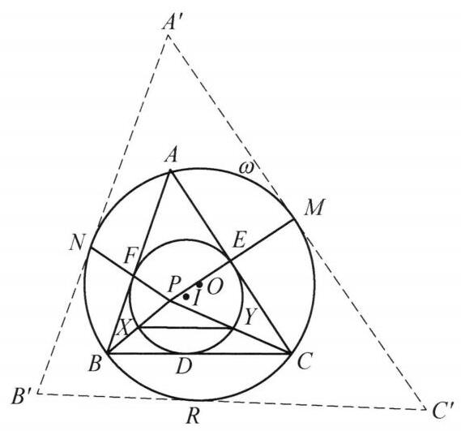

## 题目 (2.md)

例 1 设 $\bigtriangleup {ABC}$ 的内切圆 $I$ 与 ${BC},{CA},{AB}$ 分别切于点 $D, E, F, M, N$ 分别是 $\bigtriangleup {ABC}$ 的外接圆 $\omega$ 的弧 $\overset{\text{ ⏜ }}{AC},\overset{\text{ ⏜ }}{AB}$ 的中点, ${ME},{NF}$ 交于点 $P,{PB},{PC}$ 与圆 $I$ 交于点 $X, Y$ . 证明: ${XY}//{BC}$ .

证明 如图 7-1,设弧 $\overset{\text{ ⏜ }}{BC}$ 的中点为 $R$ ,过 $M, N, R$ 做 $\omega$ 的切线交成 $\bigtriangleup {A}^{\prime }{B}^{\prime }{C}^{\prime }$ . 记 $\omega$ 的圆心为 $O$ ,则 ${ON} \bot  {A}^{\prime }{B}^{\prime }$ . 又由垂径定理知 ${ON} \bot  {AB}$ ,于是 ${AB}//{A}^{\prime }{B}^{\prime }$ . 同理可得 ${BC}//{B}^{\prime }{C}^{\prime },{CA}//{C}^{\prime }{A}^{\prime }$ . 所以,存在将点 $A$ 变为 ${A}^{\prime }, B$ 变为 ${B}^{\prime }, C$ 变为 ${C}^{\prime }$ 的位似变换. 此变换也将 $F$ 变为 $N, E$ 变为 $M$ , 从而 $P$ 为位似中心,故 $P, B,{B}^{\prime }$ 共线, $P$ , $C,{C}^{\prime }$ 也共线,注意到该位似变换将圆 $I$ 变为圆 $\omega$ ,结合 $X$ 在 ${PB}$ 上, $Y$ 在 ${PC}$ 上,知 ${XY}//{BC}$ . 原问题得证.

图 7-1

注:通过位似变换将切点与弧中点相互转换是一个常见手法.

这是一个费解的证明。我能确认每一步的正确性，但我想知道这是怎么想出来的。请为我解释。

---

\begin{solution}

这份证明之所以让人觉得“费解”甚至有些“神来之笔”，是因为教材采用了**倒果为因的叙述方式**，并且在最后几步混入了一句**极具误导性的冗余推导**。

如果我们顺着几何直觉做“逆向工程”，就能清晰地看穿命题人和证明者的真实思考路径：

---

### 一、 破题的真正起点：点 $P$ 究竟是什么点？

在读题时，最有特征的条件是：**$E, F$ 是内切圆 $I$ 的切点，$M, N$ 是外接圆 $\omega$ 的弧中点，且 $P = ME \cap NF$**[cite: 1]。为什么会把“内切圆切点”和“外接圆弧中点”连起来？

我们不妨直接观察这两个圆在点 $E$ 和点 $M$ 处的局部几何性质：
1. **切点的本质**：$E$ 是内切圆 $\odot I$ 在边 $AC$ 上的切点，因此半径 $\overrightarrow{IE} \perp AC$，且方向指向 $AC$ 背离顶点 $B$ 的一侧[cite: 1]。
2. **弧中点的本质**：$M$ 是外接圆 $\odot \omega$ 上弧 $\overset{\frown}{AC}$ 的中点，由垂径定理知半径 $\overrightarrow{OM} \perp AC$，且方向同样指向 $AC$ 背离顶点 $B$ 的一侧[cite: 1]。

这意味着：**半径向量 $\overrightarrow{IE}$ 与 $\overrightarrow{OM}$ 平行且同向（$\overrightarrow{IE} \uparrow\uparrow \overrightarrow{OM}$）**！同理，在 $AB$ 边上也有 **$\overrightarrow{IF} \uparrow\uparrow \overrightarrow{ON}$**。

在位似变换（Homothety）的视角下，这是一个极其强烈的信号：
> **两圆位似基本定理**：平面上任意两个半径不等的圆 $\odot I$（半径 $r$）与 $\odot \omega$（半径 $R$），必定存在唯一的**正位似变换**（即位似比 $k = \frac{R}{r} > 0$ 的外位似变换）将 $\odot I$ 映射为 $\odot \omega$。在该变换下，$\odot I$ 上的点 $E$ 必然映射为 $\odot \omega$ 上使得**半径平行且同向**（或切线平行且同侧）的唯一点 $M$。

看清这一点，整道题的窗户纸就捅破了：
* 在将 $\odot I$ 变为 $\odot \omega$ 的正位似变换 $\mathcal{H}$ 下，$E$ 的像就是 $M$，$F$ 的像就是 $N$[cite: 1]。
* 既然 $E \mapsto M$ 且 $F \mapsto N$，那么对应点连线 $ME$ 与 $NF$ 都必须经过位似中心[cite: 1]。
* 因此，**交点 $P$ 根本不是什么神秘的偶然交点，它就是内切圆 $\odot I$ 与外接圆 $\odot \omega$ 的外位似中心**（在三角形几何中记作特征点 $X_{56}$）！

---

### 二、 去掉“脚手架”后的最自然证明

一旦认出 **$P$ 是 $\odot I$ 到 $\odot \omega$ 的正位似中心**，根本不需要构造证明中的 $\triangle A'B'C'$，两句话就能完成证明：

1. **确定 $P$ 的位置与射线的对应关系**：
   由欧拉定理知两圆心距 $OI = \sqrt{R^2 - 2Rr} < R - r$。由于 $P$ 是外位似中心，有 $\frac{PI}{PO} = \frac{r}{R}$，即：
   $$PI = \frac{r}{R - r} OI < r$$
   这说明**点 $P$ 严格位于内切圆 $\odot I$ 的内部**[cite: 1]！因此，从 $P$ 出发的射线 $\overrightarrow{PB}$ 与 $\odot I$ 有且仅有一个交点 $X$（位于线段 $PB$ 上），与 $\odot \omega$ 有且仅有一个交点 $B$[cite: 1]。
2. **直接利用圆的位似得出平行**：
   以 $P$ 为中心、位似比 $k = \frac{R}{r} > 0$ 的位似变换 $\mathcal{H}$ 将 $\odot I$ 变为 $\odot \omega$[cite: 1]。对于过位似中心 $P$ 的射线 $\overrightarrow{PB}$ 和 $\overrightarrow{PC}$，它们在 $\odot I$ 上的交点 $X, Y$ 必然直接被映射为在 $\odot \omega$ 上的同向交点 $B, C$[cite: 1]，即：
   $$\mathcal{H}(X) = B, \quad \mathcal{H}(Y) = C \implies \frac{PB}{PX} = \frac{PC}{PY} = \frac{R}{r}$$
   位似变换将线段映射为平行线段，故立得 $XY \parallel BC$[cite: 1]。

---

### 三、 为什么书上的证明读起来“费解”？

对比上面的自然思路，回看教材的证明过程，你会发现造成阅读障碍的两个原因：

#### 1. 把“脚手架”当成了开篇第一步（构造 $\triangle A'B'C'$ 的真正目的）
在中学数学竞赛教材中，作者往往避免直接使用“利用平行同向半径判定两圆位似对应点”这一结论，而是希望把问题转化为学生更熟悉的**两个三角形的位似**。
* 为了给外接圆 $\omega$ 套上一个与 $\triangle ABC$ 地位对等的外切三角形，作者在弧中点 $M, N, R$ 处作 $\omega$ 的切线，围成 $\triangle A'B'C'$[cite: 1]。
* 这样一来，$\odot I$ 是 $\triangle ABC$ 的内切圆（切点 $D,E,F$），而 $\odot \omega$ 恰好是 $\triangle A'B'C'$ 的内切圆（切点 $R,M,N$）[cite: 1]。
* 由三边分别平行（$AB \parallel A'B'$ 等）推出 $\triangle ABC$ 与 $\triangle A'B'C'$ 位似，就能顺理成章地把“内切圆 $\odot I \mapsto$ 内切圆 $\odot \omega$”以及“切点 $(E,F) \mapsto$ 切点 $(M,N)$”打包证明出来[cite: 1]。

也就是说，**$\triangle A'B'C'$ 只是为了规避直接讲“两圆位似”而搭建的脚手架**。教材在第一句话就凭空抛出“设弧 $BC$ 中点为 $R$，作切线交成 $\triangle A'B'C'$”[cite: 1]，隐去了从 $\overrightarrow{IE} \parallel \overrightarrow{OM}$ 想到位似的思维动机，自然让人觉得突兀。

#### 2. 极具迷惑性的冗余步骤：“故 $P, B, B'$ 共线，$P, C, C'$ 也共线”
这是整段证明中最容易把读者绕晕的地方。请看原文的逻辑链条[cite: 1]：
> “从而 $P$ 为位似中心，**故 $P, B, B'$ 共线，$P, C, C'$ 也共线**，注意到该位似变换将圆 $I$ 变为圆 $\omega$，结合 $X$ 在 $PB$ 上，$Y$ 在 $PC$ 上，知 $XY \parallel BC$。”[cite: 1]

很多读者读到这里会卡壳：**为什么要强调 $P, B, B'$ 共线？后面证 $XY \parallel BC$ 用到 $B'$ 了吗？**
答案是：**完全没用到！这句话在这里是纯粹的冗余（甚至是干扰项）。**

因为在同一个以 $P$ 为中心的位似变换 $\mathcal{H}$ 下，射线 $PB$ 上其实发生了**两次接力映射**[cite: 1]：
$$X \ (\odot I \text{ 上的点}) \xrightarrow{\ \mathcal{H}\ } B \ (\odot \omega \text{ 上的点 / } \triangle ABC \text{ 的顶点}) \xrightarrow{\ \mathcal{H}\ } B' \ (\triangle A'B'C' \text{ 的顶点})$$
* 要证明 $XY \parallel BC$，我们只需要用到第一段映射 **$(X, Y) \xrightarrow{\mathcal{H}} (B, C)$**（即把 $B, C$ 视为大圆 $\omega$ 上的点）[cite: 1]。
* 只要 $P$ 是位似中心，**过点 $P$ 的任意一条直线都是位似不动直线**，因此连接 $PB$ 本身就是一条位似射线，根本不需要借助“$B$ 的像是 $B'$，所以 $PB$ 是位似线”来证明！
* 作者在写下“$P$ 为位似中心”后，顺手按照 $\triangle ABC \mapsto \triangle A'B'C'$ 的惯性写出了“$P, B, B'$ 共线”[cite: 1]，紧接着下一句却偷偷把视角从“三角形顶点映射（$B \mapsto B'$）”切换回了“两圆交点映射（$X \mapsto B$）”[cite: 1]，没有点破 $B$ 在这里身兼两职（既是第一段映射的**像**，又是第二段映射的**原像**），这才导致逻辑衔接显得极其跳跃。

\end{solution}