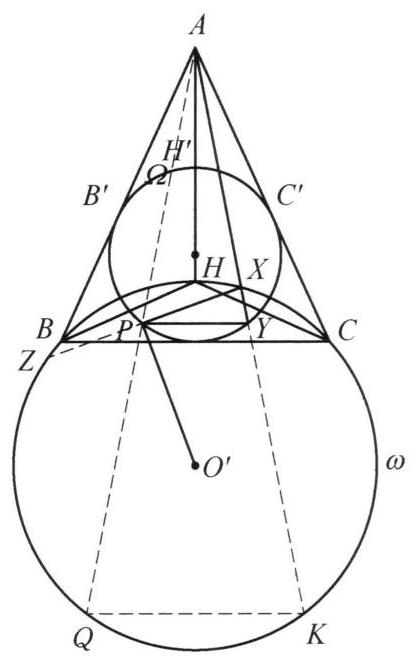

## 题目 (3.md)

例 2 如图 7-2,锐角 $\bigtriangleup {ABC}$ 中, $H$ 为其垂心,圆 $\Omega$ 为其九点圆,圆 $\omega$ 为 $\bigtriangleup {BHC}$ 的外接圆,圆心为 ${O}^{\prime }, X$ 为圆 $\omega$ 上弧 ${BHC}$ 上一点. 延长 ${AX}$ 与圆 $\Omega$ 交于 $Y, P$ 在圆 $\Omega$ 上且 ${PX} = {PY}$ . 证明: $\angle {O}^{\prime }{PX} = {90}^{ \circ  }$ .

证明 如图 7-2,设 ${AB},{AC},{AH}$ 的中点分别为 ${B}^{\prime },{C}^{\prime },{H}^{\prime }$ ,则 ${B}^{\prime },{C}^{\prime }$ , ${H}^{\prime }$ 均在圆 $\Omega$ 上. 因为 $A$ 是 $\bigtriangleup {B}^{\prime }{C}^{\prime }{H}^{\prime }$ 与 $\bigtriangleup {BCH}$ 的位似中心,且位似比为 $\frac{1}{2}$ ,所以 $A$ 是圆 $\Omega$ 与圆 $\omega$ 的外位似中心,且位似比为 $\frac{1}{2}$ .

图 7-2

延长 ${AP},{AY}$ 与圆 $\omega$ 分别交于点 $Q, K$ ,则 ${AQ} = {2AP},{AK} = {2AY}$ ,于是

$$
{PY} \text{ ⫫ } \frac{1}{2}{QK}.
$$

延长 ${XP}$ 与圆 $\omega$ 交于点 $Z$ . 由 ${PX} = {PY}$ 得 $\angle {QKX} = \angle {PYX} = \angle {PXY}$ . 于是 $\angle {ZKX} = \angle {QXY}$ , 故 ${XZ} = {QK} = {2PY} = {2PX}$ ，即 $P$ 是 ${XZ}$ 的中点，故由垂径定理，得 ${O}^{\prime }P \bot  {PX}$ .

原问题得证.

这是一个费解的证明。我能确认每一步的正确性，但我想知道这是怎么想出来的。请为我解释。

---

\begin{solution}

教材和竞赛解析通常采用**“综合法”（由因导果）**书写，把最核心的辅助线（如取位似、延长交圆于 $Q, K, Z$）直接作为第一步端出来，这就抹去了探索的痕迹，让人觉得像“神来之笔”。

如果用**“分析法”（执果索因）**并结合几何结构的拆解来还原，你会发现这个证明不仅没有巧合，而且每一条辅助线都是被条件和结论一步步“逼”出来的。我们可以分四个阶段来还原它的思考过程：

---

### 第一步：剥离冗余背景——看清“双圆位似”的本质

审题时首先会注意到一个现象：题目虽然以 $\triangle ABC$ 和垂心 $H$ 开篇，但后面的动点 $X, Y, P$ 以及结论 $\angle O'PX = 90^\circ$ 中，**顶点 $B, C$ 完全没有再出现过**[cite: 1]。

这说明 $\triangle ABC$ 只是一个“脚手架”，用来交代圆 $\Omega$（九点圆）和圆 $\omega$（$\triangle BHC$ 外接圆）的位置关系[cite: 1]。在垂心组 $A, B, C, H$ 中：
* $A$ 恰好是 $\triangle HBC$ 的垂心，而 $\triangle HBC$ 与 $\triangle ABC$ 共用同一个九点圆 $\Omega$[cite: 1]。
* 根据九点圆的基本性质（九点圆是外接圆以垂心为位似中心、位似比为 $\frac{1}{2}$ 的位似图形），可以直接得出（或像解答第一段那样用中点 $\triangle B'C'H'$ 推出）：**点 $A$ 是小圆 $\Omega$ 与大圆 $\omega$ 的位似中心，位似比为 $1:2$**[cite: 1]。

> **细节排雷（为什么 $Y$ 不是 $AX$ 的中点？）：**
> 很多人的第一反应是：既然 $A, X, Y$ 共线，且两圆关于 $A$ 位似，那 $Y$ 不就是 $AX$ 的中点吗？
> 仔细看图 7-2 就会发现，过位似中心 $A$ 的割线与每个圆都有**两个**交点（靠近 $A$ 的“近端交点”和远离 $A$ 的“远端交点”）[cite: 1]。点 $X$ 在圆 $\omega$ 的上弧 $BHC$ 上，是割线与大圆 $\omega$ 的**近端交点**；而延长 $AX$ 交小圆 $\Omega$ 于 $Y$，点 $Y$ 则是割线与小圆 $\Omega$ 的**远端交点**[cite: 1]。因此 $X$ 和 $Y$ 并不是一对位似对应点！

---

### 第二步：翻译求证目标——为什么会想到延长 $XP$ 交圆 $\omega$ 于 $Z$？

这是破题最关键的一步。我们来看结论：**要证 $\angle O'PX = 90^\circ$，即 $O'P \perp PX$**[cite: 1]。

观察一下这几个元素的身份：
* $O'$ 是**大圆 $\omega$ 的圆心**[cite: 1]；
* $P$ 在小圆 $\Omega$ 上，对于大圆 $\omega$ 而言，**$P$ 只是一个圆内点**[cite: 1]；
* 直线 $PX$ 是一条经过圆内点 $P$、且与大圆 $\omega$ 相交于 $X$ 的直线[cite: 1]。

在平面几何中，**“圆心 $O'$ 与圆内一点 $P$ 的连线，垂直于过点 $P$ 的一条直线 $PX$”**，唯一的自然几何意义是什么？
就是**垂径定理**！

一条过圆内点 $P$ 的割线，只有当 **$P$ 是该割线被圆 $\omega$ 所截得的弦的中点**时，才会有 $O'P \perp PX$。既然目前只有半条弦 $PX$，为了用上圆心 $O'$ 的性质，最本能的动作就是**把弦补全**——延长 $XP$ 交圆 $\omega$ 于另一点 $Z$[cite: 1]。

这样，原本孤立的角度问题 $\angle O'PX = 90^\circ$，就完全等价地翻译成了大圆 $\omega$ 中的一个长度问题：
$$\text{求证 } P \text{ 是弦 } XZ \text{ 的中点} \Longleftrightarrow \mathbf{XZ = 2PX}$$

---

### 第三步：桥接已知与未知——为什么会想到延长 $AP, AY$ 交圆 $\omega$ 于 $Q, K$？

现在把我们翻译出的目标，和题目的已知条件放在一起对比：
* **求证目标**：$XZ = 2PX$[cite: 1]
* **已知条件**：$PX = PY$[cite: 1]

把已知代入目标，我们要证明的其实就是：
$$\mathbf{XZ = 2PY}$$

看到这个式子，思路就彻底豁然开朗了：
1. $XZ$ 是**大圆 $\omega$** 的一条弦[cite: 1]；
2. $PY$ 是**小圆 $\Omega$** 的一条弦[cite: 1]；
3. 大圆 $\omega$ 与小圆 $\Omega$ 关于点 $A$ 的位似比**恰好就是 $2$**[cite: 1]！

既然要证大圆里的一条弦 $XZ$ 等于小圆里一条弦 $PY$ 的 $2$ 倍，最自然的做法就是**利用以 $A$ 为中心、位似比为 $2$ 的位似变换，把小圆的弦 $PY$ 放大投射到大圆 $\omega$ 上去**！

怎么做这个位似投射？连接并延长 $AP, AY$ 分别交大圆 $\omega$ 于点 $Q, K$[cite: 1]。
根据位似性质，弦 $PY$ 在大圆 $\omega$ 中的位似对应弦就是 $QK$，自动满足：
$$QK \parallel PY \quad \text{且} \quad QK = 2PY$$

---

### 第四步：收官一击——在同一个圆 $\omega$ 中证两弦相等

经过第三步的转化，小圆 $\Omega$ 和系数 $2$ 就全部功成身退了。因为 $QK = 2PY = 2PX$，要证 $XZ = 2PX$，只需要在**同一个大圆 $\omega$** 中证明两条弦相等：
$$\mathbf{XZ = QK}$$

此时再看大圆 $\omega$ 上的四个点 $Z, X, K, Q$[cite: 1]：
* 因为 $A, X, Y$ 共线，且 $K$ 在 $AY$ 的延长线上，所以 **$X, Y, K$ 三点天然共线**（直线 $XK$ 就是原来的直线 $AX$）[cite: 1]；
* $Z, P, X$ 三点也共线[cite: 1]。

在同一个圆 $\omega$ 中，两条弦 $XZ$ 和 $QK$ 被同一条割线 $XK$ 所截，如何证 $XZ = QK$？
同圆中等弦对等弧：
$$XZ = QK \Longleftrightarrow \overset{\frown}{XZ} = \overset{\frown}{QK} \Longleftrightarrow \overset{\frown}{ZK} = \overset{\frown}{QX} \Longleftrightarrow \angle ZXK = \angle QKX$$
（即证圆内接四边形 $ZKXQ$ 是以 $XK, ZQ$ 为底的等腰梯形，或像原解答那样加上公共角转化为 $\angle ZKX = \angle QXY$[cite: 1]。）

而 $\angle ZXK = \angle QKX$ 成立吗？
* $\angle ZXK$ 就是 $\angle PXY$（因为 $Z, P, X$ 共线且 $X, Y, K$ 共线）[cite: 1]；
* $\angle QKX = \angle PYX$（因为位似给出的同位角平行关系 $QK \parallel PY$）[cite: 1]；
* 已知条件 $PX = PY$ 恰好给出等腰三角形底角相等：$\angle PXY = \angle PYX$[cite: 1]！

---

### 思维导图总结

如果把这个思考过程倒过来串成一条线，你会发现它的逻辑链条极其紧凑：

$$\begin{aligned}
\text{欲证 } \angle O'PX = 90^\circ 
&\xrightarrow[\text{把半弦补全为整弦 } XZ]{\text{垂径定理逆定理（圆心}+\text{弦中点）}} \text{需证 } XZ = 2PX \\
&\xrightarrow[\text{转化到小圆弦 } PY]{\text{代入已知 } PX = PY} \text{需证 } XZ = 2PY \\
&\xrightarrow[\text{将弦 } PY \text{ 放大投射为大圆弦 } QK]{\text{利用 } A \text{ 的 } 1:2 \text{ 位似消除系数 } 2} \text{需证同圆中弦 } XZ = QK \\
&\xrightarrow[\text{同圆等弧对等角}]{\text{割线 } A-X-Y-K \text{ 共线}} \text{需证 } \angle PXY = \angle QKX \\
&\xrightarrow[\text{同位角 }\angle QKX = \angle PYX]{\text{位似平行 } QK \parallel PY} \text{即已知条件 }\angle PXY = \angle PYX \ (PX = PY).
\end{aligned}$$

这就是为什么正向看解答会觉得“莫名其妙画了一堆延长线”，而逆向从**“圆心连线垂直 $\to$ 垂径定理补全弦 $\to$ 利用位似消去 $2$ 倍关系”**出发，每一步都是唯一且自然的必然选择。

\end{solution}