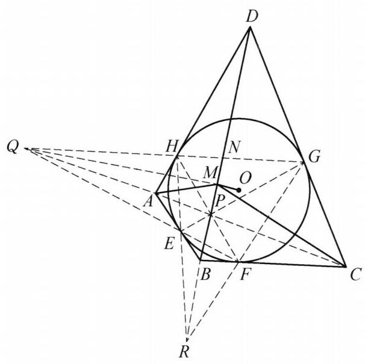

例 4 设四边形 ${ABCD}$ 的内切圆为圆 $O$ ,过 $O$ 作 ${OM} \bot  {BD}$ . 求证: ${BD}$ 平分 $\angle {AMC}$ .

证明 如图 7-4,设圆 $O$ 与 ${AB}$ , ${BC},{CD},{DA}$ 分别相切于点 $E, F, G$ , $H$ ,连接 ${AC}$ 与 ${BD}$ 交于点 $P$ . 由牛顿定理,知 ${EG},{FH}$ 也过点 $P$ . 设 ${GH}$ 与 ${FE}$ 的延长线交于点 $Q,{HE}$ 与 ${GF}$ 的延长线交于点 $R$ . 因为 ${EF}$ 为 $B$ 关于圆 $O$ 的极线, $Q$ 在直线 ${EF}$ 上,所以由配极原则知 $Q$ 关于圆 $O$ 的极线过点 $B$ . 同理可得 $Q$ 关于圆 $O$ 的极线过 $D$ ,于是直线 ${BD}$ 是 $Q$ 关于圆 $O$ 的极线.

图 7-4

因为 ${QHG},{QEF}$ 为圆 $O$ 的割线, ${HE}$ 与 ${GF}$ 交于点 $R$ ,所以 ${PR}$ 为 $Q$ 关于圆 $O$ 的极线,于是 $D, P, B, R$ 四点共线. 同理可得 $Q, A, P, C$ 四点共线.

设 ${HG}$ 与 ${BD}$ 交于点 $N$ ,由 ${DR}$ 为 $Q$ 关于圆 $O$ 的极线,知 $Q, N, H, G$ 为调和点列,则 ${DQ},{DN},{DH},{DG}$ 为调和线束,于是 $Q, A, P, C$ 也为调和点列.

连接 ${QO}$ ,由 ${BD}$ 为 $Q$ 关于圆 $O$ 的极线,知 ${QO} \bot  {BD}$ ,结合题设条件,知 $Q$ , $M, O$ 三点共线,故 $\angle {QMD} = {90}^{ \circ  }$ ,于是 ${BD}$ 平分 $\angle {AMC}$ .

原问题得证.

注:垂直结合角平分线容易想到调和点列，再结合牛顿定理及极线即可完成证明.

这是一个费解的证明。我能确认每一步的正确性，但我想知道这是怎么想出来的。请为我解释。