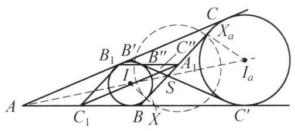

## 题目 (7.md)

例 6 (费尔巴哈定理)证明: 任意一个三角形的九点圆与其内切圆和三个旁切圆都相切.

证明 如图 7-6,设 ${A}_1,{B}_1,{C}_1$ 分别是 $\bigtriangleup {ABC}$ 三边的中点 (其外接圆就是九点圆), $I$ 为 $\bigtriangleup {ABC}$ 的内心, ${I}_a$ 为它的第一个旁切圆, $X,{X}_a$ 分别是圆 $I$ 与圆 ${I}_a$ 与 ${BC}$ 边的切点, ${B}^{\prime }{C}^{\prime }$ 为这两个圆的另一条内公切线, ${B}^{\prime },{C}^{\prime }$ 分别在 ${AC},{AB}$ 上, ${BC}$ 与 ${B}^{\prime }{C}^{\prime }$ 交于点 $S$ ,则 $A$ , $I, S,{I}_a$ 四点共线. 记 ${B}^{\prime }{C}^{\prime }$ 与 ${A}_1{B}_1,{A}_1{C}_1$ 的交点为 ${B}^{\prime \prime },{C}^{\prime \prime }$ .

图 7-6

以 ${A}_1$ 为反演中心,记 $\bigtriangleup {ABC}$ 的三边长为 $a, b, c, p = \frac{1}{2}\left( {a + b + c}\right)$ ,则易知 ${BX} = C{X}_a = p - b$ ，于是 ${A}_1$ 也是 $X{X}_a$ 的中点. 这样，以 $\frac{1}{2}X{X}_a$ 为反演半径作反演变换后，有以下结论.

(1) $X{X}_a = a - 2\left( {p - b}\right)  = b - c$ (不妨设 $b - c > 0$ ，否则重新标记顶点 $A, B$ ， $C)$ ，故反演半径为 $\frac{1}{2}\left( {b - c}\right)$ .

(2)九点圆过点 ${A}_1$ ，故其反演像为一条直线. 进一步，我们证明 ${B}_1,{C}_1$ 的反演像为 ${B}^{\prime \prime },{C}^{\prime \prime }$ .

事实上,由角平分线定理知 ${SC} = \frac{ab}{b + c},{SB} = \frac{ac}{b + c}$ ,于是

$$
S{A}_1 = \frac{1}{2}\left( {{SC} - {SB}}\right)  = \frac{a\left( {b - c}\right) }{2\left( {b + c}\right) }.
$$

另外,

$$
B{C}^{\prime } = A{C}^{\prime } - {AB} = {AC} - {AB} = b - c,
$$

同理 $C{B}^{\prime } = b - c$ . 从而,利用 $\bigtriangleup S{A}_1{B}^{\prime \prime } \backsim  \bigtriangleup {SB}{C}^{\prime }$ 及 $\bigtriangleup S{A}_1{C}^{\prime \prime } \backsim  \bigtriangleup {SC}{B}^{\prime }$ , 可知

$$
\frac{{A}_1{B}^{\prime \prime }}{b - c} = \frac{{A}_1{B}^{\prime \prime }}{B{C}^{\prime }} = \frac{S{A}_1}{SB} = \frac{b - c}{2c},
$$

$$
\frac{{A}_1{C}^{\prime \prime }}{b - c} = \frac{{A}_1{C}^{\prime \prime }}{C{B}^{\prime }} = \frac{S{A}_1}{SC} = \frac{b - c}{2b}.
$$

从而

$$
{A}_1{B}^{\prime \prime } \cdot  {A}_1{B}_1 = \frac{c}{2} \cdot  \frac{{\left( b - c\right) }^2}{2c} = {\left( \frac{b - c}{2}\right) }^2,
$$

$$
{A}_1{C}^{\prime \prime } \cdot  {A}_1{C}_1 = \frac{b}{2} \cdot  \frac{{\left( b - c\right) }^2}{2b} = {\left( \frac{b - c}{2}\right) }^{2}.
$$

所以 ${B}_1,{C}_1$ 的反演像为 ${B}^{\prime \prime },{C}^{\prime \prime }$ .

这一结论表明: 九点圆的像为通过 ${B}^{\prime \prime },{C}^{\prime \prime }$ 的直线.

(3)由于 ${A}_{1}X$ 为圆 $I$ 的切线(段)，故圆 $I$ 的反演像是其自身，同理圆 ${I}_a$ 的反演像也是其自身.

鉴于 ${B}^{\prime }{C}^{\prime }$ 为圆 $I$ 与圆 ${I}_a$ 的公切线，而它又是九点圆的反演像，所以，九点圆与圆 $I$ 和圆 ${I}_a$ 相切. 同理可证:九点圆与另外两个旁切圆相切. 定理获证.

这是一个费解的证明。我能确认每一步的正确性，但我想知道这是怎么想出来的。请为我解释。

---

\begin{solution}

这个证明之所以让人觉得“费解”，是因为教材采用了**“综合法”（正推）**的书写方式：作者一上来就把辅助线 $B'C'$、交点 $S, B'', C''$ 以及反演半径 $\frac{1}{2}(b-c)$ 像变魔术一样直接抛出来[cite: 1]，然后通过一通代数计算宣布“刚好相等，证毕”。这种写法完全掩盖了发现这个证明时的**“分析法”（逆向思维）**过程。

如果我们顺着发现者的真实思考路径倒推回去，你会发现这里的每一步选择几乎都是**唯一且必然**的；甚至书中第 (2) 步繁琐的边长计算，在几何本质上也是完全可以避免的。

---

### 第一步：为什么想到用反演？又为什么偏偏选 $A_1$ 作反演中心？

**目标**：证明九点圆同时与内切圆 $\odot I$ 和旁切圆 $\odot I_a$ 相切[cite: 1]。
如果直接用圆心距等于半径之和/差（$d = R \pm r$）去算，会陷入极其惨烈的三角恒等式或代数暴算。而在处理“多圆相切”问题时，**反演变换**是最强大的降维工具，因为它既保持相切关系，又能把圆拉直成直线。

那么，怎样选反演中心 $O$ 和反演半径 $R$ 最划算？最理想的情况需要同时满足两个愿望：
1. **把九点圆变成一条直线**：这要求反演中心 $O$ 必须选在**九点圆上**。九点圆上我们最熟悉的点，就是三边中点 $A_1, B_1, C_1$[cite: 1] 和三个垂足 $H_a, H_b, H_c$。
2. **让内切圆 $\odot I$ 和旁切圆 $\odot I_a$ 在反演下都“原地不动”（即反演像是它们自身）**[cite: 1]：
   * 一个圆在反演下保持不变的充要条件是：它与反演圆**正交**，即反演中心 $O$ 到该圆的切线长恰好等于反演半径 $R$（$R^2 = \text{Pow}(O, \odot)$）。
   * 要想让 $\odot I$ 和 $\odot I_a$ **同时**在同一个反演下保持不变，反演中心 $O$ 到这两个圆的切线长必须相等！也就是说，$O$ 必须落在这两个圆的**根轴（等幂轴）**上。

现在把这两个愿望合在一起看：在 $BC$ 边上，由于 $BC$ 与 $\odot I, \odot I_a$ 分别切于 $X, X_a$[cite: 1]，$BC$ 上到两圆切线长相等的点，显然就是线段 $XX_a$ 的中点。
而由三角形内切圆与旁切圆的经典切点性质（$BX = CX_a = p - b$），**$XX_a$ 的中点恰好就是 $BC$ 边的中点 $A_1$**[cite: 1]！

> **核心破局点**：中点 $A_1$ 迎来了一个几何奇迹——它**既在九点圆上，又在 $\odot I$ 与 $\odot I_a$ 的根轴上**！
> 因此，以 $A_1$ 为反演中心、以切线长 $A_1X = A_1X_a = \frac{1}{2}|b-c|$ 为反演半径作反演[cite: 1]，根本不是凑出来的巧合，而是为了同时实现“拉直九点圆”与“固定内切圆、旁切圆”的**唯一必然选择**。

---

### 第二步：为什么一上来就凭空画出另一条内公切线 $B'C'$？

一旦确定了以 $(A_1, A_1X)$ 进行反演，三个圆的命运就已经注定了：
* $\odot I$ 的反演像是它自己 $\odot I$[cite: 1]；
* $\odot I_a$ 的反演像是它自己 $\odot I_a$[cite: 1]；
* 九点圆过反演中心 $A_1$，所以它的反演像必然是一条直线 $\ell$[cite: 1]。

由于反演变换保持相切关系，原命题“九点圆与 $\odot I, \odot I_a$ 都相切”，在反演后就等价于：
**“直线 $\ell$ 与 $\odot I, \odot I_a$ 都相切”——即直线 $\ell$ 必须是 $\odot I$ 与 $\odot I_a$ 的一条公切线[cite: 1]！**

可是，两个相离的圆 $\odot I$ 和 $\odot I_a$ 总共只有 **4 条**公切线：
* 两条外公切线：$AB$ 和 $AC$；
* 两条内公切线：$BC$ 和另一条内公切线 $B'C'$[cite: 1]。

九点圆的反演像 $\ell$ 会是哪一条呢？显然不可能是过反演中心的 $BC$，从图形位置看也不可能是 $AB$ 或 $AC$。所以，**如果费尔巴哈定理是对的，九点圆反演出来的那条直线 $\ell$ 除了是第四条公切线 $B'C'$ 之外，别无可能[cite: 1]！**

这就是为什么作者在证明的第一段就急匆匆地把另一条内公切线 $B'C'$ 画出来[cite: 1]——因为那是他通过逆向分析早就看穿的“终点靶心”。

---

### 第三步：书中第 (2) 步的 $B'', C''$ 和边长计算是怎么想出来的？

既然已经猜到了“九点圆的反演像必然是直线 $B'C'$”，接下来只需要写一段严谨的证明去确认它。

教材作者采取的是最朴素的**“代点验证法”**：
1. 九点圆是由 $A_1, B_1, C_1$ 三点决定的外接圆[cite: 1]，因此它的反演像直线 $\ell$ 由 $B_1, C_1$ 的反演像 $B_1^*, C_1^*$ 决定。
2. 根据反演的定义，$B_1^*$ 一定在射线 $A_1 B_1$ 上。如果反演像直线真的就是 $B'C'$，那么 $B_1^*$ 必须同时在直线 $B'C'$ 上——也就是说，**$B_1^*$ 只能是 $A_1 B_1$ 与 $B'C'$ 的交点 $B''$**[cite: 1]！同理，$C_1^*$ 只能是交点 $C''$[cite: 1]。
3. 于是问题转化为纯计算验证：只要算出 $A_1 B_1 \cdot A_1 B''$ 恰好等于反演半径的平方 $\left(\frac{b-c}{2}\right)^2$，就能宣布 $B''$ 确实是 $B_1$ 的反演点[cite: 1]。
4. 至于怎么算 $A_1 B''$：因为 $A_1 B_1 \parallel AB$（中位线），图中天然存在字形相似 $\triangle SA_1 B'' \sim \triangle SBC'$[cite: 1]；而 $S, B', C'$ 的位置全由内角平分线 $AI I_a$ 的对称性控制（$B'C'$ 与 $BC$ 关于角平分线 $AS$ 对称，故 $AB' = AB = c \implies CB' = b-c$，且 $S$ 为 $\angle A$ 的内角平分线与 $BC$ 的交点）[cite: 1]。顺着相似比算下来，自然水到渠成[cite: 1]。

---

### 第四步：降维视角——如何不写一行代数计算，一眼看穿第 (2) 步？

如果你觉得第 (2) 步借助 $B'', C''$ 算边长还是过于“匠气”，我们可以用**反平行（Antiparallel）**与**调和点列（Harmonic Bundle）**的几何性质，实现真正的“零计算”秒杀。

要证明九点圆的反演像直线 $\ell$ 就是 $B'C'$，我们只需要确定两件事：**直线 $\ell$ 的方向**，以及**直线 $\ell$ 上的一个定点**。

1. **看方向（天然平行于 $B'C'$）**：
   * 九点圆是 $\triangle A_1 B_1 C_1$ 的外接圆[cite: 1]。在以顶点 $A_1$ 为中心的**任意**反演变换下（无论反演半径是多少），由于 $A_1 B_1 \cdot A_1 B_1^* = A_1 C_1 \cdot A_1 C_1^*$，必有 $\triangle A_1 B_1^* C_1^* \sim \triangle A_1 C_1 B_1$（反向相似）。
   * 这意味着，反演像直线 $\ell$（即 $B_1^* C_1^*$）与直线 $B_1 C_1$ 关于 $\angle B_1 A_1 C_1$ 的角平分线是**对称（反平行）**的。
   * 注意到中位线 $A_1 B_1 \parallel AB$，$A_1 C_1 \parallel AC$，$B_1 C_1 \parallel BC$，所以把 $B_1 C_1$ 关于 $\angle B_1 A_1 C_1$ 的平分线作对称，其方向等价于**把 $BC$ 关于 $\angle A$ 的平分线 $AS$ 作对称**。
   * 而内切圆与旁切圆本身关于角平分线 $AS$ 对称，它们的两条内公切线 $BC$ 与 $B'C'$ 必然也关于 $AS$ 对称[cite: 1]！
   * **结论**：无论反演半径取多少，九点圆关于 $A_1$ 的反演像直线 $\ell$，在方向上**天然就平行于 $B'C'$**！

2. **看定点（垂足 $H_a$ 直接反演到交点 $S$）**：
   * 既然方向已经平行于 $B'C'$，我们只需要说明 $\ell$ 经过 $B'C'$ 与 $BC$ 的交点 $S$ 即可[cite: 1]。
   * 在直线 $BC$ 上，九点圆除了经过中点 $A_1$，还经过 $A$ 点的高线垂足 **$H_a$**！如果 $\ell$ 经过点 $S$，那么 $S$ 就必须是垂足 $H_a$ 的反演像。
   * 为什么 $H_a$ 和 $S$ 互为反演点？看角平分线 $AS$（其上有 $A, I, S, I_a$ 四点共线[cite: 1]）：在 $\triangle ABS$ 中，$BI$ 和 $BI_a$ 分别是 $\angle B$ 的内、外角平分线，因此直线 $AS$ 上的四个点构成经典的**调和点列**：
     $$(A, S; I, I_a) = -1$$
   * 现在，将直线 $AS$ 上的这四个点向 $BC$ 边作**正交投影（垂线）**：
     * $A$ 的投影是高线垂足 $H_a$；
     * $S$ 本身就在 $BC$ 上，投影是 $S$；
     * $I$ 和 $I_a$ 的投影恰好就是切点 $X$ 和 $X_a$[cite: 1]！
   * 因为平行投影保持交比不变，所以 $BC$ 上的这四个点也是调和点列：
     $$(H_a, S; X, X_a) = -1$$
   * 又因为 $A_1$ 是 $XX_a$ 的中点[cite: 1]，由调和点列的**牛顿公式（Newton's Relation）**立刻得到：
     $$A_1 H_a \cdot A_1 S = A_1 X^2 = R^2$$

这说明九点圆上的垂足 $H_a$ 在反演下直接映到了点 $S$！一条直线既过点 $S$，方向又与 $B'C'$ 平行，它就只能是公切线 $B'C'$ 本身。从这个视角回看教材的证明，第 (2) 步的计算其实就是把这段射影与反平行性质用初中相似三角形的语言“翻译”了一遍。

\end{solution}