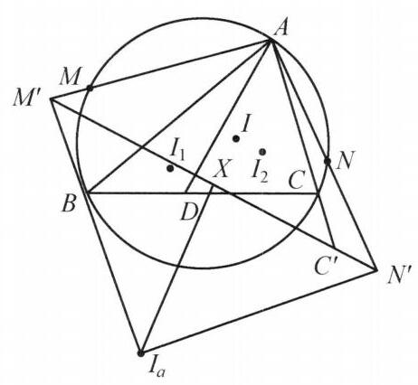

## 第七讲 反演与位似

## 知识精讲

## 一、反演

给定一个以 $O$ 为圆心的圆 $\omega$ ,其半径为 $r$ ,对平面上异于点 $O$ 的任意一点 $P$ , 称射线 ${OP}$ 上满足 ${OP} \cdot  O{P}^{\prime } = {r}^2$ 的点 ${P}^{\prime }$ 为点 $P$ 的反演点,其中 $O$ 称为反演中心, $r$ 称为反演半径, $\omega$ 称为反演圆, ${r}^2$ 称为反演幂.

反演变换有下面几个重要的性质:

1. 反演圆 $\omega$ 的反演像是它本身，任何过点 $O$ 的直线(除 $O$ 外)是它自己的反演像.

2. 不过 $O$ 的直线的反演像是一个过点 $O$ 的圆 (不包括点 $O$ )，记该圆为 $\Omega$ . 反之也成立，并且该直线与 $\Omega$ 的过 $O$ 的切线平行.

3. 不过 $O$ 的圆的反演像仍为一个圆.

4. 设点 $A, B$ 的反演像为 ${A}^{\prime },{B}^{\prime }$ ，则 ${A}^{\prime }{B}^{\prime } = \frac{{r}^2 \cdot  {AB}}{{OA} \cdot  {OB}}$ .

5. 任意两条曲线在其交点处的交角若为 $\theta$ ，则经过反演变换后，其反演像在其交点 (原交点的反演像) 处的交角仍为 $\theta$ ,这一性质称为反演变换的保角性.

## 二、极点与极线

设点 $A$ 关于圆 $O$ 的反演点为 $B$ ，过点 $B$ 作 ${OA}$ 的垂线 $l$ ，则称 $l$ 为 $A$ 对圆 $O$ 的极线，点 $A$ 称为 $l$ 关于圆 $O$ 的极点.

配极定理:如果点 $A$ 的极线经过点 $D$ ，那么点 $D$ 的极线经过点 $A$ .

## 三、位似

选定平面上一点 $S$ 及一个数 $k\left( {k \neq  0}\right)$ ，过任一点 $M$ 与点 $S$ 作直线，在该直线上沿 ${SM}$ 方向或相反的方向取一点 ${M}^{\prime }$ ，使得 $\frac{S{M}^{\prime }}{SM} = k$ ，则称 ${M}^{\prime }$ 为 $M$ 的位似点，点 $S$ 称为位似中心， $k$ 称为位似比. 若 $k > 0$ ，则 $M$ ， ${M}^{\prime }$ 在 $S$ 的同侧， $S$ 为外分点，此时称为正位似; 若 $k < 0$ ,则 $M,{M}^{\prime }$ 在 $S$ 的两侧, $S$ 为内分点,此时称为反位似,特别地 $k =  - 1$ 时,就是熟知的中心对称.

位似变换的性质:

1. 一对位似变换的对应点与位似中心共线.

2. 位似变换下,一条直线或曲线上的点,保持顺序变到一条直线或曲线上,即共线点变为共线点,共点线变为共点线.

3. 位似变换下, 对应线段之比相等, 对应角相等且转向相同, 对应面积比等于位似比的平方.

## 典型例题

---

例 1 设 $\bigtriangleup {ABC}$ 的内切圆 $I$ 与 ${BC},{CA},{AB}$ 分别切于点 $D, E, F, M, N$ 分别是 $\bigtriangleup {ABC}$ 的外接圆 $\omega$ 的弧 $\overset{\text{ ⏜ }}{AC},\overset{\text{ ⏜ }}{AB}$ 的中点, ${ME},{NF}$ 交于点 $P,{PB},{PC}$ 与圆 $I$ 交于点 $X, Y$ . 证明: ${XY}//{BC}$ .

证明 如图 7-1,设弧 $\overset{\text{ ⏜ }}{BC}$ 的中点为 $R$ ,过 $M, N, R$ 做 $\omega$ 的切线交成 $\bigtriangleup {A}^{\prime }{B}^{\prime }{C}^{\prime }$ . 记 $\omega$ 的圆心为 $O$ ,则 ${ON} \bot  {A}^{\prime }{B}^{\prime }$ . 又由垂径定理知 ${ON} \bot  {AB}$ ,于是 ${AB}//{A}^{\prime }{B}^{\prime }$ . 同理可得 ${BC}//{B}^{\prime }{C}^{\prime },{CA}//{C}^{\prime }{A}^{\prime }$ . 所以,存在将点 $A$ 变为 ${A}^{\prime }, B$ 变为 ${B}^{\prime }, C$ 变为 ${C}^{\prime }$ 的位似变换. 此变换也将 $F$ 变为 $N, E$ 变为 $M$ , 从而 $P$ 为位似中心,故 $P, B,{B}^{\prime }$ 共线, $P$ , $C,{C}^{\prime }$ 也共线,注意到该位似变换将圆 $I$ 变为圆 $\omega$ ,结合 $X$ 在 ${PB}$ 上, $Y$ 在 ${PC}$ 上,知 ${XY}//{BC}$ . 原问题得证.

图 7-1

注:通过位似变换将切点与弧中点相互转换是一个常见手法.

---

例 2 如图 7-2,锐角 $\bigtriangleup {ABC}$ 中, $H$ 为其垂心,圆 $\Omega$ 为其九点圆,圆 $\omega$ 为 $\bigtriangleup {BHC}$ 的外接圆,圆心为 ${O}^{\prime }, X$ 为圆 $\omega$ 上弧 ${BHC}$ 上一点. 延长 ${AX}$ 与圆 $\Omega$ 交于 $Y, P$ 在圆 $\Omega$ 上且 ${PX} = {PY}$ . 证明: $\angle {O}^{\prime }{PX} = {90}^{ \circ  }$ .

证明 如图 7-2,设 ${AB},{AC},{AH}$ 的中点分别为 ${B}^{\prime },{C}^{\prime },{H}^{\prime }$ ,则 ${B}^{\prime },{C}^{\prime }$ , ${H}^{\prime }$ 均在圆 $\Omega$ 上. 因为 $A$ 是 $\bigtriangleup {B}^{\prime }{C}^{\prime }{H}^{\prime }$ 与 $\bigtriangleup {BCH}$ 的位似中心,且位似比为 $\frac{1}{2}$ ,所以 $A$ 是圆 $\Omega$ 与圆 $\omega$ 的外位似中心,且位似比为 $\frac{1}{2}$ .

图 7-2

延长 ${AP},{AY}$ 与圆 $\omega$ 分别交于点 $Q, K$ ,则 ${AQ} = {2AP},{AK} = {2AY}$ ,于是

$$
{PY} \text{ ⫫ } \frac{1}{2}{QK}.
$$

延长 ${XP}$ 与圆 $\omega$ 交于点 $Z$ . 由 ${PX} = {PY}$ 得 $\angle {QKX} = \angle {PYX} = \angle {PXY}$ . 于是 $\angle {ZKX} = \angle {QXY}$ , 故 ${XZ} = {QK} = {2PY} = {2PX}$ ，即 $P$ 是 ${XZ}$ 的中点，故由垂径定理，得 ${O}^{\prime }P \bot  {PX}$ .

原问题得证.

---

例 3 设四边形 ${ABCD}$ 内接于圆 $O, W, X, Y, Z$ 分别为 ${AB},{BC},{CD},{DA}$ 的中点. 证明: $\bigtriangleup {AOC},\bigtriangleup {BOD},\bigtriangleup {WOY},\bigtriangleup {XOZ}$ 的外接圆除了点 $O$ 之外还有一个公共点.

图 7-3

证明 如图 7-3,以 $O$ 为反演中心,圆 $O$ 的半径为反演半径作反演变换. 在此变换下,点 $W, X, Y, Z$ 的反演像分别为 ${W}^{\prime },{X}^{\prime },{Y}^{\prime },{Z}^{\prime }$ . 注意到 ${W}^{\prime }$ 在射线 ${OW}$ 上且 ${OW} \cdot  O{W}^{\prime } = O{A}^2$ . 因为 $W$ 是 ${AB}$ 的中点,所以 $\angle {OWA} = {90}^{ \circ  }$ ,结合 ${OW} \cdot  O{W}^{\prime } = \; O{A}^2$ 知 $\angle {W}^{\prime }{AO} = {90}^{ \circ  }$ ,即 ${W}^{\prime }A$ 与圆 $O$ 相切.

同理可得 ${X}^{\prime }B,{Y}^{\prime }C,{Z}^{\prime }D$ 均与圆 $O$ 相切,于是四边形 ${W}^{\prime }{X}^{\prime }{Y}^{\prime }{Z}^{\prime }$ 为圆 $O$ 的外切四边形,切点分别为 $B, C, D, A$ . 由牛顿定理,得 ${AC},{BD},{W}^{\prime }{Y}^{\prime },{X}^{\prime }{Z}^{\prime }$ 共点于 ${M}^{\prime }$ ,于是圆 ${AOC}$ ,圆 ${BOD}$ ,圆 ${WOY}$ ,圆 ${XOZ}$ 也交于 ${M}^{\prime }$ 的反演点 $M$ .

---

例 4 设四边形 ${ABCD}$ 的内切圆为圆 $O$ ,过 $O$ 作 ${OM} \bot  {BD}$ . 求证: ${BD}$ 平分 $\angle {AMC}$ .

证明 如图 7-4,设圆 $O$ 与 ${AB}$ , ${BC},{CD},{DA}$ 分别相切于点 $E, F, G$ , $H$ ,连接 ${AC}$ 与 ${BD}$ 交于点 $P$ . 由牛顿定理,知 ${EG},{FH}$ 也过点 $P$ . 设 ${GH}$ 与 ${FE}$ 的延长线交于点 $Q,{HE}$ 与 ${GF}$ 的延长线交于点 $R$ . 因为 ${EF}$ 为 $B$ 关于圆 $O$ 的极线, $Q$ 在直线 ${EF}$ 上,所以由配极原则知 $Q$ 关于圆 $O$ 的极线过点 $B$ . 同理可得 $Q$ 关于圆 $O$ 的极线过 $D$ ,于是直线 ${BD}$ 是 $Q$ 关于圆 $O$ 的极线.

图 7-4

因为 ${QHG},{QEF}$ 为圆 $O$ 的割线, ${HE}$ 与 ${GF}$ 交于点 $R$ ,所以 ${PR}$ 为 $Q$ 关于圆 $O$ 的极线,于是 $D, P, B, R$ 四点共线. 同理可得 $Q, A, P, C$ 四点共线.

设 ${HG}$ 与 ${BD}$ 交于点 $N$ ,由 ${DR}$ 为 $Q$ 关于圆 $O$ 的极线,知 $Q, N, H, G$ 为调和点列,则 ${DQ},{DN},{DH},{DG}$ 为调和线束,于是 $Q, A, P, C$ 也为调和点列.

连接 ${QO}$ ,由 ${BD}$ 为 $Q$ 关于圆 $O$ 的极线,知 ${QO} \bot  {BD}$ ,结合题设条件,知 $Q$ , $M, O$ 三点共线,故 $\angle {QMD} = {90}^{ \circ  }$ ,于是 ${BD}$ 平分 $\angle {AMC}$ .

原问题得证.

注:垂直结合角平分线容易想到调和点列，再结合牛顿定理及极线即可完成证明.

---

例 5 给定 $\bigtriangleup {ABC}$ ，点 $D$ 为边 ${BC}$ 上的一个动点， $\bigtriangleup {ABC}$ ， $\bigtriangleup {ABD}$ ， $\bigtriangleup {ACD}$ 的内心分别为 $I$ ， ${I}_1$ ， ${I}_2$ ， $\bigtriangleup {IA}{I}_1$ ， $\bigtriangleup {IA}{I}_2$ 的外接圆与 $\bigtriangleup {ABC}$ 的外接圆分别交于异于点 $A$ 的点 $M, N$ . 证明: 直线 ${MN}$ 过一个定点.

图 7-5

证明 如图 7-5,以 $A$ 为反演中心, $\sqrt{{AB} \cdot  {AC}}$ 为反演半径进行反演变换. 设 ${I}_a$ 为 $\bigtriangleup {ABC}$ 的 $A -$ 旁心,则点 $I$ 的反演像为 ${I}_a$ . 设点 $B, C$ 的反演像分别为 ${B}^{\prime },{C}^{\prime }$ ,则点 $M, N$ 的反演像 ${M}^{\prime },{N}^{\prime }$ 均在直线 ${B}^{\prime }{C}^{\prime }$ 上. 圆 ${ABC}$ 的反演像为直线 ${B}^{\prime }{C}^{\prime }$ . 圆 ${IAM}$ ,圆 ${IAN}$ 的反演像分别为直线 ${I}_a{M}^{\prime },{I}_a{N}^{\prime }$ .

设圆 ${IAM}$ 和圆 ${IAN}$ 的圆心分别为 ${O}_1,{O}_2$ ,则

$$
\angle {O}_1{AI} = {90}^{ \circ  } - \angle A{I}_{1}I,
$$

$$
\angle {O}_2{AI} = {90}^{ \circ  } - \angle A{I}_{2}I
$$

而

$$
\angle A{I}_{1}I = {90}^{ \circ  } - \frac{1}{2}\angle {ADB},
$$

$$
\angle A{I}_{2}I = {90}^{ \circ  } - \frac{1}{2}\angle {ADC}.
$$

所以

$$
\angle {O}_{1}A{O}_2 = \angle {O}_1{AI} + \angle {O}_2{AI}
$$

$$
= {180}^{ \circ  } - \left( {{90}^{ \circ  } - \frac{1}{2}\angle {ADB}}\right)  - \left( {{90}^{ \circ  } - \frac{1}{2}\angle {ADC}}\right)
$$

$$
= \frac{1}{2}\left( {\angle {ADB} + \angle {ADC}}\right)
$$

$$
= {90}^{ \circ  }\text{ . }
$$

即圆 ${O}_1$ 与圆 ${O}_2$ 正交，由反演变换的保角性知 $\angle {M}^{\prime }{I}_a{N}^{\prime } = {90}^{ \circ  }$ . 设 ${I}_a$ 在直线 ${B}^{\prime }{C}^{\prime }$ 上的射影为点 $X$ ，则 $\overline{X{M}^{\prime }} \cdot  \overline{X{N}^{\prime }} =  - {\overline{X{I}_{a}}}^{2}$ 为定值.①

下面只需证明: $\bigtriangleup  A{M}^{\prime }{N}^{\prime }$ 的外接圆过异于 $A$ 的定点.②

由①知点 $X$ 对 $\bigtriangleup  A{M}^{\prime }{N}^{\prime }$ 的幂为定值，故这组圆 $A{M}^{\prime }{N}^{\prime }$ 为共轴圆， ${AX}$ 为根轴，于是它们过除 $A$ 外的另一个定点. 原问题得证.

注:多圆过同一点的问题，常常考虑利用反演变换将其转化为直线型问题去处理.

---

例 6 (费尔巴哈定理)证明: 任意一个三角形的九点圆与其内切圆和三个旁切圆都相切.

证明 如图 7-6,设 ${A}_1,{B}_1,{C}_1$ 分别是 $\bigtriangleup {ABC}$ 三边的中点 (其外接圆就是九点圆), $I$ 为 $\bigtriangleup {ABC}$ 的内心, ${I}_a$ 为它的第一个旁切圆, $X,{X}_a$ 分别是圆 $I$ 与圆 ${I}_a$ 与 ${BC}$ 边的切点, ${B}^{\prime }{C}^{\prime }$ 为这两个圆的另一条内公切线, ${B}^{\prime },{C}^{\prime }$ 分别在 ${AC},{AB}$ 上, ${BC}$ 与 ${B}^{\prime }{C}^{\prime }$ 交于点 $S$ ,则 $A$ , $I, S,{I}_a$ 四点共线. 记 ${B}^{\prime }{C}^{\prime }$ 与 ${A}_1{B}_1,{A}_1{C}_1$ 的交点为 ${B}^{\prime \prime },{C}^{\prime \prime }$ .

图 7-6

以 ${A}_1$ 为反演中心,记 $\bigtriangleup {ABC}$ 的三边长为 $a, b, c, p = \frac{1}{2}\left( {a + b + c}\right)$ ,则易知 ${BX} = C{X}_a = p - b$ ，于是 ${A}_1$ 也是 $X{X}_a$ 的中点. 这样，以 $\frac{1}{2}X{X}_a$ 为反演半径作反演变换后，有以下结论.

(1) $X{X}_a = a - 2\left( {p - b}\right)  = b - c$ (不妨设 $b - c > 0$ ，否则重新标记顶点 $A, B$ ， $C)$ ，故反演半径为 $\frac{1}{2}\left( {b - c}\right)$ .

(2)九点圆过点 ${A}_1$ ，故其反演像为一条直线. 进一步，我们证明 ${B}_1,{C}_1$ 的反演像为 ${B}^{\prime \prime },{C}^{\prime \prime }$ .

事实上,由角平分线定理知 ${SC} = \frac{ab}{b + c},{SB} = \frac{ac}{b + c}$ ,于是

$$
S{A}_1 = \frac{1}{2}\left( {{SC} - {SB}}\right)  = \frac{a\left( {b - c}\right) }{2\left( {b + c}\right) }.
$$

另外,

$$
B{C}^{\prime } = A{C}^{\prime } - {AB} = {AC} - {AB} = b - c,
$$

同理 $C{B}^{\prime } = b - c$ . 从而,利用 $\bigtriangleup S{A}_1{B}^{\prime \prime } \backsim  \bigtriangleup {SB}{C}^{\prime }$ 及 $\bigtriangleup S{A}_1{C}^{\prime \prime } \backsim  \bigtriangleup {SC}{B}^{\prime }$ , 可知

$$
\frac{{A}_1{B}^{\prime \prime }}{b - c} = \frac{{A}_1{B}^{\prime \prime }}{B{C}^{\prime }} = \frac{S{A}_1}{SB} = \frac{b - c}{2c},
$$

$$
\frac{{A}_1{C}^{\prime \prime }}{b - c} = \frac{{A}_1{C}^{\prime \prime }}{C{B}^{\prime }} = \frac{S{A}_1}{SC} = \frac{b - c}{2b}.
$$

从而

$$
{A}_1{B}^{\prime \prime } \cdot  {A}_1{B}_1 = \frac{c}{2} \cdot  \frac{{\left( b - c\right) }^2}{2c} = {\left( \frac{b - c}{2}\right) }^2,
$$

$$
{A}_1{C}^{\prime \prime } \cdot  {A}_1{C}_1 = \frac{b}{2} \cdot  \frac{{\left( b - c\right) }^2}{2b} = {\left( \frac{b - c}{2}\right) }^{2}.
$$

所以 ${B}_1,{C}_1$ 的反演像为 ${B}^{\prime \prime },{C}^{\prime \prime }$ .

这一结论表明: 九点圆的像为通过 ${B}^{\prime \prime },{C}^{\prime \prime }$ 的直线.

(3)由于 ${A}_{1}X$ 为圆 $I$ 的切线(段)，故圆 $I$ 的反演像是其自身，同理圆 ${I}_a$ 的反演像也是其自身.

鉴于 ${B}^{\prime }{C}^{\prime }$ 为圆 $I$ 与圆 ${I}_a$ 的公切线，而它又是九点圆的反演像，所以，九点圆与圆 $I$ 和圆 ${I}_a$ 相切. 同理可证:九点圆与另外两个旁切圆相切. 定理获证.

---

例 7 设凸四边形 ${ABCD}$ 外切于一个圆 $O$ ，且已知 ${OA} = 5,{OB} = 6,{OC} = 7$ ， ${OD} = 8$ . 记线段 ${AC}$ ， ${BD}$ 的中点分别为 $M$ ， $N$ . 求 $\frac{OM}{ON}$ 的值.

图 7-7

证明 如图 7-7，设四边形 ${ABCD}$ 与圆 $O$ 的切点分别为 $E, F, G, H.$ 以 $O$ 为反演中心，圆 $O$ 为反演基圆作反演变换. 设 $A, B, C, D$ 的反演点分别为 ${A}^{\prime },{B}^{\prime },{C}^{\prime },{D}^{\prime }$ ,则 ${A}^{\prime },{B}^{\prime },{C}^{\prime },{D}^{\prime }$ 分别为 ${HE},{EF},{FG},{GH}$ 的中点,故

$$
{A}^{\prime }{B}^{\prime }\not{= }\frac{1}{2}{FH}\not{= }{C}^{\prime }{D}^{\prime },
$$

$$
{A}^{\prime }{D}^{\prime } \text{ ⫫ } \frac{1}{2}{EG} \text{ ⫫ } {B}^{\prime }{C}^{\prime }.
$$

所以 ${A}^{\prime }{C}^{\prime }$ 与 ${B}^{\prime }{D}^{\prime }$ 互相平分,设其交点为 $S$ .

设圆 $O$ 的半径为 $r$ ,由 $B,{B}^{\prime }$ 互为反演点,知

$$
{OB} \cdot  O{B}^{\prime } = {r}^{2}.
$$

同理可得 ${OD} \cdot  O{D}^{\prime } = {r}^2$ ,于是 ${OB} \cdot  O{B}^{\prime } = {OD} \cdot  O{D}^{\prime }$ ,即 $\frac{O{B}^{\prime }}{O{D}^{\prime }} = \frac{OD}{OB}$ . 所以 $\bigtriangleup {B}^{\prime }O{D}^{\prime } \backsim  \bigtriangleup {DOB}$ . 又因为 $S$ 为 ${B}^{\prime }{D}^{\prime }$ 的中点, $N$ 为 ${BD}$ 的中点,所以

$$
\frac{ON}{OS} = \frac{OB}{O{D}^{\prime }} = \frac{OB}{\frac{{r}^2}{OD}} = \frac{{OB} \cdot  {OD}}{{r}^2}.
$$

同理有 $\frac{OM}{OS} = \frac{{OA} \cdot  {OC}}{{r}^2}$ .

故

$$
\frac{OM}{ON} = \frac{{OA} \cdot  {OC}}{{OB} \cdot  {OD}} = \frac{35}{48}.
$$

注: 利用反演前后的相似比的表达式表示出 ${OM},{ON}$ 的长度,进而得到答案.

