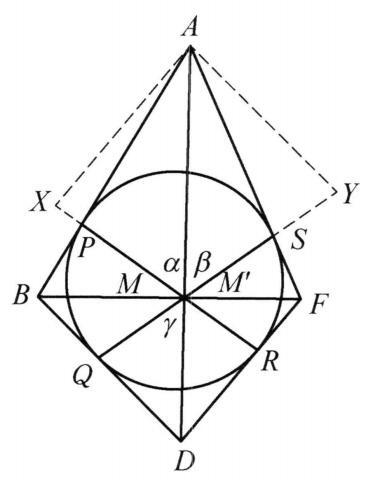
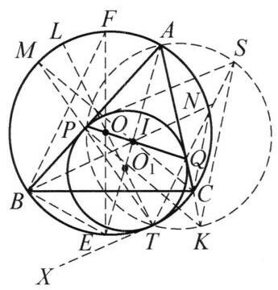
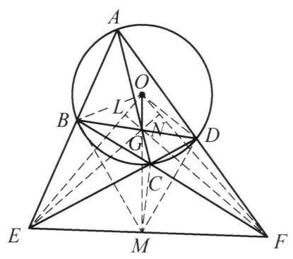
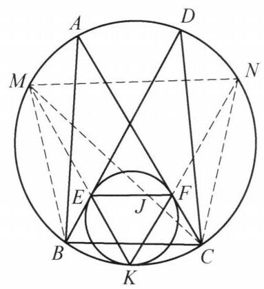
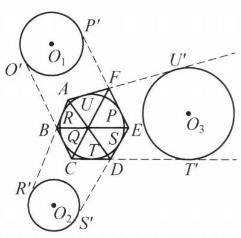
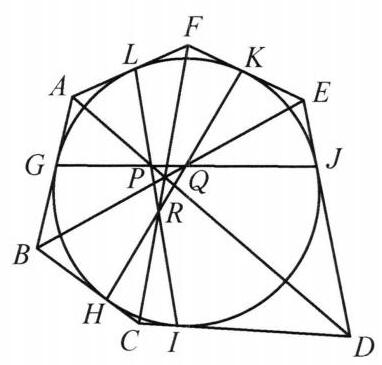

阅读欣赏

## 几个几何定理的证明

牛顿定理 圆外切四边形的对角线的交点和以切点为顶点的四边形的对角线的交点重合.

此定理说,若四边形 ${ABDF}$ 外切于圆,边 ${AB},{BD},{DF},{FA}$ 上的切点分别为 $P, Q, R, S$ ,则四条直线 ${AD},{BF},{PR},{QS}$ 交于形内一点.

图 7-8

证法 1 如图 7-8,设 ${AD}$ 与 ${PR}$ 交于点 $M,{AD}$ 与 ${QS}$ 交于点 ${M}^{\prime }$ ,下证 ${M}^{\prime }$ 与 $M$ 重合.

由切线的性质,知 $\angle {AS}{M}^{\prime } = \angle {BQ}{M}^{\prime }$ ,则有

$$
\frac{A{M}^{\prime } \cdot  S{M}^{\prime }}{Q{M}^{\prime } \cdot  D{M}^{\prime }} = \frac{{S}_{\bigtriangleup A{M}^{\prime }S}}{{S}_{\bigtriangleup D{M}^{\prime }Q}} = \frac{{AS} \cdot  S{M}^{\prime }}{{DQ} \cdot  Q{M}^{\prime }},
$$

即

$$
\frac{A{M}^{\prime }}{D{M}^{\prime }} = \frac{AS}{DQ}.
$$

同理,

$$
\frac{AM}{DM} = \frac{AP}{DR}.
$$

注意到

$$
{AP} = {AS},{DR} = {DQ},
$$

则

$$
\frac{AM}{DM} = \frac{AS}{DQ} = \frac{A{M}^{\prime }}{D{M}^{\prime }}.
$$

再由合比定理,有

$$
\frac{AM}{AD} = \frac{A{M}^{\prime }}{AD}.
$$

于是 ${M}^{\prime }$ 与 $M$ 重合,即知 ${AD},{PR},{QS}$ 三线共点.

同理, ${BF},{PR},{QS}$ 三线共点,故 ${AD},{BF},{PR},{QS}$ 四直线共点.

证法 2 如图 7-8,过 $A$ 作 ${AX}///{FD}$ 交直线 ${PR}$ 于 $X$ ,过 $A$ 作 ${AY}//{BD}$ 交直线 ${QS}$ 于 $Y$ ,设 ${AD}$ 与 ${PR},{QS}$ 分别交于点 $M,{M}^{\prime }$ ,则由 $\bigtriangleup {MAX} \backsim  \bigtriangleup {MDR}$ , $\bigtriangleup {M}^{\prime }{AY} \backsim  \bigtriangleup {M}^{\prime }{DQ}$ ,注意到 ${AX} = {AP},{AY} = {AS}$ ,

有

$$
\frac{MA}{MD} = \frac{AX}{DR} = \frac{AP}{DR},
$$

$$
\frac{{M}^{\prime }A}{{M}^{\prime }D} = \frac{AY}{DQ} = \frac{AS}{DQ} = \frac{AP}{DR},
$$

即

$$
\frac{MA}{MD} = \frac{{M}^{\prime }A}{{M}^{\prime }D}.
$$

从而 ${M}^{\prime }$ 与 $M$ 重合. 同证法 1,即知 ${AD},{BF},{PR},{QS}$ 四直线共点.

证法 3 如图 7-8,设 ${PR}$ 与 ${QS}$ 交于点 $M$ ,连 ${MA},{MB},{MD},{MF}$ . 设 $\angle {PMS} = \angle {QMR} = \alpha ,\angle {AMS} = \beta ,\angle {DMQ} = \gamma$ ,则 $\angle {AMP} = \alpha  - \beta ,\angle {DMR} = \; \alpha  - \gamma$ .

在 $\bigtriangleup {AMS}$ 中应用正弦定理,有

即

$$
\frac{AS}{\sin \beta } = \frac{AM}{\sin \angle {ASM}},
$$

$$
\frac{\sin \beta }{\sin \angle {ASQ}} = \frac{AS}{AM}.
$$

同理,在 $\bigtriangleup {APM}$ 中,有

$$
\frac{\sin \left( {\alpha  - \beta }\right) }{\sin \angle {APR}} = \frac{AP}{AM}.
$$

于是

$$
\frac{\sin \beta }{\sin \angle {ASQ}} = \frac{\sin \left( {\alpha  - \beta }\right) }{\sin \angle {APR}}.
$$

①

同理,在 $\bigtriangleup {DMR},\bigtriangleup {DMQ}$ 中,亦有

$$
\frac{\sin \gamma }{\sin \angle {DQS}} = \frac{\sin \left( {\alpha  - \gamma }\right) }{\sin \angle {DRP}}.
$$

②

注意到弦切角性质，有 $\angle {ASQ} + \angle {DQS} = {180}^{ \circ  }$ ，有

$$
\sin \angle {ASQ} = \sin \angle {DQS}.
$$

同理, $\sin \angle {APR} = \sin \angle {DRP}$ .

由①, ②得

$$
\frac{\sin \beta }{\sin \gamma } = \frac{\sin \left( {\alpha  - \beta }\right) }{\sin \left( {\alpha  - \gamma }\right) }
$$

展开化简得 $\sin \alpha  \cdot  \sin \left( {\beta  - \gamma }\right)  = 0$ .

而 $\sin \alpha  \neq  0,\beta  - \gamma  \in  \left( {-\pi ,\pi }\right)$ ,从而 $\sin \left( {\beta  - \gamma }\right)  = 0$ ,有 $\beta  = \gamma$ ,即 $A, M, D$ 共线.

同理, $B, M, F$ 共线,故 ${AD},{BF},{PR},{QS}$ 四直线共点.

曼海姆 (Mannheim) 定理 一圆切 $\bigtriangleup {ABC}$ 的两边 ${AB}$ 、 ${AC}$ 及外接圆于点 $P$ , $Q, T$ ,则 ${PQ}$ 必通过 $\bigtriangleup {ABC}$ 的内心 (还可证内心为 ${PQ}$ 的中点).

图 7-9

证法 1 如图 7-9,设已知圆与 $\bigtriangleup {ABC}$ 的外接圆的圆心分别为 ${O}_1, O,{PQ}$ 的中点为 $I$ ,则 $A, I,{O}_1$ 三点共线.

设直线 ${AI}$ 交 $\odot  O$ 于 $E$ 点,注意到 $T,{O}_1, O$ 共线,记过 ${O}_1$ 点 $\odot  O$ 的直径的另一端点为 $L$ ,则由相交弦定理,有

$$
{O}_{1}L \cdot  {O}_{1}T = {O}_{1}A \cdot  {O}_{1}E.
$$

③

由 ${O}_{1}P \bot  {AB},{O}_{1}A \bot  {PQ}$ ,有

$$
{O}_1{P}^2 = {O}_{1}I \cdot  {O}_{1}A.
$$

④

注意到 ${O}_{1}P = {O}_{1}T$ ,得

$$
{O}_{1}P \cdot  {TL} = {O}_{1}A \cdot  {EI}.
$$

⑤

作 $\odot  O$ 的直径 ${EF}$ ,由 Rt $\bigtriangleup {BEF} \backsim  \operatorname{Rt}\bigtriangleup P{O}_{1}A$ ,有

$$
{O}_{1}P \cdot  {EF} = {O}_{1}A \cdot  {BE}.
$$

⑥

由⑤、⑥,并注意 ${TL} = {EF}$ ，知 ${BE} = {EI}$ .

又 $E$ 为弧 $\overset{\text{ ⏜ }}{BC}$ 的中点，于是，知 $I$ 为 $\bigtriangleup  {ABC}$ 的内心，且 $I$ 在 ${PQ}$ 上.

证法 2 如图 7-9，设过点 $A, P, T$ 的圆交直线 ${TQ}$ 于点 $S$ ，交直线 ${AC}$ 于点 $K$ ，则由 $\angle {KST} = \angle {KAT} = \angle {CNT}$ ( $N$ 为 ${TS}$ 与 $\odot  O$ 的交点)，知 ${NC}//{SK}$ .

设直线 ${TP}$ 交 $\odot  O$ 于点 $M$ ，则知 $M$ 为 $\overset{\text{ ⏜ }}{AB}$ 的中点(读者可自证或参见下面的证法 4).

同理，知 $N$ 为 $\overset{\text{ ⏜ }}{AC}$ 的中点，从而 $\bigtriangleup {ABC}$ 的内心 $I$ 为 ${BN}$ 与 ${CM}$ 的交点.

又由 $\angle {QKP} = \angle {ATP} = \angle {ACM}$ ,知 ${PK}//{MC}$ .

由 $\angle {PST} = \angle {PAT} = \angle {BNT}$ ,知 ${BN}//{PS}$ .

于是,知 $\bigtriangleup {SPK}$ 与 $\bigtriangleup {NIC}$ 位似,且 $Q$ 为位似中心. 故 $I$ 在直线 ${PQ}$ 上.

证法 3 同证法 1 所设,延长 $A{O}_1$ 交 $\odot  O$ 于点 $E$ . 则 ${AE}$ 平分 $\angle {BAC}$ 及弧 $\overset{\text{ ⏜ }}{BC}$ . 设 $R, r$ 分别为 $\odot  O, \odot  {O}_1$ 的半径. 此时,点 ${O}_1$ 关于 $\odot  O$ 的幂为

$$
O{A}_1 \cdot  {O}_{1}E = \left( {{2R} - r}\right)  \cdot  r,
$$

且

$$
A{O}_1 = \frac{r}{\sin \frac{1}{2}\angle A},
$$

则

$$
{O}_{1}E = \left( {{2R} - r}\right)  \cdot  \sin \frac{1}{2}\angle A.
$$

设 $A{O}_1$ 交 ${PQ}$ 于 $I$ ,则

$$
{EI} = E{O}_1 + {O}_{1}I
$$

$$
= \left( {{2R} - r}\right)  \cdot  \sin \frac{1}{2}\angle A + r \cdot  \sin \frac{1}{2}\angle A
$$

$$
= {2R} \cdot  \sin \frac{1}{2}\angle A = {BE}.
$$

于是,由三角形内心的判定知 $I$ 为 $\bigtriangleup {ABC}$ 的内心且 $I$ 在直线 ${PQ}$ 上.

证法 4 如图 7-9,设直线 ${TP}$ 交 $\bigtriangleup {ABC}$ 的外接圆于点 $M$ ,连接 ${MC}$ ,则 ${MC}$ 平分 $\angle {ACM}$ (也可这样证: 过点 $T$ 作公切线 ${TX}$ ,

由

$$
\angle {XTP}\overset{m}{ = }\frac{1}{2}\overset{\text{ ⏜ }}{TP}\overset{m}{ = }\angle {BPT}\overset{m}{ = }\frac{1}{2}\left( {\overset{\text{ ⏜ }}{BT} + \overset{\text{ ⏜ }}{AM}}\right) ,
$$

$$
\angle {XTP} = \angle {MCT}\overset{m}{ = }\frac{1}{2}\overset{\text{ ⏜ }}{TM} = \frac{1}{2}\left( {\overset{\text{ ⏜ }}{TB} + \overset{\text{ ⏜ }}{BM}}\right) ,
$$

有

$$
\overset{\text{ ⏜ }}{BM} = \overset{\text{ ⏜ }}{AM}\text{ . ) }
$$

设直线 ${TQ}$ 交 $\bigtriangleup {ABC}$ 的外接圆于点 $N$ ,同理,知 ${BN}$ 平分 $\angle {ABC}$ .

在圆内接六边形 ${ABNTMC}$ 中,应用帕斯卡定理,知三双对边 ${AB}$ 与 ${TM}$ 的交点 $P,{BN}$ 与 ${MC}$ 的交点 $I,{TN}$ 与 ${AC}$ 的交点 $Q$ 三点共线. 而 $I$ 为 $\bigtriangleup {ABC}$ 内心, 则知内心在 ${PQ}$ 上. (若注意到 ${AP} = {AQ},\angle {BAC}$ 的平分线交 ${PQ}$ 于其中点,即知 $I$ 为 ${PQ}$ 中点.)

勃罗卡 (Brocard) 定理 凸四边形 ${ABCD}$ 内接于 $\odot  O$ ,延长 ${AB}\text{ 、 }{DC}$ 交于点 $E$ ，延长 ${BC}$ 、 ${AD}$ 交于点 $F$ ， ${AC}$ 与 ${BD}$ 交于点 $G$ . 连接 ${EF}$ ，则 ${OG}\bot {EF}$ .

图 7-10

证法 1 如图 7-10，在射线 ${EG}$ 上取一点 $N$ ,使得 $N, D, C, G$ 四点共圆 (即取完全四边形 ${ECDGAB}$ 的密克尔点 $N)$ ,从而 $B, G, N, A$ 及 $E, D, N, B$ 分别四点共圆.

分别注意到点 $E, G$ 对 $\odot  O$ 的幂, $\odot  O$ 的半径为 $R$ ,则

$$
{EG} \cdot  {EN} = {EC} \cdot  {ED} = O{E}^2 - {R}^{2}.
$$

$$
{EG} \cdot  {GN} = {BG} \cdot  {GD} = {R}^2 - O{G}^{2}.
$$

以上两式相减得

即

$$
E{G}^2 = O{E}^2 - {R}^2 - \left( {{R}^2 - O{G}^2}\right) ,
$$

$$
O{E}^2 - E{G}^2 = 2{R}^2 - O{G}^{2}.
$$

$$
O{F}^2 - F{G}^2 = 2{R}^2 - O{G}^{2}.
$$

同理，

又由上述两式，有 $O{E}^2 - E{G}^2 = O{F}^2 - F{G}^2$ .

于是，由定差幂线定理，知 ${OG}\bot {EF}$ .

证法 2 如图 7-10，注意到完全四边形的性质. 在完全四边形 ${ECDGAB}$ 中， 其密克尔点 $N$ 在直线 ${EG}$ 上，且 ${ON} \bot  {EG}$ ，由此知 $N$ 为过点 $G$ 的 $\odot  O$ 的弦的中点，亦即知 $O, N, F$ 三点共线，从而 ${EN} \bot  {OF}$ .

同理，在完全四边形 FDAGBC 中，其密克尔点 $L$ 在直线 ${FG}$ 上，且 ${OL}\bot {FG}$ ， 亦有 ${FL} \bot  {OE}$ .

于是，知 $G$ 为 $\bigtriangleup  {OEF}$ 的垂心，故 ${OG}\bot {EF}$ .

证法 3 如图 7-10，注意到完全四边形的性质，在完全四边形 ${ABECFD}$ 中， 其密克尔点 $M$ 在直线 ${EF}$ 上，且 ${OM}\bot {EF}$ . 连接 ${BM},{CM},{DM},{OB},{OD}$ .

此时，由密克尔点的性质，知 $E, M, C, B$ 四点共圆， $M, F, D, C$ 四点共圆，

即有

$$
\angle {BME} = \angle {BCE} = \angle {DCF} = \angle {DMF},
$$

从而

$$
\angle {BMO} = \angle {DMO} = {90}^{ \circ  } - \angle {DMF} = {90}^{ \circ  } - \angle {DCF}
$$

$$
= {90}^{ \circ  } - \left( {{180}^{ \circ  } - \angle {BCD}}\right)  = \angle {BCD} - {90}^{ \circ  }
$$

$$
= \left( {{180}^{ \circ  } - \frac{1}{2}\angle {BOD}}\right)  - {90}^{ \circ  }
$$

$$
= {90}^{ \circ  } - \frac{1}{2}\angle {BOD}
$$

$$
= \angle {ODB}
$$

即知点 $M$ 在 $\bigtriangleup {OBD}$ 的外接圆上.

同理，知点 $M$ 也在 $\bigtriangleup {OAC}$ 的外接圆上，亦即知 ${OM}$ 为 $\odot  {OBD}$ 与 $\odot  {OAC}$ 的公共弦.

由于三圆 $\odot  O, \odot  {OBD}, \odot  {OAC}$ 两两相交，由根心定理，知其三条公共弦 ${BD},{AC},{OM}$ 共点于 $G$ . 即知 $O, G, M$ 共线，故 ${OG}\bot {EF}$ .

图 7-11

沢山引理 如图 7-11,设两圆内切于点 $K,{AC}$ , ${BD}$ 是与小圆相切的大圆的弦,切点分别是 $F, E$ ,则直线 ${EF}$ 经过 $\bigtriangleup {ABC}$ 和 $\bigtriangleup {DBC}$ 的内心.

证明 延长 ${KE},{KF}$ ,分别交大圆于点 $M, N$ ,连接 ${MN},{MB},{NC},{MC}$ ,则以下事实成立:

(1)由位似知 ${EF}//{MN}$ ；

(2) $M$ ， $N$ 分别是弧 $\overset{\text{ ⏜ }}{BD}$ ， $\overset{\text{ ⏜ }}{AC}$ 的中点；

(3) $M{B}^2 = {ME} \cdot  {MK}, N{C}^2 = {NF} \cdot  {NK}$ .

又设 ${CM}$ 与 ${EF}$ 交于点 $J$ ，只需证 ${MB} = {MJ}$ 即可. 下面给出证明.

$$
\frac{MJ}{ME} = \frac{\sin \angle {MEJ}}{\sin \angle {MJE}}
$$

$$
= \frac{\sin \angle {EMN}}{\sin \angle {JMN}} = \frac{NK}{NC} = \sqrt{\frac{NK}{NF}}
$$

$$
= \sqrt{\frac{MK}{ME}} = \frac{MB}{ME},
$$

于是 ${MJ} = {MB}, J$ 为 $\bigtriangleup {DBC}$ 的内心,同理 $\bigtriangleup {ABC}$ 的内心亦在直线 ${EF}$ 上, 证毕.

布利安香定理 若一个六边形的六条边与一个圆相切, 则它的三条相对顶点连线共点或者彼此平行.

证法 1 如图 7-12,设 ${ABCDEF}$ 是凸六边形,且六条边与一个圆相切, $R, Q, T, S, P, U$ 分别是切点,对角线 ${AD},{BE},{CF}$ 都是内切圆的割线,因此不可能互相平行,在线段 ${EF},{CB},{AB},{ED},{CD},{AF}$ 的延长线上取点 ${P}^{\prime },{Q}^{\prime },{R}^{\prime },{S}^{\prime },{T}^{\prime },{U}^{\prime }$ ,使得 $P{P}^{\prime } = \; Q{Q}^{\prime } = R{R}^{\prime } = S{S}^{\prime } = T{T}^{\prime } = U{U}^{\prime }$ . 容易证明,可作圆 ${O}_1$ 与 $P{P}^{\prime }$ 和 $Q{Q}^{\prime }$ 在点 ${P}^{\prime },{Q}^{\prime }$ 相切,可作圆 ${O}_2$ 与 $R{R}^{\prime }$ 和 $S{S}^{\prime }$ 在点 ${R}^{\prime },{S}^{\prime }$ 相切,可作圆 ${O}_3$ 与 $T{T}^{\prime }$ 和 $U{U}^{\prime }$ 在点 ${T}^{\prime },{U}^{\prime }$ 相切.

图 7-12

因为 ${AR} = {AU}, R{R}^{\prime } = U{U}^{\prime }$ ,相加后得 $A{R}^{\prime } = A{U}^{\prime }$ . 又因为 ${DS} = {DT}, S{S}^{\prime } = \; T{T}^{\prime }$ ,相减后得 $D{S}^{\prime } = D{T}^{\prime }$ . 于是 $A, D$ 关于圆 ${O}_2$ 和圆 ${O}_3$ 是等幂的,直线 ${AD}$ 是这两个圆的根轴. 同理 ${BE}$ 是圆 ${O}_1$ 和圆 ${O}_2$ 的根轴, ${CF}$ 是圆 ${O}_3$ 和圆 ${O}_1$ 的根轴.

因为以不共线的三点为圆心的三个圆, 有且只有一点关于这三个圆的幂是相等的, 这个点就是三条根轴的公共点, 又称为这三个圆的根心.

如果这个六边形不是凸六边形, 那么三条相对顶点的连线, 即三条根轴就可能是相互平行的.

图 7-13

证法 2 如图 7-13,设外切六边形 ${ABCDEF}$ 的边 ${AB},{BC},{CD},{DE},{EF},{FA}$ 与圆分别相切于点 $G, H$ , $I, J, K, L$ .

在过顶点 $A$ 的两切线及过顶点 $D$ 的两切线所构成的圆外切四边形中,由牛顿定理知,三直线 ${AD},{GJ},{LI}$ 共点于 $P$ . 同理可知 ${BE},{HK},{GJ}$ 共点于 $Q;{CF},{IL}$ , ${HK}$ 共点于 $R$ .

在 $\bigtriangleup {LPA}$ 与 $\bigtriangleup {GPA}$ 中分别由正弦定理得

则

$$
\sin \angle {LPA} = \frac{AL}{AP}\sin \angle {ALP},
$$

$$
\sin \angle {APG} = \frac{AG}{AP}\sin \angle {AGP},
$$

$$
\frac{\sin \angle {LPA}}{\sin \angle {APG}} = \frac{\sin \angle {ALP}}{\sin \angle {AGP}},
$$

又 $\angle {LPA} = \angle {RPD},\angle {APG} = \angle {DPQ}$ ,所以

$$
\frac{\sin \angle {RPD}}{\sin \angle {DPQ}} = \frac{\sin \angle {ALP}}{\sin \angle {AGP}}.
$$

同理

$$
\frac{\sin \angle {PQB}}{\sin \angle {BQR}} = \frac{\sin \angle {EJQ}}{\sin \angle {EKQ}},
$$

$$
\frac{\sin \angle {QRF}}{\sin \angle {FRP}} = \frac{\sin \angle {CHR}}{\sin \angle {CIR}}.
$$

又由于 $\angle {ALP} = \angle {CIR},\angle {EJQ} = \angle {AGP},\angle {CHR} = \angle {EKQ}$ ,则

$$
\frac{\sin \angle {RPD}}{\sin \angle {DPQ}} \cdot  \frac{\sin \angle {PQB}}{\sin \angle {BQR}} \cdot  \frac{\sin \angle {QRF}}{\sin \angle {FRP}}
$$

$$
= \frac{\sin \angle {ALP}}{\sin \angle {AGP}} \cdot  \frac{\sin \angle {EJQ}}{\sin \angle {EKQ}} \cdot  \frac{\sin \angle {CHR}}{\sin \angle {CIR}} = 1.
$$

因此在 $\bigtriangleup {PQR}$ 中,由角元形式的塞瓦定理逆定理知, ${PD},{QB},{RF}$ 也即 ${AD}$ , ${BE},{CF}$ 共点. 同样,当六边形不是凸六边形时,可由角元形式的塞瓦定理知三线平行.

注 1: 布利安香定理与帕斯卡定理是对偶命题.

注 2: 布利安香定理可推广到圆锥曲线的情形，即圆锥曲线外切六边形的三条相对顶点的连线共点或互相平行.

