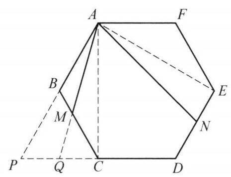

例 1 设正六边形 ${ABCDEF}$ 的边长为 $a$ ,动点 $M, N$ 分别在边 ${BC},{DE}$ 上, 满足 $\angle {MAN} = {60}^{ \circ  }$ . 证明: ${AM} \cdot  {AN} - {BM} \cdot  {DN}$ 是定值.

证明 如图 8-1,延长 ${DC}$ ,分别与 ${AB},{AM}$ 的延长线交于点 $P, Q$ ,连接 ${AC}\text{ 、 }{AE}$ .

图 8-1

由正六边形的性质易知 $\angle {CAE} = {60}^{ \circ  } = \; \angle {MAN}$ ，故 $\angle {CAQ} = \angle {EAN}$ . 又 $\angle {ACQ} = \; \angle {AEN} = {90}^{ \circ  }$ ， ${AC} = {AE} = \sqrt{3}a$ ，因此 $\bigtriangleup  {ACQ} \cong \; \bigtriangleup  {AEN}$ ，再由 ${CP} = a$ 得

$$
{DN} = a - {EN} = a - {CQ} = {PQ}.
$$

此时 ${AM} \cdot  {AN} - {BM} \cdot  {DN} = {AM} \cdot  {AQ} - \; {BM} \cdot  {PQ}$ . 记 $\angle {CAQ} = \theta$ .

在 $\bigtriangleup {ACM}$ 中,由正弦定理得

$$
\frac{CM}{\sin \theta } = \frac{AM}{\sin {30}^{ \circ  }} = \frac{\sqrt{3}a}{\sin \left( {\theta  + {30}^{ \circ  }}\right) }.
$$

因此

$$
{AM} = \frac{\sqrt{3}a}{2\sin \left( {\theta  + {30}^{ \circ  }}\right) },
$$

$$
{BM} = a - {CM} = \frac{a\left( {\sin \left( {\theta  + {30}^{ \circ  }}\right)  - \sqrt{3}\sin \theta }\right) }{\sin \left( {\theta  + {30}^{ \circ  }}\right) }
$$

$$
= \frac{a\left( {\cos \theta  - \sqrt{3}\sin \theta }\right) }{2\sin \left( {\theta  + {30}^{ \circ  }}\right) }.
$$

在 $\bigtriangleup {ACQ}$ 中,

$$
{AQ} = \frac{\sqrt{3}a}{\cos \theta }
$$

$$
{PQ} = a - {CQ} = a - \frac{\sqrt{3}a}{\tan \theta } = \frac{a\left( {\cos \theta  - \sqrt{3}\sin \theta }\right) }{\cos \theta }.
$$

因此

$$
{AM} \cdot  {AQ} - {BM} \cdot  {PQ} = \frac{{a}^2\left\lbrack  {3 - {\left( \cos \theta  - \sqrt{3}\sin \theta \right) }^2}\right\rbrack  }{2\sin \left( {\theta  + {30}^{ \circ  }}\right) \cos \theta },
$$

其中

$$
3 - {\left( \cos \theta  - \sqrt{3}\sin \theta \right) }^2 = 3 - \left( {{\cos }^2\theta  + 3{\sin }^2\theta  - 2\sqrt{3}\sin \theta \cos \theta }\right)
$$

$$
= 2\cos \theta \left( {\cos \theta  + \sqrt{3}\sin \theta }\right)
$$

$$
= 4\sin \left( {\theta  + {30}^{ \circ  }}\right) \cos \theta \text{ . }
$$

综上 ${AM} \cdot  {AN} - {BM} \cdot  {DN} = 2{a}^2$ 是定值.
