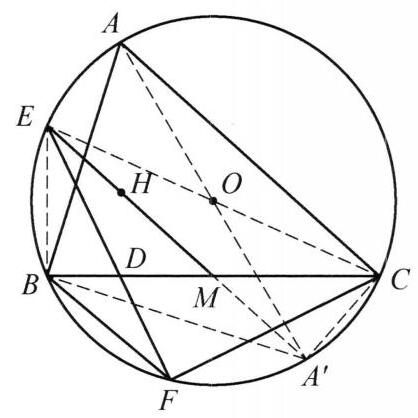

例 2 如图 8-2,在 $\bigtriangleup {ABC}$ 中, $M$ 是 ${BC}$ 的中点, $D$ 是 ${BC}$ 边上的高的垂足, $H$ 是 $\bigtriangleup {ABC}$ 的垂心. 延长 ${MH}$ 交 $\bigtriangleup {ABC}$ 的外接圆于点 $E$ ,直线 ${ED}$ 与外接圆另交于 $F$ . 证明: $\frac{BF}{CF} = \frac{AB}{AC}$ .

图 8-2

证明 由正弦定理,

$$
\frac{BF}{CF} = \frac{\sin \angle {BCF}}{\sin \angle {CBF}} = \frac{\sin \angle {BED}}{\sin \angle {CED}}
$$

$$
= \frac{\sin \angle {BED}}{\sin \angle {BDE}} \cdot  \frac{\sin \angle {CDE}}{\sin \angle {CED}}
$$

$$
= \frac{BD}{BE} \cdot  \frac{CE}{CD}\text{ . }
$$

①

其中

$$
\frac{BD}{CD} = \frac{{AB}\cos B}{{AC}\cos C}.
$$

②

设 $A$ 关于外心的对称点为 ${A}^{\prime }$ ,则

$$
\overrightarrow{OH} = \overrightarrow{OA} + \overrightarrow{OB} + \overrightarrow{OC} =  - \overrightarrow{O{A}^{\prime }} + 2\overrightarrow{OM}
$$

因此 $H, M,{A}^{\prime }$ 共线. 因为 $B, E, C,{A}^{\prime }$ 共圆. 于是

$$
\frac{BE}{BM} = \frac{C{A}^{\prime }}{{A}^{\prime }{M}^{\prime }},\frac{B{A}^{\prime }}{BM} = \frac{CE}{EM},
$$

$$
B{M}^2 = {BM} \cdot  {CM} = {EM} \cdot  {A}^{\prime }M.
$$

结合以上三式得 ${BE} \cdot  B{A}^{\prime } = {CE} \cdot  C{A}^{\prime }$ . 因此

$$
\frac{CE}{BE} = \frac{B{A}^{\prime }}{C{A}^{\prime }} = \frac{{2R}\cos \angle A{A}^{\prime }B}{{2R}\cos \angle A{A}^{\prime }C} = \frac{\cos C}{\cos B}.
$$

③

将②③代入①式即得 $\frac{BF}{CF} = \frac{AB}{AC}$ .
