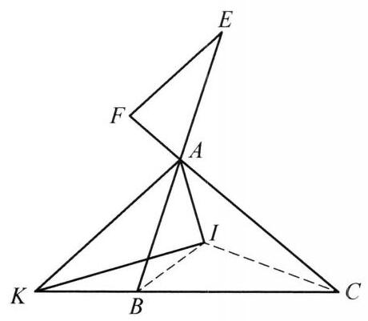
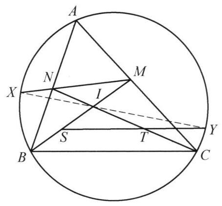

例 3 如图 8-3,在 $\bigtriangleup {ABC}$ 中, ${AB} < {AC}$ . 过内心 $I$ 作 ${AI}$ 的垂线,交直线 ${BC}$ 于点 $K$ . 点 $E, F$ 分别在 ${BA},{CA}$ 延长线上,满足 ${BE} = {CF} = \; \frac{1}{2}\left( {{AB} + {BC} + {CA}}\right)$ . 证明: ${EF}//{AK}$ .

图 8-3

证明 要证 ${EF}//{AK}$ ,只需证 $\angle {AEF} = \; \angle {KAB}$ . 注意到

$$
\angle {AEF} + \angle {AFE} = \angle {KAB} + \angle {KAF},
$$

于是只需证

$$
\frac{\sin \angle {KAB}}{\sin \angle {KAF}} = \frac{\sin \angle {AEF}}{\sin \angle {AFE}}.
$$

①

事实上，

$$
\frac{\sin \angle {KAB}}{\sin \angle {KAF}} = \frac{\sin \angle {KAB}}{\sin \angle {KAC}} = \frac{KB}{KC} \cdot  \frac{AC}{AB}
$$

$$
= \frac{{IB}\sin \angle {KIB}}{{IC}\sin \angle {KIC}} \cdot  \frac{AC}{AB}
$$

$$
= \frac{{IB}\sin \frac{C}{2}}{{IC}\sin \frac{B}{2}} \cdot  \frac{\sin B}{\sin C} = \frac{{IB}\cos \frac{C}{2}}{{IC}\cos \frac{B}{2}}
$$

$$
= \frac{p - b}{p - c} = \frac{AF}{AE} = \frac{\sin \angle {AEF}}{\sin \angle {AFE}}.
$$

因此①式成立，原命题得证.

图 8-4
