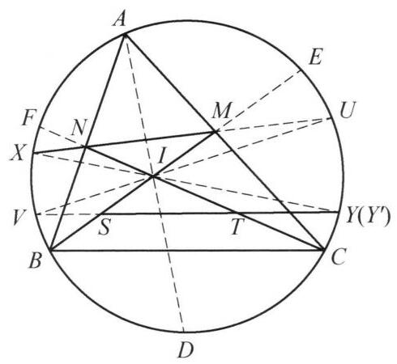

## 第八讲 三角方法

## 知识精讲

三角比是几何学中的重要概念. 对于一些平面几何问题, 在适当的时候引入三角计算,能起到事半功倍的效果.

作为平面几何中最基础的图形,三角形中蕴含了大量的三角恒等关系:

(1) $\sin A + \sin B + \sin C = 4\cos \frac{A}{2}\cos \frac{B}{2}\cos \frac{C}{2}$ ,

$$
\cos A + \cos B + \cos C = 1 + 4\sin \frac{A}{2}\sin \frac{B}{2}\sin \frac{C}{2}.
$$

(2) $\sin {2A} + \sin {2B} + \sin {2C} = 4\sin A\sin B\sin C$ ,

$$
\cos {2A} + \cos {2B} + \cos {2C} =  - 1 - 4\cos A\cos B\cos C.
$$

(3) $\tan A + \tan B + \tan C = \tan A\tan B\tan C$ ,

$$
\tan \frac{A}{2}\tan \frac{B}{2} + \tan \frac{B}{2}\tan \frac{C}{2} + \tan \frac{C}{2}\tan \frac{A}{2} = 1.
$$

以下两个定理建立了三角形的边和角之间的代数关系, 是平面几何问题中三角计算的基础.

对于 $\bigtriangleup {ABC}$ ,记 $\angle A,\angle B,\angle C$ 的对边分别为 $a, b, c$ .

正弦定理 $\frac{a}{\sin A} = \frac{b}{\sin B} = \frac{c}{\sin C} = {2R}$ ,其中 $R$ 是 $\bigtriangleup {ABC}$ 的外接圆半径.

余弦定理 ${a}^2 = {b}^2 + {c}^2 - {2bc}\cos A,{b}^2 = {c}^2 + {a}^2 - {2ca}\cos B,{c}^2 = {a}^2 + {b}^2 - \; {2ab}\cos C$ .

例如, 通过正弦定理进行边与角的转化, 我们可以得到梅涅劳斯定理、塞瓦定理的角元形式(参见第三讲).

## 典型例题

---

例 1 设正六边形 ${ABCDEF}$ 的边长为 $a$ ,动点 $M, N$ 分别在边 ${BC},{DE}$ 上, 满足 $\angle {MAN} = {60}^{ \circ  }$ . 证明: ${AM} \cdot  {AN} - {BM} \cdot  {DN}$ 是定值.

证明 如图 8-1,延长 ${DC}$ ,分别与 ${AB},{AM}$ 的延长线交于点 $P, Q$ ,连接 ${AC}\text{ 、 }{AE}$ .

图 8-1

由正六边形的性质易知 $\angle {CAE} = {60}^{ \circ  } = \; \angle {MAN}$ ，故 $\angle {CAQ} = \angle {EAN}$ . 又 $\angle {ACQ} = \; \angle {AEN} = {90}^{ \circ  }$ ， ${AC} = {AE} = \sqrt{3}a$ ，因此 $\bigtriangleup  {ACQ} \cong \; \bigtriangleup  {AEN}$ ，再由 ${CP} = a$ 得

$$
{DN} = a - {EN} = a - {CQ} = {PQ}.
$$

此时 ${AM} \cdot  {AN} - {BM} \cdot  {DN} = {AM} \cdot  {AQ} - \; {BM} \cdot  {PQ}$ . 记 $\angle {CAQ} = \theta$ .

在 $\bigtriangleup {ACM}$ 中,由正弦定理得

$$
\frac{CM}{\sin \theta } = \frac{AM}{\sin {30}^{ \circ  }} = \frac{\sqrt{3}a}{\sin \left( {\theta  + {30}^{ \circ  }}\right) }.
$$

因此

$$
{AM} = \frac{\sqrt{3}a}{2\sin \left( {\theta  + {30}^{ \circ  }}\right) },
$$

$$
{BM} = a - {CM} = \frac{a\left( {\sin \left( {\theta  + {30}^{ \circ  }}\right)  - \sqrt{3}\sin \theta }\right) }{\sin \left( {\theta  + {30}^{ \circ  }}\right) }
$$

$$
= \frac{a\left( {\cos \theta  - \sqrt{3}\sin \theta }\right) }{2\sin \left( {\theta  + {30}^{ \circ  }}\right) }.
$$

在 $\bigtriangleup {ACQ}$ 中,

$$
{AQ} = \frac{\sqrt{3}a}{\cos \theta }
$$

$$
{PQ} = a - {CQ} = a - \frac{\sqrt{3}a}{\tan \theta } = \frac{a\left( {\cos \theta  - \sqrt{3}\sin \theta }\right) }{\cos \theta }.
$$

因此

$$
{AM} \cdot  {AQ} - {BM} \cdot  {PQ} = \frac{{a}^2\left\lbrack  {3 - {\left( \cos \theta  - \sqrt{3}\sin \theta \right) }^2}\right\rbrack  }{2\sin \left( {\theta  + {30}^{ \circ  }}\right) \cos \theta },
$$

其中

$$
3 - {\left( \cos \theta  - \sqrt{3}\sin \theta \right) }^2 = 3 - \left( {{\cos }^2\theta  + 3{\sin }^2\theta  - 2\sqrt{3}\sin \theta \cos \theta }\right)
$$

$$
= 2\cos \theta \left( {\cos \theta  + \sqrt{3}\sin \theta }\right)
$$

$$
= 4\sin \left( {\theta  + {30}^{ \circ  }}\right) \cos \theta \text{ . }
$$

综上 ${AM} \cdot  {AN} - {BM} \cdot  {DN} = 2{a}^2$ 是定值.

---

例 2 如图 8-2,在 $\bigtriangleup {ABC}$ 中, $M$ 是 ${BC}$ 的中点, $D$ 是 ${BC}$ 边上的高的垂足, $H$ 是 $\bigtriangleup {ABC}$ 的垂心. 延长 ${MH}$ 交 $\bigtriangleup {ABC}$ 的外接圆于点 $E$ ,直线 ${ED}$ 与外接圆另交于 $F$ . 证明: $\frac{BF}{CF} = \frac{AB}{AC}$ .

图 8-2

证明 由正弦定理,

$$
\frac{BF}{CF} = \frac{\sin \angle {BCF}}{\sin \angle {CBF}} = \frac{\sin \angle {BED}}{\sin \angle {CED}}
$$

$$
= \frac{\sin \angle {BED}}{\sin \angle {BDE}} \cdot  \frac{\sin \angle {CDE}}{\sin \angle {CED}}
$$

$$
= \frac{BD}{BE} \cdot  \frac{CE}{CD}\text{ . }
$$

①

其中

$$
\frac{BD}{CD} = \frac{{AB}\cos B}{{AC}\cos C}.
$$

②

设 $A$ 关于外心的对称点为 ${A}^{\prime }$ ,则

$$
\overrightarrow{OH} = \overrightarrow{OA} + \overrightarrow{OB} + \overrightarrow{OC} =  - \overrightarrow{O{A}^{\prime }} + 2\overrightarrow{OM}
$$

因此 $H, M,{A}^{\prime }$ 共线. 因为 $B, E, C,{A}^{\prime }$ 共圆. 于是

$$
\frac{BE}{BM} = \frac{C{A}^{\prime }}{{A}^{\prime }{M}^{\prime }},\frac{B{A}^{\prime }}{BM} = \frac{CE}{EM},
$$

$$
B{M}^2 = {BM} \cdot  {CM} = {EM} \cdot  {A}^{\prime }M.
$$

结合以上三式得 ${BE} \cdot  B{A}^{\prime } = {CE} \cdot  C{A}^{\prime }$ . 因此

$$
\frac{CE}{BE} = \frac{B{A}^{\prime }}{C{A}^{\prime }} = \frac{{2R}\cos \angle A{A}^{\prime }B}{{2R}\cos \angle A{A}^{\prime }C} = \frac{\cos C}{\cos B}.
$$

③

将②③代入①式即得 $\frac{BF}{CF} = \frac{AB}{AC}$ .

---

例 3 如图 8-3,在 $\bigtriangleup {ABC}$ 中, ${AB} < {AC}$ . 过内心 $I$ 作 ${AI}$ 的垂线,交直线 ${BC}$ 于点 $K$ . 点 $E, F$ 分别在 ${BA},{CA}$ 延长线上,满足 ${BE} = {CF} = \; \frac{1}{2}\left( {{AB} + {BC} + {CA}}\right)$ . 证明: ${EF}//{AK}$ .

图 8-3

证明 要证 ${EF}//{AK}$ ,只需证 $\angle {AEF} = \; \angle {KAB}$ . 注意到

$$
\angle {AEF} + \angle {AFE} = \angle {KAB} + \angle {KAF},
$$

于是只需证

$$
\frac{\sin \angle {KAB}}{\sin \angle {KAF}} = \frac{\sin \angle {AEF}}{\sin \angle {AFE}}.
$$

①

事实上，

$$
\frac{\sin \angle {KAB}}{\sin \angle {KAF}} = \frac{\sin \angle {KAB}}{\sin \angle {KAC}} = \frac{KB}{KC} \cdot  \frac{AC}{AB}
$$

$$
= \frac{{IB}\sin \angle {KIB}}{{IC}\sin \angle {KIC}} \cdot  \frac{AC}{AB}
$$

$$
= \frac{{IB}\sin \frac{C}{2}}{{IC}\sin \frac{B}{2}} \cdot  \frac{\sin B}{\sin C} = \frac{{IB}\cos \frac{C}{2}}{{IC}\cos \frac{B}{2}}
$$

$$
= \frac{p - b}{p - c} = \frac{AF}{AE} = \frac{\sin \angle {AEF}}{\sin \angle {AFE}}.
$$

因此①式成立，原命题得证.

图 8-4

---

例 4 如图 8-4，设 $\bigtriangleup  {ABC}$ 的内心为 $I$ ，直线 ${BI}$ 交 ${AC}$ 于 $M$ ，直线 ${CI}$ 交 ${AB}$ 于 $N$ ， ${BI}$ 与 ${CI}$ 的中点分别为 $S$ ， $T$ . 射线 ${MN}$ 与射线 ${ST}$ 分别与 $\bigtriangleup  {ABC}$ 的外接圆交于点 $X$ ， $Y$ . 证明: $X$ ， $I$ ， $Y$ 三点共线.

证明 如图 8-5，设直线 ${MN}$ 与外接圆另交于点 $U$ . 延长 ${AI},{BI},{CI}$ ，与外接圆分别交于点 $D, E, F$ . 再延长 ${XI},{UI}$ ，与外接圆分别交于点 ${Y}^{\prime }, V$ . 只需证明 $Y = {Y}^{\prime }$ .

图 8-5

对于圆上两点 $P, Q$ ,以下用 $\overset{\text{ ⏜ }}{PQ}$ 表示其所对的圆周角.

注意到: ${AC},{XU},{BE}$ 交于点 $M,{AD}$ , ${BE},{Y}^{\prime }X$ 交于点 $I,{CF},{BE},{UV}$ 交于点 $I$ ,分别利用角元塞瓦定理得以下三式:

$$
\frac{\sin \overset{\text{ ⏜ }}{AE}}{\sin \overset{\text{ ⏜ }}{EU}} \cdot  \frac{\sin \overset{\text{ ⏜ }}{UC}}{\sin \overset{\text{ ⏜ }}{CB}} \cdot  \frac{\sin \overset{\text{ ⏜ }}{BX}}{\sin \overset{\text{ ⏜ }}{XA}} = 1,
$$

$$
\frac{\sin \overset{\text{ ⏜ }}{AX}}{\sin \overset{\text{ ⏜ }}{XB}} \cdot  \frac{\sin \overset{\text{ ⏜ }}{BD}}{\sin \overset{\text{ ⏜ }}{D{Y}^{\prime }}} \cdot  \frac{\sin \overset{\text{ ⏜ }}{{Y}^{\prime }E}}{\sin \overset{\text{ ⏜ }}{EA}} = 1,
$$

$$
\frac{\sin \overset{\text{ ⏜ }}{UE}}{\sin \overset{\text{ ⏜ }}{EF}} \cdot  \frac{\sin \overset{\text{ ⏜ }}{FV}}{\sin \overset{\text{ ⏜ }}{VB}} \cdot  \frac{\sin \overset{\text{ ⏜ }}{BC}}{\sin \overset{\text{ ⏜ }}{CU}} = 1
$$

以上三式相乘得

$$
\frac{\sin \overset{\text{ ⏜ }}{BD}}{\sin \overset{\text{ ⏜ }}{D{Y}^{\prime }}} \cdot  \frac{\sin \overset{\text{ ⏜ }}{{Y}^{\prime }E}}{\sin \overset{\text{ ⏜ }}{EF}} \cdot  \frac{\sin \overset{\text{ ⏜ }}{FV}}{\sin \overset{\text{ ⏜ }}{VB}} = 1.
$$

于是由角元塞瓦定理逆定理知 ${BE},{Y}^{\prime }V,{DF}$ 交于一点.

由鸡爪定理, ${DI} = {DB},{FI} = {FB}$ . 因此 ${DF}$ 与 ${BE}$ 交于 ${BI}$ 中点,即为 $S$ . 做 ${Y}^{\prime }, S, V$ 共线. 同理 ${Y}^{\prime }, T, V$ 共线.

从而 ${Y}^{\prime }, S, T, V$ 四点共线,这表明 $Y = {Y}^{\prime }$ ,要证命题成立.

---

例 5 设四边形 ${ABCD}$ 是圆外切四边形, ${O}_A,{O}_B,{O}_C,{O}_D$ 分别是 $\bigtriangleup {BCD}$ , $\bigtriangleup {CDA},\bigtriangleup {DAB},\bigtriangleup {ABC}$ 的外心. 证明: 四边形 ${O}_A{O}_B{O}_C{O}_D$ 也是圆外切四边形.

证明 首先证明四边形 ${O}_A{O}_B{O}_C{O}_D$ 是凸四边形. 事实上,由于 ${O}_A{O}_D \bot  {BC}$ , ${O}_A{O}_B \bot  {CD}$ ,可得 $\angle {O}_D{O}_A{O}_B = {180}^{ \circ  } - \angle {BCD}$ . 同理 $\angle {O}_A{O}_B{O}_C = {180}^{ \circ  } - \; \angle {ADC},\angle {O}_B{O}_C{O}_D = {180}^{ \circ  } - \angle {DAB},\angle {O}_C{O}_D{O}_A = {180}^{ \circ  } - \angle {ABC}$ . 假设四边形 ${O}_A{O}_B{O}_C{O}_D$ 是凹四边形,不妨设 $\angle {O}_D{O}_A{O}_B$ 最大,则

$$
\angle {O}_D{O}_A{O}_B = \angle {O}_A{O}_B{O}_C + \angle {O}_B{O}_C{O}_D + \angle {O}_C{O}_D{O}_{A}.
$$

这表明

$$
\angle {BCD} + {360}^{ \circ  } = \angle {ADC} + \angle {DAB} + \angle {ABC}
$$

$$
= {360}^{ \circ  } - \angle {BCD}\text{ . }
$$

矛盾. 因此四边形 ${O}_A{O}_B{O}_C{O}_D$ 是凸四边形.

熟知: 凸四边形是圆外切四边形的充要条件是其两组对边长之和相等. 于是只需证 ${O}_A{O}_B + {O}_C{O}_D = {O}_B{O}_C + {O}_D{O}_A$ .

设 $\bigtriangleup {BCD},\bigtriangleup {CDA},\bigtriangleup {DAB},\bigtriangleup {ABC}$ 的外接圆半径分别为 ${R}_A,{R}_B,{R}_C$ , ${R}_D$ ,并将 $\angle {DAB},\angle {ABC},\angle {BCD},\angle {CDA}$ 简记为 $A, B, C, D$ . 此时

$$
{O}_A{O}_D = {R}_A\cos \angle {BDC} - {R}_D\cos \angle {BAC}.
$$

①

由正弦定理与余弦定理，

$$
{R}_A\cos \angle {BDC} = \frac{BD}{2\sin C} \cdot  \frac{B{D}^2 + C{D}^2 - B{C}^2}{{2BD} \cdot  {CD}}
$$

$$
= \frac{\left( {C{D}^2 + B{C}^2 - {2CD} \cdot  {BC}\cos C}\right)  + C{D}^2 - B{C}^2}{{4CD}\sin C}
$$

$$
= \frac{{CD} - {BC}\cos C}{2\sin C}
$$

$$
= \frac{1}{2}\left( {{CD}\csc C - {BC}\cot C}\right) .
$$

同理

$$
{R}_D\cos \angle {BAC} = \frac{1}{2}\left( {{AB}\csc B - {BC}\cot B}\right) .
$$

代入①式得

$$
2{O}_A{O}_D = {CD}\csc C - {AB}\csc B + {BC}\left( {\cot B - \cot C}\right) .
$$

同理

$$
2{O}_A{O}_B = {BC}\csc C - {AD}\csc D + {CD}\left( {\cot D - \cot C}\right) .
$$

$$
2{O}_B{O}_C = {AB}\csc A - {CD}\csc D + {AD}\left( {\cot D - \cot A}\right) .
$$

$$
2{O}_C{O}_D = {AD}\csc A - {BC}\csc B + {AB}\left( {\cot B - \cot A}\right) .
$$

于是记

$$
S = 2\left( {{O}_A{O}_B + {O}_C{O}_D - {O}_B{O}_C - {O}_D{O}_A}\right)
$$

$$
= {AB}\left( {-\csc A - \cot A + \csc B + \cot B}\right)  + {BC}\left( {-\csc B - \cot B + \csc C + \cot C}\right)
$$

$$
+ {CD}\left( {-\csc C - \cot C + \csc D + \cot D}\right)  + {DA}\left( {-\csc D - \cot D + \csc A + \cot A}\right) .
$$

不妨设四边形 ${ABCD}$ 的内切圆半径为 1,则 ${AB} = \cot \frac{A}{2} + \cot \frac{B}{2}$ . 而

$$
\csc \theta  + \cot \theta  = \frac{1 + \cos \theta }{\sin \theta } = \cot \frac{\theta }{2}.
$$

因此

$$
{AB}\left( {-\csc A - \cot A + \csc B + \cot B}\right)  = {\cot }^2\frac{B}{2} - {\cot }^2\frac{A}{2}.
$$

同理

$$
{BC}\left( {-\csc B - \cot B + \csc C + \cot C}\right)  = {\cot }^2\frac{C}{2} - {\cot }^2\frac{B}{2}.
$$

$$
{CD}\left( {-\csc C - \cot C + \csc D + \cot D}\right)  = {\cot }^2\frac{D}{2} - {\cot }^2\frac{C}{2}.
$$

$$
{DA}\left( {-\csc D - \cot D + \csc A + \cot A}\right)  = {\cot }^2\frac{A}{2} - {\cot }^2\frac{D}{2}.
$$

四式相加得 $S = 0$ ,原命题得证.

---

例 6 在 $\bigtriangleup {ABC}$ 内,点 $P$ 满足 $\angle {PAB} = \angle {PBC} = \angle {PCA} = \omega$ ,点 ${P}^{\prime }$ 满足 $\angle {P}^{\prime }{BA} = \angle {P}^{\prime }{CB} = \angle {P}^{\prime }{AC} = {\omega }^{\prime }.$

(1)证明: $\cot \omega  = \cot {\omega }^{\prime } = \cot A + \cot B + \cot C$ .

(2)设 $\bigtriangleup {ABC}$ (不为等边三角形) 的外心为 $O$ ,证明: ${PO} = {P}^{\prime }O$ ,且 $\angle {PO}{P}^{\prime } = {2\omega }$ .

证明 记 ${PA} = x,{PB} = y,{PC} = z,{P}^{\prime }A = {x}^{\prime },{P}^{\prime }B = {y}^{\prime },{P}^{\prime }C = {z}^{\prime }$ .

(1)在 $\bigtriangleup {PAB}$ 中， $\angle {PAB} = \omega$ ， $\angle {PBA} = B - \omega$ ， $\angle {APB} = \pi  - B$ . 由正弦定理，

$$
\frac{x}{y} = \frac{\sin \left( {B - \omega }\right) }{\sin \omega } = \sin B\cot \omega  - \cos B.
$$

①

且

$$
\frac{y}{c} = \frac{\sin \omega }{\sin \left( {\pi  - B}\right) } = \frac{\sin \omega }{\sin B}.
$$

同理在 $\bigtriangleup {PCA}$ 中, $\frac{x}{b} = \frac{\sin \omega }{\sin A}$ . 两式相除得

$$
\frac{x}{y} = \frac{b\sin B}{c\sin A} = \frac{{\sin }^{2}B}{\sin A\sin C}.
$$

②

比较①②两式整理得

$$
\cot \omega  = \frac{\sin B}{\sin A\sin C} + \cot B
$$

$$
= \frac{\sin \left( {A + C}\right) }{\sin A\sin C} + \cot B
$$

$$
= \cot A + \cot B + \cot C.
$$

由对称性同理可得 $\cot {\omega }^{\prime } = \cot A + \cot B + \cot C$ . 显然 $\omega  = {\omega }^{\prime }$ .

(2)首先计算 ${PO}$ . 延长 ${AP}$ 交 $\bigtriangleup {ABC}$ 外接圆与 $D$ . 易证 $\bigtriangleup {BPD} \backsim  \bigtriangleup {ABC}$ ,

进一步有 ${PD} = \frac{ay}{c},{BD} = \frac{by}{c}$ . 又由 ② 式得 $\frac{x}{y} = \frac{{b}^2}{ac}$ . 由圆幂定理得

$$
{R}^2 - P{O}^2 = {PA} \cdot  {PD} = \frac{axy}{c} = \frac{{b}^2{y}^2}{{c}^2}
$$

$$
= B{D}^2 = {\left( 2R\sin \omega \right) }^{2}.
$$

即 ${PO} = R\sqrt{1 - 4{\sin }^2\omega }$ . 同理 ${P}^{\prime }O = R\sqrt{1 - 4{\sin }^2\omega } = {PO}$ .

再计算 $P{P}^{\prime }$ . 由上知 $x = \frac{b\sin \omega }{\sin A}$ .

类似地,在 $\bigtriangleup {P}^{\prime }{BA}$ 中由正弦定理可得 ${x}^{\prime } = \frac{c\sin \omega }{\sin A}$ .

在 $\bigtriangleup {PA}{P}^{\prime }$ 中,由余弦定理,

$$
P{P}^{\prime 2} = {x}^2 + {x}^{\prime 2} - {2x}{x}^{\prime }\cos \left( {A - {2\omega }}\right)
$$

$$
= \frac{{\sin }^2\omega }{{\sin }^{2}A}\left( {{b}^2 + {c}^2 - {2bc}\cos \left( {A - {2\omega }}\right) }\right)
$$

$$
= \frac{{\sin }^2\omega }{{\sin }^{2}A}\left( {{a}^2 + {2bc}\left( {\cos A - \cos \left( {A - {2\omega }}\right) }\right) }\right)
$$

$$
= \frac{{\sin }^2\omega }{{\sin }^{2}A}\left( {{a}^2 - {4bc}\sin \omega \sin \left( {A - \omega }\right) }\right)
$$

$$
= {\left( 2R\sin \omega \right) }^2\left( {1 - 4 \cdot  \frac{bc}{{a}^2}\sin \omega \sin \left( {A - \omega }\right) }\right) .
$$

在 $\bigtriangleup {PCA}$ 中,同理可得 $\frac{\sin \left( {A - \omega }\right) }{\sin \omega } = \frac{z}{x} = \frac{{a}^2}{bc}$ . 代入得

$$
P{P}^{\prime } = {2R}\sin \omega \sqrt{1 - 4{\sin }^2\omega }.
$$

于是在等腰 $\bigtriangleup {PO}{P}^{\prime }$ 中,

$$
\sin \frac{1}{2}\angle {PO}{P}^{\prime } = \frac{\frac{1}{2}P{P}^{\prime }}{PO} = \sin \omega .
$$

考察 $\omega$ 的范围即得 $\frac{1}{2}\angle {PO}{P}^{\prime } = \omega$ .

注: 点 $P$ 与 ${P}^{\prime }$ 分别称为三角形的第一布洛卡点与第二布洛卡点, $\omega$ 称为布洛卡角. 利用 $\left( 1\right)$ 的结论不难证明 $\omega  \leq  {30}^{ \circ  }$ .

