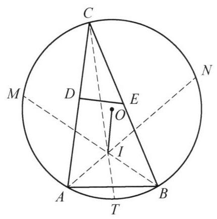

例 6 设锐角 $\bigtriangleup {ABC}$ 外心为 $O$ ,内心为 $I$ . 点 $D, E$ 分别在 ${AC},{BC}$ 上,使得 $\left| {AD}\right|  = \left| {BE}\right|  = \left| {AB}\right|$ .

(1)证明: ${OI}\bot {DE}$ .

(2)若 ${OI} = {DE}$ ，求 $\angle {ACB}$ .

图 9-5

解(1)以 $O$ 为原点建立复平面，点 $A$ 对应的复数也记为 $A$ (其余同理). 不妨设外接圆半径为 1 ， 且 $C = 1$ .

延长 ${BI},{AI}$ ,分别与外接圆交于点 $M, N$ . 注意到 $M, N$ 分别为弧 ${AC},{BC}$ 的中点,可得 $A = {M}^2$ , $B = {N}^2$ . 再延长 ${CI}$ 与外接圆交于点 $T$ ,则由 $T$ 是弧 ${AB}$ 中点可得 $T =  - {MN}$ . 又易证 $I$ 是 $\bigtriangleup {MNT}$ 的垂心, 因此

$$
I = M + N - {MN}.
$$

再设 $\angle {EBA} = \angle {COM} = \alpha$ ,则由条件得 $\frac{E - B}{A - B} = {\mathrm{e}}^{-\mathrm{i}\alpha } = \frac{C}{M}$ . 故

$$
E = B + \frac{C}{M}\left( {A - B}\right)
$$

$$
= {N}^2 + \frac{1}{M}\left( {{M}^2 - {N}^2}\right)
$$

$$
= {N}^2 + M - \frac{{N}^2}{M}.
$$

同理 $D = {M}^2 + N - \frac{{M}^2}{N}$ . 于是

$$
\frac{E - D}{I - O} = \frac{\left( {M - N}\right)  - \left( {{M}^2 - {N}^2}\right)  + \left( {\frac{{M}^2}{N} - \frac{{N}^2}{M}}\right) }{M + N - {MN}} = \frac{M}{N} - \frac{N}{M}.
$$

结合 $\left| \frac{M}{N}\right|  = 1$ 可得 $\frac{E - D}{I - O}$ 是纯虚数,这就表明 ${OI} \bot  {DE}$ .

( 2 )若 ${OI} = {DE}$ ，由( 1 )可得 $\frac{M}{N} - \frac{N}{M} = \frac{E - D}{I - O} = \mathrm{i}$ .

设 $\frac{M}{N} = k$ ，解得 $k =  \pm  \frac{\sqrt{3}}{2} + \frac{1}{2}\mathrm{i}$ .

再结合 $\bigtriangleup {ABC}$ 是锐角三角形，可得弧 ${MN}$ 所对的圆心角 $\arg k$ 是钝角，此时 $k =  - \frac{\sqrt{3}}{2} + \frac{1}{2}\mathrm{i},\angle {MON} = \arg k = {150}^{ \circ  }.$

进一步有 $\angle {ACB} = \frac{1}{2}\left( {{360}^{ \circ  } - 2\arg k}\right)  = {30}^{ \circ  }$ .

注: 在仅含一个圆的几何问题中, 我们通常以圆心为原点建立复平面来简化计算.
