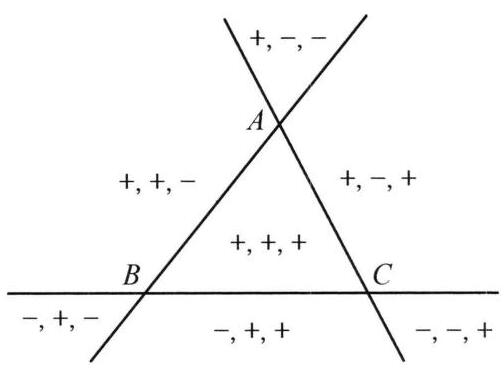
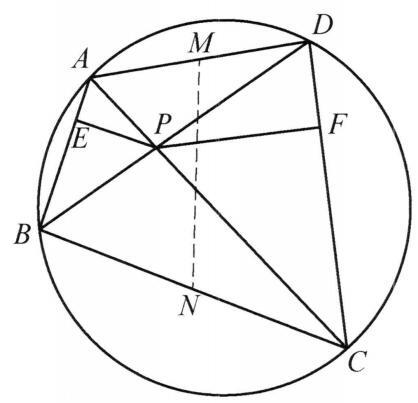
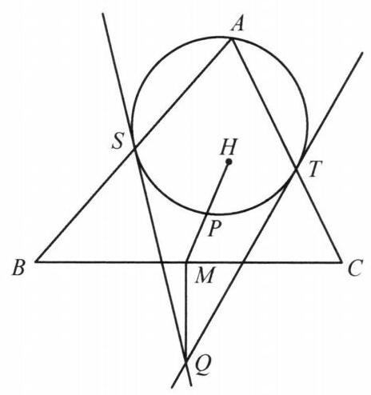
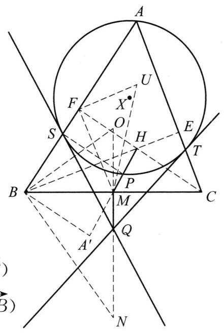

## 第九讲 向量与复数方法

## 知识精讲

一、向量 向量是既有大小又有方向的量. 在平面直角坐标系中, 如果将一个向量的起点置于原点, 那么我们就可以用向量终点的坐标表示这个向量, 这种表示方法即建立了所有平面上的点与所有平面向量的一一对应. 对于两个向量 $a = \; \left( {{x}_1,{y}_1}\right) ,\mathbf{b} = \left( {{x}_2,{y}_2}\right)$ ,可以定义如下的运算:

(1)数乘:对于实数 $\lambda ,{\lambda a} = \left( {\lambda {x}_1,\lambda {y}_1}\right)$ .

(2)加(减)法: $\mathbf{a} \pm  \mathbf{b} = \left( {{x}_1 \pm  {x}_2,{y}_1 \pm  {y}_2}\right)$ . 向量的加(减)法满足平行四边形法则或三角形法则.

(3)数量积(也称为 “内积” $) : \mathbf{a} \cdot  \mathbf{b} = {x}_1{x}_2 + {y}_1{y}_2$ . 特别地，向量的模定义为 $\left| \mathbf{a}\right|  = \sqrt{\mathbf{a} \cdot  \mathbf{a}} = \sqrt{{x}_1^2 + {y}_1^2}$ . 记 $\mathbf{a}$ 与 $\mathbf{b}$ 的夹角为 $\langle \mathbf{a},\mathbf{b}\rangle$ ，可以证明， $\mathbf{a} \cdot  \mathbf{b} = \left| \mathbf{a}\right|$ . $\left| \mathbf{b}\right| \cos \langle \mathbf{a},\mathbf{b}\rangle$ . 向量的数量积满足交换律与分配律.

通过上面的讨论可以知道，对于平面上不同的四点 $A, B, C, D$ ，利用向量可以给出如下的论断:

(1) ${AB}$ 与 ${CD}$ 平行或共线，等价于存在非零实数 $\lambda$ 使得 $\overrightarrow{AB} = \lambda \overrightarrow{CD}$ .

(2) ${AB}$ 与 ${CD}$ 垂直，等价于 $\overrightarrow{AB} \cdot  \overrightarrow{CD} = 0$ .

在实际运用中,我们常常将一个向量分解为若干个向量之和,再进行相关的运算.

二、向量的分解 对于向量的分解, 我们有如下核心的定理:

平面向量唯一分解定理 给定两个不共线的平面向量 ${e}_1,{e}_2$ (称为 “基向量”),则对平面上任一向量 $\mathbf{a}$ ,存在唯一的实数 $\lambda ,\mu$ ,使得 $\mathbf{a} = \lambda {\mathbf{e}}_1 + \mu {\mathbf{e}}_2$ .

利用向量的分解, 我们可以给出判断三点共线的另一种方法.

定理 1 设 $A, B, C$ 是平面上不共线的三点,平面上另一点 $D$ 满足 $\overrightarrow{AD} = \; \lambda \overrightarrow{AB} + \mu \overrightarrow{AC}$ ,则 $B, C, D$ 共线的充要条件是 $\lambda  + \mu  = 1$ .

证明 充分性: 由 $\lambda  + \mu  = 1$ 得

$$
\overrightarrow{BD} = \overrightarrow{AD} - \overrightarrow{AB} = \left( {\lambda  - 1}\right) \overrightarrow{AB} + \mu \overrightarrow{AC}
$$

$$
= \mu \left( {-\overrightarrow{AB} + \overrightarrow{AC}}\right)  = \mu \overrightarrow{BC}.
$$

因此 $B$ 、 $C$ 、 $D$ 共线.

必要性: 由 $B, C, D$ 共线,可设 $\overrightarrow{BD} = t\overrightarrow{DC}$ . 因此

$$
\overrightarrow{AD} - \overrightarrow{AB} = t\left( {\overrightarrow{AC} - \overrightarrow{AD}}\right)
$$

上式整理得

$$
\overrightarrow{AD} = \frac{1}{t + 1}\overrightarrow{AB} + \frac{t}{t + 1}\overrightarrow{AC}
$$

由分解的唯一性知 $\lambda  = \frac{1}{t + 1},\mu  = \frac{t}{t + 1}$ ,因此 $\lambda  + \mu  = 1$ .

注: 上述必要性证明中的 $t$ 称为 $D$ 分有向线段 $\overline{BC}$ 的比. 如果取 $A$ 为原点 $O$ , 设 $B\left( {{x}_1,{y}_1}\right) , C\left( {{x}_2,{y}_2}\right)$ ,则可得 $D$ 点坐标为

$$
\left( {\frac{{x}_1 + t{x}_2}{t + 1},\frac{{y}_1 + t{y}_2}{t + 1}}\right) .
$$

这个结果称为定比分点公式.

利用定比分点，我们可以证明如下定理 2.

定理 2 设 $P$ 是 $\bigtriangleup {ABC}$ 内一点，记 $\bigtriangleup {PBC}$ 、 $\bigtriangleup {PCA}$ 、 $\bigtriangleup {PAB}$ 的面积分别为 ${S}_A$ 、 ${S}_B$ 、 ${S}_C$ ，则 ${S}_{A}\overrightarrow{PA} + {S}_{B}\overrightarrow{PB} + {S}_{C}\overrightarrow{PC} = \mathbf{0}$ .

证明 延长 ${AP}$ 交 ${BC}$ 于 $D$ ,则

$$
\frac{\left| BD\right| }{\left| DC\right| } = \frac{{S}_{\bigtriangleup {PBD}}}{{S}_{\bigtriangleup {PCD}}} = t.
$$

因此

$$
\overrightarrow{PD} = \frac{1}{t + 1}\overrightarrow{PB} + \frac{t}{t + 1}\overrightarrow{PC} = \frac{{S}_{\bigtriangleup {PCD}}}{{S}_{\bigtriangleup {PBC}}}\overrightarrow{PB} + \frac{{S}_{\bigtriangleup {PBD}}}{{S}_{\bigtriangleup {PBC}}}\overrightarrow{PC}.
$$

又 $\frac{{S}_{\bigtriangleup {PAB}}}{{S}_{\bigtriangleup {PBD}}} = \frac{{S}_{\bigtriangleup {PCA}}}{{S}_{\bigtriangleup {PCD}}} = \frac{\left| PA\right| }{\left| PD\right| }$ ,且 $\overrightarrow{PA}$ 与 $\overrightarrow{PD}$ 方向相反,故

$$
- {S}_{\bigtriangleup {PBC}}\overrightarrow{PA} = \left( {{S}_{\bigtriangleup {PBC}} \cdot  \frac{\left| PA\right| }{\left| PD\right| }}\right) \overrightarrow{PD}
$$

$$
= \left( {{S}_{\bigtriangleup {PCD}} \cdot  \frac{\left| PA\right| }{\left| PD\right| }}\right) \overrightarrow{PB} + \left( {{S}_{\bigtriangleup {PBD}} \cdot  \frac{\left| PA\right| }{\left| PD\right| }}\right) \overrightarrow{PC}
$$

$$
= {S}_{\bigtriangleup {PCA}}\overrightarrow{PB} + {S}_{\bigtriangleup {PAB}}\overrightarrow{PC}\text{ . }
$$

移项即得要证等式成立.

事实上，“P 在 $\bigtriangleup  {ABC}$ 内” 这一条件并不需要. 当 $P$ 在三角形外时，需要为 ${S}_A$ ， ${S}_B$ ， ${S}_C$ 加上合适的符号，称为“有向面积”. 其具体判断方式为:若 $P, B, C$ 三点逆时针排列时， ${S}_A$ 符号为正，否则符号为负. 若 $A, B, C$ 三点已按逆时针排列，则上述判断条件等价于 $P$ 与 $A$ 位于直线 ${BC}$ 同侧. ${S}_B$ 与 ${S}_C$ 的符号也用同样的方法定义.

图 9-1

不难看出,按上述定义方式,如果 $P$ 在三角形内,则 ${S}_A,{S}_B,{S}_C$ 的符号均为正. 三角形三边所在的直线将平面分为七个部分,在这七个部分内, ${S}_A,{S}_B,{S}_C$ 的符号如图 9-1 所示. 其余部分的定理 2 证明是完全类似的, 此处不再赘述.

将定理 2 直接应用到三角形的一些特殊点上, 可以得到如下的推论.

推论 设 $\bigtriangleup {ABC}$ 的重心为 $G$ ,外心为 $O$ ,内心为 $I$ ,垂心为 $H$ ,顶点 $A, B, C$ 对应的旁心分别为 ${I}_A,{I}_B,{I}_C$ ,角 $A, B, C$ 的对边记为 $a, b, c$ ,则

(1) $\overrightarrow{GA} + \overrightarrow{GB} + \overrightarrow{GC} = \mathbf{0}$ .

(2) $\sin {2A} \cdot  \overrightarrow{OA} + \sin {2B} \cdot  \overrightarrow{OB} + \sin {2C} \cdot  \overrightarrow{OC} = \mathbf{0}$ .

(3) $a \cdot  \overrightarrow{IA} + b \cdot  \overrightarrow{IB} + c \cdot  \overrightarrow{IC} = \mathbf{0}$ ，或由正弦定理等价于

$$
\sin A \cdot  \overrightarrow{IA} + \sin B \cdot  \overrightarrow{IB} + \sin C \cdot  \overrightarrow{IC} = \mathbf{0}.
$$

(4) $\tan A \cdot  \overrightarrow{HA} + \tan B \cdot  \overrightarrow{HB} + \tan C \cdot  \overrightarrow{HC} = 0$ . ( $\bigtriangleup {ABC}$ 不是直角三角形)

(5) $- a \cdot  \overrightarrow{{I}_{A}A} + b \cdot  \overrightarrow{{I}_{A}B} + c \cdot  \overrightarrow{{I}_{A}C} = a \cdot  \overrightarrow{{I}_{B}A} - b \cdot  \overrightarrow{{I}_{B}B} + c \cdot  \overrightarrow{{I}_{B}C}$

$$
= a \cdot  \overrightarrow{{I}_{C}A} + b \cdot  \overrightarrow{{I}_{C}B} - c \cdot  \overrightarrow{{I}_{C}C} = \mathbf{0}.
$$

如果已知三个顶点的坐标 $A\left( {{x}_A,{y}_A}\right) , B\left( {{x}_B,{y}_B}\right) , C\left( {{x}_C,{y}_C}\right)$ ,就可以利用推论得到这些特殊点的坐标,例如 $G\left( {\frac{{x}_A + {x}_B + {x}_C}{3},\frac{{y}_A + {y}_B + {y}_C}{3}}\right)$ , $I\left( {\frac{a{x}_A + b{x}_B + c{x}_C}{a + b + c},\frac{a{y}_A + b{y}_B + c{y}_C}{a + b + c}}\right)$ 等等.

下面的定理也可以利用向量给出证明.

欧拉线定理 设 $\bigtriangleup {ABC}$ 的外心为 $O$ ,重心为 $G$ ,垂心为 $H$ ,则 $\overrightarrow{OH} = 3\overrightarrow{OG}$ .

证明 定义点 ${H}^{\prime }$ 满足

$$
\overrightarrow{O{H}^{\prime }} = 3\overrightarrow{OG} = \left( {\overrightarrow{OA} + \overrightarrow{OB} + \overrightarrow{OC}}\right)  - \left( {\overrightarrow{GA} + \overrightarrow{GB} + \overrightarrow{GC}}\right)
$$

$$
= \overrightarrow{OA} + \overrightarrow{OB} + \overrightarrow{OC}
$$

由同一法,只需证明 ${H}^{\prime }$ 是垂心. 计算

$$
\overrightarrow{A{H}^{\prime }} \cdot  \overrightarrow{BC} = \left( {\overrightarrow{O{H}^{\prime }} - \overrightarrow{OA}}\right)  \cdot  \left( {\overrightarrow{OC} - \overrightarrow{OB}}\right)
$$

$$
= \left( {\overrightarrow{OC} + \overrightarrow{OB}}\right)  \cdot  \left( {\overrightarrow{OC} - \overrightarrow{OB}}\right)
$$

$$
= {\left| \overrightarrow{OC}\right| }^{2} - {\left| \overrightarrow{OB}\right| }^{2}\text{ . }
$$

注意到 $O$ 是外心,因此 $\left| \overrightarrow{OB}\right|  = \left| \overrightarrow{OC}\right|$ 为外接圆半径,故 $\overrightarrow{A{H}^{\prime }} \cdot  \overrightarrow{BC} = 0$ ,即 $A{H}^{\prime } \bot  {BC}$ . 同理 $B{H}^{\prime } \bot  {CA}, C{H}^{\prime } \bot  {AB}$ .

因此 ${H}^{\prime }$ 是 $\bigtriangleup {ABC}$ 的垂心,即 ${H}^{\prime } = H$ .

三、复数 对于复数 $z = x + y\mathrm{i}\left( {x, y \in  \mathbf{R}}\right)$ ,其也可以与平面上的点 $\left( {x, y}\right)$ 建立自然的对应关系 (这个平面通常称为复平面), 进而与平面向量建立一一对应关系. 如果点 $A\left( {{x}_1,{y}_1}\right)$ 分别对应向量 $\overrightarrow{OA}$ 与复数 ${z}_A$ ,点 $B\left( {{x}_2,{y}_2}\right)$ 分别对应向量 $\overrightarrow{OB}$ 与复数 ${z}_B$ ,考虑向量与复数的运算,有:

(1) $\overrightarrow{OA} \pm  \overrightarrow{OB}$ 对应复数 ${z}_A \pm  {z}_B$ . 特别地， $\overrightarrow{AB}$ 对应复数 ${z}_B - {z}_A$ .

(2) $\overrightarrow{OA} \cdot  \overrightarrow{OB}$ 对应实数 $\operatorname{Re}\left( {{z}_{A}\overline{{z}_{B}}}\right)  = \frac{1}{2}\left( {{z}_{A}\overline{{z}_{B}} + \overline{{z}_{A}}{z}_{B}}\right)$ . 特别地, $\left| \overrightarrow{OA}\right|$ 对应 $\left| {z}_A\right|$ .

因此, 复数与向量在平面几何领域拥有相近的功能, 对于能用向量解决的平面几何问题,也可以将其“翻译”成复数语言.

复数乘除法的几何意义 我们将复数表示为三角形式: ${z}_1 = {r}_1\left( {\cos {\theta }_1 + }\right. \; \left. {\mathrm{i}\sin {\theta }_1}\right) ,{z}_2 = {r}_2\left( {\cos {\theta }_2 + \mathrm{i}\sin {\theta }_2}\right)$ ,其中 ${r}_1,{r}_2 > 0$ . 直接计算得到

$$
{z}_1{z}_2 = {r}_1{r}_2\left( {\cos \left( {{\theta }_1 + {\theta }_2}\right)  + \mathrm{i}\sin \left( {{\theta }_1 + {\theta }_2}\right) }\right) .
$$

从上式可以看出, ${z}_1{z}_2$ 相当于在复平面上将 ${z}_1$ 绕原点逆时针旋转 ${\theta }_2$ ,再将模长变为原先的 ${r}_2$ 倍. 类似地, $\frac{{z}_1}{{z}_2}$ 则相当于在复平面上将 ${z}_1$ 绕原点顺时针旋转 ${\theta }_2$ , 再将模长变为原先的 $\frac{1}{{r}_2}$ 倍.

如果考虑复平面上四点 $A, B, C, D$ ,那么复数 $z = \frac{{z}_B - {z}_A}{{z}_D - {z}_C}$ 就包含了关于这四点的大量信息: $z$ 的模长表示线段 ${AB}$ 与 ${CD}$ 的长度之比,而 $z$ 的辐角表示直线 ${AB}$ 与 ${CD}$ 的夹角 (根据 $A, B, C, D$ 位置的不同,两条直线的夹角可能是 $\arg z$ , $\left. {{180}^{ \circ  } - \arg z,\arg z - {180}^{ \circ  }\text{ 或 }{360}^{ \circ  } - \arg z}\right)$ . 这一运算性质是向量并不直接具有的. 在几何问题中,这一性质可以用来判断相似或共线.

特别地, $A, B, C$ 三点共线等价于

$$
\left| \begin{matrix} {z}_{A} & \overline{{z}_{A}} & 1 \\  {z}_{B} & \overline{{z}_{B}} & 1 \\  {z}_{C} & \overline{{z}_{C}} & 1 \end{matrix}\right|  = {z}_{A}\overline{{z}_{B}} + {z}_{B}\overline{{z}_{C}} + {z}_{C}\overline{{z}_{A}} - \overline{{z}_{A}}{z}_{B} - \overline{{z}_{B}}{z}_{C} - \overline{{z}_{C}}{z}_{A}
$$

$$
= \left( {{z}_{B} - {z}_{A}}\right) \left( {\overline{{z}_{C}} - \overline{{z}_{A}}}\right)  - \left( {{z}_{C} - {z}_{A}}\right) \left( {\overline{{z}_{B}} - \overline{{z}_{A}}}\right)  = 0.
$$

通过前面的讨论, 我们可以发现, 向量与复数都是沟通平面几何与代数的 “桥梁”, 在适当的时候引入向量与复数进行一些代数运算, 往往是解决问题的关键.

## 典型例题

例 1 在圆内接四边形 ${ABCD}$ 中,对角线 ${AC}$ 与 ${BD}$ 交于点 $P$ ,点 $P$ 在边 ${AB}$ , ${CD}$ 上的投影分别为 $E, F$ . 证明: ${EF}$ 的中垂线平分线段 ${BC}$ 与 ${DA}$ .

图 9-2

证明 如图 9-2,设 ${DA}$ 与 ${BC}$ 的中点分别为 $M, N$ . 只需证 $M, N$ 均在 ${EF}$ 的中垂线上.

由 ${PE} \bot  {AE}$ 得 $\overrightarrow{PA} \cdot  \overrightarrow{PE} = {\overrightarrow{PE}}^{2}$ ,同理 $\overrightarrow{PD} \cdot  \overrightarrow{PF} = \; {\overrightarrow{PF}}^{2}$ . 由 $M$ 是 ${DA}$ 中点得 $2\overrightarrow{PM} = \overrightarrow{PA} + \overrightarrow{PD}$ .

又易证 $\bigtriangleup {APE} \backsim  \bigtriangleup {DPF}$ . 由此得 $\angle {APF} = \; \angle {DPE}$ ,且 $\left| \overrightarrow{PA}\right|  \cdot  \left| \overrightarrow{PF}\right|  = \left| \overrightarrow{PD}\right|  \cdot  \left| \overrightarrow{PE}\right|$ . 故 $\overrightarrow{PA}$ . $\overrightarrow{PF} = \overrightarrow{PD} \cdot  \overrightarrow{PE}$ .

计算

$$
{\overrightarrow{FM}}^{2} - {\overrightarrow{EM}}^{2} = {\left( \overrightarrow{PM} - \overrightarrow{PF}\right) }^{2} - {\left( \overrightarrow{PM} - \overrightarrow{PE}\right) }^{2}
$$

$$
= 2\overrightarrow{PM} \cdot  \overrightarrow{PE} - 2\overrightarrow{PM} \cdot  \overrightarrow{PF} - {\overrightarrow{PE}}^{2} + {\overrightarrow{PF}}^{2}
$$

$$
= \left( {\overrightarrow{PA} + \overrightarrow{PD}}\right)  \cdot  \overrightarrow{PE} - \left( {\overrightarrow{PA} + \overrightarrow{PD}}\right)  \cdot  \overrightarrow{PF} - \overrightarrow{PA} \cdot  \overrightarrow{PE} + \overrightarrow{PD} \cdot  \overrightarrow{PF}
$$

$$
= \overrightarrow{PD} \cdot  \overrightarrow{PE} - \overrightarrow{PA} \cdot  \overrightarrow{PF} = 0.
$$

因此 $\left| \overrightarrow{EM}\right|  = \left| \overrightarrow{FM}\right|$ ,即 $M$ 在 ${EF}$ 的中垂线上. 同理 $N$ 在 ${EF}$ 的中垂线上,原命题得证.

例 2 如图 9-3,在锐角 $\bigtriangleup {ABC}$ 中, $H$ 是垂心, $M$ 是 ${BC}$ 中点, $P$ 是线段 ${MH}$ 上一点. 以 ${AP}$ 为直径作圆 $\Gamma$ ,与边 ${AB},{AC}$ 分别交于点 $S, T$ ,过 $S, T$ 分别作圆 $\Gamma$ 的切线,交于点 $Q$ . 证明: ${QB} = {QC}$ .

证明 记 $\bigtriangleup {ABC}$ 的外心为 $O$ ,点 $A$ 关于 $O$ 的对称点为 ${A}^{\prime }$ . 于是

$$
\overrightarrow{O{A}^{\prime }} =  - \overrightarrow{OA}
$$

$$
\overrightarrow{OM} = \frac{1}{2}\left( {\overrightarrow{OB} + \overrightarrow{OC}}\right)
$$

$$
\overrightarrow{OH} = \overrightarrow{OA} + \overrightarrow{OB} + \overrightarrow{OC}
$$

图 9-3

故 $\overrightarrow{OM} = \frac{1}{2}\left( {\overrightarrow{O{A}^{\prime }} + \overrightarrow{OH}}\right)$ ,即 $M$ 是 ${A}^{\prime }H$ 中点. 只需证结论对线段 ${A}^{\prime }H$ 上的点成立.

记 ${AH}$ 中点为 $U$ ,圆 $\Gamma$ 的圆心为 $X$ . 延长 ${CH}$ 交 ${AB}$ 于点 $F$ . 过点 $B, C$ 分别作 ${OB}$ 、 ${OC}$ 的垂线, 交于点 $N$ ,则 $N$ 在 ${BC}$ 中垂线上.

引理: ${MF} \bot  {UF}$ ,且 $\bigtriangleup {MFU} \backsim  \bigtriangleup {NBO}$ .

引理证明: 由 $\bigtriangleup {HFA}$ 是直角三角形且 $U$ 是斜边 ${AH}$ 中点知 ${UF} = {HU} = \; \frac{1}{2}{AH},\angle {UFH} = \angle {UHF} = {90}^{ \circ  } - \angle {HAF} = \angle {ABC}$ . 再由 $\bigtriangleup {BFC}$ 是直角三角形且 $M$ 是斜边 ${BC}$ 中点知 $\angle {MFC} = \angle {MCF} = {90}^{ \circ  } - \angle {ABC}$ . 因此 $\angle {UFM} = \angle {UFH} + \; \angle {CFM} = {90}^{ \circ  }$ ，即 ${MF}\bot {UF}$ .

延长 ${BH}$ 交 ${AC}$ 于点 $E$ . 同理可得 $\angle {UEM} = {90}^{ \circ  }$ ，且 ${UE} = \frac{1}{2}{AH} = {UF},{UM} = \; {UM}$ ，故 $\bigtriangleup  {UFM} \cong   \bigtriangleup  {UEM}$ . 又

$$
\angle {FUH} = 2\angle {FAH} = {180}^{ \circ  } - 2\angle {ABC},
$$

$$
\angle {EUH} = 2\angle {EAH} = {180}^{ \circ  } - 2\angle {ACB},
$$

可得

$$
\angle {FUM} = \frac{1}{2}\angle {FUE} = \frac{1}{2}\left( {\angle {FUH} + \angle {EUH}}\right)
$$

$$
= {180}^{ \circ  } - \angle {ABC} - \angle {ACB} = \angle {BAC}.
$$

再考虑 $\angle {BON} = \frac{1}{2}\angle {BOC} = \angle {BAC} = \angle {FUM}$ ，且 $\angle {OBN} = \angle {UFM} = {90}^{ \circ  }$ ， 因此 $\bigtriangleup  {MFU} \backsim   \bigtriangleup  {NBO}$ .

回到原命题，由于 $P$ 在线段 ${A}^{\prime }H$ 上，可设 $\overrightarrow{OP} = \lambda \overrightarrow{O{A}^{\prime }} + \left( {1 - \lambda }\right) \overrightarrow{OH}$ . 注意到 ${A}^{\prime }B//{PS}//{HF}$ ，以及 ${OU}//{A}^{\prime }H$ ，可以得到

$$
\frac{\left| {A}^{\prime }P\right| }{\left| PH\right| } = \frac{\left| BS\right| }{\left| SF\right| } = \frac{\left| OX\right| }{\left| XU\right| }.
$$

进一步有

$$
\overrightarrow{OS} = \lambda \overrightarrow{OB} + \left( {1 - \lambda }\right) \overrightarrow{OF}
$$

$$
\overrightarrow{OX} = \left( {1 - \lambda }\right) \overrightarrow{OU}
$$

图 9-4

考虑同一法,在线段 ${MN}$ 上取一点 ${Q}^{\prime }$ 满足 $\overrightarrow{O{Q}^{\prime }} = \lambda \overrightarrow{ON} + \left( {1 - \lambda }\right) \overrightarrow{OM}$ . 只需证 ${Q}^{\prime }S$ 与 ${Q}^{\prime }T$ 均与圆 $\Gamma$ 相切,即 ${Q}^{\prime }S \bot  {XS},{Q}^{\prime }T \bot  {XT}$ . 计算

$$
\overrightarrow{{Q}^{\prime }S} \cdot  \overrightarrow{XS} = \left( {\overrightarrow{OS} - \overrightarrow{O{Q}^{\prime }}}\right)  \cdot  \left( {\overrightarrow{OS} - \overrightarrow{OX}}\right)
$$

$$
= \left( {\lambda \overrightarrow{BN} + \left( {1 - \lambda }\right) \overrightarrow{FM}}\right)  \cdot  \left( {\lambda \overrightarrow{OB} + \left( {1 - \lambda }\right) \overrightarrow{UF}}\right)
$$

$$
= {\lambda }^{2}\overrightarrow{BN} \cdot  \overrightarrow{OB} + \lambda \left( {1 - \lambda }\right) \left( {\overrightarrow{BN} \cdot  \overrightarrow{UF} + \overrightarrow{FM} \cdot  \overrightarrow{OB}}\right)
$$

$$
+ {\left( 1 - \lambda \right) }^{2}\overrightarrow{FM} \cdot  \overrightarrow{UF}
$$

$$
= \lambda \left( {1 - \lambda }\right) \left( {\overrightarrow{BN} \cdot  \overrightarrow{UF} + \overrightarrow{FM} \cdot  \overrightarrow{OB}}\right) .
$$

而由引理知

$$
\langle \overrightarrow{BN},\overrightarrow{UF}\rangle  = {180}^{ \circ  } - \langle \overrightarrow{FM},\overrightarrow{OB}\rangle ,
$$

$$
\left| {BN}\right|  \cdot  \left| {UF}\right|  = \left| {FM}\right|  \cdot  \left| {OB}\right| .
$$

故 $\overrightarrow{BN} \cdot  \overrightarrow{UF} + \overrightarrow{FM} \cdot  \overrightarrow{OB} = 0$ ,即 $\overrightarrow{{Q}^{\prime }S} \cdot  \overrightarrow{XS} = 0$ .

同理可证 $\overrightarrow{{Q}^{\prime }T} \cdot  \overrightarrow{XT} = 0$ . 因此 $Q = {Q}^{\prime }$ ,而 ${Q}^{\prime }$ 在线段 ${MN}$ 即 ${BC}$ 中垂线上,综上即证得 ${QB} = {QC}$ .

例 3 (1)(拿破仑定理)对于 $\bigtriangleup  {ABC}$ ，由 ${AB},{BC},{CA}$ 分别向三角形外侧作一个等边三角形，这三个等边三角形的中心分别为 $P, Q, R$ . 证明: $\bigtriangleup  {PQR}$ 是等边三角形.

(2)对于凸四边形 ${ABCD}$ ，由 ${AB},{BC},{CD},{DA}$ 分别向四边形外侧作一个正方形，这四个正方形的中心分别 $P, Q, R, S$ . 证明: ${PR}$ 与 ${QS}$ 垂直且相等.

证明(1)不妨设 $A, B, C$ 逆时针排列. 在复平面上，为简便起见，将点 $A$ 对应的复数也记为 $A$ (其余同理).

注意到 $\overrightarrow{AP}$ 即为 $\overrightarrow{AB}$ 绕点 $A$ 顺时针旋转 ${30}^{ \circ  }$ ，再将模长变为原先的 $\frac{\sqrt{3}}{3}$ 倍得到， 这一过程可用复数 $\varepsilon  = \frac{\sqrt{3}}{3}\left( {\cos {30}^{ \circ  } - \mathrm{i}\sin {30}^{ \circ  }}\right)  = \frac{1}{2} - \frac{\sqrt{3}}{4}\mathrm{i}$ 描述，即 $P - A = \varepsilon \left( {B - A}\right)$ ， 整理得

$$
P = \overline{\varepsilon }A + {\varepsilon B}.
$$

同理

$$
Q = \overline{\varepsilon }B + {\varepsilon C},
$$

$$
R = \overline{\varepsilon }C + {\varepsilon A}.
$$

进一步地, $\overrightarrow{PQ}$ 与 $\overrightarrow{PR}$ 分别对应复数

$$
Q - P =  - \overline{\varepsilon }A - \left( {\varepsilon  - \overline{\varepsilon }}\right) B + {\varepsilon C},
$$

$$
R - R = \left( {\varepsilon  - \overline{\varepsilon }}\right) A - {\varepsilon B} + \overline{\varepsilon }C,
$$

注意到

$$
\frac{\varepsilon  - \overline{\varepsilon }}{-\overline{\varepsilon }} = \frac{\varepsilon }{\varepsilon  - \overline{\varepsilon }} = \frac{\overline{\varepsilon }}{\varepsilon } = \cos {60}^{ \circ  } + \mathrm{i}\sin {60}^{ \circ  }.
$$

这表明 $R - P = \left( {\cos {60}^{ \circ  } + \mathrm{i}\sin {60}^{ \circ  }}\right) \left( {Q - P}\right)$ ,即 $\left| {PQ}\right|  = \left| {PR}\right|$ ,且 $\overrightarrow{PQ}$ 与 $\overrightarrow{PR}$ 的夹角为 ${60}^{ \circ  }$ . 因此 $\bigtriangleup {PQR}$ 是等边三角形.

(2)与(1)类似，不妨设 $A, B, C, D$ 逆时针排列. 此时用于旋转的复数为 $\varepsilon  = \; \frac{\sqrt{2}}{2}\left( {\cos {45}^{ \circ  } - \mathrm{i}\sin {45}^{ \circ  }}\right)  = \frac{1}{2} - \frac{1}{2}\mathrm{i}$ . 整理得

$$
P = \overline{\varepsilon }A + {\varepsilon B},
$$

$$
Q = \overline{\varepsilon }B + {\varepsilon C},
$$

$$
R = \overline{\varepsilon }C + {\varepsilon D},
$$

$$
S = \overline{\varepsilon }D + {\varepsilon A}
$$

进一步整理得到 $S - Q = \mathrm{i}\left( {R - P}\right)$ ,即 ${PR}$ 与 ${QS}$ 垂直且相等.

注:证明复平面上三点构成等边三角形有多种方法, 例如还可以证明: $\left| {A - B}\right|  = \left| {B - C}\right|  = \left| {C - A}\right|$ (三边长相等), $\frac{A - B}{B - C} = \frac{B - C}{C - A} = \frac{C - A}{A - B}$ (三夹角相等), $A + {\varepsilon B} + {\varepsilon }^{2}C = 0$ (其中 $\varepsilon  = \cos {120}^{ \circ  } + \operatorname{isin}{120}^{ \circ  }$ ) 等等.

例 4 设圆 ${C}_1,{C}_2$ 是平面上两个圆心不同且半径不相等的圆. 动点 $A, B$ 分别在圆 ${C}_1,{C}_2$ 上,以相同的角速度运动. 证明:

(1)存在平面上一点 $P$ ，使得运动过程中 $\bigtriangleup  {PAB}$ 的形状不变(即所有 $\bigtriangleup  {PAB}$ 均相似).

(2)存在平面上一点 $Q$ ，使得运动过程中 $\bigtriangleup  {QAB}$ 的面积不变.

证明 以 ${C}_1$ 为原点建立复平面,不妨设圆 ${C}_1$ 的半径为 1 . 再设点 ${C}_2$ 对应复数 $z$ ,圆 ${C}_2$ 的半径为 $r$ .

此时点 $A, B$ 分别对应复数

$$
A = {\mathrm{e}}^{\mathrm{i}{\omega t}}, B = z + r{\mathrm{e}}^{\mathrm{i}\left( {{\omega t} + \varphi }\right) } = z + {\kappa A},
$$

其中 $\kappa  = r{\mathrm{e}}^{\mathrm{i}\varphi } \neq  1$ .

(1)只需存在复数 $P$ ,使得 $\frac{A - P}{B - P}$ 为常数. 计算得

$$
\frac{A - P}{B - P} = \frac{A - P}{z + {\kappa A} - P} = \frac{A - P}{\kappa \left( {A - P}\right)  + z - \left( {1 - \kappa }\right) P}.
$$

于是可取 $z - \left( {1 - \kappa }\right) P = 0$ ,即 $P = \frac{z}{1 - \kappa }$ .

(2) $\bigtriangleup {QAB}$ 的面积为 $\frac{1}{2}\operatorname{Im}\left( {\bar{A}B + \bar{B}Q + \bar{Q}A}\right)$ . 计算得

$$
\bar{A}B + \bar{B}Q + \bar{Q}A = A\bar{Q} + \bar{A}\left( {z + \overline{\kappa }Q}\right)  + \kappa  + \bar{z}Q.
$$

于是可取 $Q$ 使得 $\operatorname{Im}\left( {A\bar{Q} + \bar{A}\left( {z + \overline{\kappa }Q}\right) }\right)  = 0$ . 令 $\bar{A}\left( {z + \overline{\kappa }Q}\right)  = \bar{A}\overline{\bar{Q}} = \bar{A}Q$ 即可. 解得 $Q = \frac{z}{1 - \overline{\kappa }}$ .

注: (1) 上述证明中只需 $\kappa  \neq  1$ . 如果圆 ${C}_1$ 与 ${C}_2$ 的半径相等,但 $A$ 与 $B$ 存在相位差, 结论依然成立.

(2)对于复平面上以 ${z}_1,{z}_2,{z}_3$ 为顶点的三角形(逆时针排列)，设 ${z}_k = {x}_k + \; {y}_k\mathrm{i}\left( {{x}_k,{y}_k \in  \mathbf{R}, k = 1,2,3}\right)$ ,则其面积

$$
S = \frac{1}{2}\left| \begin{array}{lll} {x}_1 & {y}_1 & 1 \\  {x}_2 & {y}_2 & 1 \\  {x}_3 & {y}_3 & 1 \end{array}\right|
$$

$$
= \frac{1}{2}\left( {{x}_1{y}_2 - {x}_2{y}_1 + {x}_2{y}_3 - {x}_3{y}_2 + {x}_3{y}_1 - {x}_1{y}_3}\right)
$$

$$
= \frac{1}{2}\operatorname{Im}\left( {{\bar{z}}_{1}{z}_{2} + {\bar{z}}_{2}{z}_{3} + {\bar{z}}_{3}{z}_{1}}\right) .
$$

例 5 设平面上有一条直线 $l$ 与直线上一点 $P$ . 对于 $\bigtriangleup {ABC}$ ,设直线 ${PA}$ 关于 $l$ 的对称直线与 ${BC}$ 交于点 ${A}^{\prime }$ . 类似定义点 ${B}^{\prime },{C}^{\prime }$ . 证明: ${A}^{\prime },{B}^{\prime },{C}^{\prime }$ 共线.

证明 以点 $P$ 为原点,直线 $l$ 为实轴建立复平面. 点 $A$ 对应的复数也记为 $A$ (其余同理). 此时 $A$ 关于 $l$ 的对称点即为 $\bar{A}$ . 为了计算 ${A}^{\prime }$ ,可设 ${A}^{\prime } = {\lambda }_{A}\bar{A}$ ,代入 $\frac{B - {A}^{\prime }}{C - {A}^{\prime }} \in  \mathbf{R}$ ,即 $\frac{B - {A}^{\prime }}{C - {A}^{\prime }} = \frac{\bar{B} - \overline{{A}^{\prime }}}{\bar{C} - \overline{{A}^{\prime }}}$ ,解得

$$
{\lambda }_{A} = \frac{B\bar{C} - \bar{B}C}{\left( {B - C}\right) A - \left( {\bar{B} - \bar{C}}\right) \bar{A}}.
$$

对于 ${B}^{\prime },{C}^{\prime }$ 同理. 要证明 ${A}^{\prime },{B}^{\prime },{C}^{\prime }$ 共线,只需证如下的行列式

$$
\left| \begin{matrix} {A}^{\prime } & \overline{{A}^{\prime }} & 1 \\  {B}^{\prime } & \overline{{B}^{\prime }} & 1 \\  {C}^{\prime } & \overline{{C}^{\prime }} & 1 \end{matrix}\right|  = \left| \begin{matrix} {\lambda }_{A}\bar{A} & {\lambda }_{A}A & 1 \\  {\lambda }_{B}\bar{B} & {\lambda }_{B}B & 1 \\  {\lambda }_{C}\bar{C} & {\lambda }_{C}C & 1 \end{matrix}\right|  = {\lambda }_{A}{\lambda }_{B}{\lambda }_{C}\left| \begin{matrix} \bar{A} & A & 1/{\lambda }_{A} \\  \bar{B} & B & 1/{\lambda }_{B} \\  \bar{C} & C & 1/{\lambda }_{C} \end{matrix}\right|  = 0.
$$

上式按最后一列展开得其值为

$$
\mathop{\sum }\limits_{\text{ сус }}\frac{\left( {B - C}\right) A - \left( {\bar{B} - \bar{C}}\right) \bar{A}}{B\bar{C} - \bar{B}C}\left| \begin{matrix} \bar{B} & B \\  \bar{C} & C \end{matrix}\right|  = \mathop{\sum }\limits_{\text{ сус }}\left( {\overline{BA} - \overline{CA} - {BA} + {CA}}\right)  = 0.
$$

原命题得证.

例 6 设锐角 $\bigtriangleup {ABC}$ 外心为 $O$ ,内心为 $I$ . 点 $D, E$ 分别在 ${AC},{BC}$ 上,使得 $\left| {AD}\right|  = \left| {BE}\right|  = \left| {AB}\right|$ .

(1)证明: ${OI}\bot {DE}$ .

(2)若 ${OI} = {DE}$ ，求 $\angle {ACB}$ .

图 9-5

解(1)以 $O$ 为原点建立复平面，点 $A$ 对应的复数也记为 $A$ (其余同理). 不妨设外接圆半径为 1 ， 且 $C = 1$ .

延长 ${BI},{AI}$ ,分别与外接圆交于点 $M, N$ . 注意到 $M, N$ 分别为弧 ${AC},{BC}$ 的中点,可得 $A = {M}^2$ , $B = {N}^2$ . 再延长 ${CI}$ 与外接圆交于点 $T$ ,则由 $T$ 是弧 ${AB}$ 中点可得 $T =  - {MN}$ . 又易证 $I$ 是 $\bigtriangleup {MNT}$ 的垂心, 因此

$$
I = M + N - {MN}.
$$

再设 $\angle {EBA} = \angle {COM} = \alpha$ ,则由条件得 $\frac{E - B}{A - B} = {\mathrm{e}}^{-\mathrm{i}\alpha } = \frac{C}{M}$ . 故

$$
E = B + \frac{C}{M}\left( {A - B}\right)
$$

$$
= {N}^2 + \frac{1}{M}\left( {{M}^2 - {N}^2}\right)
$$

$$
= {N}^2 + M - \frac{{N}^2}{M}.
$$

同理 $D = {M}^2 + N - \frac{{M}^2}{N}$ . 于是

$$
\frac{E - D}{I - O} = \frac{\left( {M - N}\right)  - \left( {{M}^2 - {N}^2}\right)  + \left( {\frac{{M}^2}{N} - \frac{{N}^2}{M}}\right) }{M + N - {MN}} = \frac{M}{N} - \frac{N}{M}.
$$

结合 $\left| \frac{M}{N}\right|  = 1$ 可得 $\frac{E - D}{I - O}$ 是纯虚数,这就表明 ${OI} \bot  {DE}$ .

( 2 )若 ${OI} = {DE}$ ，由( 1 )可得 $\frac{M}{N} - \frac{N}{M} = \frac{E - D}{I - O} = \mathrm{i}$ .

设 $\frac{M}{N} = k$ ，解得 $k =  \pm  \frac{\sqrt{3}}{2} + \frac{1}{2}\mathrm{i}$ .

再结合 $\bigtriangleup {ABC}$ 是锐角三角形，可得弧 ${MN}$ 所对的圆心角 $\arg k$ 是钝角，此时 $k =  - \frac{\sqrt{3}}{2} + \frac{1}{2}\mathrm{i},\angle {MON} = \arg k = {150}^{ \circ  }.$

进一步有 $\angle {ACB} = \frac{1}{2}\left( {{360}^{ \circ  } - 2\arg k}\right)  = {30}^{ \circ  }$ .

注: 在仅含一个圆的几何问题中, 我们通常以圆心为原点建立复平面来简化计算.

