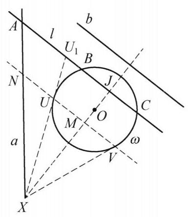

例 1 给定平面上两条相交直线 $a, b$ 和一个与 $a, b$ 无公共点的圆 $\omega$ . 对与 $b$ 平行且与 $\omega$ 相交于两点的直线 $l$ ,设 $A$ 是 $l$ 与 $a$ 的交点, $B, C$ 是 $l$ 与 $\omega$ 的交点,使得 $B$ 在线段 ${AC}$ 上. 试构造直线 $l$ 使得 $\frac{BC}{AB}$ 取到最大值.

解 如果 $b \bot  a$ ,显然令 $l$ 过 $\omega$ 圆心 $O$ 时 $\frac{BC}{AB}$ 最大.

下设 $b$ 与 $a$ 不垂直,过 $O$ 作 $b$ 的垂线,交 $a$ 于点 $X$ . 过点 $X$ 作 $\odot  O$ 的两条切线 ${XU},{XV}$ ,切点分别为 $U, V$ 其中 $U$ 为更靠近 $a$ 的值. 下证 ${UV}$ 即为所求的 $l$ .

图 10-1

对一般的与 $b$ 平行且与 $\omega$ 相交于两点的直线 $l$ ,设 ${BC}$ 中点为 $J,{U}_1 = l \cap  {XU}, N = {UV} \cap  a,{UV}$ 中点为 $M$ . 由于 $\omega$ 位于 ${U}_{1}X$ 的一侧,可知 $B$ 在线段 ${U}_{1}J$ 上,从而有

$$
\frac{MU}{UN} = \frac{J{U}_1}{{U}_{1}A} \geq  \frac{JB}{BA},
$$

即

$$
\frac{UV}{UN} \geq  \frac{BC}{BA}
$$

由此知直线 ${UV}$ 即为所求的 $l$ .
