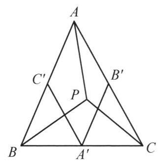
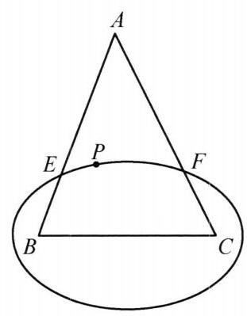

例 2 设 $P$ 是 $\bigtriangleup {ABC}$ 内一点,证明:

$$
\sqrt{PA} + \sqrt{PB} + \sqrt{PC} < \frac{\sqrt{5}}{2}\left( {\sqrt{BC} + \sqrt{CA} + \sqrt{AB}}\right) .
$$

①

证法 1 首先证明如下引理:

引理:设 $P$ 是凸四边形 ${ABCD}$ 的一个内点，则

$$
{PB} + {PC} < {BA} + {AD} + {DC}.
$$

该引理由 $\bigtriangleup {BPC}$ 的周长小于凸四边形 ${ABCD}$ 周长即得.

下面证明①. 设 ${BC} = a,{AC} = b,{BA} = c,{PA} = x,{PB} = y,{PC} = z$ .

图 10-2

如图 10-2,作出 $\bigtriangleup {ABC}$ 三边的中点 ${A}^{\prime },{B}^{\prime },{C}^{\prime }$ ,则 $P$ 必位于平行四边形 ${A}^{\prime }{B}^{\prime }A{C}^{\prime },{C}^{\prime }{B}^{\prime }C{A}^{\prime },{B}^{\prime }{A}^{\prime }B{C}^{\prime }$ 中的一个的内部. 不妨假设 $P$ 在平行四边形 ${A}^{\prime }{B}^{\prime }A{C}^{\prime }$ 内,则对凸四边形 ${AB}{A}^{\prime }{B}^{\prime }$ 应用引理有

$$
{PA} + {PB} < B{A}^{\prime } + {A}^{\prime }{B}^{\prime } + {B}^{\prime }A,
$$

即

$$
x + y < \frac{1}{2}\left( {a + b + c}\right) .
$$

②

同理,对凸四边形 ${AC}{A}^{\prime }{C}^{\prime }$ 应用引理可得

$$
x + z < \frac{1}{2}\left( {a + b + c}\right) .
$$

③

将②，③相加有

$$
{2x} + y + z < a + b + c.
$$

④

注意到原不等式等价于

$$
{\left( \sqrt{x} + \sqrt{y} + \sqrt{z}\right) }^2 < \frac{5}{4}{\left( \sqrt{a} + \sqrt{b} + \sqrt{c}\right) }^2,
$$

即

$$
x + y + z + 2\sqrt{xy} + 2\sqrt{xz} + 2\sqrt{yz} < \frac{5}{4}\left( {a + b + c + 2\sqrt{ab} + 2\sqrt{ac} + 2\sqrt{bc}}\right) .
$$

⑤故只需证明⑤即可. 由均值不等式有

$$
2\sqrt{xy} \leq  {2x} + \frac{1}{2}y
$$

$$
2\sqrt{xz} \leq  {2x} + \frac{1}{2}z,
$$

$$
2\sqrt{yz} \leq  y + z
$$

利用上述不等式和④可得

$$
\text{ ⑤ 的左边 } \leq  x + y + z + {2x} + \frac{1}{2}y + {2x} + \frac{1}{2}z + y + z
$$

$$
= \frac{5}{2}\left( {{2x} + y + z}\right)  < \frac{5}{2}\left( {a + b + c}\right) .
$$

因此要证⑤，只需证如下不等式

$$
\frac{5}{2}\left( {a + b + c}\right)  \leq  \frac{5}{4}\left( {a + b + c + 2\sqrt{ab} + 2\sqrt{ac} + 2\sqrt{bc}}\right) .
$$

将上式化简后等价于

$$
a + b + c \leq  2\left( {\sqrt{ab} + \sqrt{ac} + \sqrt{bc}}\right) .
$$

⑥

⑥是容易证明的,不妨设 $a \geq  b \geq  c$ ,有

$$
2\left( {\sqrt{ab} + \sqrt{ac} + \sqrt{bc}}\right)  \geq  2\left( {b + c + c}\right)
$$

$$
> 2\left( {\frac{a}{2} + \frac{b + c}{2} + c}\right)
$$

$$
> a + b + c\text{ . }
$$

综上,①得证.

本题还可以用等高线的方法证明. 所谓等高线就是在讨论极值问题时引进的特殊平面曲线, 常用的有圆, 椭圆等等. 本题可以使用椭圆.

图 10-3

证法 2 设 ${BC} = a,{AC} = b,{BA} = c$ ,且不妨设 $a \leq  b$ , c. 现过 $P$ 点作一个以 $B, C$ 为焦点的椭圆,与 ${AB},{AC}$ 分别交于 $E$ 和 $F$ ,如图 10-3. 有

$$
{PA} \leq  \max \left( {{EA},{FA}}\right) .
$$

不妨设 ${EA} \geq  {FA}$ ,则 ${PA} \leq  {EA}$ .

又

$$
\sqrt{PB} + \sqrt{PC} \leq  \sqrt{2\left( {{PB} + {PC}}\right) } = \sqrt{2\left( {{EB} + {EC}}\right) }.
$$

故

$$
\sqrt{PA} + \sqrt{PB} + \sqrt{PC} < \sqrt{EA} + \sqrt{2\left( {{EB} + {EC}}\right) }
$$

$$
\leq  {\left\lbrack  5EA + \frac{5}{2}\left( EB + EC\right) \right\rbrack  }^{\frac{1}{2}}
$$

$$
= {\left\lbrack  5\left( EA + EB\right)  + \frac{5}{2}\left( EC - EB\right) \right\rbrack  }^{\frac{1}{2}}
$$

$$
< \sqrt{5}{\left( c + \frac{a}{2}\right) }^{\frac{1}{2}}.
$$

于是只需证明

$$
2{\left( c + \frac{a}{2}\right) }^{\frac{1}{2}} \leq  \sqrt{a} + \sqrt{b} + \sqrt{c}.
$$

两边平方得

$$
{4c} + {2a} \leq  a + b + c + 2\sqrt{ab} + 2\sqrt{bc} + 2\sqrt{ca}.
$$

由 $a$ 为最短边, $2\sqrt{ab} \geq  {2a}$ ,故只需证

$$
{3c} \leq  a + b + 2\sqrt{bc} + 2\sqrt{ca}.
$$

考虑到 $a + b > c$ ,只需证

$$
{2c} \leq  2\sqrt{bc} + 2\sqrt{ca} \Leftrightarrow  \sqrt{c} \leq  \sqrt{b} + \sqrt{a} \Leftrightarrow  c \leq  a + b + 2\sqrt{ab}.
$$

由 $a + b > c$ 知上式成立,命题得证.

著名的托勒密不等式是关于任意四边形的一个距离不等式. 它可表述为下面的形式:
