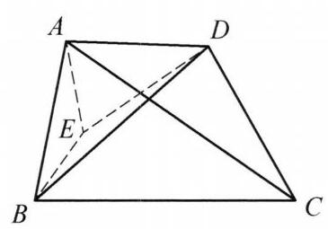

例 3 (托勒密不等式) 在四边形 ${ABCD}$ 中有

$$
{AB} \cdot  {CD} + {AD} \cdot  {BC} \geq  {AC} \cdot  {BD},
$$

等号成立当且仅当 $A, B, C, D$ 四点共圆.

证明 如图 10-4,在四边形 ${ABCD}$ 内取点 $E$ ,使 $\angle {BAE} = \angle {CAD},\angle {ABE} = \; \angle {ACD}$ ,则 $\bigtriangleup {ABE} \backsim  \bigtriangleup {ACD}$ . 因此

$$
{AB} \cdot  {CD} = {AC} \cdot  {BE}.
$$

图 10-4

又 $\angle {BAC} = \angle {EAD}$ ,且 $\frac{AB}{AE} = \frac{AC}{AD}$ ,所以 $\bigtriangleup {ABC} \backsim \; \bigtriangleup {AED},{AD} \cdot  {BC} = {AC} \cdot  {DE}$ . 故

$$
{AB} \cdot  {CD} + {AD} \cdot  {BC} = {AC}\left( {{BE} + {DE}}\right)  \geq  {AC} \cdot  {BD},
$$

等号成立当且仅当点 $E$ 在 ${BD}$ 上,此时 $\angle {ABD} = \; \angle {ABE} = \angle {ACD}$ ,即四边形 ${ABCD}$ 内接于圆.

应用托勒密不等式, 可以给出一些距离不等式的简洁证明如习题 3 .
