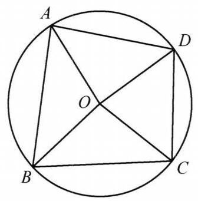
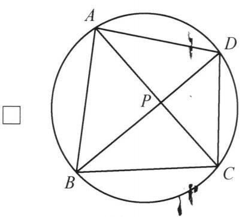
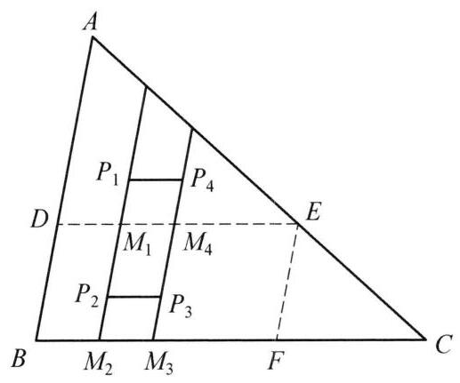

## 第十讲 几何不等式

## 知识精讲

在几何问题中有一类出现不等式的问题称为几何不等式,例如比较长度,角度或面积的大小. 在几何不等式的证明中, 不但需要用到一些常用的不等式还需要用到几何中的一些基本不等公理和定理, 三角函数也是一种常用的工具. 本节介绍了例如:距离不等式，托勒密不等式，圆内接四边形中的不等式等一些几何不等式中常见的问题和求解方法.

## 典型例题

---

例 1 给定平面上两条相交直线 $a, b$ 和一个与 $a, b$ 无公共点的圆 $\omega$ . 对与 $b$ 平行且与 $\omega$ 相交于两点的直线 $l$ ,设 $A$ 是 $l$ 与 $a$ 的交点, $B, C$ 是 $l$ 与 $\omega$ 的交点,使得 $B$ 在线段 ${AC}$ 上. 试构造直线 $l$ 使得 $\frac{BC}{AB}$ 取到最大值.

解 如果 $b \bot  a$ ,显然令 $l$ 过 $\omega$ 圆心 $O$ 时 $\frac{BC}{AB}$ 最大.

下设 $b$ 与 $a$ 不垂直,过 $O$ 作 $b$ 的垂线,交 $a$ 于点 $X$ . 过点 $X$ 作 $\odot  O$ 的两条切线 ${XU},{XV}$ ,切点分别为 $U, V$ 其中 $U$ 为更靠近 $a$ 的值. 下证 ${UV}$ 即为所求的 $l$ .

图 10-1

对一般的与 $b$ 平行且与 $\omega$ 相交于两点的直线 $l$ ,设 ${BC}$ 中点为 $J,{U}_1 = l \cap  {XU}, N = {UV} \cap  a,{UV}$ 中点为 $M$ . 由于 $\omega$ 位于 ${U}_{1}X$ 的一侧,可知 $B$ 在线段 ${U}_{1}J$ 上,从而有

$$
\frac{MU}{UN} = \frac{J{U}_1}{{U}_{1}A} \geq  \frac{JB}{BA},
$$

即

$$
\frac{UV}{UN} \geq  \frac{BC}{BA}
$$

由此知直线 ${UV}$ 即为所求的 $l$ .

---

例 2 设 $P$ 是 $\bigtriangleup {ABC}$ 内一点,证明:

$$
\sqrt{PA} + \sqrt{PB} + \sqrt{PC} < \frac{\sqrt{5}}{2}\left( {\sqrt{BC} + \sqrt{CA} + \sqrt{AB}}\right) .
$$

①

证法 1 首先证明如下引理:

引理:设 $P$ 是凸四边形 ${ABCD}$ 的一个内点，则

$$
{PB} + {PC} < {BA} + {AD} + {DC}.
$$

该引理由 $\bigtriangleup {BPC}$ 的周长小于凸四边形 ${ABCD}$ 周长即得.

下面证明①. 设 ${BC} = a,{AC} = b,{BA} = c,{PA} = x,{PB} = y,{PC} = z$ .

图 10-2

如图 10-2,作出 $\bigtriangleup {ABC}$ 三边的中点 ${A}^{\prime },{B}^{\prime },{C}^{\prime }$ ,则 $P$ 必位于平行四边形 ${A}^{\prime }{B}^{\prime }A{C}^{\prime },{C}^{\prime }{B}^{\prime }C{A}^{\prime },{B}^{\prime }{A}^{\prime }B{C}^{\prime }$ 中的一个的内部. 不妨假设 $P$ 在平行四边形 ${A}^{\prime }{B}^{\prime }A{C}^{\prime }$ 内,则对凸四边形 ${AB}{A}^{\prime }{B}^{\prime }$ 应用引理有

$$
{PA} + {PB} < B{A}^{\prime } + {A}^{\prime }{B}^{\prime } + {B}^{\prime }A,
$$

即

$$
x + y < \frac{1}{2}\left( {a + b + c}\right) .
$$

②

同理,对凸四边形 ${AC}{A}^{\prime }{C}^{\prime }$ 应用引理可得

$$
x + z < \frac{1}{2}\left( {a + b + c}\right) .
$$

③

将②，③相加有

$$
{2x} + y + z < a + b + c.
$$

④

注意到原不等式等价于

$$
{\left( \sqrt{x} + \sqrt{y} + \sqrt{z}\right) }^2 < \frac{5}{4}{\left( \sqrt{a} + \sqrt{b} + \sqrt{c}\right) }^2,
$$

即

$$
x + y + z + 2\sqrt{xy} + 2\sqrt{xz} + 2\sqrt{yz} < \frac{5}{4}\left( {a + b + c + 2\sqrt{ab} + 2\sqrt{ac} + 2\sqrt{bc}}\right) .
$$

⑤故只需证明⑤即可. 由均值不等式有

$$
2\sqrt{xy} \leq  {2x} + \frac{1}{2}y
$$

$$
2\sqrt{xz} \leq  {2x} + \frac{1}{2}z,
$$

$$
2\sqrt{yz} \leq  y + z
$$

利用上述不等式和④可得

$$
\text{ ⑤ 的左边 } \leq  x + y + z + {2x} + \frac{1}{2}y + {2x} + \frac{1}{2}z + y + z
$$

$$
= \frac{5}{2}\left( {{2x} + y + z}\right)  < \frac{5}{2}\left( {a + b + c}\right) .
$$

因此要证⑤，只需证如下不等式

$$
\frac{5}{2}\left( {a + b + c}\right)  \leq  \frac{5}{4}\left( {a + b + c + 2\sqrt{ab} + 2\sqrt{ac} + 2\sqrt{bc}}\right) .
$$

将上式化简后等价于

$$
a + b + c \leq  2\left( {\sqrt{ab} + \sqrt{ac} + \sqrt{bc}}\right) .
$$

⑥

⑥是容易证明的,不妨设 $a \geq  b \geq  c$ ,有

$$
2\left( {\sqrt{ab} + \sqrt{ac} + \sqrt{bc}}\right)  \geq  2\left( {b + c + c}\right)
$$

$$
> 2\left( {\frac{a}{2} + \frac{b + c}{2} + c}\right)
$$

$$
> a + b + c\text{ . }
$$

综上,①得证.

本题还可以用等高线的方法证明. 所谓等高线就是在讨论极值问题时引进的特殊平面曲线, 常用的有圆, 椭圆等等. 本题可以使用椭圆.

图 10-3

证法 2 设 ${BC} = a,{AC} = b,{BA} = c$ ,且不妨设 $a \leq  b$ , c. 现过 $P$ 点作一个以 $B, C$ 为焦点的椭圆,与 ${AB},{AC}$ 分别交于 $E$ 和 $F$ ,如图 10-3. 有

$$
{PA} \leq  \max \left( {{EA},{FA}}\right) .
$$

不妨设 ${EA} \geq  {FA}$ ,则 ${PA} \leq  {EA}$ .

又

$$
\sqrt{PB} + \sqrt{PC} \leq  \sqrt{2\left( {{PB} + {PC}}\right) } = \sqrt{2\left( {{EB} + {EC}}\right) }.
$$

故

$$
\sqrt{PA} + \sqrt{PB} + \sqrt{PC} < \sqrt{EA} + \sqrt{2\left( {{EB} + {EC}}\right) }
$$

$$
\leq  {\left\lbrack  5EA + \frac{5}{2}\left( EB + EC\right) \right\rbrack  }^{\frac{1}{2}}
$$

$$
= {\left\lbrack  5\left( EA + EB\right)  + \frac{5}{2}\left( EC - EB\right) \right\rbrack  }^{\frac{1}{2}}
$$

$$
< \sqrt{5}{\left( c + \frac{a}{2}\right) }^{\frac{1}{2}}.
$$

于是只需证明

$$
2{\left( c + \frac{a}{2}\right) }^{\frac{1}{2}} \leq  \sqrt{a} + \sqrt{b} + \sqrt{c}.
$$

两边平方得

$$
{4c} + {2a} \leq  a + b + c + 2\sqrt{ab} + 2\sqrt{bc} + 2\sqrt{ca}.
$$

由 $a$ 为最短边, $2\sqrt{ab} \geq  {2a}$ ,故只需证

$$
{3c} \leq  a + b + 2\sqrt{bc} + 2\sqrt{ca}.
$$

考虑到 $a + b > c$ ,只需证

$$
{2c} \leq  2\sqrt{bc} + 2\sqrt{ca} \Leftrightarrow  \sqrt{c} \leq  \sqrt{b} + \sqrt{a} \Leftrightarrow  c \leq  a + b + 2\sqrt{ab}.
$$

由 $a + b > c$ 知上式成立,命题得证.

著名的托勒密不等式是关于任意四边形的一个距离不等式. 它可表述为下面的形式:

---

例 3 (托勒密不等式) 在四边形 ${ABCD}$ 中有

$$
{AB} \cdot  {CD} + {AD} \cdot  {BC} \geq  {AC} \cdot  {BD},
$$

等号成立当且仅当 $A, B, C, D$ 四点共圆.

证明 如图 10-4,在四边形 ${ABCD}$ 内取点 $E$ ,使 $\angle {BAE} = \angle {CAD},\angle {ABE} = \; \angle {ACD}$ ,则 $\bigtriangleup {ABE} \backsim  \bigtriangleup {ACD}$ . 因此

$$
{AB} \cdot  {CD} = {AC} \cdot  {BE}.
$$

图 10-4

又 $\angle {BAC} = \angle {EAD}$ ,且 $\frac{AB}{AE} = \frac{AC}{AD}$ ,所以 $\bigtriangleup {ABC} \backsim \; \bigtriangleup {AED},{AD} \cdot  {BC} = {AC} \cdot  {DE}$ . 故

$$
{AB} \cdot  {CD} + {AD} \cdot  {BC} = {AC}\left( {{BE} + {DE}}\right)  \geq  {AC} \cdot  {BD},
$$

等号成立当且仅当点 $E$ 在 ${BD}$ 上,此时 $\angle {ABD} = \; \angle {ABE} = \angle {ACD}$ ,即四边形 ${ABCD}$ 内接于圆.

应用托勒密不等式, 可以给出一些距离不等式的简洁证明如习题 3 .

---

例 4 已知四边形 ${ABCD}$ 是圆的内接四边形,证明:

$$
\left| {{AB} - {CD}}\right|  + \left| {{AD} - {BC}}\right|  \geq  2\left| {{AC} - {BD}}\right| .
$$

图 10-5

证法 1 如图 10-5,不妨设四边形 ${ABCD}$ 外接圆的圆心为 $O$ ,半径为 1 . 记 $\angle {AOB} = {2\alpha },\angle {BOC} = {2\beta }$ , $\angle {COD} = {2\gamma },\angle {DOA} = {2\delta }$ ,则

$$
\alpha  + \beta  + \gamma  + \delta  = \pi
$$

不妨设 $\alpha  \geq  \gamma ,\beta  \geq  \delta$ ,则

$$
\left| {{AB} - {CD}}\right|  = 2\left| {\sin \alpha  - \sin \gamma }\right|
$$

$$
= 4\left| {\sin \frac{\alpha  - \gamma }{2}\cos \frac{\alpha  + \gamma }{2}}\right|
$$

$$
= 4\left| {\sin \frac{\alpha  - \gamma }{2}\sin \frac{\beta  + \delta }{2}}\right| .
$$

同理

$$
\left| {{AD} - {BC}}\right|  = 4\left| {\sin \frac{\beta  - \delta }{2}\sin \frac{\alpha  + \gamma }{2}}\right| ,
$$

$$
\left| {{AC} - {BD}}\right|  = 4\left| {\sin \frac{\beta  - \delta }{2}\sin \frac{\alpha  - \gamma }{2}}\right| .
$$

因此

$$
\left| {{AB} - {CD}}\right|  - \left| {{AC} - {BD}}\right|  = 4\left| {\sin \frac{\alpha  - \gamma }{2}}\right| \left( {\left| {\sin \frac{\beta  + \delta }{2}}\right|  - \left| {\sin \frac{\beta  - \delta }{2}}\right| }\right)
$$

$$
= 4\left| {\sin \frac{\alpha  - \gamma }{2}}\right| \left( {\sin \frac{\beta  + \delta }{2} - \sin \frac{\beta  - \delta }{2}}\right)
$$

$$
= 4\left| {\sin \frac{\alpha  - \gamma }{2}}\right|  \cdot  \left( {2\cos \frac{\beta }{2} \cdot  \sin \frac{\delta }{2}}\right)
$$

$$
\geq  0\text{ . }
$$

即

$$
\left| {{AB} - {CD}}\right|  \geq  \left| {{AC} - {BD}}\right| .
$$

图 10-6

同理

$$
\left| {{AD} - {BC}}\right|  \geq  \left| {{AC} - {BD}}\right|
$$

结合上述两个不等式即得题目所求不等式.

证法 2 如图 10-6,设 ${AC}$ 交 ${BD}$ 于 $P$ ,有

$$
\bigtriangleup {ABP} \backsim  \bigtriangleup {DCP},\bigtriangleup {ADP} \backsim  \bigtriangleup {BCP}.
$$

因此

$$
\left| {{AB} - {CD}}\right|  + \left| {{AD} - {BC}}\right|
$$

$$
= {AB}\left| {1 - \frac{CD}{AB}}\right|  + {AD}\left| {1 - \frac{BC}{AD}}\right|
$$

$$
= {AB}\left| {1 - \frac{DP}{AP}}\right|  + {AD}\left| {1 - \frac{BP}{AP}}\right|
$$

$$
\geq  \left| {{AP} - {BP}}\right|  \cdot  \left| {1 - \frac{DP}{AP}}\right|  + \left| {{AP} - {DP}}\right|  \cdot  \left| {1 - \frac{BP}{AP}}\right|
$$

$$
= \left| {{AP} - {BP} - {DP} + \frac{{BP} \cdot  {DP}}{AP}}\right|  + \left| {{AP} - {DP} - {BP} + \frac{{BP} \cdot  {DP}}{AP}}\right|
$$

$$
= 2\left| {{AP} + {CP} - {BP} - {DP}}\right| \text{ (圆幂定理) }
$$

$$
= 2\left| {{AC} - {BD}}\right| \text{ . }
$$

命题得证.

---

例 5 证明: 任意一个三角形的内含平行四边形的面积不超过三角形面积的一半.

证明 如图 10-7,设平行四边形 ${P}_1{P}_2{P}_3{P}_4$ 是 $\bigtriangleup {ABC}$ 内的平行四边形. 不妨设直线 ${P}_1{P}_2,{P}_3{P}_4$ 交边 ${BC}$ 于两点,分别记为 ${M}_2,{M}_3$ ,在这两条直线上分别截取线段 ${M}_2{M}_1,{M}_3{M}_4$ 使得

$$
{M}_2{M}_1 = {M}_3{M}_4 = {P}_1{P}_{2}.
$$

图 10-7

则四边形 ${M}_1{M}_2{M}_3{M}_4$ 为平行四边形,且面积与平行四边形 ${P}_1{P}_2{P}_3{P}_4$ 相同.

设直线 ${M}_1{M}_4$ 分别交边 ${AB},{AC}$ 于两点 $D, E$ ,过点 $E$ 作 ${AB}$ 的平行线交 ${BC}$ 于 $F$ ,则得到平行四边形 ${BDEF}$ . 此时

$$
{S}_{BDEF} \geq  {S}_{{M}_1{M}_2{M}_3{M}_4} = {S}_{{P}_1{P}_2{P}_3{P}_4}.
$$

故只要证明

$$
{S}_{BDEF} \leq  \frac{1}{2}{S}_{\bigtriangleup {ABC}}.
$$

(*)

下证 $\left( *\right)$ 式. 设

$$
\lambda  = \frac{AD}{AB},\lambda  \in  \left( {0,1}\right) .
$$

由 $\bigtriangleup {ADE} \backsim  \bigtriangleup {ABC}$ ,可得

$$
{S}_{\bigtriangleup {ADE}} = {\lambda }^2{S}_{\bigtriangleup {ABC}}.
$$

同理

$$
{S}_{\bigtriangleup {EFC}} = {\left( 1 - \lambda \right) }^2{S}_{\bigtriangleup {ABC}}.
$$

相加得

$$
{S}_{\bigtriangleup {ADE}} + {S}_{\bigtriangleup {EFC}} = \left\lbrack  {{\lambda }^2 + {\left( 1 - \lambda \right) }^2}\right\rbrack  {S}_{\bigtriangleup {ABC}} \geq  \frac{1}{2}{S}_{\bigtriangleup {ABC}},
$$

因此

$$
{S}_{BDEF} = {S}_{\bigtriangleup {ABC}} - {S}_{\bigtriangleup {ADE}} - {S}_{\bigtriangleup {EFC}} \leq  \frac{1}{2}{S}_{\bigtriangleup {ABC}}.
$$

(*) 式得证,等号成立当且仅当 $D, E, F$ 分别为三边中点.

---

例 6 设 $\bigtriangleup {ABC}$ 的三边为 $a, b, c$ ,则

$$
{h}_a + {m}_b + {t}_c \leq  \frac{\sqrt{3}}{2}\left( {a + b + c}\right) ,
$$

其中 ${h}_a,{m}_b,{t}_c$ 分别表示边 ${BC},{AC},{AB}$ 上的高,中线和内角平分线.

证明 考虑到在三角形中 ${h}_a \leq  {t}_a$ ,可以证明加强的不等式如下

$$
{t}_a + {m}_b + {t}_c \leq  \frac{\sqrt{3}}{2}\left( {a + b + c}\right) .
$$

首先证明局部不等式

$$
{m}_b + 2{t}_a \leq  \frac{\sqrt{3}}{2}\left( {b + {2c}}\right) .
$$

由内角平分线公式知

$$
{t}_a^2 = \frac{4}{{\left( b + c\right) }^2} \cdot  {bcp}\left( {p - a}\right)
$$

$$
\leq  p\left( {p - a}\right)
$$

$$
= \frac{1}{4}\left( {{\left( b + c\right) }^2 - {a}^2}\right) ,
$$

且

$$
{m}_b^2 = \frac{1}{4}\left( {2{a}^2 + 2{c}^2 - {b}^2}\right) .
$$

故由柯西不等式有

$$
{m}_b + 2{t}_a \leq  \sqrt{3\left( {{m}_b^2 + 2{t}_a^2}\right) }
$$

$$
\leq  \sqrt{\frac{3}{4}\left( {2{a}^2 + 2{c}^2 - {b}^2 + 2{\left( b + c\right) }^2 - 2{a}^2}\right) }
$$

$$
= \frac{\sqrt{3}}{2}\left( {b + {2c}}\right) \text{ . }
$$

同理可得

$$
{m}_b + 2{t}_c \leq  \frac{\sqrt{3}}{2}\left( {b + {2a}}\right) .
$$

相加后即为加强的不等式.

