阅读欣赏

本章主要新补一些几何问题，包括几何不等式与几何极值问题，轨迹问题，作图问题与空间问题。

## 1. 几何不等式与几何极值

范例 1 对任意圆内接五边形，证明:其面积与各对角线长度之和的比不会超过其外接圆半径的 $\frac{1}{4}$ .

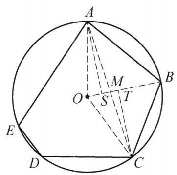

图 10-8

证明 不妨设五边形 ${ABCDE}$ 为单位圆的内接五边形，其圆心为 $O.A, C$ 在 ${BO}$ 上的投影分别为点 $S, T$ ， ${AC}$ 交 ${BO}$ 于点 $M$ ,如图 10-8. 故

$$
2{S}_{ABCDE} = {S}_{AOCB} + {S}_{BODC} + {S}_{COED} + {S}_{DOAE} + {S}_{EOBA}.
$$

由于

$$
{S}_{AOCB} = {S}_{\bigtriangleup {AOB}} + {S}_{\bigtriangleup {BOC}} = \frac{1}{2}\left( {\sin \angle {AOB} + \sin \angle {BOC}}\right)
$$

$$
= \frac{1}{2}\left( {{AS} + {CT}}\right)  \leq  \frac{1}{2}\left( {{AM} + {CM}}\right)  = \frac{1}{2}{AC}.
$$

同理可得另外的四个局部不等式, 将这五个不等式相加便得

则

$$
2{S}_{ABCDE} \leq  \frac{1}{2}\left( {{AC} + {BD} + {CE} + {DA} + {EB}}\right) ,
$$

$$
\frac{{S}_{ABCDE}}{{AC} + {BD} + {CE} + {DA} + {EB}} \leq  \frac{1}{4} = \frac{1}{4}R.
$$

得证.

范例 2 给定实数 $\lambda  > 1$ ，已知一个平行四边形的相邻边长度之比为 $\lambda$ ，求其对角线夹角的最大值.

解 不妨设在平行四边形 ${ABCD}$ 中， ${AB} = 1,{AD} = \lambda  > 1,{BD}$ 中点为 $M$ ，我们求 $\angle {BMA}$ 最大值.

注意到 $\frac{AD}{AB} = \lambda  > 1$ ，从而 $A$ 在以 $B$ ， $D$ 为定点， $\frac{AD}{AB} = \lambda$ 的阿波罗尼斯圆上， 且若设该圆圆心为 $O$ ,则 $O$ 在 ${DB}$ 延长线上.

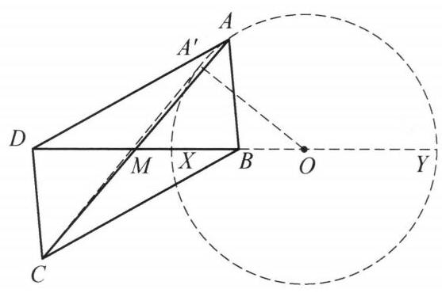

图 10-9

设圆 $O$ 与直线 ${DB}$ 交于点 $X, Y$ ,其中 $X$ 在 ${DB}$ 内部. 设 ${BD} = a$ ,则

$$
{BX} = \frac{a}{\lambda  + 1},{BY} = \frac{a}{\lambda  - 1},
$$

从而圆 $O$ 半径

$$
R = \frac{1}{2}{XY} = \frac{1}{2}\left( {{BX} + {BY}}\right)  = \frac{\lambda a}{{\lambda }^2 - 1},
$$

故

$$
{OM} = {OX} + {XM} = \frac{\lambda a}{{\lambda }^2 - 1} + \frac{a}{2} - \frac{a}{\lambda  + 1} = \frac{{\lambda }^2 + 1}{2\left( {{\lambda }^2 - 1}\right) }a.
$$

显然在 ${AM}$ 与圆 $O$ 相切时, $\angle {BMA}$ 最大,此时 $\sin \angle {BMA} = \frac{R}{OM} = \; \frac{2\lambda }{{\lambda }^2 + 1}$ ,即 $\angle {BMA} = \arcsin \frac{2\lambda }{{\lambda }^2 + 1} = 2\arctan \frac{1}{\lambda }$ ,从而两对角线夹角的最大值为 $2\arctan \frac{1}{\lambda }$ .

注: 将 $A$ 视为动点, $A$ 的轨迹是圆,从而夹角最大即相切的情形. 这样利用阿波罗尼斯圆进行处理规避了过多的三角计算.

范例 3 一个三角形的内切圆半径为 $r$ ,外接圆半径为 $R$ ,最长的高线长度为 $H$ . 证明: 若该三角形是非钝角三角形,则 $H \geq  r + R$ ,并求等号成立条件.

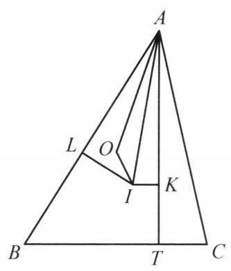

图 10-10

证明 设该三角形的三个顶点分别为 $A, B, C$ ,不妨设 $\angle A \leq  \angle B \leq  \angle C$ . 如果 $\bigtriangleup {ABC}$ 是等边三角形,显然 $H = \; r + R$ ,下设 $\bigtriangleup {ABC}$ 不是等边三角形. 设 $\bigtriangleup {ABC}$ 的内心为 $I$ , 外心为 $O$ ,则 $O, I$ 两点不重合.

设 ${AT} \bot  {BC}$ 于点 $T,{IL} \bot  {AB}$ 于点 $L,{IK} \bot  {AT}$ 于点 $K$ .

显然 $O$ 在 $\angle {BAI}$ 内,结合 ${IB}$ 到 ${AB}$ 的射影长为 $\frac{{AB} + {BC} - {AC}}{2} \leq  \frac{1}{2}{AB}$ ，可知 $O$ 在 $\bigtriangleup  {ALI}$ 内部(或边界)， 因此 $\angle {AOI} \geq  {90}^{ \circ  }$ . 注意到 $\angle {OAI} = \angle {IAK}$ ,故

$$
{AO} \leq  {AI}\cos \angle {OAI}
$$

$$
= {AI}\cos \angle {IAK}
$$

$$
= {AK}\text{ . }
$$

因此 $R + r \leq  {AK} + {KT} = {AH}$ ,等号成立时 ${AO} \bot  {OI}$ ,故 (因 $O$ 在 $\bigtriangleup {ALI}$ 内部或边界) $O \equiv  L$ .

由 $O$ 在 ${AB}$ 上可知 $\angle C = {90}^{ \circ  }$ ,进而得出 $L \equiv  O$ 是边 ${AB}$ 中点,故 ${AC} = {BC}$ ,因此 $\bigtriangleup {ABC}$ 是等腰直角三角形.

综上所述 $H \geq  r + R$ ,等号成立当且仅当 $\bigtriangleup {ABC}$ 是等边三角形或等腰直角三角形.

注: 为了证明 $H \geq  r + R$ ,我们在图形中构造出 $H - r$ ,然后讨论 $O$ 的位置以得到 ${OA}$ 与 ${AK}$ 的长度关系.

范例 4 试求正方形 ${ABCD}$ 边长的最小可能值,使得正方形 ${ABCD}$ 内部可以摆放面积之和不大于 1 的任意 4 个互不相交的小正方形.

解 答案是 $\sqrt{2}$ . 将四个正方形一个角放一个,任何两个正方形的面积之和不超过 1 , 对于其中的任何两个正方形, 设其边长分别为 $a, b$ ,这时 ${a}^2 + {b}^2 \leq  1$ ,这样我们根据柯西不等式有 $a + b \leq  \sqrt{\left( {{1}^2 + {1}^2}\right) \left( {{a}^2 + {b}^2}\right) } \leq  \sqrt{2}$ ,这样这两个正方形由于在边长为 $\sqrt{2}$ 的正方形的不同侧,所以这两个正方形当然不相交. 所以边长为 $\sqrt{2}$ 的正方形满足条件.

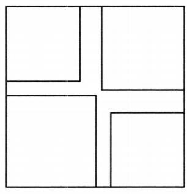

图 10-11

另一方面，我们可以令四个正方形面积分别为 $\frac{1}{2} - \varepsilon ,\frac{1}{2} - \varepsilon ,\varepsilon ,\varepsilon$ (其中 $\varepsilon  <$ 0.1 为足够小的正数)，这样两个边长为 $\sqrt{\frac{1}{2} - \varepsilon }$ 的正方形不相交，那么大正方形的边长就不能小于 $2\sqrt{\frac{1}{2} - \varepsilon } = \sqrt{2 - {4\varepsilon }}$ . 令 $\varepsilon  \rightarrow  0$ 即得满足条件的正方形边长不小于 $\sqrt{2}$ ，即证.

范例 5 给定 $\bigtriangleup  {ABC}$ ，分别在边 ${BC},{CA},{AB}$ 上独立随机等概率取点 ${A}^{\prime }$ ， ${B}^{\prime }$ ， ${C}^{\prime }$ . 对平面上一点 $Z$ ， $P$ ( $Z$ ) 表示 $Z$ 在直线 $A{A}^{\prime }$ ， $B{B}^{\prime }$ ， $C{C}^{\prime }$ 构成的三角形内 (不含边界) 的概率. 求平面上的所有点 $Z$ ,使得 $P\left( Z\right)$ 取到最大值.

解 由于直线 $A{A}^{\prime }, B{B}^{\prime }, C{C}^{\prime }$ 构成的三角形一定含在 $\bigtriangleup {ABC}$ 中,故只用考虑 $Z$ 在 $\bigtriangleup {ABC}$ 内部的情形. 设 $Z$ 对 $\bigtriangleup {ABC}$ 的塞瓦三角形为 $\bigtriangleup {DEF}$ ,

$$
\frac{BD}{DC} = u,\frac{CE}{EA} = v,\frac{AF}{FB} = w,
$$

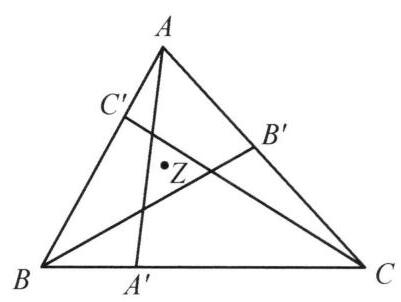

图 10-12

则 $u, v, w > 0$ ,且由塞瓦定理知 ${uvw} = 1$ .

用 $\left( {XY}\right)$ 表示除去端点 $X, Y$ 的开线段 ${XY}$ . 易知 $Z$ 在直线 $A{A}^{\prime }, B{B}^{\prime }, C{C}^{\prime }$ 构成的三角形内 (不含边界) 当且仅当下述(1)、(2)之一成立:

(1) ${A}^{\prime } \in  \left( {BD}\right) ,{B}^{\prime } \in  \left( {CE}\right) ,{C}^{\prime } \in  \left( {AF}\right)$ ；

(2) ${A}^{\prime } \in  \left( {DC}\right) ,{B}^{\prime } \in  \left( {EA}\right) ,{C}^{\prime } \in  \left( {FB}\right)$ .

显然(1)、(2)不同时发生. 由几何概型知，

$$
P\left( Z\right)  = \frac{uvw}{\left( {u + 1}\right) \left( {v + 1}\right) \left( {w + 1}\right) } + \frac{1}{\left( {u + 1}\right) \left( {v + 1}\right) \left( {w + 1}\right) }
$$

$$
= \frac{2}{\left( {u + 1}\right) \left( {v + 1}\right) \left( {w + 1}\right) }
$$

$$
\leq  \frac{1}{4}\text{ (赫尔德不等式), }
$$

等号取到当且仅当 $u = v = w = 1$ . 即当且仅当 $Z$ 是 $\bigtriangleup {ABC}$ 重心时, $P\left( Z\right)$ 取到最大值.

注: 将概率表为显式再应用代数的方法求最值. 题中的变量实际上就是 $D, E$ , $F$ 在三边上所截的比例,但这些比例的不同设参方法对解题的复杂度有一定影响. 本题是简单题.

范例 6 将一个三角形的每个顶点关于对边作反射, 证明: 由三个反射点构成的三角形面积小于原三角形面积的 5 倍.

证明 利用解析几何.

设原三角形为 ${ABC}, A, B, C$ 关于对边的反射点分别为 ${A}^{ * },{B}^{ * },{C}^{ * }$ . 不妨设在平面直角坐标系中, $C\left( {-1,0}\right) , B\left( {1,0}\right) , A\left( {s, t}\right) \left( {t > 0}\right)$ ,则 ${S}_{\bigtriangleup {ABC}} = t$ , ${A}^{ * }\left( {s, - t}\right)$ .

设 ${B}^{ * }\left( {u, v}\right) ,{C}^{ * }\left( {z, w}\right)$ ,则

$$
{S}_{\bigtriangleup {A}^{ * }{B}^{ * }{C}^{ * }} = \frac{1}{2}\left| {{uw} - {zt} + {sv} + {ut} - {zv} - {sw}}\right| .
$$

不难解得

$$
u = \frac{{\left( s + 1\right) }^2 - 3{t}^2}{{\left( s + 1\right) }^2 + {t}^2}, v = \frac{{4t}\left( {s + 1}\right) }{{\left( s + 1\right) }^2 + {t}^2},
$$

$$
z = \frac{3{t}^2 - {\left( 1 - s\right) }^2}{{\left( 1 - s\right) }^2 + {t}^2}, w = \frac{{4t}\left( {1 - s}\right) }{{\left( 1 - s\right) }^2 + {t}^2},
$$

代入上式化简得

$$
{S}_{\bigtriangleup {A}^{ * }{B}^{ * }{C}^{ * }} = \frac{t}{\left( {{\left( s + 1\right) }^2 + {t}^2}\right) \left( {{\left( 1 - s\right) }^2 + {t}^2}\right) } \cdot  \left| {5{s}^4 - {10}{s}^2 - 3{t}^4 - {14}{t}^2 + 2{s}^2{t}^2 + 5}\right|
$$

$$
= \frac{t}{{s}^4 - 2{s}^2 + 2{s}^2{t}^2 + {t}^4 + 2{t}^2 + 1} \cdot  \left| {5{s}^4 - {10}{s}^2 - 3{t}^4 - {14}{t}^2 + 2{s}^2{t}^2 + 5}\right| .
$$

## 一方面，容易看出

$$
5{s}^4 - {10}{s}^2 - 3{t}^4 - {14}{t}^2 + 2{s}^2{t}^2 + 5 < 5\left( {{s}^4 - 2{s}^2 + 2{s}^2{t}^2 + {t}^4 + 2{t}^2 + 1}\right) ,
$$

## 另一方面，有

$$
\left( {5{s}^4 - {10}{s}^2 - 3{t}^4 - {14}{t}^2 + 2{s}^2{t}^2 + 5}\right)  + 5\left( {{s}^4 - 2{s}^2 + 2{s}^2{t}^2 + {t}^4 + 2{t}^2 + 1}\right)
$$

$$
= {10}{s}^4 - {20}{s}^2 + {12}{s}^2{t}^2 + 2{t}^4 - 4{t}^2 + {10}.
$$

若 $3{s}^2 \geq  1$ ,则

$$
\text{ 上式 } \geq  {10}{\left( {s}^{2} - 1\right) }^{2} + 2{t}^{4} \geq  1\text{ . }
$$

若 $3{s}^2 < 1$ ,则

$$
\text{ 上式 } \geq  {10}{\left( {s}^{2} - 1\right) }^{2} + 2{\left( {t}^{2} - 1\right) }^{2} - 2
$$

$$
> {10}{\left( \frac{1}{3} - 1\right) }^{2} - 2 > 0\text{ . }
$$

这便说明了 ${S}_{\bigtriangleup {A}^{ * }{B}^{ * }{C}^{ * }} < {5t} = 5{S}_{\bigtriangleup {ABC}}$ ,结论得证.

注: 本题还可以用图形割补的几何办法来做,但那样则需依赖 $\bigtriangleup {ABC}$ 的形状讨论大量情况, 上述解法以一定量的计算代之. 从证明过程中不难看出, 常数 5 是最佳的.

范例 7 设 ${P}_1,{P}_2,{P}_3$ 为闭多边形区域,满足对任意三点 $A \in  {P}_1, B \in  {P}_2$ , $C \in  {P}_3$ ,都有 $\left\lbrack  {\bigtriangleup {ABC}}\right\rbrack   \leq  1$ . (这里 $\left\lbrack  X\right\rbrack$ 表示多边形 $X$ 的面积). 证明:

(1) $\min \left\{  {\left\lbrack  {P}_1\right\rbrack  ,\left\lbrack  {P}_2\right\rbrack  ,\left\lbrack  {P}_3\right\rbrack  }\right\}   < 4$ .

(2)试构造 ${P}_1,{P}_2,{P}_3$ 满足条件，使得 $\left\lbrack  {P}_1\right\rbrack   > 4,\left\lbrack  {P}_2\right\rbrack   > 4$ .

证明(1)设 $d$ 是 ${P}_1,{P}_2,{P}_3$ 中不在同一集合中的两点的距离的最大值，由于 ${P}_1,{P}_2,{P}_3$ 是闭多边形，故 $d$ 存在. 不妨设存在 $X \in  {P}_1, Y \in  {P}_2$ 使得 $d = \left| {XY}\right|$ . 则由 $d$ 的定义，对于 ${P}_1,{P}_2,{P}_3$ 中任意一点 $Z$ ，有

$$
Z \in   \odot  \left( {X, d}\right)  \cap   \odot  \left( {Y, d}\right) ,
$$

(*)

其中 $\odot  \left( {X, d}\right) , \odot  \left( {Y, d}\right)$ 分别表示以 $X, Y$ 为圆心,半径为 $d$ 的圆盘.

对于任意一点 $Z \in  {P}_3$ ,由于 $\left\lbrack  {XYZ}\right\rbrack   \leq  1$ ,故点 $Z$ 到直线 ${XY}$ 距离不超过 $\frac{2}{d}$ . 从而 ${P}_3$ 中的点在以 ${XY}$ 为一条中线,且相邻边长分别为 $d,\frac{4}{d}$ 的矩形 $R$ 中. 因此有

$$
\left\lbrack  {P}_3\right\rbrack   \leq  \left\lbrack  R\right\rbrack   = d \cdot  \frac{4}{d} = 4.
$$

由 $\left( *\right)$ 可知上式等号不成立，从而(1)得证.

(2)待定正整数 $n$ ，取 ${P}_1,{P}_2$ 是半径为 $\sqrt{\frac{5}{\pi }}$ 的圆的内接正 $n$ 边形，且 ${P}_1,{P}_2$ 重合. ${P}_3$ 是外接圆半径为 0.01 的正方形，满足其外接圆圆心与 ${P}_1,{P}_2$ 外接圆圆心 $O$ 重合. 利用 $\mathop{\lim }\limits_{x \rightarrow  0}\frac{\sin x}{x} = 1$ 知可令正整数 $n$ 充分大，使得

$$
\left\lbrack  {P}_1\right\rbrack   = \left\lbrack  {P}_2\right\rbrack   = n \cdot  \frac{1}{2}{\left( \sqrt{\frac{5}{\pi }}\right) }^2\sin \frac{2\pi }{n}
$$

$$
= \frac{5}{\pi } \cdot  \frac{n}{2}\sin \frac{2\pi }{n} > 4.
$$

此时对任意三点 $A \in  {P}_1, B \in  {P}_2, C \in  {P}_3$ ,有

$$
\left\lbrack  {\bigtriangleup {ABC}}\right\rbrack   \leq  \frac{1}{2}{AC} \cdot  {BC}
$$

$$
\leq  \frac{1}{2}\left( {{AO} + {OC}}\right) \left( {{BO} + {OC}}\right)
$$

$$
\leq  \frac{1}{2}{\left( \sqrt{\frac{5}{\pi }} + {0.01}\right) }^2 < 1
$$

从而这个构造满足条件.

范例 8 求证:任意两条奈格尔(Nagel)线长度之和大于该三角形的半周长. (三角形顶点与对应边与旁切圆切点连接的线段为奈格尔线.)

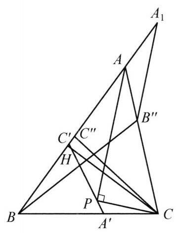

图 10-13

解 设 $\bigtriangleup {ABC}$ 的内切圆分别切于 ${BC},{CA},{AB}$ 于点 ${A}^{\prime },{B}^{\prime },{C}^{\prime }$ ,对应旁切圆与对应边的切点分别为 ${A}^{\prime \prime },{B}^{\prime \prime }$ , ${C}^{\prime \prime }.P$ 为 $C$ 在 $\angle A$ 平分线上的投影,所以 $P$ 在线段 ${A}^{\prime }{C}^{\prime }$ 上. 先证明 $B{B}^{\prime \prime } + C{C}^{\prime \prime } >$ 半周长 $p$ . 由于对称性不妨设 $\angle B \leq  \angle C.{CH}$ 为三角形的高. 射线 ${BA}$ 上有点 ${A}_1$ ,使得 $B{A}_1 = p$ . 则

$$
A{B}^{\prime \prime } = A{A}_1 = p - c
$$

且

$$
p < B{B}^{\prime \prime } + {B}^{\prime \prime }{A}_{1}.
$$

可知如果

$$
{B}^{\prime \prime }{A}_1 < {CH}
$$

可得

$$
p < B{B}^{\prime \prime } + {CH} < B{B}^{\prime \prime } + C{C}^{\prime \prime }.
$$

由于

$$
{A}_1{B}^{\prime \prime } = 2\left( {p - c}\right) \cos \frac{A}{2},
$$

$$
{CH} = {AC}\sin A = {2AC}\sin \frac{A}{2}\cos \frac{A}{2}.
$$

则还需证明

$$
{AC}\sin \frac{A}{2} > p - c.
$$

由于 $\angle C \geq  \angle B$ ,又

$$
{PC} = {AC}\sin \frac{A}{2},{A}^{\prime }C = p - c,
$$

且

$$
\angle P{A}^{\prime }C = \frac{\pi  + \angle B}{2}.
$$

可知 ${CP}$ 是 $\bigtriangleup {A}^{\prime }{CP}$ 的最长边,命题得证.

注: 这个题是一个较难的几何(不等式)题. 要能够想到 ${B}^{\prime \prime }{A}_1 \leq  {CH}$ 是需要比较强的观察力,之后的 $P$ 在 ${A}_1{C}_1$ 上也是需要对内切圆结构有较为透彻的了解才能够联想到的,事实上本题也可设 $\angle A \leq  \angle B \leq  \angle C$ 而推出 $A{A}^{\prime \prime } \geq  B{B}^{\prime \prime } \geq  C{C}^{\prime \prime }$ 的结论,如证明

$$
\frac{-{a}^3 + {2a}{b}^2 - {2abc} + {2a}{c}^2 + {b}^3 - {b}^{2}c - b{c}^2 + {c}^3}{2a}
$$

$$
\leq  \frac{{a}^3 + 2{a}^b - {a}^{2}c - {2abc} - a{c}^2 - {b}^3 + {2b}{c}^2 + {c}^3}{2b}
$$

$$
\leq  \frac{{a}^3 - {a}^{2}b + 2{a}^c - {2abc} - a{b}^2 + {b}^3 + 2{b}^{2}c - {c}^3}{2c},
$$

即可证明该结论, 则本题的证明将简单一些, 但这并不太容易. 本题也可以用三角形 ${ABC}$ 的三边长 $a, b, c$ 计算,但是计算量十分大,并且想要证明这个不等式也基本没有竞赛做法, 故在此也不推荐用三边将命题转化为纯不等式问题的做法.

范例 9 设 $n$ 是正整数,给定平面上 ${3n}$ 条直线和 ${2n}$ 个点,证明: 存在平面上一点 $P$ ,使得 $P$ 到 ${3n}$ 条直线的距离之和小于 $P$ 到 ${2n}$ 个点的距离之和.

证明 任取平面上异于已知点的一点 $Q$ ,取正实数 $R$ 充分大,考虑以 $Q$ 为圆心,半径为 $R$ 的圆 $\Omega$ ,使得 ${2n}$ 个已知点都在 $\Omega$ 的内部.

对于 $\Omega$ 的一个内接正六边形 $H$ 以及一条已知直线 $l$ ,称 $H$ 是 “ $l$ 好的”,如果 $l$ 恰好与 $H$ 的一组对边相交. 先证明存在 $R$ 和 $H$ 使得对于每条已知直线 $l, H$ 都是 $l$ 好的.

事实上,设 $H = {P}_1{P}_2{P}_3{P}_4{P}_5{P}_6$ ,则 $H$ 由 ${P}_1$ 的位置唯一确定. 对任意一条已知直线 $l$ ,设 $Q$ 到 $l$ 的距离是 $d$ , 则如图可知 $H$ 不是 $l$ 好的当且仅当 ${P}_1$ 属于 $\Omega$ 的某六段弧之并,每段这样的弧所对的圆心角为 $2\arcsin \frac{d}{R}$ .

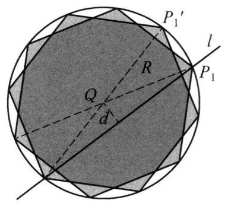

图 10-14

当 $R$ 充分大时这个角度总是小于 $\frac{2\pi }{18n}$ ,从而对所有的 $l$ ,这样圆弧之并的长度小于 ${2\pi }$ ,知存在所说的 $H$ .

对平面上任意一点 $P$ ,用 $f\left( P\right)  = \mathop{\sum }\limits_{X}d\left( {P, X}\right)  - \mathop{\sum }\limits_{l}d\left( {P, l}\right)$ 表示 $P$ 到各点距离之和减去 $P$ 到各直线距离之和. 我们说明存在 $1 \leq  i \leq  6$ 使得 $f\left( {P}_i\right)  > 0$ ,这只要证明 $\mathop{\sum }\limits_{i = 1}^{6}f\left( {P}_i\right)  > 0$ .

注意到

$$
\mathop{\sum }\limits_{i = 1}^{6}f\left( {P}_i\right)  = \mathop{\sum }\limits_X\mathop{\sum }\limits_{i = 1}^{6}d\left( {{P}_i, X}\right)  - \mathop{\sum }\limits_i\mathop{\sum }\limits_{i = 1}^{6}d\left( {{P}_i, l}\right) ,
$$

由三角不等式,对 $1 \leq  i \leq  6$ 均有 (下标模 6 考虑)

$$
d\left( {{P}_i, X}\right)  + d\left( {{P}_{i + 3}, X}\right)  \geq  d\left( {{P}_i,{P}_{i + 3}}\right)  = {2R},
$$

故

$$
\mathop{\sum }\limits_X\mathop{\sum }\limits_{i = 1}^{6}d\left( {{P}_i, X}\right)  \geq  \mathop{\sum }\limits_{X}3 \cdot  {2R} = {12nR}.
$$

等号不能取到,否则每个已知点 $X$ 都同时在线段 ${P}_1{P}_4,{P}_2{P}_5,{P}_3{P}_6$ 上,即 $X = \; Q$ ,这与 $Q$ 的选取矛盾.

另一方面,对每条已知直线 $l$ ,因为 $H$ 是 $l$ 好的,故不妨设 $l$ 与线段 ${P}_1{P}_2$ , ${P}_4{P}_5$ 相交. 于是有

$$
d\left( {{P}_1, l}\right)  + d\left( {{P}_2, l}\right)  \leq  d\left( {{P}_1,{P}_2}\right)  = R,
$$

$$
d\left( {{P}_4, l}\right)  + d\left( {{P}_5, l}\right)  \leq  d\left( {{P}_4,{P}_5}\right)  = R,
$$

$$
d\left( {{P}_3, l}\right)  + d\left( {{P}_6, l}\right)  \leq  d\left( {{P}_3,{P}_6}\right)  = {2R}.
$$

故

$$
\mathop{\sum }\limits_l\mathop{\sum }\limits_{i = 1}^{6}d\left( {{P}_i, l}\right)  \leq  \mathop{\sum }\limits_l\left( {R + R + {2R}}\right)
$$

$$
= {12nR} < \mathop{\sum }\limits_X\mathop{\sum }\limits_{i = 1}^{6}d\left( {{P}_i, X}\right) ,
$$

这便证明了所说结论.

注:考虑极端的情形:所有的已知点全部重合于一点 $O$ ，每条直线都经过 $O$ . 如果此时存在异于 $O$ 的一点 $P$ 满足要求，则直线 ${OP}$ 上任何一点都满足要求. 这提示我们只需在距离各已知点相当远处选取点 $P$ ，同时在这种考量下，任意一种初始的分布都可以近似看做上述极端情形.

这容易引导出，在 $\Omega$ 上利用平均值原理选取点 $P$ 这一主要想法. 这之后还可以通过在 $\Omega$ 上对 $f$ 积分，得到更好的估计. 本题是一个难题.

## 2. 轨迹问题

范例 10 三只螳螂在一个圆上绕着同样的方向匀速爬行. 已知这三只螳螂爬行的起点都为点 $S$ ，螳螂 $B$ 的速度是螳螂 $A$ 的两倍，螳螂 $C$ 的速度是螳螂 $A$ 的三倍. 在线段 ${SC}$ 上作出两点 $X, Y$ 满足 ${SX} = {XY} = {YC}$ ，设 ${AX},{BY}$ 交于点 $Z$ ，求 $\bigtriangleup  {ZAB}$ 重心的轨迹.

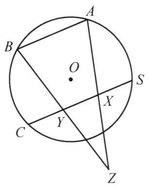

图 10-15

解 记螳螂爬行的圆为 $\odot  O$ . 以圆心 $O$ 为原点建立复平面，设该圆半径为 1，再设 $S = 1, A = a\left( {\left| a\right|  = 1}\right)$ ，则 $B = {a}^2$ ， $C = {a}^3, X = \frac{2}{3} + \frac{{a}^3}{3}, Y = \frac{1}{3} + \frac{2{a}^3}{3}.$

由 $Z$ 为 ${AX}$ 和 ${BY}$ 的交点可得

$$
\left\{  \begin{array}{l} A\left( {\bar{X} - \bar{Z}}\right)  + X\left( {\bar{Z} - \bar{A}}\right)  + Z\left( {\bar{A} - \bar{X}}\right)  = 0, \\  B\left( {\bar{Y} - \bar{Z}}\right)  + Y\left( {\bar{Z} - \bar{B}}\right)  + Z\left( {\bar{B} - \bar{Y}}\right)  = 0, \end{array}\right.
$$

解得 $Z =  - a - {a}^2$ . 因此 $\bigtriangleup {ZAB}$ 的重心 $G = \frac{A + B + Z}{3} = 0 = O$ . 故其重心的轨迹即为圆心 $O$ .

注: 本题形式简洁, 但三等分弦, 三等分弧的条件不便直接使用, 而复数处理该类问题效果较好.

范例 11 给定正数 $a, b$ 和平面上的一条长度为 $a$ 的线段 ${AB}$ . 设此平面上的两个动点 $C$ 和 $D$ 满足 ${ABCD}$ 是一个非退化的凸四边形,且 ${BC} = {CD} = b,{DA} = a$ . 易知存在圆 $I$ 与四边形 ${ABCD}$ 的四边都相切,求圆心 $I$ 的轨迹.

解 建立复平面, 用一个点的字母表示该点对应的复数.

(1)先证明 $I = \frac{b}{a + b}A + \frac{a}{a + b}C$ .

事实上，因为 $\odot  I$ 与 ${ABCD}$ 四边均相切，所以 $I$ 到四边距离相等且 $I$ 在内部， 于是 ${AI}$ 平分 $\angle {BAD}$ 、 ${BI}$ 平分 $\angle {ABC}$ . 由 ${AB} = {AD},{BC} = {DC}$ 知 $\bigtriangleup  {ABC} \cong \; \bigtriangleup {ADC}$ ,所以 ${AC}$ 平分 $\angle {BAD}$ ,故 $A, I, C$ 共线.

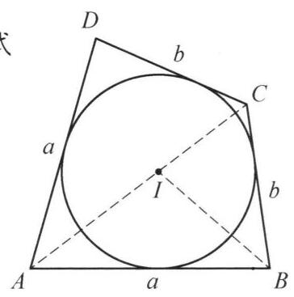

图 10-16

由角平分线定理, $\frac{AI}{CI} = \frac{AB}{CB} = \frac{a}{b}$ ,再由定比分点公式

$$
I = \frac{b}{a + b}A + \frac{a}{a + b}C.
$$

(2)因为 $a, b$ 是定值， $A$ 是定点，所以只需研究 $C$ 的轨迹.

首先，C在以 $B$ 为圆心、 $b$ 为半径的圆上，记该圆为 $\Gamma$ .

注意到当 $C$ 确定时， $D$ 可由 $B$ 关于 ${AC}$ 作对称所确定.

为保证 ${ABCD}$ 为非退化的凸四边形，需要以下条件:

① $A, B, C$ 不共线;

② $2\angle {BAC} = \angle {BAD} < {180}^{ \circ  }$ ，即 $\angle {BAC} < {90}^{ \circ  }$ ；

③ $2\angle {BCA} = \angle {BCD} < {180}^{ \circ  }$ ，即 $\angle {BCA} < {90}^{ \circ  }$ .

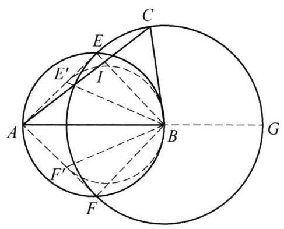

图 10-17

下面按 $a, b$ 的大小关系讨论.

情形 1: 如图 10-17,若 $a > b$ ,则由 $\angle {BCA} \; > \angle {BAC}$ 知 ② 已成立. 为保证 ③,需要 $C$ 在 $\odot  \left( {AB}\right)$ 的外部. 由 $a > b$ ，可设 $\Gamma$ 与 $\odot  \left( {AB}\right)$ 交于点 $E$ ， $F$ ，与 ${AB}$ 延长线交于点 $G$ ，则 $C$ 的轨迹为弧 $\overset{\text{ ⏜ }}{EGF}$ (不含点 $E, F$ )去掉点 $G$ .

作 $\angle {ABE}$ 的平分线交 ${AE}$ 于点 ${E}^{\prime }$ ， $\angle {ABF}$ 的平分线交 ${AF}$ 于点 ${F}^{\prime }$ ，则

$$
\frac{b}{a + b}A + \frac{a}{a + b}E = {E}^{\prime },\frac{b}{a + b}A + \frac{a}{a + b}F = {F}^{\prime },
$$

$$
\frac{b}{a + b}A + \frac{a}{a + b}G = B,\frac{b}{a + b}A + \frac{a}{a + b}C = I.
$$

注意到对任意一点 $P,\frac{b}{a + b}A + \frac{a}{a + b}P$ 是一个关于 $A$ 的位似变换,所以 $I$ 的轨迹为 $\odot  \left( {{E}^{\prime }B{F}^{\prime }}\right)$ 上弧 $\overset{\text{ ⏜ }}{{E}^{\prime }B{F}^{\prime }}$ (不含点 ${E}^{\prime },{F}^{\prime }$ ) 去掉点 $B$ .

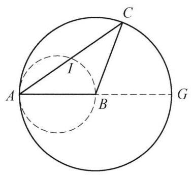

图 10-18

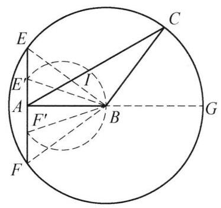

图 10-19

情形 2: 如图 10-18,若 $a = b$ ,则由 $\angle {BCA} = \angle {BAC}$ 知 ②、③ 已成立.

此时 $\Gamma  =  \odot  \left( {B,{BA}}\right)$ ，设 ${AB}$ 延长线与 $\Gamma$ 交于点 $G$ ，则 $C$ 的轨迹为 $\Gamma$ 去掉点 $A$ ， $G$ . 因为 $I$ 为 ${AC}$ 中点，所以 $I$ 的轨迹为 $\odot  \left( {AB}\right)$ 去掉点 $A$ ， $B$ .

情形 3:如图 10-19，若 $a < b$ ，则由 $\angle {BAC} > \angle {BCA}$ 知③ 已成立，为保证 ②， 需要 $C$ 与 $B$ 在过 $A$ 且垂直于 ${AB}$ 的直线 (记为 $l$ ) 的同侧. 设 $\Gamma$ 与 $l$ 交于点 $E, F$ ,与 ${AB}$ 延长线交于点 $G$ ,则 $C$ 的轨迹为弧 $\overset{\text{ ⏜ }}{EGF}$ (不含点 $E, F$ ) 去掉点 $G$ . 后同情形 1, $I$ 的轨迹为 $\odot  \left( {{E}^{\prime }B{F}^{\prime }}\right)$ 上弧 $\overset{\text{ ⏜ }}{{E}^{\prime }B{F}^{\prime }}$ (不含点 ${E}^{\prime },{F}^{\prime }$ ) 去掉点 $B$ .

综上,得到了 $I$ 的轨迹.

注: 这是一道极为简单的几何题,容易发现 $I$ 的轨迹是圆的一部分,不要漏掉对弧的端点的讨论即可.

范例 12 圆内接四边形 ${ABCD}$ 中 ${AD} = {BD} = {AC}$ . 点 $P$ 是 ${ABCD}$ 外接圆 $\omega$ 上的一个动点. 直线 ${AP}$ 和 ${DP}$ 分别交 ${CD}$ 和 ${AB}$ 于 $E, F$ . 直线 ${BE}$ 和 ${CF}$ 交于点 $Q$ . 求 $Q$ 的轨迹.

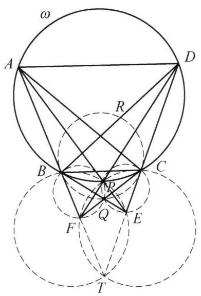

图 10-20

解 如图 10-20 所示,假设 $P$ 在 $\overset{\text{ ⏜ }}{BC}$ 上,在其他位置类似,注意到 ${AD} = {AC} = {BD}$ 及四边形 ${ABCD}$ 是等腰梯形, 则

$$
\angle {DAB} = \angle {DBA} = \angle {DCA}.
$$

设 ${AB}$ 交 ${CD}$ 于 $T, R$ 是线段 ${BD}$ 上一点,使得 ${BC} = \; {BR}$ ,我们来证明 $Q$ 在 $\bigtriangleup {BRC}$ 的外接圆上. 注意到

$$
\angle {APB} = \angle {ADB} = {180}^{ \circ  } - 2\angle {BAD}
$$

$$
= {180}^{ \circ  } - \angle {BAD} - \angle {ADC} = \angle T,
$$

于是 $B, P, E, T$ 四点共圆,同理可得 $C, P, F, T$ 也共圆,则 $P$ 是完全四边形 ${FTECQB}$ 的密克尔点,那么 $B, Q, P, F$ 四点共圆,则

$$
\angle {FQB} = \angle {FPB} = \angle {BAD} = \angle {BRC},
$$

即 $Q$ 在 $\bigtriangleup {BRC}$ 的外接圆上. 最后一步是因为等腰 $\bigtriangleup {DAB}$ 与等腰 $\bigtriangleup {BRC}$ 相似. 故 $Q$ 的轨迹是 $\bigtriangleup {BRC}$ 的外接圆.

注:本题的一个关键是联想到完全四边形的密克尔点，事实上，通过命题的转化，我们就知道最后要证明的就是 $\angle {BRC}$ 是定值，定值的大小很容易猜到是 $\angle {DCA}$ ，这又等价于证明 $B$ ， $Q$ ， $P$ ， $F$ 四点共圆，最后通过密克尔点便可得到这个重要结论.

范例 13 给定一个椭圆 $\Gamma$ 及一条给定的弦 ${AB}$ . 求内接于 $\Gamma$ 的 $\bigtriangleup {ABC}$ 垂心的轨迹.

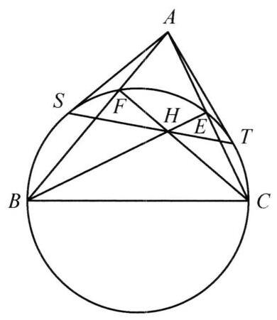

图 10-21

解 先证明一个引理.

引理: 如图 10-21,设 ${BE},{CF}$ 是 $\bigtriangleup {ABC}$ 的两条高. ${AS},{AT}$ 为以 ${BC}$ 为直径的圆的切线,则 $S, H, T$ 共线.

证明: 易知 $B, C, E, F$ 共于该圆上. 则 $A, H$ 关于此圆共轭 (勃罗卡定理). 又 $A$ 关于该圆极线为 ${ST}$ ,则 $S, H, T$ 共线.

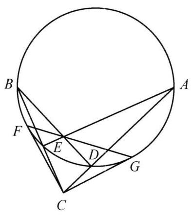

图 10-22

回到原题. 我们固定 $A, B$ ,设 $A\left( {1,0}\right) , B( - 1$ , $0)$ ,以 ${AB}$ 为直径的圆 $O : {x}^2 + {y}^2 = 1$ ,则过 $A, B$ 的椭圆可表示为 $\left( {x - 1}\right) \left( {x + 1}\right)  + \left( {{Bxy} + C{y}^2 + {Ey}}\right)  = 0$ (其中 $B, C, E$ 为三个常数).

因为 ${x}^2 + {Bxy} + C{y}^2 + {Ey} - 1 = 0$ 为椭圆 $\Gamma$ 的方程, 则

$$
\Delta  = {B}^2 - {4C} < 0.
$$

如图 10-22,我们取点 $C\left( {{x}_0,{y}_0}\right)$ 为 $\Gamma$ 上一点,连 ${AC}$ 交 $\odot  O$ 于 $E,{BC}$ 交 $\odot  O$ 于 $D$ . 过 $C$ 点引两切线,切点为 $F, G$ . 我们下面证明 ${BD},{AE},{FG}$ 共点,即

$$
\frac{\sin \angle {BGF}}{\sin \angle {FGE}} \cdot  \frac{\sin \angle {GEA}}{\sin \angle {AEB}} \cdot  \frac{\sin \angle {EBD}}{\sin \angle {DBG}} = 1.
$$

即

$$
\frac{BF}{FE} \cdot  \frac{AG}{AB} \cdot  \frac{ED}{DG} = 1.
$$

由三角形的相似, 有

$$
\frac{BF}{FE} = \frac{CF}{CE},\frac{AG}{DG} = \frac{CA}{CG},\frac{ED}{AB} = \frac{CE}{CA}.
$$

所以

$$
\frac{BF}{FE} \cdot  \frac{AG}{AB} \cdot  \frac{ED}{DG} = \frac{CF}{CE} \cdot  \frac{CA}{CG} \cdot  \frac{CE}{CA} = 1.
$$

于是 ${BD},{AE},{FG}$ 共点,设交点为 $H$ . 由于 ${BD} \bot  {AC},{AE} \bot  {BC}$ ,故 $H$ 为 $\bigtriangleup {ABC}$ 垂心 (证明共点也可以使用引理). 由 $\odot  O : {x}^2 + {y}^2 = 1, C\left( {{x}_0,{y}_0}\right)$ 得切点弦 ${FG}$ 的方程为 ${x}_{0}x + {y}_{0}y = 1$ . 又 ${CH} \bot  {AB}$ ,则 ${x}_H = {x}_0$ .

$$
H\left( {{x}_0,\frac{1 - {x}_H^2}{{y}_H}}\right) .
$$

由

$$
{x}_H = {x}_0,{y}_H = \frac{1 - {x}_0^2}{{y}_0},
$$

可知

$$
{x}_0 = {x}_H,{y}_0 = \frac{1 - {x}_H^2}{{y}_H}.
$$

又因为 $C$ 在椭圆上,故

$$
{x}_0^2 + B{x}_0{y}_0 + C{y}_0^2 + E{y}_0 - 1 = 0,
$$

则

$$
{x}_H^2 + B{x}_H \cdot  \frac{1 - {x}_H^2}{{y}_H} + C \cdot  \frac{{\left( 1 - {x}_H^2\right) }^2}{{y}_H^2} + E \cdot  \frac{1 - {x}_H^2}{{y}_H} - 1 = 0,
$$

约去 ${x}_H^2 - 1$ ,化简得

$$
1 - B \cdot  \frac{{x}_H}{{y}_H} + C \cdot  \frac{{x}_H^2 - 1}{{y}_H^2} + \frac{E}{{y}_H} = 0,
$$

$$
{y}_H^2 - B{x}_H{y}_H + C{x}_H^2 - E{y}_H - C = 0.
$$

则 $H$ 点的轨迹方程为:

$$
C{x}^2 - {Bxy} + {y}^2 - {Ey} - C = 0.
$$

由于 $\Delta  = {\left( -B\right) }^2 - {4C} = {B}^2 - {4C} < 0$ ,则 $H$ 点的轨迹为椭圆. 又因为 $C$ 与 $A, B$ 不能重合,故 $H$ 点的轨迹方程为:

$$
C{x}^2 - {Bxy} + {y}^2 - {Ey} - C = 0\left( {y \neq  0}\right) ,
$$

即除去 $A, B$ 两点的一个椭圆.

注:这是一道不算很常规的解析几何题，考查了发散思维能力，若以椭圆的标准方程建立坐标系，则计算量异常繁琐，但如果跳出这个思路，思考到垂心会带来四点共圆，将视角转变为固定 ${AB}$ ，而让椭圆动起来，这样便可利用平面几何知识， 计算出点 $H$ 坐标,后面便是常规的使用相关点法求轨迹方程了. 而且,此题还可以衍生出一些美妙的性质,例如参数 $C = 1$ 时, $H$ 点的轨迹与椭圆 $\Gamma$ 关于 $x$ 轴对称. 本题最后说明两个椭圆相似 (离心率相等) 的命题可用高等知识更为快捷地证明.

## 3. 空间问题

范例 14 是否存在一个空间中的点集使得它与任何平面的交都是非空有限集?

解 考虑点集

$$
T = \left\{  {\left( {{x}^{i},{x}^{j},{x}^{k}}\right)  \mid  x \in  \mathbf{R}, i, j, k\text{ 是 }1,2,3\text{ 的排列 }}\right\}  ,
$$

下证 $T$ 满足要求.

事实上,对任意一个平面 $\tau  : {ax} + {by} + {cz} + d = 0(a, b, c, d \in  \mathbf{R}, a, b, c$ 不全为零), 考虑方程

$$
a{x}^i + b{x}^j + c{x}^k + d = 0.
$$

(*)

注意到，一定存在 $i, j, k$ 为1,2,3的排列使得这个方程为三次方程，从而这个三次方程至少有一个实数解.

而对其他 1,2,3 的排列 $i, j, k$ (有限个)，其对应方程(*)只有有限个解.

这就说明了 $T$ 与 $\tau$ 的交是非空有限集，即证.

注:本题入手可能会从几何上考虑，但验证时不难发现还是要借助代数手段 (解方程) 来解决. 为了让方程的解总是存在且易于控制数目，我们联想到三次方程，问题便迎刃而解.

范例 15 证明或否定: 存在由空间中 2006 个点组成的集合 $S$ ,使得 $S$ 的元素不全共面，并且对任意一条连接 $S$ 中两点的线段，都存在另一条连接 $S$ 中两点的线段与之平行.

解 存在这样的集合 $S$ .

考虑两个圆心重合但不在同一平面上的等圆，设它们的公共圆心为 $O$ ，分别取这两个圆周的 1004 等分点，使得这两圆的交点在两个圆中均作为取出的等分点. 这样我们得到了 ${1004} \times  2 - 2 = {2006}$ 个不全共面的点，设 $S$ 是这 2006 个点的集合， 下证 $S$ 满足要求.

对任意 $A, B \in  S, A \neq  B$ ,若 $A, B$ 在同一个已知圆上,则显然此圆上还有另一条弦 ${CD}//{AB}$ ; 若 $A, B$ 不在同一个已知圆上,则 $A, B$ 均不是两圆交点. 设 $A$ , $B$ 关于 $O$ 的对称点分别为 ${A}^{\prime },{B}^{\prime }$ ,因 $A, B$ 不在同一个已知圆上,故 $\left\{  {{A}^{\prime },{B}^{\prime }}\right\}   \neq \; \{ A, B\}$ . 显然 $\left\{  {{A}^{\prime },{B}^{\prime }}\right\}   \subseteq  S,{AB}//{A}^{\prime }{B}^{\prime }$ .

故 $S$ 符合要求.

注: 为满足 ${CD}//{AB}$ 可以利用圆的平行弦,也可利用中心对称,将这两种办法结合即可满足不共面的要求.

范例 16 请问一个四棱锥的展开面是否可以是一个三角形?

解 可以.

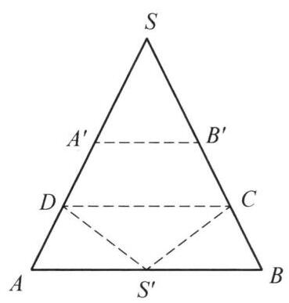

图 10-23

展开图如图 10-23. 取 $\bigtriangleup {SAB}$ ,满足 ${SA} = {SB} > {AB}$ . 设 ${S}^{\prime }$ 是 ${AB}$ 中点, ${A}^{\prime },{B}^{\prime }$ 分别在边 ${SA},{SB}$ 上且满足 $S{A}^{\prime } \; = S{B}^{\prime } = {S}^{\prime }A, C, D$ 分别为 $B{B}^{\prime }, A{A}^{\prime }$ 的中点. 故可以将该三角形沿 ${A}^{\prime }{B}^{\prime }$ 和 ${CD}$ 折起,那么 $S$ 将和 ${S}^{\prime }$ 重合.

此时 $\bigtriangleup {SAD},\bigtriangleup S{A}^{\prime }D,\bigtriangleup {SBC},\bigtriangleup S{B}^{\prime }C$ 全等,因此可以将此三角形沿 ${SC}$ 和 ${SD}$ 折起,此时 $A$ 将与 ${A}^{\prime }$ 重合, 且 $B$ 与 ${B}^{\prime }$ 重合.

按上述方法,可以得到四棱锥 $S - {ABCD}$ .

注:本题是个十分新颖的题目，其思路主要是寻找有可能可以折成四棱锥的三角形，这需要在三角形中构造一些边相等的条件，从而找到这样的三角形.

范例 17 证明以下两个命题等价.

(1)在由一个点引出的 3 条射线上可以分别取出以该点为端点的三条线段， 使得存在以这三条线段为面对角线的长方体;

(2)这 3 条射线两两之间的夹角均为锐角，且这 3 个角和为 $\pi$ .

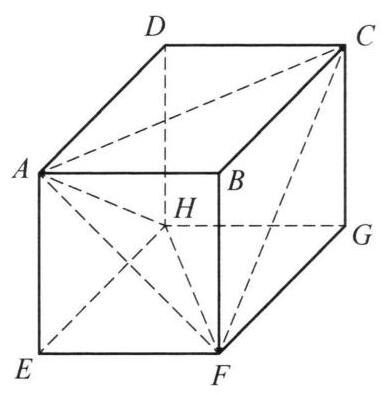

图 10-24

证明 若(1)成立，设长方体为 ${ABCD} - {EFGH}$ ，其中 ${AC},{AF},{AH}$ 为三条射线. 连接 ${HF},{CF}$ . 如图 10-24.

由于 ${HF} = {DB} = {AC},{AH} = {BG} = {CF},{AF} = {AF}$ , 从而 $\bigtriangleup {AHF} \cong  \bigtriangleup {FCA}$ ,故 ${AH}$ 与 ${AF}$ 的夹角等于 ${FC}$ 与 ${FA}$ 夹角,即 $\angle {CFA}$ .

同理, ${AC}$ 与 ${AH}$ 夹角等于 ${CA}$ 与 ${CF}$ 夹角,即 $\angle {ACF}$ .

而 ${AF}$ 与 ${AC}$ 的夹角即为 $\angle {FAC}$ ,因为 $\bigtriangleup {ACF}$ 三个内角之和为 $\pi$ ,故结合上述可知 ${AH},{AC},{AF}$ 两两夹角之和为 $\pi$ .

又由于

$$
A{C}^2 + A{F}^2 = A{B}^2 + C{B}^2 + A{B}^2 + B{F}^2 > C{B}^2 + F{B}^2 = C{F}^2,
$$

故 $\angle {CAF}$ 为锐角. 同理 ${AH},{AF}$ 夹角， ${AG},{AH}$ 夹角均为锐角. 故(2)成立.

另一方面，若(2)成立，设从端点 $A$ 引出的三条射线分别为 ${l}_1,{l}_2,{l}_3$ . 设 ${l}_1$ 与 ${l}_3$ 的夹角为 $\alpha ,{l}_1$ 与 ${l}_2$ 夹角为 $\beta ,{l}_2$ 与 ${l}_3$ 夹角为 $\gamma$ ，知 $\alpha ,\beta ,\gamma  \in  \left( {0,\frac{\pi }{2}}\right)$ ， $\alpha  + \beta  + \; \gamma  = \pi$

在 ${l}_1$ 上取一点 $C$ 使 ${AC} = \sin \gamma$ ，在 ${l}_2$ 上取一点 $H$ 使 ${AH} = \sin \alpha$ ，在 ${l}_3$ 上取一点 $F$ 使 ${AF} = \sin \beta$ . 注意到由正弦定理，存在一个以 ${AC},{AH},{AF}$ 为三边边长且三个内角为 $\alpha ,\beta ,\gamma$ 的锐角三角形，故 ${CF} = \sin \alpha  = {AH}.$

此时考虑以

$$
\sqrt{\frac{{\sin }^2\alpha  + {\sin }^2\beta  - {\sin }^2\gamma }{2}},\sqrt{\frac{{\sin }^2\alpha  + {\sin }^2\gamma  - {\sin }^2\beta }{2}},\sqrt{\frac{{\sin }^2\beta  + {\sin }^2\gamma  - {\sin }^2\alpha }{2}}
$$

为边长的长方体 ${A}^{ * }{B}^{ * }{C}^{ * }{D}^{ * } - {E}^{ * }{F}^{ * }{G}^{ * }{H}^{ * }$ ,其中

$$
{A}^{ * }{B}^{ * } = \sqrt{\frac{{\sin }^2\beta  + {\sin }^2\gamma  - {\sin }^2\alpha }{2}},
$$

$$
{B}^{ * }{F}^{ * } = \sqrt{\frac{{\sin }^2\alpha  + {\sin }^2\beta  - {\sin }^2\gamma }{2}},
$$

$$
{B}^{ * }{C}^{ * } = \sqrt{\frac{{\sin }^2\alpha  + {\sin }^2\gamma  - {\sin }^2\beta }{2}}.
$$

则 ${A}^{ * }{C}^{ * } = {\sin }^2\gamma  = {AC},{A}^{ * }{F}^{ * } = {AF},{C}^{ * }{F}^{ * } = {CF}$ .

于是存在长方体 ${ABCD} - {EFG}{H}^{\prime }$ 与长方体 ${A}^{ * }{B}^{ * }{C}^{ * }{D}^{ * } - {E}^{ * }{F}^{ * }{G}^{ * }{H}^{ * }$ 全等,且 ${H}^{\prime }$ 与 $H$ 在面 ${AFC}$ 同侧.

由前面证明可知, ${A}^{ * }{H}^{ * }$ 与 ${A}^{ * }{F}^{ * },{A}^{ * }{C}^{ * }$ 的夹角分别为 $\gamma ,\beta$ ,故 ${A}^{ * }{H}^{\prime }$ 与 ${AF},{AC}$ 夹角分别为 $\gamma ,\beta$ . 而 ${AH}$ 与 ${AF},{AC}$ 的夹角分别为 $\gamma ,\beta$ ,且 $A{H}^{\prime } = {AH}$ , 故 $H = {H}^{\prime }$ .

这就说明了(1)成立，原题得证.

注:结论提示我们应该将 3 条不共面直线两两之间的夹角转化到一个三角形中去, 这由几何体的对称性容易实现, 构造的时候再将长方体还原即可.

范例 18 设 $d$ 是一个四面体的三组相对棱距离的最小值, $h$ 是四面体的最小高,求证: ${2d} > h$ . (第 24 届苏联奥林匹克试题)

本例是一个典型的立体几何问题，解决的关键是寻找或者确定一个数量关系比较集中的平面，从而将问题化归为平面问题来处理.

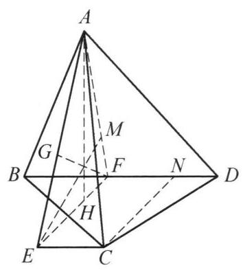

图 10-25

证明 如图 10-25. 不妨设 ${AH} = h,{AC}$ 与 ${BD}$ 的距离为 $d$ . 现作 ${AF},{CN}$ 分别垂直 ${BD}$ 于 $F, N$ ，显然

$$
{HF}//{CN},
$$

于是可在平面 ${BCD}$ 内作矩形 ${FECN}$ .

现考虑 $\bigtriangleup {AEF},{AH}$ 为其边 ${EF}$ 上的高,边 ${AE}$ 上的高 ${FG} = d$ ,高 ${EM}$ 为 $C$ 到面 ${ABD}$ 的距离,因此 ${EM} \geq  {AH}$ .

这样一来,题中的数量关系都集中到了平面 ${AEF}$ 内, 问题就转化为一个平面几何问题. 即在 $\bigtriangleup {AEF}$ 中求证 $\frac{AH}{FG} < 2$ .

这是不难的,事实上由 ${AH} \leq  {EM}$ 可知

$$
{AF} \leq  {EF}.
$$

再注意到 $\bigtriangleup {AEH} \backsim  \bigtriangleup {FEG}$ ,便有

$$
\frac{h}{d} = \frac{AH}{FG} = \frac{AE}{EF} < \frac{\left( AF + EF\right) }{EF} \leq  2.
$$

范例 19 在四面体 ${SABC}$ 中,任意两条边的长度都不相等. 在平面 ${BCS}$ 中, 作 $S$ 关于 ${BC}$ 的中垂线的对称点 ${A}^{\prime }$ ,类似的定义 ${B}^{\prime },{C}^{\prime }$ . 证明: 平面 ${ABC}$ , $A{B}^{\prime }{C}^{\prime },{A}^{\prime }B{C}^{\prime },{A}^{\prime }{B}^{\prime }C$ 经过同一点.

证明 命题等价于: 平面 $A{B}^{\prime }{C}^{\prime }$ 和平面 ${ABC}$ 的交线 ${l}_a$ 以及类似定义的 ${l}_b,{l}_c$ 三线共点.

注意到 ${BC}//{A}^{\prime }S,{AC}//{B}^{\prime }S$ ,这表明 ${A}^{\prime }{B}^{\prime }//$ 面 ${ABC}$ ,而 ${l}_c \in$ 面 ${ABC}$ ,因此 ${l}_c//{A}^{\prime }{B}^{\prime }$ .①

设 $\bigtriangleup {ABC}$ 的外心 $O$ ,外接圆为 ${\omega }_1$ . 对称性表明 ${OS} = O{A}^{\prime } = O{B}^{\prime } = O{C}^{\prime }$ ,这样 $S$ , ${A}^{\prime },{B}^{\prime },{C}^{\prime }$ 四点共圆,设这个圆为 ${\omega }_2$ ,用位似变换将 ${\omega }_2$ 变换为 ${\omega }_1$ ,设位似对应点为 ${S}_1,{A}_1,{B}_1,{C}_1$ ,由于位似保平行,条件变为 ${S}_1{A}_1//{BC}$ ,① 变为 ${l}_c//{A}_1{B}_1$ .

以 ${\omega }_1$ 为单位圆建立复平面,用相应点的字母表示对应的复数,那么条件化简为 ${S}_1{A}_1 = {BC}$ 和 ${S}_1{B}_1 = {AC}$ ,显然 $C \in  {l}_c$ ,设 ${l}_c$ 再次交 ${\omega }_1$ 于 $X$ ,那么 ${CX} = {A}_1{B}_1$ , 联立三式得到 $X = \frac{ABC}{{S}_1^2}$ 为一个对称式,这表明 ${l}_c,{l}_b,{l}_a$ 共点于 $X$ . 证毕!

注: 这是一道中等难度的立体几何题, 考虑刻画出交线之后就变为难度不大的平面几何问题了.

范例 20 设 $G$ 为四面体 ${A}_1{A}_2{A}_3{A}_4$ 的重心, $G$ 到棱 ${A}_i{A}_j$ 的距离为 ${h}_{ij}, G$ 到 ${A}_i$ 的距离为 ${D}_i$ ,求证:

$$
\mathop{\sum }\limits_{1 \leq  i < j \leq  4}{h}_{ij} \leq  \frac{\sqrt{3}}{2}\mathop{\sum }\limits_{i = 1}^4{D}_{i}.
$$

①

证明 一个基本的想法是将 $\bigtriangleup {A}_i{A}_{j}G$ 中的高 ${h}_{ij}$ 转化为这个三角形中相应的内角平分线来处理. 为此先证引理.

引理 设 ${AT}$ 是 $\bigtriangleup {ABC}$ 的内角平分线,则

$$
A{T}^{2} \leq  \frac{1}{2}\left( {\overrightarrow{AB} \cdot  \overrightarrow{AC} + \left| \overrightarrow{AB}\right|  \cdot  \left| \overrightarrow{AC}\right| }\right) .
$$

证明 由角平分线公式有

$$
{AT} = \frac{2bc}{b + c}\cos \frac{A}{2} \leq  \sqrt{bc}\cos \frac{A}{2}.
$$

因此

$$
A{T}^2 \leq  {bc}{\cos }^2\frac{A}{2} = \frac{1}{2}{bc}\left( {1 + \cos A}\right)
$$

$$
= \frac{1}{2}\left( {\overrightarrow{AB} \cdot  \overrightarrow{AC} + \left| \overrightarrow{AB}\right|  \cdot  \left| \overrightarrow{AC}\right| }\right) .
$$

引理得证.

下面回证原题.

为简单起见,记 $\overrightarrow{G{A}_{i}} = \overrightarrow{{A}_{i}}, i = 1,2,3,4$ ,则

$$
\mathop{\sum }\limits_{{i = 1}}^{4}{\overrightarrow{A}}_{i} = \overrightarrow{0}
$$

因此

$$
{\left( \mathop{\sum }\limits_{{i = 1}}^{4}{\overrightarrow{A}}_{i}\right) }^{2} = \overrightarrow{0}
$$

也即

$$
\mathop{\sum }\limits_{{i = 1}}^{4}{D}_{i}^{2} + 2\mathop{\sum }\limits_{{1 \leq  i < j \leq  4}}{\overrightarrow{A}}_{i} \cdot  {\overrightarrow{A}}_{j} = 0.
$$

②

另一方面，由引理知

$$
{h}_{ij}^{2} \leq  \frac{1}{2}\left( {{\overrightarrow{A}}_{i} \cdot  {\overrightarrow{A}}_{j} + \left| {\overrightarrow{A}}_{i}\right|  \cdot  \left| {\overrightarrow{A}}_{j}\right| }\right) ,
$$

因此

$$
{\left( \mathop{\sum }\limits_{1 \leq  i < j \leq  4}{h}_{ij}\right) }^2 \leq  6\mathop{\sum }\limits_{1 \leq  i < j \leq  4}{h}_{ij}^2
$$

$$
\leq  3\mathop{\sum }\limits_{{1 \leq  i < j \leq  4}}\left( {\overrightarrow{{A}_{i}} \cdot  \overrightarrow{{A}_{j}} + \left| \overrightarrow{{A}_{i}}\right|  \cdot  \left| \overrightarrow{{A}_{j}}\right| }\right)
$$

$$
= 3\mathop{\sum }\limits_{{1 \leq  i < j \leq  4}}\overrightarrow{{A}_{i}} \cdot  \overrightarrow{{A}_{j}} + 3\mathop{\sum }\limits_{{1 \leq  i < j \leq  4}}{D}_{i} \cdot  {D}_{j},
$$

③

将②代入③可得

$$
{\left( \mathop{\sum }\limits_{1 \leq  i < j \leq  4}{h}_{ij}\right) }^2 \leq   - \frac{3}{2}\mathop{\sum }\limits_{i = 1}^4{D}_i^2 + 3\mathop{\sum }\limits_{1 \leq  i < j \leq  4}{D}_i \cdot  {D}_j
$$

$$
= \frac{3}{2}\left( {-\mathop{\sum }\limits_{i = 1}^4{D}_i^2 + \left\lbrack  {{\left( \mathop{\sum }\limits_{i = 1}^4{D}_i\right) }^2 - \mathop{\sum }\limits_{i = 1}^4{D}_i^2}\right\rbrack  }\right)
$$

$$
= \frac{3}{2}\left\lbrack  {{\left( \mathop{\sum }\limits_{i = 1}^4{D}_i\right) }^2 - 2\mathop{\sum }\limits_{i = 1}^4{D}_i^2}\right\rbrack
$$

$$
\leq  \frac{3}{2}\left\lbrack  {{\left( \mathop{\sum }\limits_{i = 1}^4{D}_i\right) }^2 - \frac{1}{2}{\left( \mathop{\sum }\limits_{i = 1}^4{D}_i\right) }^2}\right\rbrack
$$

$$
= \frac{3}{4}{\left( \mathop{\sum }\limits_{i = 1}^4{D}_i\right) }^2,
$$

④

上面的最后一个不等式用到了柯西不等式.

由④便立得所证的不等式.

