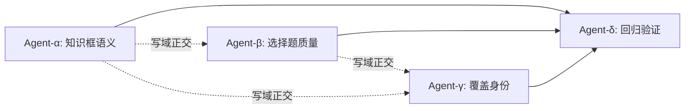

# qchain self_study 多 Agent 并行修复方案

> **性质：** 纯设计文档，不实际执行任何修改。
> **前置：** 基于 [qchain_self_study_attack_report.md](qchain_self_study_attack_report.md) 中 F1–F4 四项高置信度发现设计。
> **源码基线：** `C:\Users\63254\AppData\Roaming\npm\node_modules\@deepseek-ai\dsh\node_modules\@local\qchain`

---

## 一、Agent 拓扑总览

```
                    ┌──────────────┐
                    │  Lead Agent  │
                    │  (协调+验收)  │
                    └──────┬───────┘
           ┌───────────────┼───────────────┐
           │               │               │
    ┌──────▼─────┐  ┌──────▼──────┐  ┌─────▼──────┐
    │  Agent-α   │  │  Agent-β    │  │  Agent-γ   │
    │ 知识框语义  │  │ 选择题质量   │  │ 覆盖身份   │
    │ 增强        │  │ 增强        │  │ 精确匹配   │
    └──────┬─────┘  └──────┬──────┘  └─────┬──────┘
           │               │               │
           └───────────────┼───────────────┘
                    ┌──────▼───────┐
                    │  Agent-δ     │
                    │ 回归测试集成  │
                    │ + 门禁全量   │
                    └──────────────┘
```

- **α、β、γ 三路完全正交**，各自只写各自的文件和函数，可同时启动。
- **δ 依赖 α+β+γ 全部完成后**方可启动（集成验证）。
- **Lead** 负责任务创建、依赖编排、中间 review 和最终交付。

---

## 二、写域正交划分

| Agent | 独占写域（文件:函数/行区间） | 禁写区域 |
|-------|---------------------------|---------|
| **α** | `scripts/check_pedagogy.py` 全文；`scripts/check_numbering.py:489-506`（知识框存在性检查段） | β/γ 的文件；`shuffle_options.py`；`estimate_minutes.py` |
| **β** | `scripts/shuffle_options.py:320-518`（verify/stats/main 段）；新建 `scripts/check_option_quality.py` | α/γ 的文件；`check_pedagogy.py`；`estimate_minutes.py` |
| **γ** | `scripts/estimate_minutes.py:280-330`（匹配段）；`scripts/check_budget.py:183-220`（估算调用段） | α/β 的文件；`check_pedagogy.py`；`shuffle_options.py` |
| **δ** | `scripts/test_templates.py`（追加新测试用例）；`scripts/test_runtime.py`（追加集成测试） | α/β/γ 的核心文件（只读调用） |

> 写域以函数/行级别切分。任何 Agent 不得在自己域外做 `edit`/`write` 操作；共享的 `evidence.py`、`check_numbering.py` 公共函数（如 `scan_fillins`、`norm_opt`、`strip_comment`）均为只读依赖。

---

## 三、各 Agent 详细修复任务

### Agent-α：知识框语义增强（修复 F1）

**目标文件：**
- `check_pedagogy.py:60-75`（知识框存在性检查）
- `check_pedagogy.py:80-84`（教师区过滤函数）
- `check_numbering.py:489-506`（结构侧知识框检查段）

**修复设计：**

#### α-1. 学生可见性过滤（P0，核心修复）

**现状：** `check_pedagogy_slice()` 第 63-64 行用 `RE_KNOWLEDGEBOX.findall(text)` 和 `RE_MICROKNOWLEDGE.findall(text)` 在全文（含 `solution`/`teacherNote`）中搜索。第 80-84 行已有 `_in_teacher()` 函数，但仅用于 fillin 过滤，未用于知识框统计。

**方案：**
```python
# check_pedagogy.py:60-75 替换为：
#
# 1. 先提取教师区间
teacher_spans = [(m.start(), m.end())
                 for m in RE_TEACHER_BLOCK.finditer(text)]

def _in_teacher(pos):
    return any(a <= pos < b for a, b in teacher_spans)

# 2. 只统计学生可见的知识框
kb_matches = [m for m in RE_KNOWLEDGEBOX.finditer(text)
              if not _in_teacher(m.start())]
mk_matches = [m for m in RE_MICROKNOWLEDGE.finditer(text)
              if not _in_teacher(m.start())]
```

**关键决策：** 将 `teacher_spans` 的计算从原来的第 80 行上提到知识框检查之前，让同一个 `_in_teacher()` 同时服务知识框和 fillin 两个检查路径。这是最小改动：不引入新解析器，复用已有的教师区正则。

#### α-2. 环境闭合校验（P0）

**现状：** `check_numbering.py:489-499` 用子串 `in text` 检查存在性。第 486-488 行的栈式环境配平检查已覆盖 `begin/end` 事件，但知识框环境可能被栈检测跳过（因为在 `KNOWN_ENVS` 之外）。

**方案：**
```python
# check_numbering.py:489-506 段增强：
# 将知识框/微知识卡加入栈式环境配平的 KNOWN_ENVS 列表（如未在内），
# 让已有的第 486-488 行 "环境未闭合" 检查自然覆盖；
# 然后将 :490-499 的子串检查改为：
#   has_knowledgebox = any(frame[0] == "knowledgebox" for frame in closed_envs
#                         if not _was_inside_teacher(frame))
# 其中 closed_envs 是栈检查过程中正常闭合的帧列表，
# _was_inside_teacher 利用帧的 start_line 判断是否落在教师区。
```

**备选方案（更简单）：** 在 `check_pedagogy_slice` 中直接验证匹配到的 `\begin{knowledgebox}` 是否有对应的 `\end{knowledgebox}`，位置差 > 0 且 `\end` 也不在教师区内：

```python
# 对每个 kb_match，检查其后最近的 \end{knowledgebox} 是否存在且在学生可见区
RE_END_KB = re.compile(r"\\end\{knowledgebox\}")
for m in kb_matches:
    rest = text[m.end():]
    end_m = RE_END_KB.search(rest)
    if not end_m:
        problems.append("%s:%d: knowledgebox 环境未闭合" % (name, ...))
    elif _in_teacher(m.start() + m.end() - m.start() + end_m.start()):
        problems.append("%s:%d: knowledgebox 的 \\end 落入教师区" % (name, ...))
```

**推荐：** 采用备选方案（在 `check_pedagogy.py` 内自含），因为修改 `check_numbering.py` 的 `KNOWN_ENVS` 影响面更大，且知识框的语义约束（位置/顺序）在 pedagogy 侧更自然。

#### α-3. 位置顺序校验（P1）

**现状：** 无检查确保 microknowledge 出现在 probchain 之前、knowledgebox 出现在最后一个 probchain 之后。

**方案：**
```python
# 在 check_pedagogy_slice() 返回前追加：
# 获取第一个 probchain 起始位置和最后一个 probchain 结束位置
first_prob = text.find("\\begin{probchain}")
last_prob_end = text.rfind("\\end{probchain}")

if mk_matches and first_prob >= 0:
    last_mk_end = max(m.end() for m in mk_matches)
    if last_mk_end > first_prob:
        # 允许 probchain 之间插入追加 microknowledge，但至少第一个必须在第一道题前
        first_mk = min(m.start() for m in mk_matches)
        if first_mk > first_prob:
            problems.append(
                "%s: 所有前置知识卡均出现在题目之后（首个 microknowledge 在第 %d 行，"
                "首个 probchain 在第 %d 行），学生无法自学！"
                % (name, text.count("\n", 0, first_mk) + 1,
                   text.count("\n", 0, first_prob) + 1))

if kb_matches and last_prob_end >= 0:
    first_kb = min(m.start() for m in kb_matches)
    if first_kb < last_prob_end:
        problems.append(
            "%s: knowledgebox 出现在题链中间而非节末（第 %d 行），"
            "请将总结框移至最后一个 probchain 之后"
            % (name, text.count("\n", 0, first_kb) + 1))
```

**要点：** 允许多个 microknowledge 在不同题组前出现（多知识点的切片合法需要中间插卡），但至少第一张卡必须在第一道题前。knowledgebox 必须在最后一个 probchain 之后（节末总结）。

#### α-4. 回归兼容

- 不改变 `check_pedagogy_slice` 的返回签名 `(kb_count, mk_count)`，只改内部过滤逻辑。
- 不改变 `scan_project_pedagogy` 的调用接口。
- 已有 `test_templates.py` 中的 pedagogy 测试用例：如果正好使用了"教师区内放知识框仍通过"的写法，则需协调 δ 更新测试期望值。

---

### Agent-β：选择题质量增强（修复 F2 + F3）

**目标文件：**
- 新建 `scripts/check_option_quality.py`（全新文件，零冲突）
- `scripts/shuffle_options.py:343-351`（`position_stats` 函数，追加分布均衡检查）
- `scripts/shuffle_options.py:470-495`（report 生成段，追加分布告警）

**修复设计：**

#### β-1. 新建 `check_option_quality.py`（P1，选项语义质检）

**设计哲学：** 不尝试做通用数学等价性判定（不可判定），而是做可计算的结构性检查。

```python
# check_option_quality.py — 选择题选项质量门禁
#
# 检查项（全部基于 TeX 源文本，不需要 CAS）：
#
# Q1. 选项表面重复检测（超越 norm_opt）
#     对每对选项做 LaTeX 语义归一化：
#     - 去掉 $...$、\text{}、\mathrm{} 等包裹
#     - 将 \frac{a}{b} 与 a/b 视为同形
#     - 将 -(-x) 与 x 视为同形
#     归一化后重复 → 硬失败
#
# Q2. 纯数值选项可计算验证
#     当选项全部为纯数值（整数、分数、小数）时：
#     - 解析为有理数
#     - 检查答案是否唯一正确
#     - 检查是否存在两个数值相等的选项
#     → 可精确判定，硬失败
#
# Q3. 选项多样性检查
#     - 选项去除数学符号后文字完全相同 → 警告
#       （如 "$2$"、"$3$"、"$4$"、"$5$" 是合法的纯数值题）
#     - 所有选项都是单个字母/符号 → 警告
#
# Q4. 干扰项标注审读协议（附加字段检查）
#     当 \fillin 后方跟随 % distractor: ... 注释时解析为
#     干扰项来源标注，缺失时发出 warning（可选，逐步推广）
#
# 调用方式：
#   check_option_quality.scan_project(workdir) → (problems, warnings)
#   由 check_numbering.py 或独立运行调用
```

**关键技术点：**
- Q2 的纯数值解析用 Python `fractions.Fraction` 精确有理数，覆盖 `\frac{p}{q}`、`p/q`、`-3`、`0.5`、`\sqrt{4}` 等可精确计算的常见形式。
- 不做 sympy 符号化（太重、太慢、太多误报），只做字面归一化 + 数值精确计算两个层级。
- 该文件为全新文件，与 α/γ 零写域冲突。

#### β-2. 答案位置分布告警（P1）

**现状：** `shuffle_options.py:343-351` 的 `position_stats()` 只汇总统计，不做偏差判定；main 函数打印分布但不报错。

**方案：** 在 `shuffle_options.py:470` 的 report 构建之后、status 判定之前，追加：

```python
# 章节级答案位置分布均衡检查
all_after = [r["answer_position_after"] for r in all_records
             if r.get("answer_position_after") is not None]
if len(all_after) >= 8:   # 至少 8 个选择题才做分布检查
    from collections import Counter
    dist = Counter(all_after)
    n = len(all_after)
    k = len(dist)   # 位置种类数
    if k >= 2:
        expected = n / k
        max_dev = max(abs(v - expected) / expected for v in dist.values())
        if max_dev > 0.5:  # 任一位置偏离期望 >50%
            msg = ("答案位置分布显著不均（%s），最大偏差 %.0f%%"
                   % (dict(dist), max_dev * 100))
            issues.append({"category": "POSITION_SKEW",
                          "severity": "warn", "message": msg})
```

**要点：** 50% 偏差阈值是设计建议（8 题 4 位置下期望 2，偏差 50% 意味着某位置出现 3 次或 1 次）。此处用 warn 而非 error，不阻断交付但记入审读报告。

#### β-3. 与现有机制的接口

- `check_option_quality.py` 作为独立门禁脚本，入口与 `check_pedagogy.py`、`check_numbering.py` 同级。
- 在流水线编排中的接入点：`workflow/edges.py:68-79` 的 checks 阶段路由中追加调用（但此修改属于 Lead 统筹层，不在 β 的写域内）。
- β 只负责脚本本身和 shuffle_options 的分布告警。

---

### Agent-γ：覆盖身份精确匹配（修复 F4）

**目标文件：**
- `scripts/estimate_minutes.py:280-330`（匹配逻辑段）
- `scripts/check_budget.py:183-220`（估算调用与差集检查段）

**修复设计：**

#### γ-1. 消除顺序 fallback 的静默行为（P0）

**现状：** `estimate_minutes.py:309-314` 当 qid 和 carrier_qid/node_id 均不匹配时，按顺序取下一道题，不报告身份不匹配。

**方案：**
```python
# estimate_minutes.py:309-314 替换为：
if not matched_tex_task and sec_tasks:
    curr_idx = sec_matched_idx.get(sec_name, 0)
    if curr_idx < len(sec_tasks):
        matched_tex_task = sec_tasks[curr_idx]
        sec_matched_idx[sec_name] = curr_idx + 1
        # 新增：记录 fallback 事件
        fallback_used.append({
            "node_id": node_id,
            "section": sec_name,
            "expected_qid": req_qid,
            "fallback_qid": matched_tex_task.get("qid"),
            "fallback_index": curr_idx,
        })
```

在函数入口初始化 `fallback_used = []`，最终将其写入 `est_data["_fallback_matches"]`。

#### γ-2. 双向集合核对（P0）

**在 `check_budget.py` 的 coverage 检查段追加：**

```python
# check_budget.py:220 之后追加：
# 双向精确集合核对
if est_data:
    fallbacks = est_data.get("_fallback_matches", [])
    if fallbacks:
        for fb in fallbacks:
            msg = (
                f"coverage-map 节点 {fb['node_id']} 的 qid "
                f"'{fb['expected_qid']}' 在 {fb['section']} 中"
                f"未精确匹配，顺序兜底到第 {fb['fallback_index']+1} "
                f"道题（qid={fb['fallback_qid']}）；"
                f"请检查 qid 拼写或补充 carrier_qid 显式复用"
            )
            problems.append(msg)
            coverage_problems.append(msg)

    # TeX 侧多余题目检查：TeX 中有 qid 但 coverage-map 未列出
    tex_qids = set()
    for sec_name in {r.get("section") for r in rows}:
        for t in get_section_tasks_cached(pdir, sec_name):
            if t.get("qid"):
                tex_qids.add(t["qid"])
    cov_qids = {r.get("qid") or r.get("carrier_qid")
                for r in rows} - {None, ""}
    orphan_tex = tex_qids - cov_qids
    if orphan_tex:
        msg = (
            f"TeX 切片中存在 coverage-map 未列出的题目 qid：{sorted(orphan_tex)}；"
            f"请在 coverage-map 中补充这些题目的角色分配，或确认是否为废弃题目"
        )
        warnings.append(msg)
```

**要点：**
- 将 fallback 从静默兜底变为显式 problems（硬失败），强制要求 coverage-map 的 qid 与 TeX 精确对应。
- 反向检查 TeX 中有但 coverage 未列的孤立题目（warn，不硬阻断，因为可能是草稿题）。
- `get_section_tasks_cached` 需要复用 `estimate_minutes` 内的 task_struct 解析；γ 在 `check_budget.py` 中 import `task_struct` 并调用，与 α/β 无文件冲突。

#### γ-3. 兼容性保证

- `estimate_minutes.estimate_project()` 的返回值 schema 追加 `_fallback_matches` 字段（带 `_` 前缀表示内部诊断字段），不破坏现有 `totals`/`tasks` 结构。
- `check_budget.py` 的 fallback 检查在 `if est_data:` 分支内，coverage-map 不存在时自然跳过。
- 已有 `test_estimate_minutes.py` 的 11 个测试用例不涉及 fallback 路径（它们的 mock 数据 qid 精确对应），无需修改。

---

### Agent-δ：回归测试与集成验证（依赖 α+β+γ 全部完成）

**目标文件：**
- `scripts/test_templates.py`（追加测试用例）
- `scripts/test_runtime.py`（追加集成测试）

**任务：**

#### δ-1. 针对 α 的回归测试

```python
# test_templates.py 追加：

def test_knowledgebox_in_teacher_area_rejected():
    """F1 攻击复现：知识框藏在 solution 内应被拒绝"""
    tex = r"""
\begin{microknowledge}[前置] ... \end{microknowledge}
\begin{probchain}
\item ...
\begin{solution} \begin{knowledgebox}[本节结论] ... \end{knowledgebox} \end{solution}
\end{probchain}
"""
    problems, warnings = [], []
    check_pedagogy.check_pedagogy_slice("test_attack_f1.tex", tex, problems, warnings)
    assert any("knowledgebox" in p.lower() or "知识总结框" in p for p in problems)

def test_microknowledge_after_probchain_rejected():
    """F1 攻击：微知识卡出现在题目之后应被拒绝"""
    tex = r"""
\begin{probchain}
\item ...
\begin{solution} ... \end{solution}
\begin{teacherNote} ... \end{teacherNote}
\end{probchain}
\begin{microknowledge}[核心定义] ... \end{microknowledge}
\begin{knowledgebox}[本节结论] ... \end{knowledgebox}
"""
    problems, warnings = [], []
    check_pedagogy.check_pedagogy_slice("test_attack_f1b.tex", tex, problems, warnings)
    assert any("前置知识卡" in p or "microknowledge" in p.lower() for p in problems)

def test_unclosed_knowledgebox_rejected():
    """F1 攻击：未闭合的 knowledgebox 应被拒绝"""
    tex = r"""
\begin{microknowledge}[前置] ... \end{microknowledge}
\begin{probchain} \item ... \end{probchain}
\begin{knowledgebox}[本节结论] 内容未闭合
"""
    problems, warnings = [], []
    check_pedagogy.check_pedagogy_slice("test_attack_f1c.tex", tex, problems, warnings)
    assert any("未闭合" in p for p in problems)
```

#### δ-2. 针对 β 的回归测试

```python
def test_numeric_duplicate_options_rejected():
    """F2 攻击：数值等价但形式不同的重复选项"""
    # \fillin[2]{2cm}[2, \frac{4}{2}, 3, 4]
    # 2 和 \frac{4}{2} 数值相同，应被 check_option_quality 拦截
    ...

def test_answer_position_skew_warned():
    """F3 攻击：章节级答案全部落在位置 0"""
    # 构造 10 道题，答案恰好排在第一位
    # verify_project 应在 issues 中包含 POSITION_SKEW
    ...
```

#### δ-3. 针对 γ 的回归测试

```python
def test_qid_mismatch_fallback_reported():
    """F4 攻击：coverage-map 的 qid 与 TeX 不匹配时应报告 fallback"""
    # 构造 coverage-map 写 qid=q99，TeX 中只有 qid=q1
    # check_budget 应产出 problems 包含 "未精确匹配"
    ...

def test_orphan_tex_qid_warned():
    """F4 攻击：TeX 中有 qid 但 coverage-map 未列出"""
    ...
```

#### δ-4. 门禁全量运行

```bash
# 依次执行，全部通过方可确认修复完成：
python scripts/test_templates.py     # 含新增攻击用例
python scripts/test_runtime.py       # 含新增集成测试
python scripts/test_estimate_minutes.py
python scripts/test_redteam_verification.py
```

然后对一个包含真实题链的样例工作区执行 `qchain_gate all`，确认无误报回归。

---

## 四、依赖与时序



| 阶段 | 并行度 | 预计改动量 | 风险 |
|------|--------|-----------|------|
| α+β+γ 同时启动 | 3 路并行 | α: ~80 行改 + ~20 行新增<br>β: ~200 行新建 + ~30 行改<br>γ: ~40 行改 + ~30 行新增 | α 改 `check_pedagogy.py` 逻辑，若改错影响所有教学门禁 |
| δ 集成测试 | 1 路串行 | ~150 行新测试 | 需等 α+β+γ 全部完成 |

---

## 五、Lead 统筹检查清单

修复完成后，Lead 需人工审查以下关键点：

1. **α 的教师区过滤是否破坏已有 fillin 检查逻辑** —— `_in_teacher()` 和 `teacher_spans` 从第 80 行上提到第 62 行前，确认 fillin 过滤仍然正常（第 86-87 行不重复计算 `teacher_spans`）。

2. **β 的数值解析是否引入误报** —— 纯数值判定用 `fractions.Fraction` 需验证对 `\frac{-1}{2}` 和 `$-\frac{1}{2}$` 的解析一致性；对 `\sqrt{2}` 等无理数应明确跳过而非误报。

3. **γ 的 fallback 硬失败是否破坏无 coverage-map 的旧工程** —— fallback 检查在 `if est_data and fallbacks:` 条件内，无 coverage-map 时 `est_data` 为空或无 `_fallback_matches`，应自然跳过。需验证边界。

4. **流水线编排层接入** —— `check_option_quality.py` 作为新门禁脚本，需要在 `workflow/edges.py` 或 `workflow/nodes/` 中追加调用入口。此修改影响流水线图，需 Lead 单独评审，不在 α/β/γ 写域内。

5. **TOOL_VERSION 升级** —— `check_pedagogy.py` TOOL_VERSION 从 `1.1` → `1.2`；`shuffle_options.py` TOOL_VERSION 从当前值 +1；`check_budget.py` 和 `estimate_minutes.py` 同理。版本号变更是报告 schema 的一部分，需确保所有已有的报告消费者不依赖硬编码版本。

---

## 六、不修复项（设计边界）

| 编号 | 不修复原因 |
|------|-----------|
| R1（知识依赖图语义验证） | 需要 CAS 或知识图谱，远超脚本层门禁的合理复杂度；由提示词和人工审读保证 |
| R2（三节规划的字面冲突） | 提示词层面问题，不需要代码修复；建议在 `mapping_nodes.py:75-89` 的注释中澄清 |
| 选项数学语义等价的完整判定 | 不可判定问题；β 只做可计算子集（纯数值 + 表面归一化） |
| ResourceWarning 未关闭文件 | 已有测试的 teardown 问题，不影响功能，不在本次范围 |

---

## 七、执行命令示例（仅供参考，不实际运行）

```python
# Lead 创建共享任务
team_task_create(subject="F1: 知识框学生可见性+闭合+位置检查",
                 description="...", write_scopes=["scripts/check_pedagogy.py",
                                                   "scripts/check_numbering.py:489-506"])
team_task_create(subject="F2+F3: 选项质量门禁+答案位置分布",
                 description="...", write_scopes=["scripts/check_option_quality.py",
                                                   "scripts/shuffle_options.py:320-518"])
team_task_create(subject="F4: coverage qid 精确匹配",
                 description="...", write_scopes=["scripts/estimate_minutes.py:280-330",
                                                   "scripts/check_budget.py:183-220"])
team_task_create(subject="δ: 回归测试与全量门禁",
                 description="...", blocked_by=["task-α", "task-β", "task-γ"],
                 write_scopes=["scripts/test_templates.py", "scripts/test_runtime.py"])

# Lead 派发 3 个 Teammate 并行工作
spawn_teammate(name="agent-alpha", ...)
spawn_teammate(name="agent-beta", ...)
spawn_teammate(name="agent-gamma", ...)

# α+β+γ 完成后，启动 δ
spawn_teammate(name="agent-delta", ...)
```
