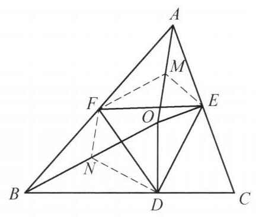

::: {.problem-meta-bar}
第 1 讲 全等三角形
竞赛难度
全等三角形 中点
:::

## 题目

已知 $O$ 为 $\triangle {ABC}$ 内一点,满足 ${OD} \perp  {BC},{OE} \perp  {AC}$ (点 $D, E$ 分别在边 ${BC},{AC}$ 上), $F$ 为边 ${AB}$ 的中点. 若 ${DF} = {EF}$ . 证明: $\angle {OBD} = \angle {OAE}$ .

## 参考解答

::: {.callout-important title="标准解答" collapse="false"}
如图 1-1,分别取 ${AO},{BO}$ 的中点 $M$ , $N$ . 连接 ${ME},{MF},{ND},{NF}$ ,则 ${FM}$ 是 $\triangle {ABO}$ 的中位线,故 ${FM} = \frac{1}{2}{BO}$ . 因为 $\triangle {ODB}$ 是直角三角形, 所以, ${ND} = \frac{1}{2}{BO}$ ,即 ${FM} = {ND}$ .

图 1-1

同理, ${ME} = \frac{1}{2}{AO} = {FN}$ ,再结合 ${DF} = {EF}$ ,知 $\triangle {FND} \cong  \triangle {EMF}$ . 所以, $\angle {FND} = \angle {FME}$ . 又因为四边形 ${FNOM}$ 是平行四边形,所以, $\angle {FNO} = \angle {FMO}$ ,于是

$$
\angle {OND} = \angle {FND} - \angle {FNO} = \angle {FME} - \angle {FMO} = \angle {OME}.
$$

故 $\angle {OBD} = \frac{1}{2}\angle {OND} = \frac{1}{2}\angle {OME} = \angle {OAE}$ . 命题得证.

注:看到中点构造中位线是常见思路. 若中点在直角三角形的斜边上，想到利用结论:直角三角形斜边上的中线等于斜边的一半.
:::

## 解题思路与分析

::: {.callout-note title="思路还原与分析" collapse="false"}
这个证明之所以读起来让人觉得“费解”甚至“神来之笔”，是因为教材展示的是**整理后的“演绎过程”（从辅助线直接推到结论）**，而隐藏了**解题者最初的“探索与分析过程”（为什么会想到取这两个中点）**。

如果我们顺着解题者的真实思维路径，通过**“顺推条件”**与**“逆推结论”**双向夹击，就会发现取 $AO, BO$ 的中点 $M, N$ 其实是非常自然、甚至可以说是唯一的破局思路。下面为你完整还原这个证明的诞生过程：

---

### 第一步：审视题目，发现“卡点”在哪里？

我们先看题目给出的核心条件和目标：
1. **两个直角三角形**：$OD \perp BC, OE \perp AC \implies \text{Rt}\triangle BDO$ 和 $\text{Rt}\triangle AEO$（斜边分别是 $BO$ 和 $AO$）。
2. **一个中点**：$F$ 是 $AB$ 的中点。
3. **一组等长线段**：$DF = EF$。
4. **目标**：证明 $\angle OBD = \angle OAE$（即两个直角三角形中的锐角相等）。

**为什么直接做会卡住？**
* 条件中的中点 $F$ 在边 $AB$ 上，而两个直角三角形 $\text{Rt}\triangle BDO$ 和 $\text{Rt}\triangle AEO$ 的斜边却是 $BO$ 和 $AO$。
* 也就是说，**直角条件在 $BO, AO$ 上，中点条件却在 $AB$ 上**，两边“不搭界”。线段 $DF$ 和 $EF$ 既不是中位线，也不是直角三角形斜边上的中线，导致 $DF = EF$ 这个条件悬在半空中，无法直接转化为角度关系。

---

### 第二步：顺推条件——如何把“中点”和“直角”联系起来？

既然条件分散在 $\triangle ABO$ 的三边（$AB$ 上有中点 $F$，$BO, AO$ 是两个直角三角形的斜边）上，解题者脑海中会立刻触发平面几何中关于“中点”的**两大基本联想**：

* **联想 1（见到中点想“中位线”）**：
  点 $F$ 是 $\triangle ABO$ 的边 $AB$ 的中点。孤立的一个中点很难发挥作用，必须配合其他边的中点才能构成**三角形中位线**。而在 $\triangle ABO$ 中，另外两条边恰好就是 $AO$ 和 $BO$！
* **联想 2（见到直角三角形想“斜边中线”）**：
  $\text{Rt}\triangle AEO$ 和 $\text{Rt}\triangle BDO$ 的斜边恰好也是 $AO$ 和 $BO$！在直角三角形中，最核心的性质就是**“斜边上的中线等于斜边的一半”**。

**破局的“灵光一现”：**
这两个联想竟然指向了**完全相同的两个点**——**$AO$ 的中点 $M$ 和 $BO$ 的中点 $N$**！
一旦取了 $M, N$ 这两个点，它们在图中就同时扮演了**双重角色**：
1. **在 $\triangle ABO$ 中充当中位线端点**：
* $FM$ 是中位线 $\implies FM = \frac{1}{2}BO$ 且 $FM \parallel BO$。
* $FN$ 是中位线 $\implies FN = \frac{1}{2}AO$ 且 $FN \parallel AO$。
* 同时，两组对边平行的四边形 $FNOM$ 自动成为一个**平行四边形**。
2. **在 $\text{Rt}\triangle BDO$ 和 $\text{Rt}\triangle AEO$ 中充当斜边中点**：
* $ND$ 是 $\text{Rt}\triangle BDO$ 斜边上的中线 $\implies ND = \frac{1}{2}BO$。
* $ME$ 是 $\text{Rt}\triangle AEO$ 斜边上的中线 $\implies ME = \frac{1}{2}AO$。

**条件的瞬间合拢：**
把上面两组等式放在一起，以 $\frac{1}{2}BO$ 和 $\frac{1}{2}AO$ 为桥梁，立刻得到两对相等的线段：
$$FM = ND \quad \left(\text{都等于 } \frac{1}{2}BO\right)$$
$$FN = ME \quad \left(\text{都等于 } \frac{1}{2}AO\right)$$
此时再看题目还没用上的已知条件 **$DF = EF$**：
* $FN, ND, DF$ 恰好围成了 $\triangle FND$；
* $ME, FM, EF$ 恰好围成了 $\triangle EMF$。
三组对应边全部相等，$\triangle FND \cong \triangle EMF\ (\text{SSS})$ 就这样水到渠成地浮现出来了！

---

### 第三步：逆推目标——为什么想到去算 $\angle OND$ 和 $\angle OME$？

很多人即便看懂了全等，还是会困惑：**为什么证完 $\triangle FND \cong \triangle EMF$ 后，会想到用 $\angle FND - \angle FNO$ 去凑 $\angle OND$？**

这其实是从**结论倒推（逆向思维）**得来的：

1. **目标要证**：$\angle OBD = \angle OAE$。
2. **观察这两个角所在的图形**：
当我们连出斜边中线 $ND$ 和 $ME$ 后，$\triangle BND$ 和 $\triangle AME$ 都变成了**等腰三角形**（因为 $NB = ND = \frac{1}{2}BO$，$MA = ME = \frac{1}{2}AO$）。
3. **利用等腰三角形外角定理转换目标**：
* 在等腰 $\triangle BND$ 中，$NB = ND \implies \angle OBD = \angle BDN$，因此顶角的外角满足 $\angle OND = \angle OBD + \angle BDN = 2\angle OBD$。
* 在等腰 $\triangle AME$ 中，$MA = ME \implies \angle OAE = \angle AEM$，因此顶角的外角满足 $\angle OME = \angle OAE + \angle AEM = 2\angle OAE$。
* 于是，**要证 $\angle OBD = \angle OAE$，等价于要证 $\angle OND = \angle OME$**！
4. **将新目标与刚证出的全等三角形挂钩**：
* 我们已经由 $\triangle FND \cong \triangle EMF$ 得到了对应角相等：$\angle FND = \angle FME$（它们分别是等边 $DF$ 和 $EF$ 所对的角）。
* 在图上看 $\angle FND$ 和目标角 $\angle OND$ 差了什么？恰好差了一个 $\angle FNO$！
* 同样，$\angle FME$ 和目标角 $\angle OME$ 恰好差了一个 $\angle FMO$！
* 而四边形 $FNOM$ 是平行四边形，其对角天然相等：$\angle FNO = \angle FMO$。
* 等量减等量，立刻得到 $\angle OND = \angle OME$，证毕！

---

### 第四步：站在更高视角看本质（圆与圆心视角）

如果从**“圆”**的视角来看，这道题的辅助线就更透明了：

* 因为 $\angle BDO = 90^\circ$，所以点 $D$ 在以 $BO$ 为直径的圆上，**中点 $N$ 就是这个圆的圆心**。
  在这个圆中，$\angle OBD$ 是弧 $OD$ 所对的**圆周角**，而 $\angle OND$ 是弧 $OD$ 所对的**圆心角**，因此天然有 $\angle OND = 2\angle OBD$。
* 同理，点 $E$ 在以 $AO$ 为直径的圆上，**中点 $M$ 就是该圆的圆心**，$\angle OAE$ 是圆周角，$\angle OME$ 是圆心角，天然有 $\angle OME = 2\angle OAE$。

**总结解题思维链：**
$$\text{直角三角形 } + \text{ 斜边 } AO, BO \xrightarrow{\text{找外接圆圆心}} \text{取中点 } M, N \xrightarrow{\text{配合 } AB \text{ 中点 } F} \text{形成中位线与平行四边形 } FNOM$$
$$\xrightarrow{\text{结合 } DF=EF} \triangle FND \cong \triangle EMF \xrightarrow{\text{减去平行四边形对角}} \text{圆心角 } \angle OND = \angle OME \xrightarrow{\text{折半}} \text{圆周角 } \angle OBD = \angle OAE$$

所以，这个证明并不是靠“猜”出来的，而是通过**“取斜边中点（圆心）将直角条件转化为等长半径，同时与 $F$ 构造中位线”**这一核心桥梁，把原本割裂的“直角”、“中点”、“等距”三个条件严丝合缝地组装在了一起。
:::

## 分步证明

::: {.callout-tip title="分步推理与几何步骤" collapse="false"}
### 步骤 0：已知条件与图形构形

已知 $O$ 为 $\triangle ABC$ 内一点，满足 $OD \perp BC$ 于点 $D$，$OE \perp AC$ 于点 $E$。

$F$ 为边 $AB$ 的中点，且满足 $DF = EF$（画面红线标出）。

求证：$\angle OBD = \angle OAE$。

### 步骤 1：① 取中点构造中位线与斜边中线

看到中点构造中位线，看到直角三角形斜边构造斜边中线。

分别取 $AO, BO$ 的中点 $M$ 与 $N$。

连接 $AO, BO$，并连接 $ME, MF, ND, NF$。

此时 $F, M, N$ 构成中位线体系，而 $M, N$ 又是直角三角形斜边中点！

### 步骤 2：② $FM$ 与 $ND$ 均等于 $\frac{1}{2}BO$

在 $\triangle ABO$ 中，$F, M$ 分别为 $AB, AO$ 的中点，故 $FM$ 为中位线，有：

$FM = \frac{1}{2}BO$。

在 $\text{Rt}\triangle ODB$ 中，$OD \perp BC$，$N$ 为斜边 $BO$ 的中点，由直角三角形斜边中线定理得：

$ND = \frac{1}{2}BO$。

因此得出第一组关键等长：$FM = ND$。

### 步骤 3：③ $FN$ 与 $ME$ 均等于 $\frac{1}{2}AO$

同理，在 $\triangle ABO$ 中，$F, N$ 分别为 $AB, BO$ 的中点，故 $FN$ 为中位线，有：

$FN = \frac{1}{2}AO$。

在 $\text{Rt}\triangle OEA$ 中，$OE \perp AC$，$M$ 为斜边 $AO$ 的中点，由直角三角形斜边中线定理得：

$ME = \frac{1}{2}AO$。

因此得出第二组关键等长：$ME = FN$。

### 步骤 4：④ 构造 SSS 全等：$\triangle FND \cong \triangle EMF$

在 $\triangle FND$ 和 $\triangle EMF$ 中对照三边：

$\begin{cases} FN = ME & (\text{由步骤 ③}) \\\\ ND = FM & (\text{由步骤 ②}) \\\\ DF = EF & (\text{已知条件}) \end{cases}$

由 SSS 全等判定定理，得 $\triangle FND \cong \triangle EMF$！

对应角相等：$\angle FND = \angle FME$。

### 步骤 5：⑤ 平行四边形 $FNOM$ 转换顶角

因 $FM \parallel BO$ 且 $FM = ON = \frac{1}{2}BO$，故四边形 $FNOM$ 为平行四边形。

平行四边形对角相等：$\angle FNO = \angle FMO$。

两式作差：

$\angle OND = \angle FND - \angle FNO$

$\angle OME = \angle FME - \angle FMO$

从而得出核心角相等关系：$\angle OND = \angle OME$。

### 步骤 6：⑥ 结论：等腰外角推得 $\angle OBD = \angle OAE$

在 $\text{Rt}\triangle ODB$ 中，$NB = ND = NO$，$\triangle NOB$ 是等腰三角形，外角 $\angle OND = 2\angle OBD$，即 $\angle OBD = \frac{1}{2}\angle OND$。

同理在 $\text{Rt}\triangle OEA$ 中，$MA = ME = MO$，等腰 $\triangle MOA$ 外角 $\angle OME = 2\angle OAE$，即 $\angle OAE = \frac{1}{2}\angle OME$。

因 $\angle OND = \angle OME$，立得：

$\angle OBD = \angle OAE$。

命题获证！
:::

## 动态演示

::: {.demo-link-container}
[在新窗口打开交互式分步演示](../demos/02.html){.demo-link target="_blank" rel="noopener"}
:::

  <iframe src="../demos/02.html" title="例 2：中位线与斜边中线构造全等（证明角相等） 分步演示" loading="lazy"></iframe>

