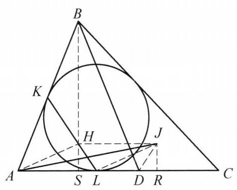

::: {.problem-meta-bar}
第 1 讲 全等三角形
竞赛难度
全等三角形 中点
:::

## 题目

在 $\triangle {ABC}$ 中， $\angle C < \angle A < {90}^{ \circ  }$ ， $D$ 为边 ${AC}$ 上一点，使得 ${BD} = {BA}$ . $\triangle  {ABC}$ 的内切圆分别与边 ${AB}$ ， ${AC}$ 切于点 $K$ ， $L$ . 设 $J$ 为 $\triangle  {BCD}$ 的内心. 证明:直线 ${KL}$ 过线段 ${AJ}$ 的中点.

图 1-2

## 参考解答

::: {.callout-important title="标准解答" collapse="false"}
如图 1-2,过点 $B$ 作 ${BS} \perp  {AC}$ 于点 $S,{BS}$ 与 ${KL}$ 交于点 $H$ . 过 $J$ 作 ${JR} \perp  {AC}$ 于点 $R$ ,连接 ${DJ},{HJ},{LJ},{AH}$ ,则由 ${BD} = {BA}$ ,知

$$
{LR} = {AD} + {DR} - {AL}
$$

$$
= {AD} + \frac{{BD} + {CD} - {BC}}{2} - \frac{{AB} + {AC} - {BC}}{2}
$$

$$
= \frac{1}{2}{AD} = {AS} = {SD}.
$$

所以 ${AL} = {SR},{SL} = {DR}$ .

因为

$$
\angle {CDJ} = \frac{1}{2}\angle {CDB} = \frac{1}{2}\left( {\angle {DAB} + \angle {DBA}}\right)
$$

$$
= \frac{1}{2}\left( {\angle {DAB} + {180}^{ \circ  } - 2\angle {DAB}}\right)  = {90}^{ \circ  } - \frac{1}{2}\angle {DAB} = \angle {ALH},
$$

所以 $\triangle {LSH} \cong  \triangle {DRJ}$ ,故 ${SH} = {JR}$ ,结合 ${HS}//{JR}$ 知 ${HSRJ}$ 为矩形,故 ${HJ} = \; {SR} = {AL}$ ,于是四边形 ${ALJH}$ 为平行四边形,从而 ${HL}$ 与 ${AJ}$ 互相平分. 原问题得证.

注:通过条件中的角相等及要证的结论中直线 ${KL}$ 过线段 ${AJ}$ 的中点猜测图中有一个矩形结构，再通过内切圆相关边长表达式即可导出结论.
:::

## 解题思路与分析

::: {.callout-note title="思路还原与分析" collapse="false"}
教材和竞赛书在书写几何证明时，通常采用**“综合法”（由因导果）**的叙事顺序：一上来先把所有辅助线画好（“过 $B$ 作 $BS \perp AC$ 交 $KL$ 于 $H$”），然后一通计算和全等推导，最后突然变魔术般地得出平行四边形。这种写法在逻辑上最简短，但完全掩盖了**“分析法”（执果索因）**的探索痕迹。

要看穿这个证明是怎么想出来的，我们可以从**逆向倒推（怎么锁定点 $H$ 的位置）**和**正向破题（条件特征如何自然触发构造）**两个维度，完整还原解题者的真实思考过程：

---

## 一、 逆向倒推：点 $H$ 和辅助线 $BS$ 是怎么被“算”出来的？

假设你刚拿到这道题，目标是证明：**直线 $KL$ 平分线段 $AJ$**。

### 1. 转化目标：用“平行四边形”处理“中点”
在平面几何中，要证明一条已知直线（$KL$）平分一条线段（$AJ$），最经典的几何模型是什么？
注意到直线上已经有一个非常特殊且固定的点 $L$（内切圆切点，且在底边 $AC$ 上）。如果直线 $KL$ 真的经过 $AJ$ 的中点 $M$，那么把点 $L$ 关于中点 $M$ 作中心对称，就会在直线 $KL$ 上得到一个对应点 $H$，使得**四边形 $ALJH$ 是一个平行四边形**！

> **核心追问**：如果四边形 $ALJH$ 真的是平行四边形，那么直线 $KL$ 上的这个点 $H$ 究竟在哪里？它有什么几何特征？

### 2. 将平行四边形投影到底边 $AC$ 上
一旦假设 $ALJH$ 是平行四边形，它立刻需要满足两个条件：
* $HJ \parallel AL$（即 $HJ$ 平行于底边 $AC$）；
* $HJ = AL$。

在几何中，处理“平行于底边的线段 $HJ$”最自然的操作，就是**向底边 $AC$ 作垂线（正投影）**：
* 过点 $J$ 作 $JR \perp AC$ 于点 $R$；
* 过我们假想的点 $H$ 作 $HS \perp AC$ 于点 $S$。

因为 $HJ \parallel AC$，所以四边形 $HSRJ$ 必然是一个**矩形**！既然是矩形，底边上的投影长度就必须满足：
$$SR = HJ = AL$$
两边同时减去公共部分 $SL$，立刻得到一个极其关键的定位等式：
$$AS = LR$$

### 3. 切线长公式揭晓点 $S$ 的真实身份
现在我们来算一算 $LR$ 到底有多长。
* $L$ 是 $\triangle ABC$ 内切圆在 $AC$ 上的切点；
* $J$ 是 $\triangle BCD$ 的内心，而 $JR \perp AC$，说明 **$R$ 恰好就是 $\triangle BCD$ 内切圆在 $CD$ 上的切点**！

利用烂熟于心的**内切圆切线长公式**，把 $AL$ 和 $DR$ 写出来：
$$AL = \frac{AB + AC - BC}{2}, \quad DR = \frac{BD + CD - BC}{2}$$
题目给出了条件 $BD = BA$，把两式相减，烦人的 $AB, BD, BC$ 全部抵消了：
$$AL - DR = \frac{AC - CD}{2} = \frac{AD}{2}$$
而从图上看，线段 $LR$ 的长度正是 $AD + DR - AL$，代入上式立得：
$$LR = AD - (AL - DR) = AD - \frac{AD}{2} = \frac{1}{2}AD$$

结合刚才倒推出来的 $AS = LR$，我们震惊地发现：
$$AS = \frac{1}{2}AD$$
这说明什么？说明**点 $H$ 在底边 $AC$ 上的投影点 $S$，必然是线段 $AD$ 的中点**！
而已知 $\triangle ABD$ 是等腰三角形（$BA = BD$），过底边 $AD$ 的中点 $S$ 作 $AC$ 的垂线，这条垂线不就是等腰 $\triangle ABD$ 底边上的高 $BS$ 吗？！

**破案了！** 解题者根本不是灵机一动“过 $B$ 作 $BS \perp AC$ 交 $KL$ 于 $H$”，而是先在草稿纸上假定平行四边形 $ALJH$ 存在，把 $H$ 投影到 $AC$ 上算出了 $AS = \frac{1}{2}AD$，这才顺藤摸瓜发现点 $H$ 必定落在等腰 $\triangle ABD$ 的高线 $BS$ 上！

---

## 二、 正向破题：题目条件中的“两大巧合”是如何给出暗示的？

即便不先从平行四边形倒推，一个有经验的解题者在正向审题时，也会被题目中两个强烈的信号推着走完全程：

### 1. 信号一：等腰条件 $BD = BA$ 与两个内切圆的“代数消元”
题目中同时出现了 $\triangle ABC$ 的内切圆切点 $L$ 和 $\triangle BCD$ 的内心 $J$，且两者的底边都在同一条直线 $AC$ 上。
* 看到内心 $J$，第一反应就是向底边作垂线 $JR \perp AC$ 找到切点 $R$。
* 写出两个切线长 $AL = \frac{AB+AC-BC}{2}$ 和 $DR = \frac{BD+CD-BC}{2}$，看到条件 $BD = BA$，几乎会本能地将两式联立消元。
* 一旦算出 $AL - DR = \frac{1}{2}AD$，而等腰 $\triangle ABD$ 的三线合一垂足 $S$ 恰好提供了 $\frac{1}{2}AD = AS = SD$，把 $AS$ 代进去立刻得到：
  $$AL - AS = DR \implies SL = DR$$
  也就是说，在底边 $AC$ 上，天然存在着两条相等的短线段 $SL = DR$（以及两段相等的长线段 $AL = SR$）。

### 2. 信号二：隐藏的等角 $90^\circ - \frac{1}{2}\angle A$
在底边 $AC$ 上有了相等线段 $SL = DR$ 后，我们自然会去观察从分点 $L$ 和 $D$ 出发的两条斜线——$LK$ 与 $DJ$ 与底边 $AC$ 的夹角：
* **在点 $L$ 处**：因为 $AK, AL$ 是内切圆切线，所以 $AK = AL$，等腰 $\triangle AKL$ 的底角为：
  $$\angle ALH = 90^\circ - \frac{1}{2}\angle A$$
* **在点 $D$ 处**：因为 $BA = BD$，在等腰 $\triangle ABD$ 中，$\angle ADB = 90^\circ - \frac{1}{2}\angle A$，从而其邻补角 $\angle BDC = 90^\circ + \frac{1}{2}\angle A$？不对，注意算式：
  $$\angle BDC = \angle A + \angle ABD = \angle A + (180^\circ - 2\angle A) = 180^\circ - \angle A$$
  因为 $J$ 是 $\triangle BCD$ 的内心，$DJ$ 平分 $\angle BDC$，所以：
  $$\angle CDR \text{ 处的 }\angle JDR = \frac{1}{2}\angle BDC = 90^\circ - \frac{1}{2}\angle A$$

**奇迹出现了**：
1. 在点 $D$ 右侧，有一个直角三角形 $\text{Rt}\triangle DRJ$，它的水平直角边是 $DR$，斜边 $DJ$ 与底边夹角为 $90^\circ - \frac{1}{2}\angle A$；
2. 在点 $L$ 左侧，有一段长度完全相等的水平线段 $SL$（$SL = DR$），且从 $L$ 出发的直线 $LH$ 与底边夹角**也是** $90^\circ - \frac{1}{2}\angle A$！

既然底边相等（$SL = DR$）、夹角相等（$\angle SLH = \angle RDJ$），在 $R$ 点有一条垂线 $JR \perp AC$ 构成了 $\text{Rt}\triangle DRJ$，那么在 $S$ 点**依样画葫芦作一条垂线 $SH \perp AC$ 去截 $KL$ 于点 $H$**，构造出全等的 $\text{Rt}\triangle LSH \cong \text{Rt}\triangle DRJ$，就是极其顺理成章的对称操作了。

---

## 三、 思维路径与教材书写的对比

把整个过程串联起来，就能看清“探索顺序”与“书写顺序”刚好是完全相反的：

| 阶段 | 解题者的真实探索顺序（分析法） | 教材呈现的证明顺序（综合法） |
| :--- | :--- | :--- |
| **第一步** | 要证 $KL$ 平分 $AJ$ $\implies$ 猜想在 $KL$ 上找点 $H$ 使 $ALJH$ 为平行四边形。 | 直接作 $BS \perp AC$ 交 $KL$ 于 $H$，作 $JR \perp AC$ 于 $R$。 |
| **第二步** | 将 $HJ \parallel AC, HJ = AL$ 投影到 $AC$ 上 $\implies$ 需要矩形 $HSRJ$，且 $AS = LR$。 | 用切线长公式计算 $LR = \frac{1}{2}AD = AS = SD$，得出 $AL = SR, SL = DR$。 |
| **第三步** | 用切线长公式算出 $LR = \frac{1}{2}AD$ $\implies$ 发现 $S$ 就是 $AD$ 中点（即 $BS \perp AC$ 的垂足）。 | 导角证明 $\angle CDJ = 90^\circ - \frac{1}{2}\angle A = \angle ALH$。 |
| **第四步** | 检验 $SH$ 是否等于 $JR$ $\implies$ 通过 $\angle ALH = \angle CDJ$ 发现 $\triangle LSH \cong \triangle DRJ$，逻辑闭环！ | 证出 $\triangle LSH \cong \triangle DRJ \implies HSRJ$ 为矩形 $\implies ALJH$ 为平行四边形，得证。 |

掌握了**“遇到切点算切线长消元”**和**“遇到平分线段构造平行四边形向底边投影”**这两个基本功，这类看似神来之笔的几何构造就会变成有迹可循的常规推演。
:::

## 分步证明

::: {.callout-tip title="分步推理与几何步骤" collapse="false"}
### 步骤 0：已知条件与图形架构

在 △ABC 中，∠C < ∠A < 90°。
点 D 位于边 AC 上且满足 BD = BA。
△ABC 的内切圆分别切边 AB, AC 于点 K, L；点 J 为 △BCD 的内心。
连结直线 KL 与线段 AJ，求证：直线 KL 经过线段 AJ 的中点。

### 步骤 1：① 作垂线 BS 与 JR，确定 AD 中点 S

过点 B 作 BS ⊥ AC 于点 S，直线 BS 与 KL 交于点 H。
过内心 J 作 JR ⊥ AC 于点 R（R 即为 △BCD 内切圆在边 AC 上的切点）。
在等腰 △BAD 中，因 BA = BD，高 BS 亦为底边中线，故 S 为 AD 的中点，即：
AS = SD = ½ AD

### 步骤 2：② 利用切线长导出 AL = SR 与 SL = DR

由切线长定理，AL = ½(AB + AC - BC)。
在 △BCD 中，切点 R 满足 DR = ½(BD + CD - BC)。
代入 BD = BA 与 CD = AC - AD，相减得：
AL - DR = ½ AD = AS = SD
在直线 AC 上计算：
LR = AD + DR - AL = AD - (AL - DR) = ½ AD = AS。
由此导出：
AL = SR 且 SL = DR

### 步骤 3：③ 由外角与角平分线性质导出 ∠SLH = ∠RDJ

在等腰 △AKL 中（AK = AL），底角 ∠ALK = 90° - ½∠A。
又在等腰 △BAD 中，外角 ∠CDB = 180° - ∠A。
因 J 是 △BCD 的内心，DJ 平分 ∠CDB，故：
∠CDJ = ½∠CDB = 90° - ½∠A
由点 A, S, L 共线知 ∠SLH = ∠ALK；由点 D, R, C 共线知 ∠RDJ = ∠CDJ。
因此得出关键角相等：∠SLH = ∠RDJ。

### 步骤 4：④ △LSH ≌ △DRJ 导出对应边 SH = JR

考察直角三角形 △LSH 与 △DRJ：
1. ∠LSH = ∠DRJ = 90°（垂直于边 AC）；
2. 直角边 SL = DR（由步骤 ②）；
3. 锐角 ∠SLH = ∠RDJ（由步骤 ③）。
根据直角三角形全等判定（ASA），得：
△LSH ≌ △DRJ
从而对应直角边相等：SH = JR。

### 步骤 5：⑤ 判定 HSRJ 为矩形，导出 HJ ∥ AL 且 HJ = AL

因为 HS ⊥ AC 且 JR ⊥ AC，所以 HS ∥ JR。
又 SH = JR（步骤 ④），故四边形 HSRJ 为平行四边形；
再结合 ∠HSR = 90°，知 HSRJ 为矩形！
由矩形性质，对边平行且相等：HJ ∥ SR 且 HJ = SR。
结合步骤 ② 中已证的 SR = AL 及 A, S, R 共线，立即得出：
HJ ∥ AL 且 HJ = AL

### 步骤 6：⑥ 判定 ALJH 为平行四边形，KL 平分 AJ

在四边形 ALJH 中：
因 HJ ∥ AL 且 HJ = AL，一组对边平行且相等，故 ALJH 为平行四边形！
在平行四边形中，对角线互相平分，因此对角线 HL 与 AJ 互相平分。
设其交点为 M，则 M 为线段 AJ 的中点。
又因点 H, L 均在直线 KL 上，直线 HL 即为直线 KL。
由此证明：直线 KL 经过线段 AJ 的中点 M！
:::

## 动态演示

::: {.demo-link-container}
[在新窗口打开交互式分步演示](../demos/03.html){.demo-link target="_blank" rel="noopener"}
:::

  <iframe src="../demos/03.html" title="例 3：直线 KL 过线段 AJ 的中点 分步演示" loading="lazy"></iframe>

