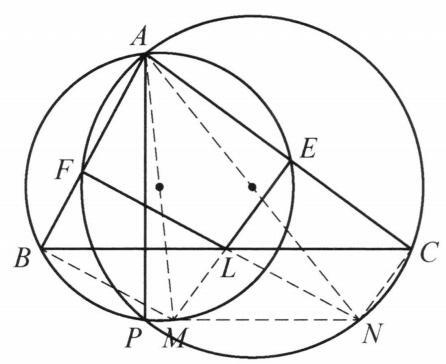

::: {.problem-meta-bar}
第 1 讲 全等三角形
竞赛难度
全等三角形 中点
:::

## 题目

在 $\triangle {ABC}$ 中，设 $L$ 是 ${BC}$ 的中点， $E$ ， $F$ 分别是 $L$ 在 ${AC}$ ， ${AB}$ 上的射影. 圆 ${ABE}$ 与圆 ${ACF}$ 交于另一点 $P$ . 求证: ${AP}\perp {BC}$ .

图 1-7

## 参考解答

::: {.callout-important title="标准解答" collapse="false"}
如图 1-7，设 ${AM},{AN}$ 分别是圆 ${ABE}$ 与圆 ${ACF}$ 的直径，则 $\angle {APM} = \angle {APN} = {90}^{ \circ  }$ ,故 $P, M, N$ 三点共线且 ${AP}\perp {PN}$ . 所以,要证 ${AP}\perp \; {BC},$ 只需证明: ${PN}//{BC}$ .

由 $\angle {AEM} = \angle {AEL} = {90}^{ \circ  }$ ,得 $E, L, M$ 三点共线.

同理可得 $F, L, N$ 三点共线.

连接 ${BM},{CN}$ ,所以

$$
\angle {BLM} = {90}^{ \circ  } - \angle {ACB} = \angle {LCN},
$$

$$
\angle {LBM} = {90}^{ \circ  } - \angle {ABC} = \angle {CLN}.
$$

又 ${BL} = {CL}$ ,所以

$$
\triangle {BLM} \cong  \triangle {CLN}
$$

故 $M$ 到 ${BC}$ 的距离等于 $N$ 到 ${BC}$ 的距离,即 ${MN}//{BC}$ . 所以 ${AP} \perp  {BC}$ ,原问题得证.

注: 两圆连心线可以刻画公共弦方向,这里 $M, N$ 作用与此类似.
:::

## 解题思路与分析

::: {.callout-note title="思路还原与分析" collapse="false"}
这个证明之所以让人觉得费解，是因为**教材的书写顺序（正向推导）与真实的思考顺序（逆向分析）完全相反**。如果顺着读，第一句“设 $AM, AN$ 是直径”就像凭空变出的魔术；但如果从结论出发倒着想，每一步都是顺理成章的必然选择。

下面我们将这个证明的诞生过程拆解为 **4 个思维阶段**，还原它是如何被想出来的：

---

### 1. 破局：如何处理悬空的交点 $P$？（对应书末的“注”）
* **难点**：我们要证 $AP \perp BC$。但点 $P$ 是圆 $ABE$ 和圆 $ACF$ 的交点，$AP$ 是两圆的**公共弦**。点 $P$ 孤立在圆上，很难直接与 $BC$ 的中点 $L$ 产生联系。
* **核心转化**：平面几何中处理“两圆公共弦”最常用的工具是**两圆连心线垂直平分公共弦**。如果设两圆圆心为 $O_1, O_2$，那么 $AP \perp O_1O_2$，要证 $AP \perp BC$ 只需证 $O_1O_2 \parallel BC$。
* **为什么要引出直径 $AM, AN$？** 
  圆心 $O_1, O_2$ 不在圆周上，无法利用圆周角导角。但如果我们以公共点 $A$ 为中心，把圆心 $O_1, O_2$ 向外放大 2 倍，就得到了两条直径 $AM$ 和 $AN$：
  1. $O_1O_2$ 是 $\triangle AMN$ 的中位线，所以 **$MN \parallel O_1O_2$**（$MN$ 完美替代了连心线的方向）。
  2. 直径所对的圆周角是直角（$\angle APM = \angle APN = 90^\circ$），直接保证了 $P, M, N$ 三点共线且 $AP \perp MN$。
  
  **这就是引出直径 $AM, AN$ 的真实动机**：用圆周上的直径端点 $M, N$ 代替圆心，彻底甩掉难算的点 $P$，把问题转化为证明 **$MN \parallel BC$**。

---

### 2. 顺藤摸瓜：直径端点 $M, N$ 到底在哪？
把目标转化为 $MN \parallel BC$ 后，我们需要看清 $M, N$ 和已知条件（$LE \perp AC, LF \perp AB$）有什么联系：
* 因为 $AM$ 是圆 $ABE$ 的直径，根据直径所对圆周角为直角，必有 $\angle AEM = 90^\circ$，即 **$EM \perp AC$**。
* 而已知条件给出 $E$ 是 $L$ 在 $AC$ 上的射影，即 **$EL \perp AC$**。
* 过点 $E$ 只有一条直线垂直于 $AC$，所以 **$E, L, M$ 三点必然共线**！
* 换句话说，点 $M$ 根本不是一个凭空捏造的点，它就是**垂线 $EL$ 延长后与圆 $ABE$ 的交点**；同理，点 $N$ 就是**垂线 $FL$ 延长后与圆 $ACF$ 的交点**。

> **另一种发现路径**：很多做题者在画图时，会先顺手把垂线 $EL, FL$ 延长去交两个圆于 $M, N$，然后连接 $AM, AN$，利用 $\angle AEM = \angle AFN = 90^\circ$ 发现它们恰好是两条直径，进而想到连 $PM, PN$ 消去点 $P$。

---

### 3. 搭桥：为什么想到连接 $BM, CN$ 证全等？
现在图形简化为：两条直线 $EM, FN$ 交于 $BC$ 的中点 $L$，我们要证 $MN \parallel BC$。
* 既然要用上“$L$ 是 $BC$ 中点（$BL = CL$）”这个核心条件，最自然的做法就是把 $M$ 与 $BL$、$N$ 与 $CL$ 围成两个三角形——即**连接 $BM$ 和 $CN$**，考察 $\triangle BLM$ 和 $\triangle CLN$。
* 连接 $BM, CN$ 还有一个巨大的好处——**再次利用直径构造直角**：
  * $AM$ 是直径 $\implies \angle ABM = 90^\circ \implies BM \perp AB$。
  * $AN$ 是直径 $\implies \angle ACN = 90^\circ \implies CN \perp AC$。
* 有了这两个直角，再结合已知的 $LE \perp AC$ 和 $LF \perp AB$，图中出现了 4 个直角三角形，所有的角都可以用 $\angle B$ 和 $\angle C$ 表示出来：
  * **同为 $90^\circ - \angle C$ 的角**：在 $Rt\triangle CEL$ 中，$\angle BLM = \angle CLE = 90^\circ - \angle ACB$；而在 $Rt\triangle ACN$ 中，$\angle LCN = 90^\circ - \angle ACB$，故 $\angle BLM = \angle LCN$。
  * **同为 $90^\circ - \angle B$ 的角**：在 $Rt\triangle ABM$ 中，$\angle LBM = 90^\circ - \angle ABC$；而在 $Rt\triangle BFL$ 中，$\angle CLN = \angle BLF = 90^\circ - \angle ABC$，故 $\angle LBM = \angle CLN$。

---

### 4. 破解书中的“跳步”：为什么错位全等能推出距离相等？
证明的最后两行最容易让人感到困惑：为什么证出全等后，直接就得出“$M, N$ 到 $BC$ 的距离相等”了？

这里教材省略了一个非常关键的逻辑环节（而且书中写的 $\triangle BLM \cong \triangle CLN$ 没有严格按对应顶点排序）：
1. **严格的对应关系（错位全等）**：
* 在 $\triangle BLM$ 中，两角为 $\angle B$ 和 $\angle L$，夹边为 $BL$。
* 在 $\triangle LCN$ 中，与之相等的对应角是 $\angle L$（即 $\angle CLN$）和 $\angle C$（即 $\angle LCN$），夹边为 $LC$。
* 因此，严格按对应顶点写，根据 **ASA（角边角）** 判定，应当是 **$\triangle BLM \cong \triangle LCN$**。
2. **等底等面积 $\implies$ 等高**：
* 注意到这是一组**“错位全等”**（顶点 $B$ 对应 $L$，顶点 $L$ 对应 $C$，$BM$ 对应 $LN$），两个三角形并不是简单平移或对称的姿态。
* 但无论姿态如何，**全等三角形的面积必然相等**，即 $S_{\triangle BLM} = S_{\triangle LCN}$。
* 现在，把 $BL$ 看作 $\triangle BLM$ 的底边，把 $LC$ 看作 $\triangle LCN$ 的底边。既然**面积相等**，且**底边长度相等（$BL = LC$）**，根据面积公式 $S = \frac{1}{2} \times \text{底} \times \text{高}$，它们在底边 $BC$ 上的**高必然相等**！
* 这两条高，恰好就是点 $M$ 到 $BC$ 的距离与点 $N$ 到 $BC$ 的距离，从而立刻得出 $MN \parallel BC$。
:::

## 分步证明

::: {.callout-tip title="分步推理与几何步骤" collapse="false"}
### 步骤 0：已知条件与几何构形

在 $\triangle ABC$ 中，已知：
• $L$ 是底边 $BC$ 的中点，即 $BL = CL$；
• $E, F$ 分别是 $L$ 在边 $AC, AB$ 上的垂足射影（$LE \perp AC, LF \perp AB$）；
• 圆 $ABE$ 与圆 $ACF$ 交于顶点 $A$ 与另一点 $P$。
求证目标：公共弦割线 $AP \perp BC$

### 步骤 1：① 作直径 $AM, AN$，将垂直转化为平行

分别作圆 $ABE$ 的直径 $AM$ 与圆 $ACF$ 的直径 $AN$：
• 由直径所对圆周角为直角：$\angle APM = 90^\circ$ 且 $\angle APN = 90^\circ$；
• 两角之和 $\angle APM + \angle APN = 180^\circ$，故 $P, M, N$ 三点共线，且 $AP \perp MN$；
目标转化：要证 $AP \perp BC$，只需证明 $MN \parallel BC$

### 步骤 2：② 利用直径与射影垂直，发现三点共线

分析点 $M, N$ 的几何位置：
• 在圆 $ABE$ 中，直径所对圆周角 $\angle AEM = 90^\circ$；又已知 $LE \perp AC$（$\angle AEL = 90^\circ$）；
• 过点 $E$ 垂直于 $AC$ 的直线唯一，因此 $E, L, M$ 三点共线（$M$ 落在直线 $LE$ 延长线上）；
• 同理，$\angle AFN = \angle AFL = 90^\circ$，因此 $F, L, N$ 三点共线（$N$ 落在直线 $LF$ 延长线上）。

### 步骤 3：③ 连结 $BM, CN$，完成角度导引

连结辅助线段 $BM$ 与 $CN$：
• 因 $AM$ 为直径，$\angle ABM = 90^\circ$，故 $\angle LBM = 90^\circ - \angle B$；
• 在直角 $\triangle BFL$ 中，$\angle FLB = 90^\circ - \angle B$；由对顶角知 $\angle CLN = \angle FLB$；
第一组等角：$\angle LBM = \angle CLN = 90^\circ - \angle B$
• 同理，在圆 $ACF$ 中，$\angle ACN = 90^\circ$，由余角与对顶角变换：
第二组等角：$\angle BLM = \angle LCN = 90^\circ - \angle C$

### 步骤 4：④ 判定 $\triangle BLM \cong \triangle CLN$，对应高相等

观察由中点 $L$ 对称展开的两个三角形 $\triangle BLM$ 与 $\triangle CLN$：
• $\angle BLM = \angle LCN$（Step 3 已证）；
• $BL = CL$（$L$ 是 $BC$ 中点）；
• $\angle LBM = \angle CLN$（Step 3 已证）；
由角边角（ASA）公理，知 $\triangle BLM \cong \triangle CLN$！
全等三角形对应高相等：$h_M = h_N$（点 $M, N$ 到底边 $BC$ 距离相等）

### 步骤 5：⑤ 推得 $MN \parallel BC$，得出最终结论

• 由于点 $M, N$ 到直线 $BC$ 的距离相等且位于 $BC$ 同侧，因此：
$MN \parallel BC$
• 结合 Step 1 中已证的垂直关系 $AP \perp MN$：
• 一条直线垂直于两条平行线之一，必垂直于另一条：
$MN \parallel BC \quad \text{且} \quad AP \perp MN \implies AP \perp BC$
至此，原命题全部证毕！
:::

## 动态演示

::: {.demo-link-container}
[在新窗口打开交互式分步演示](../demos/08.html){.demo-link target="_blank" rel="noopener"}
:::

  <iframe src="../demos/08.html" title="例 8：中点外接圆与垂足共线证明 分步演示" loading="lazy"></iframe>

