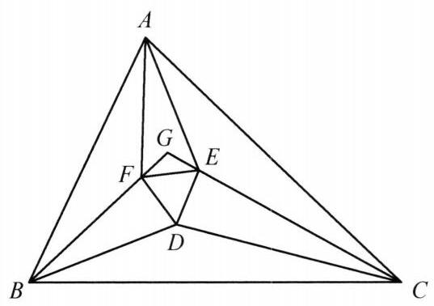

::: {.problem-meta-bar}
第 1 讲 全等三角形
竞赛难度
全等三角形
:::

## 题目

设 $\triangle {ABC}$ 三内角的三等分线两两相交于 $D, E, F$ . 证明: $\triangle {DEF}$ 是正三角形.

图 1-8

## 参考解答

::: {.callout-important title="标准解答" collapse="false"}
如图 1-8,设 ${BG},{BD}$ 是 $\angle {ABC}$ 的三等分线, ${CG},{CD}$ 是 $\angle {ACB}$ 的三等分线,于是 $D$ 为 $\triangle {BCG}$ 的内心,且

$$
\angle {BGC} = {180}^{ \circ  } - \left( {\frac{2}{3}\angle {ABC} + \frac{2}{3}\angle {ACB}}\right)
$$

$$
= {60}^{ \circ  } + \frac{2}{3}\angle {BAC}\text{ . }
$$

以 ${GD}$ 为对称轴,作 $\angle {GDF} = \angle {GDE} = {30}^{ \circ  }$ ,与边 ${GB},{GC}$ 分别交于点 $F, E$ ,顺次连接 $D, E, F$ ,则 $\triangle {DEF}$ 是顶点为 ${60}^{ \circ  }$ 的等腰三角形,即正三角形.

在 ${AB}$ 上取 ${BH} = {BD}$ ,在 ${AC}$ 上取 ${CK} = {CD}$ ,连接 ${HF},{EK},{HE},{FK}$ ,则

$$
\triangle {BHF} \cong  \triangle {BDF},\triangle {CKE} \cong  \triangle {CDE}.
$$

所以,

$$
{FH} = {FD} = {FE} = {DE} = {EK},
$$

①

且

$$
\angle {BFD} = \angle {FGD} + \angle {GDF}
$$

$$
= \frac{1}{2}\left( {{60}^{ \circ  } + \frac{2}{3}\angle {BAC}}\right)  + {30}^{ \circ  }
$$

$$
= {60}^{ \circ  } + \frac{1}{3}\angle {BAC}\text{ . }
$$

所以

$$
\angle {EFH} = {360}^{ \circ  } - 2\angle {BFD} - \angle {DFE}
$$

$$
= {360}^{ \circ  } - 2\left( {{60}^{ \circ  } + \frac{1}{3}\angle {BAC}}\right)  - {60}^{ \circ  }
$$

$$
= {180}^{ \circ  } - \frac{2}{3}\angle {BAC}.
$$

在等腰三角形 ${FEH}$ 中,有

$$
\angle {FHE} = \frac{1}{2}\left( {{180}^{ \circ  } - \angle {EFH}}\right)  = \frac{1}{3}\angle {BAC}.
$$

②

同理可得

$$
\angle {FKE} = \frac{1}{3}\angle {BAC}.
$$

③

由①②③可知，四边形 ${HFEK}$ 为圆内接等腰梯形，弦 ${HF}$ ， ${FE}$ ， ${EK}$ 所对的圆周角均为 $\frac{1}{3}\angle {BAC}$ ，所以弦 ${HK}$ 所对的圆周角为 $\angle {BAC}$ ，这表明 $A$ 在外接圆上，于是有 $\angle {HAF} = \angle {FAE} = \angle {EAK}$ . 即 ${AF}$ ， ${AE}$ 为 $\angle {BAC}$ 的三等分线，正三角形 ${DEF}$ 的三个顶点是 $\triangle  {ABC}$ 三内角三等分线两两相交的交点.

因此， $\triangle  {ABC}$ 的三内角的三等分线两两相交的交点组成的三角形与正 $\triangle  {DEF}$ 重合，也是个正三角形.

注:这是著名的莫莱定理，其证明方法比较典型.
:::

## 解题思路与分析

::: {.callout-note title="思路还原与分析" collapse="false"}
这个证明之所以让人觉得“费解”、像变魔术一样，是因为课本采用的是**拆掉脚手架之后的“正向综合法”**（从已知直接推到结论），而隐去了数学家最初探索时的**“逆向分析法”**（执果索因）。

要看懂这个证明是怎么想出来的，我们需要顺着发明者的真实思路，把它**倒过来还原**。整个证明其实由**四个核心灵感**串联而成：

---

### 灵感一：正面强攻太难，不如“先造正三角形，再证三等分”（同一法）

莫莱定理如果正面硬算（画出全部 6 条三等分线，去算 $\triangle DEF$ 的角度），会非常痛苦。因为 $D, E, F$ 三个点悬浮在三角形内部，每一点都同时受两个顶角的影响，很难直接找到全等三角形或四点共圆。

于是几何学家退了一步：**暂时不管 $\angle A$ 的三等分线，只画 $\angle B$ 和 $\angle C$ 的三等分线。**
这样做有一个巨大的好处：
* $BD, CD$ 各占 $\frac{1}{3}\angle B, \frac{1}{3}\angle C$，而 $BG, CG$ 各占 $\frac{2}{3}\angle B, \frac{2}{3}\angle C$。
* 这意味着 $BD, CD$ 恰好是 $\triangle BGC$ 的角平分线，**点 $D$ 自然就成了 $\triangle BGC$ 的内心**！
* 既然 $D$ 是内心，连接 $GD$，**$GD$ 就自动平分 $\angle BGC$**。

有了 $GD$ 这条角平分线作为**局部对称轴**，与其苦苦证明交出来的 $\triangle DEF$ 是正三角形，不如**反客为主（同一法）**：直接以 $GD$ 为对称轴，向两边各张开 $30^\circ$ 作出 $DF, DE$ 交 $BG, CG$ 于 $F, E$。
根据角边角（$\text{ASA}$），$\triangle GDF \cong \triangle GDE$，这就**强行造出**了一个正三角形 $\triangle DEF$。接下来的唯一任务，就是证明这个“人造正三角形”的顶点 $F, E$ 跟顶点 $A$ 连起来后，$AF, AE$ 恰好三等分 $\angle A$。

---

### 灵感二：如何把内部的 $F, E$ 和外部的边 $AB, AC$ 联系起来？（角平分线触发“翻折”）

书中突然写了一句：“*在 $AB$ 上取 $BH = BD$，在 $AC$ 上取 $CK = CD$*”。这是全篇最让人摸不着头脑的一步——怎么突然想到去截这两条线段的？

其实这是平面几何中最经典的**条件反射**：
1. 我们的目标是研究 $\angle A$（由外部的边 $AB, AC$ 夹成），但已知条件却集中在内部的 $\triangle DEF$ 上。我们需要一座桥梁，把内部的边转移到 $AB, AC$ 上。
2. 观察直线 $BF$（即 $BG$）：因为 $BG, BD$ 是 $\angle B$ 的三等分线，所以**$BF$ 恰好是 $\angle ABD$ 的角平分线**！
3. **几何直觉：看到角平分线，第一反应就是“沿角平分线翻折（构造轴对称全等）”！**

把 $\triangle BDF$ 沿着角平分线 $BF$ 往外翻折到边 $AB$ 上，点 $D$ 落到的位置就是点 $H$（即 $BH = BD$）；同理，把 $\triangle CDE$ 沿着角平分线 $CE$ 翻折到边 $AC$ 上，点 $D$ 落到的位置就是点 $K$（即 $CK = CD$）。

这一翻折，奇迹发生了：原本缩在里面的正三角形的两条边 $FD, ED$，被“展开”到了外围，变成了 $FH$ 和 $EK$。于是我们顺手得到了一条极为漂亮的**三等长折线链**：
$$FH = FE = EK$$

---

### 灵感三：看到“三段等长”与“三等分角”，立刻联想到什么？（圆周角定理！）

现在停下来，把我们**手头有的条件**和**想要证的结论**放在一起对比：
* **手头有的条件**：三条相等的线段 $FH = FE = EK$。
* **想要证的结论**：它们对顶点 $A$ 张开的三个角相等，即 $\angle HAF = \angle FAE = \angle EAK = \frac{1}{3}\angle A$。

问自己一个问题：**在平面几何里，什么时候“相等的线段”会对同一个点张开“相等的角”？**
答案只有一个：**在圆里！“同圆中，等弦对等圆周角”！**

这就是整个证明最核心的“顿悟”时刻：
> **如果莫莱定理是真的，那么 $A, H, F, E, K$ 这五个点一定共圆！且 $FH, FE, EK$ 就是这个圆上三条相等的弦！**

---

### 灵感四：顺藤摸瓜，先锁死四点共圆，再拉点 $A$ 入局

一旦通过逆向思考猜到了“$A, H, F, E, K$ 五点共圆”，剩下的证明步骤就完全变成了顺水推舟的验证工作：

1. **先证 $H, F, E, K$ 四点共圆**：
既然已经有 $FH = FE = EK$，这四点连起来是个折线。只要算出两个顶角 $\angle HFE$ 和 $\angle FEK$ 相等，它就是一个对称的**等腰梯形**，而等腰梯形必定四点共圆！
于是作者去算了 $\angle BFD = 60^\circ + \frac{1}{3}\angle A$，进而算出：
$$\angle EFH = 360^\circ - 2\angle BFD - 60^\circ = 180^\circ - \frac{2}{3}\angle A$$
同理 $\angle FEK = 180^\circ - \frac{2}{3}\angle A$，四点共圆顺利得证！

2. **再算每条等弦所对的圆周角**：
在等腰 $\triangle FEH$ 中，顶角是 $180^\circ - \frac{2}{3}\angle A$，底角自然就是：
$$\angle FHE = \frac{1}{3}\angle A$$
这说明在这个外接圆中，每条等弦（$HF, FE, EK$）所对的圆周角都恰好是 $\frac{1}{3}\angle A$！

3. **最后把点 $A$ 拉到圆上**：
三条等弦合起来对应的总弦是 $HK$，因此弦 $HK$ 在圆周上所对的圆周角正好是 $3 \times \frac{1}{3}\angle A = \angle A$。
而点 $H$ 在射线 $AB$ 上，点 $K$ 在射线 $AC$ 上，原本的顶角 $\angle HAK$ 就是 $\angle A$（且通过角度关系可知点 $A$ 与圆弧同侧，直线 $AB$ 与圆除点 $H$ 外只有一个交点），因此**点 $A$ 必定就在这个外接圆上**！既然 $A$ 在圆上，三条等弦 $HF, FE, EK$ 对点 $A$ 张开的圆周角自然相等，全部等于 $\frac{1}{3}\angle A$。

---

### 思维还原对照表

把“发明者的逆向探索”和“课本上的正向书写”对比来看，脉络就彻底清晰了：

| 思考阶段 | 发明者的逆向分析（怎么想出来的） | 课本的正向书写（怎么写出来的） |
| :--- | :--- | :--- |
| **1. 破局** | 三角同时三等分太乱 $\rightarrow$ 先固定 $B, C$，利用内心对称性直接“钦定”正 $\triangle DEF$（同一法）。 | 设 $BG, BD$ 和 $CG, CD$ 三等分 $\angle B, \angle C$，以 $GD$ 为对称轴作 $30^\circ$ 角得正 $\triangle DEF$。 |
| **2. 搭桥** | 要联系边 $AB, AC$，发现 $BF, CE$ 是 $\angle ABD, \angle ACD$ 的平分线 $\rightarrow$ 沿角平分线向外翻折！ | 在 $AB, AC$ 上截取 $BH=BD, CK=CD$，证 $\triangle BHF \cong \triangle BDF$，得 $FH=FE=EK$。 |
| **3. 联想** | 要证 $AF, AE$ 三等分 $\angle A$，且已有三等长线段 $FH=FE=EK$ $\rightarrow$ **等弦对等角，必有五点共圆！** | （隐去不提，直接开始算角） |
| **4. 收官** | 只要算出 $\angle EFH = 180^\circ - \frac{2}{3}\angle A$，就能凑出圆周角 $\frac{1}{3}\angle A$，从而把点 $A$ 纳入圆周。 | 计算 $\angle BFD \rightarrow \angle EFH \rightarrow \angle FHE = \frac{1}{3}\angle A$，由圆内接等腰梯形推导出点 $A$ 共圆。 |
:::

## 分步证明

::: {.callout-tip title="分步推理与几何步骤" collapse="false"}
### 步骤 0：已知条件与逆向构造思路

在 △ABC 中，三内角的三等分线两两相交于 D, E, F。
直接正向推导 △DEF 为正三角形较为繁复。我们采用经典的倒推构造法（逆向思维）：
设 ∠A = 3α, ∠B = 3β, ∠C = 3γ（满足 α + β + γ = 60°）。
我们先从底角三等分线出发确定点 D 与辅助点 G，逆向构造出正三角形 △DEF，再证明从顶点 A 引出的两条射线恰为 ∠BAC 的三等分线。

### 步骤 1：辅助点 G 与内心性质

设射线 BG, BD 是 ∠ABC 的三等分线（∠GBC = 2β, ∠DBC = β），CG, CD 是 ∠ACB 的三等分线（∠GCB = 2γ, ∠DCB = γ），两射线交于点 G。
在 △BCG 中，底角分别为 2β 与 2γ，而 BD, CD 恰好分别是这两个角的平分线。
因此，D 恰为 △BCG 的内心！
由此得连线 GD 为顶角平分线（对称轴），且计算顶角得：
∠BGC = 180° - (2β + 2γ) = 60° + 2/3∠A
从而 ∠BGD = ∠CGD = 30° + 1/3∠A。

### 步骤 2：逆向构造正三角形 DEF

以 GD 为对称轴，作 ∠GDF = ∠GDE = 30°，两射线分别与边 GB, GC 交于点 F, E。顺次连接 D, E, F。
由轴对称及全等 △GDF ≅ △GDE（ASA）可知：DF = DE。
而顶角 ∠EDF = ∠GDF + ∠GDE = 30° + 30° = 60°。
顶角为 60° 的等腰三角形必为正三角形，故 △DEF 是正三角形（DE = EF = FD）。

### 步骤 3：截取等长并证明两对三角形全等

在边 AB 上截取 BH = BD，在边 AC 上截取 CK = CD，连接 HF, EK。
在 △BHF 与 △BDF 中：BH = BD，BF 为公共边，夹角 ∠HBF = ∠DBF = β。
由 SAS 判定得：△BHF ≅ △BDF，因此 FH = FD。
同理，在 △CKE 与 △CDE 中由 SAS 判定得：△CKE ≅ △CDE，因此 EK = ED。
结合正三角形等边性质，得到关键等长链：
FH = FD = FE = DE = EK。

### 步骤 4：角度追索：计算底角 ∠FHE = ∠BAC / 3

在 △GDF 中，外角 ∠BFD = ∠FGD + ∠GDF = (30° + 1/3∠A) + 30° = 60° + 1/3∠A。
由全等得 ∠BFH = ∠BFD。
观察点 F 处的周角：
∠EFH = 360° - 2∠BFD - ∠DFE = 360° - 2(60° + 1/3∠A) - 60° = 180° - 2/3∠A。
因为 FH = FE，在等腰三角形 △FEH 中，两底角为：
∠FHE = 1/2(180° - ∠EFH) = 1/3∠A = α。
同理在等腰三角形 △EKF 中可得：∠FKE = 1/3∠A = α。

### 步骤 5：四点共圆与圆内接等腰梯形

在四边形 HFEK 中，两腰 FH = EK，且底角 ∠FHE = ∠FKE = 1/3∠A（点 H, K 在 FE 同侧且对 FE 张角相等）。
根据圆周角逆定理，H, F, E, K 四点共圆，且 HFEK 为圆内接等腰梯形！
在该外接圆中，相等弦所对的圆周角相等，因此三段等弦 HF, FE, EK 所对的圆周角均为：
∠FHE = 1/3∠A = α。

### 步骤 6：顶点 A 落在外接圆上，莫莱定理得证

连续三段等弦 HF, FE, EK 所张的总圆周角为 3 × (1/3∠A) = ∠A。
而点 A 是直线 BH（即 AB）与直线 CK（即 AC）的交点，夹角恰为 ∠HAK = ∠BAC = ∠A。
根据圆周角判定定理，顶点 A 必然落在该外接圆上！
由圆周角定理，弦 HF, FE, EK 对顶点 A 所张的圆周角相等：
∠HAF = ∠FAE = ∠EAK = 1/3∠A = α。
这说明：射线 AF, AE 恰好是 ∠BAC 的三等分线！
因此，△ABC 三内角的三等分线两两相交的交点正是正三角形的顶点 D, E, F。
莫莱定理获证：△DEF 必是正三角形！
:::

## 动态演示

::: {.demo-link-container}
[在新窗口打开交互式分步演示](../demos/09.html){.demo-link target="_blank" rel="noopener"}
:::

  <iframe src="../demos/09.html" title="例 9：角三等分线与莫利正三角形构造 分步演示" loading="lazy"></iframe>

